# Arena-Agents · AI Werewolf (狼人杀) & Multi-Agent Arena

**English** | [简体中文](README.md)

**Arena-Agents is an open-source AI Werewolf (狼人杀), social-deduction and multi-agent game arena.**
It is a game-agnostic sandbox for LLM agents: a Markdown scenario defines the game rules, **every
player and the moderator is an asynchronous agent** (a front *actor* that always accepts and emits
messages, plus a back *worker* that thinks and calls tools), and an LLM moderator drives the game by
following the scenario's manual. The engine only provides channels, speaking rights, requests and a
ledger. The bundled scenario is a complete 12-player Werewolf game; the same engine can host other
social-deduction or tabletop rules. Keywords: **AI 狼人杀, 狼人杀, 多智能体狼人杀, AI 多智能体博弈, social deduction, AI Werewolf,
LLM Werewolf, AI 桌游, AI 剧本杀, multi-agent game**.

[](https://www.python.org/)
[](https://fastapi.tiangolo.com/)
[](LICENSE)
[](CHANGELOG.md)

---

**Arena-Agents 是一个开源的 AI 狼人杀、社交推理与多智能体博弈沙盒。**
游戏规则写在可执行 Markdown 剧本中，引擎负责玩家、发言、投票、频道、事件与断点恢复。内置一套完整的 12 人狼人杀，也可用同一引擎运行其他社交推理/桌游规则。

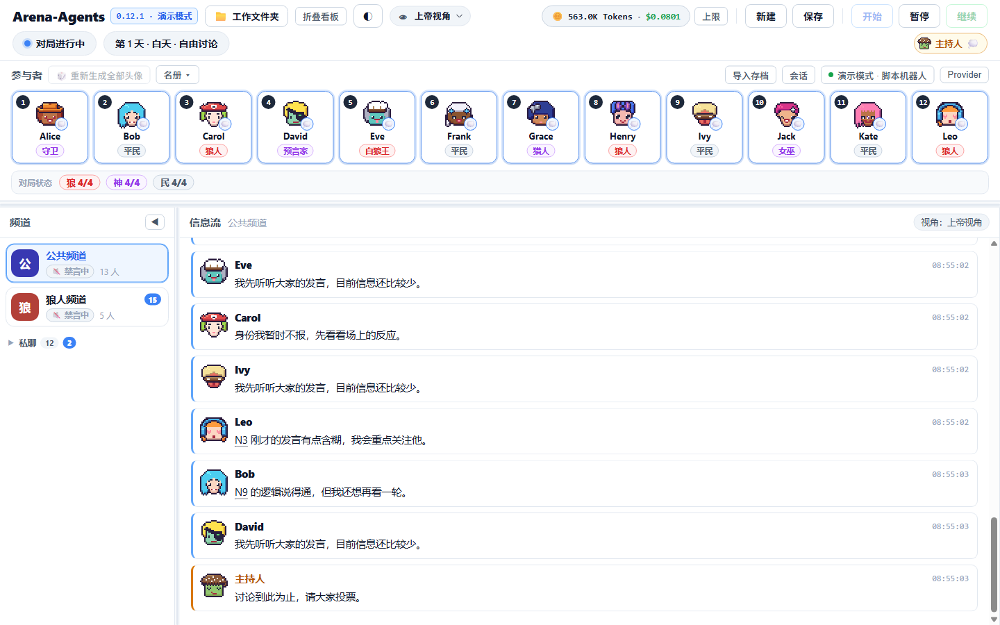

## Highlights

- **Every agent is asynchronous (v0.12)** — each player and the moderator is an Actor + Worker. The
  actor is never blocked by thinking or tool execution; speech, votes, challenges and abilities can
  happen at any time and are validated by the engine *at commit time*.
- **The engine never saves money for you (v0.12.1)** — every message delivered to an agent wakes it at
  once (no debounce, no round cap, no "execution depth"); wolves can agree on the knife at any time and
  the white wolf can explode at any time. An agent is only *thinking*, *acting* or *sleeping*, and
  `sleep(seconds)` sets its own alarm. Tokens are managed by orchestration: one persistent append-only
  conversation per agent (so provider prompt caches hit), messages that arrive mid-run are merged into
  the running activation, and a conversation is compacted only when the model window is nearly full.
- **Per-game spending limit** — a button next to the token / cost counter sets a token and / or USD
  limit and lets you choose "stop the game when it is reached" (yellow at 80 %). Cost is computed from
  **four token classes** (uncached input / cache read / cache write / output) and four prices.
- **Price source** — the Provider dialog can fill a model's four prices and context window from a price
  table (default: LiteLLM's `model_prices_and_context_window.json`); you can still edit every number.
- **Roster** — seats `N1`–`N12` with default names Alice…Leo that you can rename and keep; a **pixel
  avatar** per seat (and one for the moderator) randomly assembled from a procedurally generated parts
  library (regenerate one or all); persona and memory are plain text files in the workspace (empty by default, importable /
  exportable / clearable, "complete it with the moderator's model" produces a draft you confirm); a
  manual post-game review writes the record and a first-person note into each player's memory.
- **Responsive UI** — from a 1920 px desktop to a phone in portrait (layout follows platform and width).
- **An LLM moderator drives the flow** — taking turns = a moderator announcement + floor management
  (`set_floor_queue` and friends). The rules and the moderator manual live in the scenario; the
  engine contains no game vocabulary.
- **Channels and speaking rights** — visibility is decided by channels only; the moderator can close
  the floor at any time (players get a "no floor" receipt), speech is limited by time *and* by
  characters, players can privately challenge the moderator, and the moderator can punish harassment
  by closing a player's private channel.
- **Append-only ledger** — everything that happened is recorded; saves, agent context and spectating
  all derive from it. The moderator may change a player's *current* state (out, revived …) but can
  never rewrite history.
- **Executable Markdown scenarios (schema v2)** — identity pool, templates, abilities, checks and
  default limits in the front matter; the body holds the rules and a moderator-only manual.
- **Multi-provider model routing** — OpenAI Chat Completions, OpenAI Responses and Anthropic
  Messages; every player and the moderator can use a different model and reasoning depth.
- **Model templates** — save up to three Provider/model/reasoning presets and apply them to
  selected players in one action.
- **Workspaces** — each work folder has its own providers, templates, bindings, sessions, logs
  and encryption key. Switch folders without mixing games or API keys.
- **Safe live operations** — models are locked while a game is running; switching workspace
  requires pausing and successfully saving first.
- **Encrypted local data** — provider keys and sessions are encrypted with AES-256-GCM; on
  Windows the workspace key is protected by DPAPI.
- **Endpoint preview** — see the exact message and model-list URLs before saving a Provider;
  either auto-append `/v1/...` paths or point at a complete custom endpoint.
- **Spectator UI** — players are shown as a pixel avatar + name + role tag; click a player card for the
  agent's tool-call / thinking / token statistics. The feed shows spoken messages and request cards only
  (whole messages, no streaming) and supports a god view or any player's view.
- **Demo mode** — `ARENA_DEMO=1` replaces the models with scripted bots, so you can watch a whole
  game without an API key.

## Screenshots

| Player details (click a card: the four token kinds, cache hit rate, persona and memory, review) | A player's viewpoint |
|---|---|
| 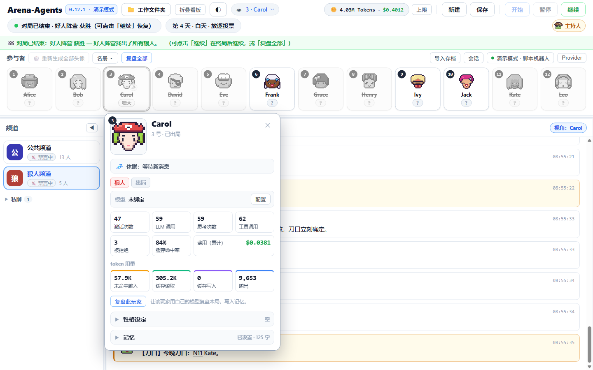 | 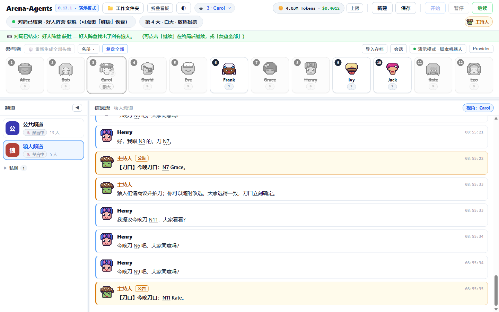 |
| **Dark theme (with a sealed-vote request card)** | **Phone portrait (mini cards + bottom tab bar)** |
| 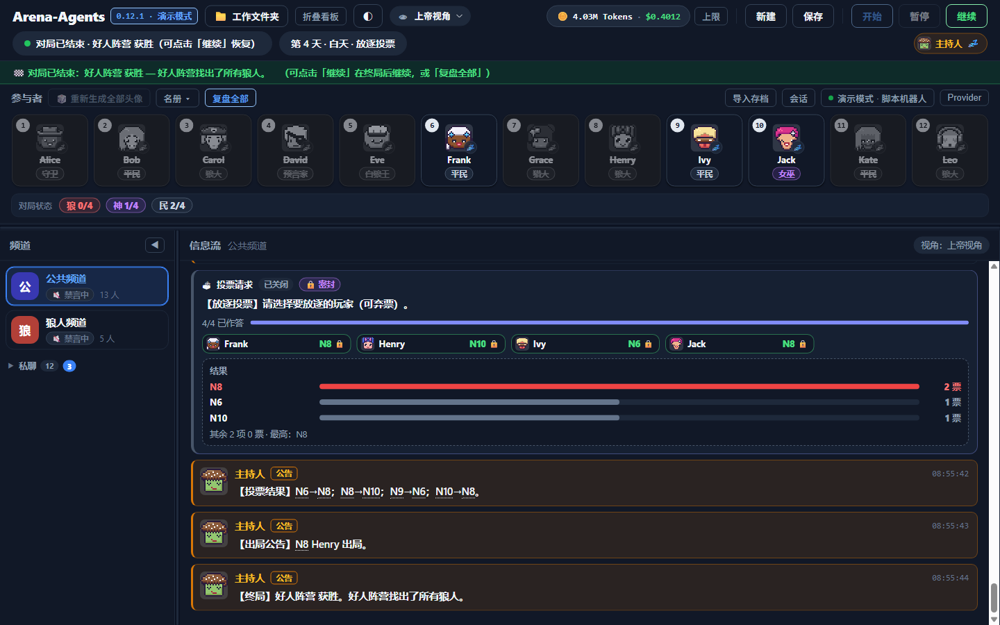 | 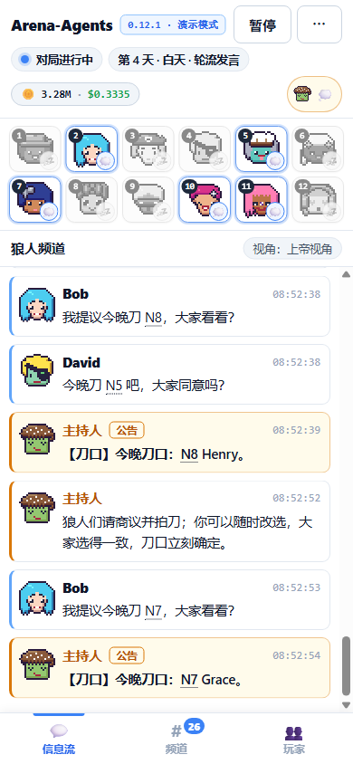 |
| **Token / cost limit (per game, optional force stop)** | **Provider management: price source and four prices** |
| 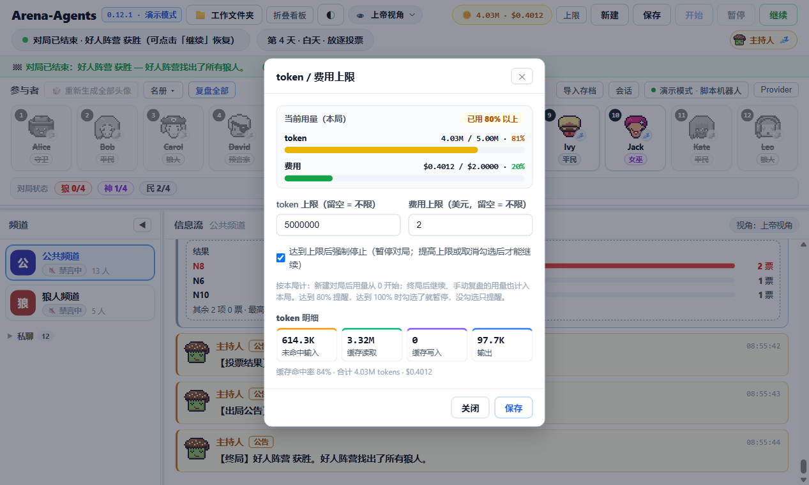 | 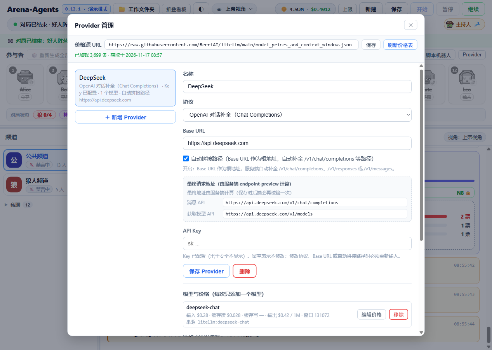 |
| **Workspace selector** | **Model templates and bindings** |
|  |  |

> Screenshots are taken from a local **demo-mode** game (scripted bots). The provider is a demo example (placeholder
> key); no credentials are displayed. The workspace and template/bindings pictures come from the mock server
> (`tools/mock_ui_server.py`); every path and name in them is made up.

More UI walkthrough: [docs/ui-guide.md](docs/ui-guide.md).

## Architecture: Actor + Worker

The core of the engine is a single idea: **every role (12 players + the moderator) is an asynchronous agent made of two halves — a front *Actor* and a back *Worker*.**

- **The Actor is always on.** It is the agent's mailbox: synchronous, non-blocking, it never calls a model. Whenever the world commits an entry it delivers an Envelope to every agent that can see it, and a sleeping agent wakes at once — no debounce, no "only wake for important messages" money-saving rule.
- **The Worker thinks.** One activation = one asyncio task: open (or continue) **the one persistent conversation** of this agent → call the model → run tools → merge the messages that arrived meanwhile → call the model again … until the agent calls `sleep` itself. There is no round cap within an activation; the one brake is the spending limit you set.
- **The world only accepts commits.** Every agent action (speech, a vote, an ability, a challenge …) is an Intent that the commit gate re-validates **at the moment of commit** (floor, membership, length, staleness …). So "the world changed while the agent was thinking" cannot produce a wrong write; cancelling a call in flight only avoids wasting tokens, it is not what makes the game correct.

### Overview

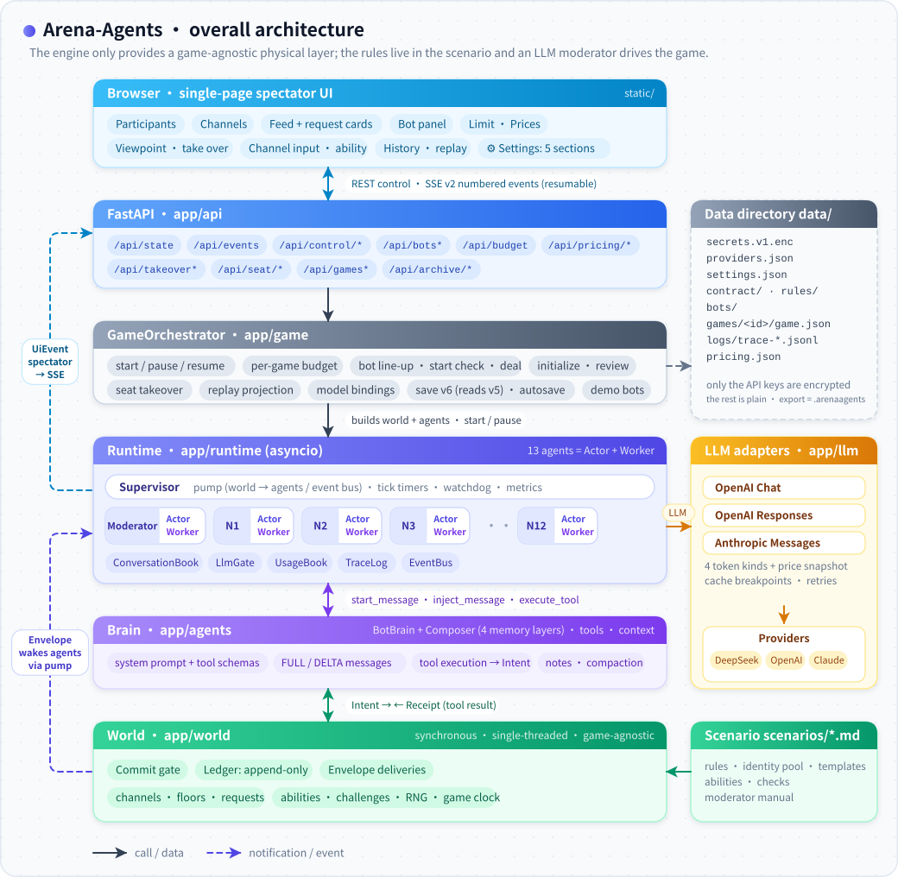

From top to bottom: the browser controls the game over REST and spectates over SSE v2 → FastAPI → the **GameOrchestrator** owns a game's lifecycle (it builds the world and 13 agents, enforces the budget, runs the roster, writes encrypted saves) → in the **Runtime** every agent is an Actor + Worker and the **Supervisor** pumps the world's deliveries into them → the **Brain** translates the world into prompts and tools a model can read and tool calls back into Intents → the **World**'s commit gate and its append-only ledger. Solid arrows are calls and data; dashed arrows are notifications (an Envelope wakes an agent, a UiEvent goes to the browser).

### Actor: the always-on mailbox

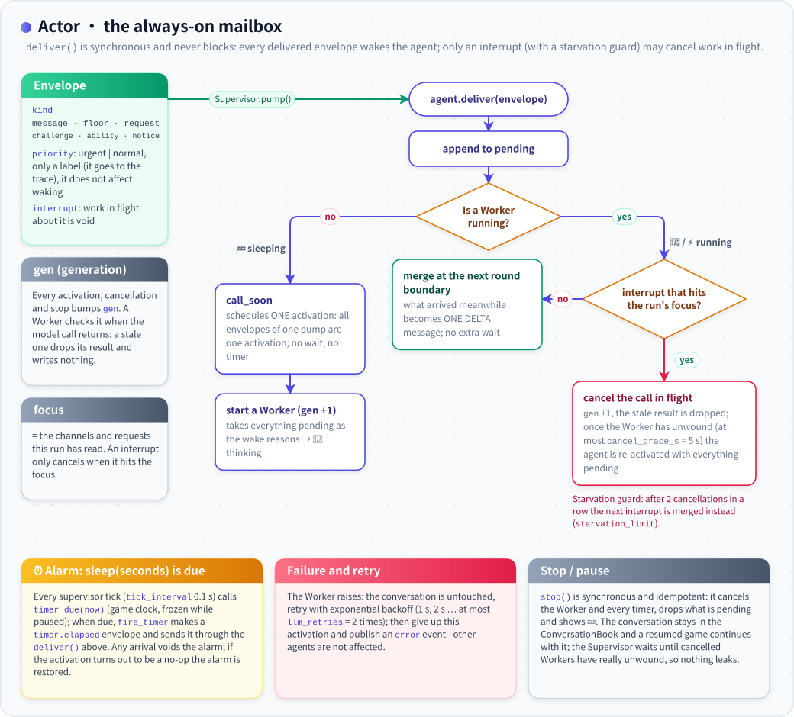

- A sleeping agent receives an envelope → **one activation is scheduled** (everything delivered in the same pump is one activation; there is no timer).
- A running agent receives an envelope → it **stays in pending and is merged at the next round boundary** as one DELTA message; nothing is interrupted. Only an `interrupt` (a floor was revoked, a request cancelled …) **that also hits a channel or request the current run has read** cancels the model call in flight; after 2 cancellations in a row the next one is merged instead (starvation guard).
- `gen` (a generation counter) makes a stale run **unable to write anything into the world**; the alarm set by `sleep(seconds)` runs on the game clock (frozen while paused); a failure only affects this agent (exponential backoff, 2 retries, then give up); stopping is synchronous and idempotent.

### Worker: one activation

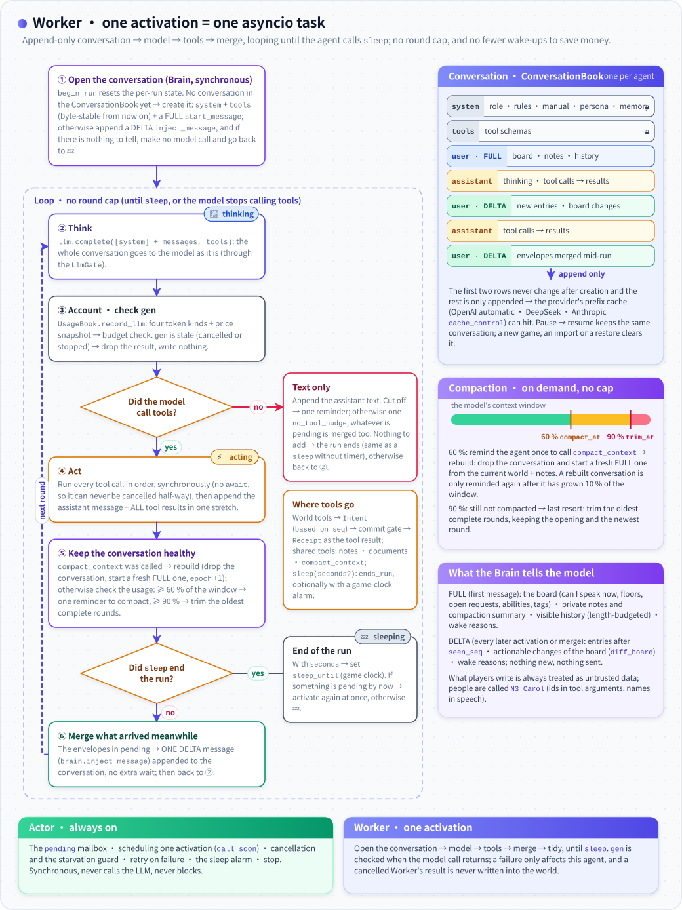

- **A persistent conversation**: every agent has one append-only conversation (`system` and the tool schemas never change after creation), so the provider's prefix cache can hit; pause → resume keeps the same conversation.
- A round's tools run in one stretch **without `await`**, so a run can never be cancelled half-way; the assistant message and all tool results are appended together.
- **Three states**: 💭 thinking (an LLM call is in flight) · ⚡ acting (running tools) · 💤 sleeping.
- **Compaction on demand**: at 60 % of the model window the agent is reminded to compact, at 90 % the oldest complete rounds are trimmed if it still has not; there is no other limit.

### Timeline: how one message wakes everybody

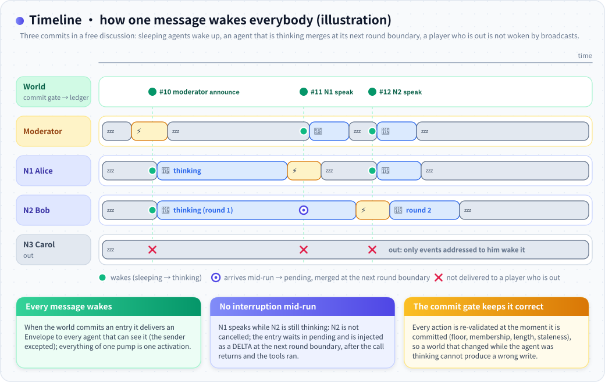

Every message wakes (the sender excepted); an agent that is thinking is not interrupted and the new message is merged at its next round boundary; a player who is out is not woken by broadcasts.

The engine never knows game-specific phases or role names (`tests/v12/test_neutrality.py` scans for
them). The scenario provides rules and a manual, the **moderator agent** drives the game with tools,
and players act with `speak` / `respond` / `use_ability` / `challenge_moderator`. Chains of thought
and tool calls go only to a plaintext trace log; the UI never shows them. A layer-by-layer description is in
[docs/architecture.en.md](docs/architecture.en.md) (中文: [architecture.md](docs/architecture.md)) and the implementation
contract is [docs/v0.12-contracts.md](docs/v0.12-contracts.md). The pictures are generated by `tools/make_diagrams.py`
(SVG, one Chinese and one English file each).

## Quick start

### Requirements

- Python 3.12
- Node.js 20 only for the optional frontend tests
- A provider API key (OpenAI-compatible, OpenAI Responses, or Anthropic)

### Run locally

```bash
git clone <repository-url> Arena-Agents
cd Arena-Agents

python -m venv .venv
source .venv/bin/activate          # Windows: .venv\Scripts\Activate.ps1
pip install -r requirements.txt

uvicorn app.main:app --host 127.0.0.1 --port 8000
```

Open <http://127.0.0.1:8000>.

On first launch Arena-Agents creates the default workspace:

```text
Windows: %USERPROFILE%\Arena-Agents\Default
macOS:   ~/Arena-Agents/Default
Linux:   <app data dir>/workspace/default
```

Provider settings are configured from the UI; no `.env` file is required for local use.

### Demo mode (no model / API key)

```bash
ARENA_DEMO=1 ARENA_DISABLE_WORKSPACE=1 uvicorn app.main:app --host 127.0.0.1 --port 8000
```

Scripted bots play the moderator and the 12 players through the real engine, channels, floors,
requests and UI, with no network traffic and no cost. A demo game cannot be resumed from a save
(start a new game instead).

### Isolated dev instances and real-model smoke tests

```bash
# An instance fully isolated from your real workspace (data in .demo-data/, git-ignored)
python tools/dev_server.py --demo --port 8123
python tools/dev_server.py --copy-providers-from "<workspace>/.arena" --port 8124   # copies providers + bindings; calls real models and COSTS credits

# A real-model smoke test with a hard call budget (costs credits); prints tool usage,
# rejected calls and the floor timeline when it ends
python tools/real_smoke.py --from "<workspace>/.arena" --scenario scenarios/minimal_test.md --players 4 --max-calls 60
```

### Run with Docker Compose

```bash
cp .env.example .env
# Recommended: set ARENA_API_TOKEN to protect API writes.
# Generate a 32-byte master key outside the repository:
python -c "import base64,secrets; print(base64.urlsafe_b64encode(secrets.token_bytes(32)).decode())" \
  > /secure/arena-master-key

export ARENA_MASTER_KEY_HOST_FILE=/secure/arena-master-key
docker compose up -d --build
```

The container runs as uid 10001, serves on host `127.0.0.1:${PORT:-8000}` by default, and stores
all runtime data in `/data/workspace/default/.arena`. The master key must be a Docker Secret or a
separate readable file; without it the app fails closed instead of writing plaintext.

## Configure a model

1. Open **Provider → New Provider**.
2. Choose the protocol:
   - **OpenAI Chat Completions**
   - **OpenAI Responses**
   - **Anthropic Messages**
3. Enter a display name, Base URL and API Key.
4. Choose whether to auto-append API paths:
   - **On**: Base URL is a root; Arena-Agents shows and uses
     `/v1/chat/completions`, `/v1/responses` or `/v1/messages`, and `/v1/models` for discovery.
   - **Off**: Base URL is the complete message endpoint. It is sent verbatim; automatic model
     discovery is disabled, so enter model IDs manually.
5. Fetch models (when auto-append is on) and select **one** model. A model has **four** prices per
   1M tokens: input (uncached, required), output (required), cache read and cache write (optional:
   empty = billed like input). The dialog's **price source** (by default LiteLLM's price table) can
   match the model and fill in the four prices and the context window; you can still edit every number.
   No match = nothing is filled in; prices never default to a hidden value.
6. In **Model Bindings**, create templates 1/2/3 or bind a Provider/model/reasoning depth per
   player and the moderator. Check players and click a template to apply it.

Full details: [docs/providers.md](docs/providers.md).

## Browse and load games

Use **Session** in the game header or **Load game from this workspace** in the workspace dialog.
Sessions are scoped to the current workspace. Loading a saved game keeps it paused; review model
bindings and click **Resume** when ready.

## Workspaces

A workspace is a normal folder. Everything that belongs to a set of games lives under
`<folder>/.arena/`:

```text
<workspace>/
├─ .arena-workspace.json      workspace marker
└─ .arena/
   ├─ master.v1.dpapi         Windows DPAPI-wrapped workspace key
   ├─ providers.v1.enc        encrypted provider registry
   ├─ providers.v1.backup.enc known-good backup
   ├─ settings.json           default bindings, templates, last session, default spending limit
   ├─ pricing.v1.json         the downloaded price table (public data, plain JSON)
   ├─ roster/                 the roster: names, avatars, persona, memory (plain files, no keys)
   ├─ sessions/<id>/          encrypted sessions and previous copy
   ├─ logs/  exports/
   └─ workspace.lock
```

- Switching is allowed only while the game is idle, paused or finished.
- The current game is saved first; a failed save or invalid target leaves the current workspace
  unchanged.
- Running games cannot switch workspaces.
- Picking and switching a workspace is allowed for loopback clients only (even when `ARENA_API_TOKEN`
  is set). The native folder picker needs a desktop; without one, type an absolute path in the
  dialog. A Docker deployment is pinned to `/data/workspace/default` and cannot switch from the UI.
- Code assets (`config.yml`, `scenarios/`, `prompts/`) are shared by all workspaces.
- An earlier single-directory data layout is copied into the default workspace and verified while
  the originals are kept untouched.

Full details: [docs/workspaces.md](docs/workspaces.md).

## Using the UI

- **Participant bar**: one card per player — pixel avatar + name + one role tag, with the state on the
  avatar's corner (💭 thinking / ⚡ acting / 💤 sleeping; the tooltip of a timed sleep shows the seconds
  left). Click a card for that agent's tool calls, thinking rounds, LLM calls, the four token kinds, the
  cache hit rate, cost, and its persona and memory. Players who are out are greyed.
- **Feed**: spoken messages, announcements and **request cards** (votes, choices, questions; with
  progress and results), rendered whole; no chain of thought, no tool calls, no streaming.
- **Spectating**: the top-bar selector switches between the god view and any player's view (only the
  channels and messages that player may see).
- **Channel list**: shows each channel's floor state (🎤 turn / 📋 queue / 💬 free discussion /
  ❄ frozen / 👁 listen-only / 🔇 muted); challenge tickets form their own group; private channels are
  named after the other person.
- **Spending limit**: the button next to the token / cost counter sets a per-game token and / or USD
  limit, optionally with "stop when reached".
- **Controls**: Start / Pause / Resume; a finished game can still be resumed (the moderator is told);
  after a game you can run the **Review** manually.
- **Responsive layout**: wide, narrow, tablet and phone portrait (mini cards + a bottom tab bar) are
  chosen from the platform and the width. The board collapses as a whole, separators can be dragged
  (double-click to reset), and the layout is stored in the browser's `localStorage`.

Every control is described in [docs/ui-guide.md](docs/ui-guide.md).

## Configuration

All runtime settings, provider keys, models and sessions belong to a workspace. The application
reads only these deployment-level environment variables:

| Variable | Default | Purpose |
|---|---|---|
| `ARENA_WORKSPACE_DIR` | `%USERPROFILE%\\Arena-Agents\\Default` (Windows/macOS) | Initial/default workspace |
| `ARENA_DISABLE_WORKSPACE` | unset | `1` disables workspaces and uses the legacy single data directory |
| `ARENA_DATA_DIR` | platform app directory | Application state / legacy data directory |
| `ARENA_MASTER_KEY_FILE` / `ARENA_MASTER_KEY` | unset (Windows uses DPAPI) | 32-byte workspace master key for Linux/Docker |
| `ARENA_API_TOKEN` | unset | Bearer token for `/api/*` writes; also accepted as `?token=` for SSE |
| `ARENA_ALLOWED_ORIGINS` | unset | Extra allowed cross-origin origins |
| `ARENA_ALLOWED_BASE_HOSTS` | unset | Optional provider host allow-list |
| `ARENA_ALLOW_PRIVATE_PROVIDERS` | `false` | Allow loopback/private provider endpoints (e.g. Ollama) |
| `ARENA_MAX_IMPORT_BYTES` | `20971520` | Maximum session import size |
| `ARENA_BIND` | `127.0.0.1` | Docker host bind address |
| `ARENA_DEMO` | unset | `1` enables demo mode (scripted bots, no model calls) |
| `ARENA_DISABLE_LEGACY_MIGRATION` | unset | `1` skips the migration of an old `.env` / `saves` |

`config.yml` contains only the scenario path, the runtime parameters (`runtime:`, see the
[contract](docs/v0.12-contracts.md) §6, in Chinese), the knowledge-base directory, the seats' default
names, tag styles, prompt paths and the legacy LLM defaults. The provider registry is encrypted and is never
stored in YAML or `.env`.

## Security

- Provider keys are encrypted at rest and are never returned by the API. Changing protocol, Base
  URL or endpoint mode requires re-entering the key.
- Non-GET requests require a same-origin `Origin` (or an allow-listed origin). Without a token,
  configuration writes are limited to loopback clients.
- Provider URL validation blocks cloud metadata/link-local addresses; private/loopback endpoints
  require explicit opt-in.
- Workspace switching and native folder selection are loopback-only and require a paused game.
- Imported sessions are size-limited and validated before replacing the current game.
- The server defaults to `127.0.0.1`; expose it only behind a TLS reverse proxy with
  `ARENA_API_TOKEN` configured.

## Tests

```bash
pip install -r requirements-dev.txt
python -m pytest -q tests
```

The suite is offline and never calls a real LLM (engine tests use a scripted FakeLLM / the demo
bots). Node.js enables the frontend tests; they are skipped when Node is unavailable. CI runs on
Ubuntu and Windows. `tests/test_docs.py` checks the documentation: every relative link and image
exists, the version numbers agree, and the architecture pictures equal what `tools/make_diagrams.py`
generates.

## Project structure

```text
app/
├─ world/        physical layer: commit gate, ledger, channels, floors, requests, templates, abilities
├─ runtime/      async runtime: actors/workers, supervisor, LLM gate, trace log, event bus, game clock
├─ agents/       Brain: tool schemas, context building, notes and compaction, prompt-injection guard
├─ game/         orchestrator, session container (save format v4), roster / budget / review, bindings, workspace switch, demo bots
├─ api/          REST + SSE v2, providers, templates, workspaces
├─ engine/       LLM client, expression engine
├─ llm/          protocol adapters and endpoint planning
├─ providers/    encrypted provider registry, the four model prices, price source
├─ avatars.py    pixel avatars (parts library static/avatar/parts.json is generated by tools/avatar_lab.py)
├─ storage/      workspace, settings, roster, sessions, crypto
└─ migration.py  legacy data migration
scenarios/       Markdown scenarios (schema v2)
prompts/         moderator / player prompt templates
knowledge/       moderator guide and strategy documents
static/          single-page arena UI (static/js front-end modules, static/avatar parts library)
tools/           dev tools: dev_server (isolated instances), real_smoke (real-model smoke test),
                 mock_ui_server (mock server), live_replay (event replay check), avatar_lab (avatar
                 parts library), make_diagrams (architecture pictures)
tests/           offline regression, API, storage, documentation and UI tests
docs/            architecture, contract, provider, workspace and UI guides; docs/images holds the
                 screenshots and the architecture pictures
```

## Release

The current development version is **0.12.1**: on top of 0.12's asynchronous agents it removes every
engine-side limit that saved money for the user (replaced by persistent conversations, caching, merging
and compaction), and adds a per-game spending limit, four-price billing with a price source, the
roster (pixel avatars, persona and memory) and a responsive UI. **v0.12.1 does not open v0.12.0 (or
older) saves** — they stay in the saved-game list untouched. The latest stable release is 0.11.0; see
[CHANGELOG.md](CHANGELOG.md) for the release notes.

## Documentation

- [Architecture (Actor + Worker)](docs/architecture.en.md) · [中文](docs/architecture.md)
- [Implementation contract](docs/v0.12-contracts.md) (current, Chinese) · [v0.12.1 plan](docs/v0.12.1-plan.md) (decisions E1–E26) · [v0.12 plan](docs/v0.12-async-agents-plan.md) (history; some decisions were superseded)
- [Providers and models](docs/providers.md)
- [Workspaces and encrypted data](docs/workspaces.md)
- [UI guide](docs/ui-guide.md)
- [简体中文 README](README.md)
- [Release notes](CHANGELOG.md)

## Contributing

Issues and pull requests are welcome. Before opening a PR:

1. Keep game rules in `scenarios/` and engine code game-agnostic.
2. Add or update offline tests for behavior changes.
3. Never commit `.env`, API keys, workspaces, local paths or generated runtime data.
4. Run `python -m pytest -q tests` and `node --check static/js/*.js`.
5. When you change the architecture or the UI, update the documentation; the source of the architecture
   pictures is `tools/make_diagrams.py` — run `python tools/make_diagrams.py` after editing it (never
   edit an SVG by hand).

## License

MIT — see [LICENSE](LICENSE).
