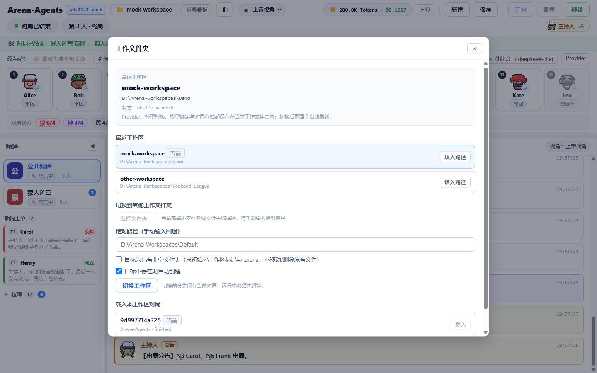

# Arena-Agents · AI Werewolf (狼人杀) & Multi-Agent Arena

**English** | [简体中文](README.md)

**Arena-Agents is an open-source AI Werewolf (狼人杀), social-deduction and multi-agent game arena.**
It is a game-agnostic sandbox for LLM agents: a Markdown scenario defines the game rules, **every
player and the moderator is an asynchronous agent** (a front *actor* that always accepts and emits
messages, plus a back *worker* that thinks and calls tools), and an LLM moderator drives the game by
following the scenario's manual. The engine only provides channels, speaking rights, requests and a
ledger. The bundled scenario is a complete 12-player Werewolf game; the same engine can host other
social-deduction or tabletop rules. Keywords: **AI 狼人杀, 狼人杀, 多智能体狼人杀, AI 多智能体博弈, social deduction, AI Werewolf,
LLM Werewolf, AI 桌游, AI 剧本杀, multi-agent game**.

[](https://www.python.org/)
[](https://fastapi.tiangolo.com/)
[](LICENSE)
[](CHANGELOG.md)

---

**Arena-Agents 是一个开源的 AI 狼人杀、社交推理与多智能体博弈沙盒。**
游戏规则写在可执行 Markdown 剧本中，引擎负责玩家、发言、投票、频道、事件与断点恢复。内置一套完整的 12 人狼人杀，也可用同一引擎运行其他社交推理/桌游规则。


## Highlights

- **Every agent is asynchronous (v0.12)** — each player and the moderator is an Actor + Worker. The
  actor is never blocked by thinking or tool execution; speech, votes, challenges and abilities can
  happen at any time and are validated by the engine *at commit time*.
- **An LLM moderator drives the flow** — taking turns = a moderator announcement + floor management
  (`set_floor_queue` and friends). The rules and the moderator manual live in the scenario; the
  engine contains no game vocabulary.
- **Channels and speaking rights** — visibility is decided by channels only; the moderator can close
  the floor at any time (players get a "no floor" receipt), speech is limited by time *and* by
  characters, players can privately challenge the moderator, and the moderator can punish harassment
  by closing a player's private channel.
- **Append-only ledger** — everything that happened is recorded; saves, agent context and spectating
  all derive from it. The moderator may change a player's *current* state (out, revived …) but can
  never rewrite history.
- **Executable Markdown scenarios (schema v2)** — identity pool, templates, abilities, checks and
  default limits in the front matter; the body holds the rules and a moderator-only manual.
- **Multi-provider model routing** — OpenAI Chat Completions, OpenAI Responses and Anthropic
  Messages; every player and the moderator can use a different model and reasoning depth.
- **Model templates** — save up to three Provider/model/reasoning presets and apply them to
  selected players in one action.
- **Workspaces** — each work folder has its own providers, templates, bindings, sessions, logs
  and encryption key. Switch folders without mixing games or API keys.
- **Safe live operations** — models are locked while a game is running; switching workspace
  requires pausing and successfully saving first.
- **Encrypted local data** — provider keys and sessions are encrypted with AES-256-GCM; on
  Windows the workspace key is protected by DPAPI.
- **Endpoint preview** — see the exact message and model-list URLs before saving a Provider;
  either auto-append `/v1/...` paths or point at a complete custom endpoint.
- **Minimal spectator UI** — players are shown as a tiny geometric glyph + short id + tag; click a
  tag for the agent's tool-call / thinking / token statistics. The feed shows spoken messages only
  (whole messages, no streaming) and supports a god view or any player's view.
- **Demo mode** — `ARENA_DEMO=1` replaces the models with scripted bots, so you can watch a whole
  game without an API key.

## Screenshots

| Game board and live feed | Workspace selector |
|---|---|
|  |  |
| **Provider management and URL preview** | **Model templates and bindings** |
|  |  |

> The v0.12 UI uses minimal player tiles and a speech-only feed; the screenshots below are refreshed
> before the v0.12 release. They are taken from a local demo game. Workspace paths and provider hostnames are
> pixelated before publication; no credentials are displayed.

More UI walkthrough: [docs/ui-guide.md](docs/ui-guide.md).

## How it works

```text
Browser ──REST + SSE v2 (numbered incremental events, resumable)──► FastAPI API ── workspace (.arena/)
                                                                      │             ├─ providers.v1.enc
                                                                      ▼             ├─ settings.json
                                                              GameOrchestrator      ├─ sessions/*.enc
                                                                      │             ├─ logs/<game>/trace-*.jsonl
                                  ┌───────────────────────────────────┴───┐         └─ workspace key
                                  ▼                                       ▼
          World (synchronous, game-agnostic)               Runtime (asyncio)
          commit gate → ledger (append-only)               13 agents = Actor (mailbox) + Worker (LLM loop)
          channels · floors · requests · templates         supervisor · watchdog · LLM concurrency gate
          abilities · challenges · RNG · game clock        Brain: state board + memory + visible history + tools
                                                                      │
                                                                      ▼
                                    OpenAI Chat / OpenAI Responses / Anthropic Messages adapters
```

The engine never knows game-specific phases or role names (`tests/v12/test_neutrality.py` scans for
them). The scenario provides rules and a manual, the **moderator agent** drives the game with tools,
and players act with `speak` / `respond` / `use_ability` / `challenge_moderator`. Chains of thought
and tool calls go only to a plaintext trace log; the UI never shows them. See
[docs/architecture.md](docs/architecture.md) for the module map and
[docs/v0.12-contracts.md](docs/v0.12-contracts.md) for the implementation contract.

## Quick start

### Requirements

- Python 3.12
- Node.js 20 only for the optional frontend tests
- A provider API key (OpenAI-compatible, OpenAI Responses, or Anthropic)

### Run locally

```bash
git clone <repository-url> Arena-Agents
cd Arena-Agents

python -m venv .venv
source .venv/bin/activate          # Windows: .venv\Scripts\Activate.ps1
pip install -r requirements.txt

uvicorn app.main:app --host 127.0.0.1 --port 8000
```

Open <http://127.0.0.1:8000>.

On first launch Arena-Agents creates the default workspace:

```text
Windows: %USERPROFILE%\Arena-Agents\Default
macOS:   ~/Arena-Agents/Default
Linux:   <app data dir>/workspace/default
```

Provider settings are configured from the UI; no `.env` file is required for local use.

### Demo mode (no model / API key)

```bash
ARENA_DEMO=1 ARENA_DISABLE_WORKSPACE=1 uvicorn app.main:app --host 127.0.0.1 --port 8000
```

Scripted bots play the moderator and the 12 players through the real engine, channels, floors,
requests and UI, with no network traffic and no cost. A demo game cannot be resumed from a save
(start a new game instead).

### Run with Docker Compose

```bash
cp .env.example .env
# Recommended: set ARENA_API_TOKEN to protect API writes.
# Generate a 32-byte master key outside the repository:
python -c "import base64,secrets; print(base64.urlsafe_b64encode(secrets.token_bytes(32)).decode())" \
  > /secure/arena-master-key

export ARENA_MASTER_KEY_HOST_FILE=/secure/arena-master-key
docker compose up -d --build
```

The container runs as uid 10001, serves on host `127.0.0.1:${PORT:-8000}` by default, and stores
all runtime data in `/data/workspace/default/.arena`. The master key must be a Docker Secret or a
separate readable file; without it the app fails closed instead of writing plaintext.

## Configure a model

1. Open **Provider → New Provider**.
2. Choose the protocol:
   - **OpenAI Chat Completions**
   - **OpenAI Responses**
   - **Anthropic Messages**
3. Enter a display name, Base URL and API Key.
4. Choose whether to auto-append API paths:
   - **On**: Base URL is a root; Arena-Agents shows and uses
     `/v1/chat/completions`, `/v1/responses` or `/v1/messages`, and `/v1/models` for discovery.
   - **Off**: Base URL is the complete message endpoint. It is sent verbatim; automatic model
     discovery is disabled, so enter model IDs manually.
5. Fetch models (when auto-append is on), select **one** model, and enter its input/output prices
   per 1M tokens. Prices are required and never default to a hidden value.
6. In **Model Bindings**, create templates 1/2/3 or bind a Provider/model/reasoning depth per
   player and the moderator. Check players and click a template to apply it.

Full details: [docs/providers.md](docs/providers.md).

## Browse and load games

Use **Session** in the game header or **Load game from this workspace** in the workspace dialog.
Sessions are scoped to the current workspace. Loading a saved game keeps it paused; review model
bindings and click **Resume** when ready.

## Workspaces

A workspace is a normal folder. Everything that belongs to a set of games lives under
`<folder>/.arena/`:

```text
<workspace>/
├─ .arena-workspace.json      workspace marker
└─ .arena/
   ├─ master.v1.dpapi         Windows DPAPI-wrapped workspace key
   ├─ providers.v1.enc        encrypted provider registry
   ├─ providers.v1.backup.enc known-good backup
   ├─ settings.json           default bindings, templates, last session
   ├─ sessions/<id>/          encrypted sessions and previous copy
   ├─ logs/  exports/
   └─ workspace.lock
```

- Switching is allowed only while the game is idle, paused or finished.
- The current game is saved first; a failed save or invalid target leaves the current workspace
  unchanged.
- Running games cannot switch workspaces.
- The native folder picker is available to loopback clients only. Headless/Docker deployments use
  an absolute path instead.
- Code assets (`config.yml`, `scenarios/`, `prompts/`) are shared by all workspaces.
- An earlier single-directory data layout is copied into the default workspace and verified while
  the originals are kept untouched.

Full details: [docs/workspaces.md](docs/workspaces.md).

## Using the UI

- **Player tiles**: a minimal glyph + short id + one main tag; click the tag to see that agent's
  tool-call count, thinking rounds, LLM calls, tokens and cost. Players who are out are greyed.
- **Feed**: spoken messages, announcements and challenge replies only, rendered whole; no chain of
  thought, no tool calls, no streaming.
- **Spectating**: the top-bar selector switches between the god view and any player's view (only the
  channels and messages that player may see).
- **Channel list**: shows each channel's floor state (🔒 closed / 🎤 holder / 📋 queue / 💬 free
  discussion / ❄ frozen); challenge tickets form their own group.
- **Controls**: Start / Pause / Resume; a finished game can still be resumed (the moderator is told).
- **Layout**: collapse the board or side panels from their headers; drag the separators, double-click
  to reset. Layout is stored in the browser's `localStorage`.

## Configuration

All runtime settings, provider keys, models and sessions belong to a workspace. The application
reads only these deployment-level environment variables:

| Variable | Default | Purpose |
|---|---|---|
| `ARENA_WORKSPACE_DIR` | `%USERPROFILE%\\Arena-Agents\\Default` (Windows/macOS) | Initial/default workspace |
| `ARENA_DISABLE_WORKSPACE` | unset | `1` disables workspaces and uses the legacy single data directory |
| `ARENA_DATA_DIR` | platform app directory | Application state / legacy data directory |
| `ARENA_MASTER_KEY_FILE` / `ARENA_MASTER_KEY` | unset (Windows uses DPAPI) | 32-byte workspace master key for Linux/Docker |
| `ARENA_API_TOKEN` | unset | Bearer token for `/api/*` writes; also accepted as `?token=` for SSE |
| `ARENA_ALLOWED_ORIGINS` | unset | Extra allowed cross-origin origins |
| `ARENA_ALLOWED_BASE_HOSTS` | unset | Optional provider host allow-list |
| `ARENA_ALLOW_PRIVATE_PROVIDERS` | `false` | Allow loopback/private provider endpoints (e.g. Ollama) |
| `ARENA_MAX_IMPORT_BYTES` | `20971520` | Maximum session import size |
| `ARENA_BIND` | `127.0.0.1` | Docker host bind address |
| `ARENA_DEMO` | unset | `1` enables demo mode (scripted bots, no model calls) |

`config.yml` contains only game defaults, seats/personas, tag styles and the scenario path. The
cryptographic provider registry is never stored in YAML or `.env`.

## Security

- Provider keys are encrypted at rest and are never returned by the API. Changing protocol, Base
  URL or endpoint mode requires re-entering the key.
- Non-GET requests require a same-origin `Origin` (or an allow-listed origin). Without a token,
  configuration writes are limited to loopback clients.
- Provider URL validation blocks cloud metadata/link-local addresses; private/loopback endpoints
  require explicit opt-in.
- Workspace switching and native folder selection are loopback-only and require a paused game.
- Imported sessions are size-limited and validated before replacing the current game.
- The server defaults to `127.0.0.1`; expose it only behind a TLS reverse proxy with
  `ARENA_API_TOKEN` configured.

## Tests

```bash
pip install -r requirements-dev.txt
python -m pytest -q tests
```

The suite is offline and never calls a real LLM (engine tests use a scripted FakeLLM / the demo
bots). Node.js enables the frontend tests; they are skipped when Node is unavailable. CI runs on
Ubuntu and Windows.

## Project structure

```text
app/
├─ world/        physical layer: commit gate, ledger, channels, floors, requests, templates, abilities
├─ runtime/      async runtime: actors/workers, supervisor, LLM gate, trace log, event bus, game clock
├─ agents/       Brain: tool schemas, context building, notes and compaction, prompt-injection guard
├─ game/         orchestrator, session container (save format v3), bindings, workspace switch, demo bots
├─ api/          REST + SSE v2, providers, templates, workspaces
├─ engine/       LLM client, expression engine
├─ llm/          protocol adapters and endpoint planning
├─ providers/    encrypted provider registry / model metadata
├─ storage/      workspace, settings, sessions, crypto
└─ migration.py  legacy data migration
scenarios/       Markdown scenarios (schema v2)
prompts/         moderator / player prompt templates
knowledge/       moderator guide and strategy documents
static/          single-page arena UI
tests/           offline regression, API, storage and UI tests
docs/            architecture, provider, workspace and UI guides
```

## Release

The current development version is **0.12.0**: asynchronous agents everywhere, an LLM-driven
moderator, channels and speaking rights, challenges and a minimal spectator UI. **v0.12 does not
open v0.11 (or older) saves** — they stay in the saved-game list untouched. The latest stable
release is 0.11.0; see [CHANGELOG.md](CHANGELOG.md) for the release notes.

## Documentation

- [Architecture](docs/architecture.md)
- [v0.12 plan and decision log](docs/v0.12-async-agents-plan.md) · [implementation contract](docs/v0.12-contracts.md)
- [Providers and models](docs/providers.md)
- [Workspaces and encrypted data](docs/workspaces.md)
- [UI guide](docs/ui-guide.md)
- [简体中文 README](README.md)
- [Release notes](CHANGELOG.md)

## Contributing

Issues and pull requests are welcome. Before opening a PR:

1. Keep game rules in `scenarios/` and engine code game-agnostic.
2. Add or update offline tests for behavior changes.
3. Never commit `.env`, API keys, workspaces, local paths or generated runtime data.
4. Run `python -m pytest -q tests` and `node --check static/js/*.js`.

## License

MIT — see [LICENSE](LICENSE).
