# Arena-Agents · AI 狼人杀（Werewolf）多智能体博弈沙盒

[English](README.en.md) | **简体中文**

**Arena-Agents 是一个开源的 AI 狼人杀、社交推理与多智能体博弈沙盒。** 游戏规则写在 Markdown
剧本中；**每一位玩家和主持人都是异步 Agent**（前端 Actor 随时收发消息，后端 Worker 负责思考和
工具调用），由 LLM 主持人按剧本手册推进流程，引擎只提供与游戏无关的频道、发言权、请求与账本。
项目内置一套完整的 12 人狼人杀，也可以用同一引擎运行其他社交推理、剧本杀或桌游规则。

关键词：**AI 狼人杀、狼人杀、多智能体狼人杀、AI 多智能体博弈、社交推理、LLM 智能体、
AI 桌游、AI 剧本杀、social deduction、AI Werewolf、LLM Werewolf**。

[](LICENSE)
[](CHANGELOG.md)
[](https://www.python.org/)
[](https://fastapi.tiangolo.com/)

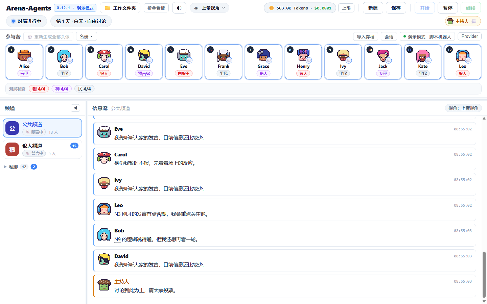

## 主要能力

- **全员异步 Agent（v0.12）**：每个玩家和主持人都是 Actor + Worker。Actor 永远能收发消息，
  不会被思考或工具执行阻塞；发言、投票、质询和能力随时可以发生，引擎在**提交的那一刻**校验。
- **引擎不替你省钱（v0.12.1）**：每一条投递给 agent 的消息都会立刻唤醒它（没有防抖、没有轮数上限、没有
  “执行深度”），狼人可以随时“拍刀”、白狼王随时自爆；agent 只有三种状态——思考 / 行动 / 休眠，
  `sleep(秒数)` 可以给自己设闹钟。token 靠**编排**管理：每个 agent 一条持久的只追加对话（命中供应商的
  前缀缓存）、运行中到达的消息合并注入、窗口快满时才压缩。
- **预算上限（按局）**：顶栏的 token / 金额统计旁有一个上限按钮，可设 token 和 / 或美元上限，并选择
  “达到上限后强制停止”；80% 变黄，100% 提示或暂停（原因“预算”）。费用按**四类 token**
  （未命中缓存的输入 / 缓存读 / 缓存写 / 输出）和四个价格精确计算。
- **价格源**：Provider 对话框里可从价格表（默认 LiteLLM 的 `model_prices_and_context_window.json`）
  自动填入模型的四个价格和上下文窗口，你仍可手动修改。
- **角色名册**：12 个座位 `N1`–`N12`，默认名字 Alice…Leo，可改名并保存；每人有一个由程序化素材库随机组合的
  **像素头像**（可重新生成全部或单个；主持人也有一个随机头像）；性格设定与记忆是工作区里的纯文本文件，默认为空，可导入 / 导出 /
  清空，也可让主持人的模型把几句要点“完善”成草稿；赛后手动“复盘”会把战绩和第一人称笔记写进记忆。
- **自适应界面**：从 1920 宽屏到手机竖屏都能用（按平台与宽度自动切换布局）。
- **LLM 主持人驱动流程**：轮流发言 = 主持人公告 + 发言权管理（`set_floor_queue` 等工具）；
  规则文本与“主持人手册”写在剧本里，引擎本身不含任何游戏词汇。
- **频道与发言权**：可见性只由频道决定；主持人可随时关闭发言权（玩家收到“无发言权”回执），
  发言既有时间限制也有字数限制；玩家可以私聊质询主持人，主持人可以惩罚骚扰者（关闭其私聊）。
- **只追加的账本**：所有已发生的事都记在账本里，存档、上下文和观战都以它为准；主持人可以改玩家的
  当前状态（出局、复活…），但不能改写历史。
- **可执行 Markdown 剧本（schema v2）**：身份池、模板、能力、检查项和默认限额写在
  `scenarios/*.md` 的 front matter 中，正文是规则说明和只给主持人看的手册。
- **多 Provider / 多模型**：支持 OpenAI Chat Completions、OpenAI Responses、Anthropic
  Messages；主持人及每位玩家可以使用不同模型和思考深度。
- **模型模板**：保存 3 个 Provider/模型/思考深度预设，勾选玩家后一键应用。
- **工作文件夹（Workspace）**：每个工作区独立保存 Provider、模板、绑定、对局、日志和加密密钥；
  不同游戏、不同 API 配置不会互相污染。
- **安全运行**：对局运行中锁定模型与工作区；切换工作区必须先暂停并保存成功。
- **本地加密**：Provider 密钥和对局存档使用 AES-256-GCM；Windows 工作区主密钥由 DPAPI 保护。
- **API 端点预览**：保存 Provider 前显示最终消息地址和模型列表地址；支持自动拼接 `/v1/...`
  或直接填写完整自定义 endpoint。
- **观战界面**：玩家用像素头像 + 名字 + 身份标签表示，点击玩家卡片看工具调用/思考/token 统计；
  信息流只显示发言和请求卡片（整条渲染，不流式），支持“上帝视角”和任意玩家视角。
- **演示模式**：`ARENA_DEMO=1` 用脚本化机器人代替模型，不需要 API Key 就能完整体验一局。

## 界面截图

| 玩家详情（点击玩家卡片：四类 token、缓存命中率、性格设定与记忆、复盘） | 玩家视角（只看到该玩家可见的内容） |
|---|---|
| 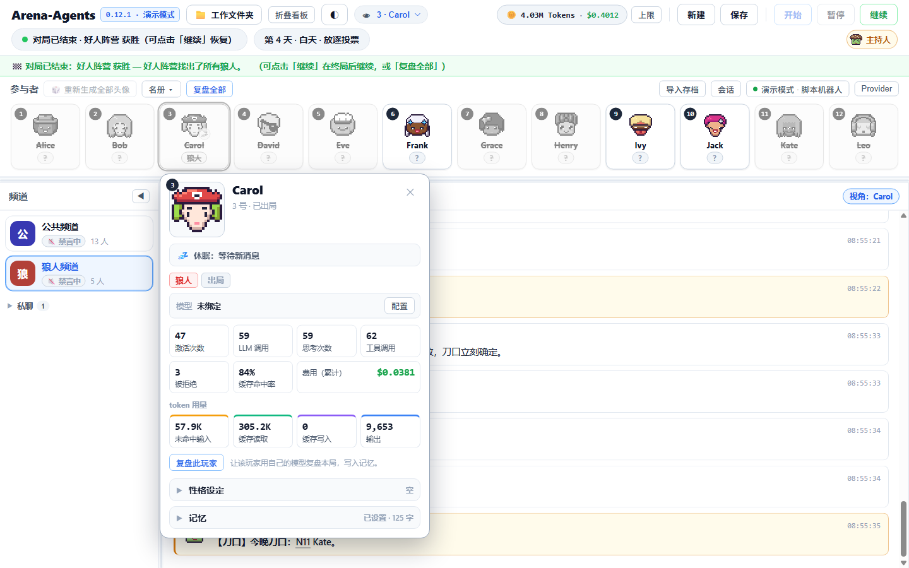 | 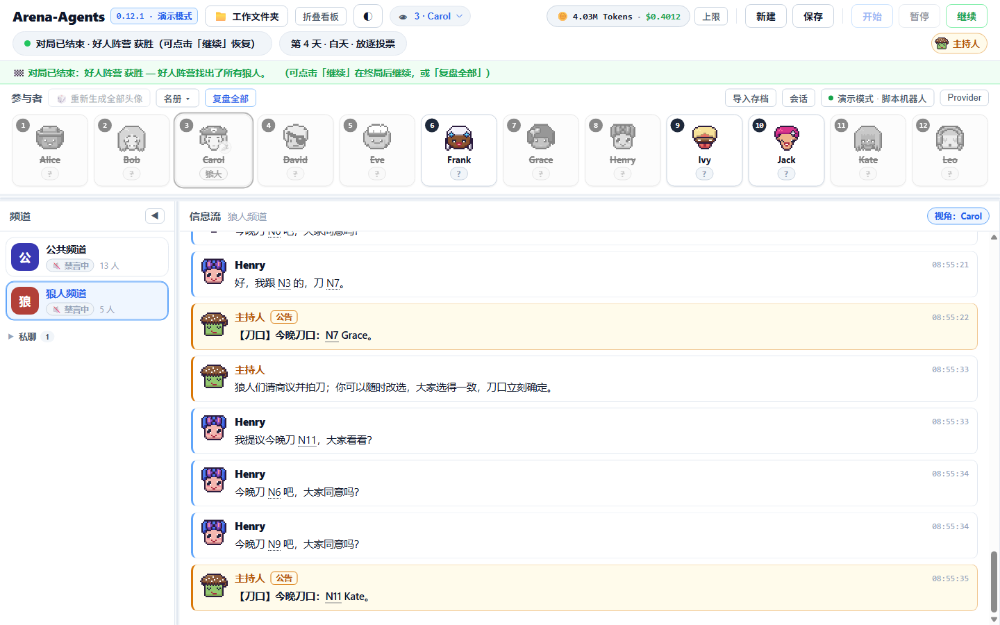 |
| **深色主题（含密封投票请求卡片）** | **手机竖屏（迷你卡片 + 底部标签栏）** |
| 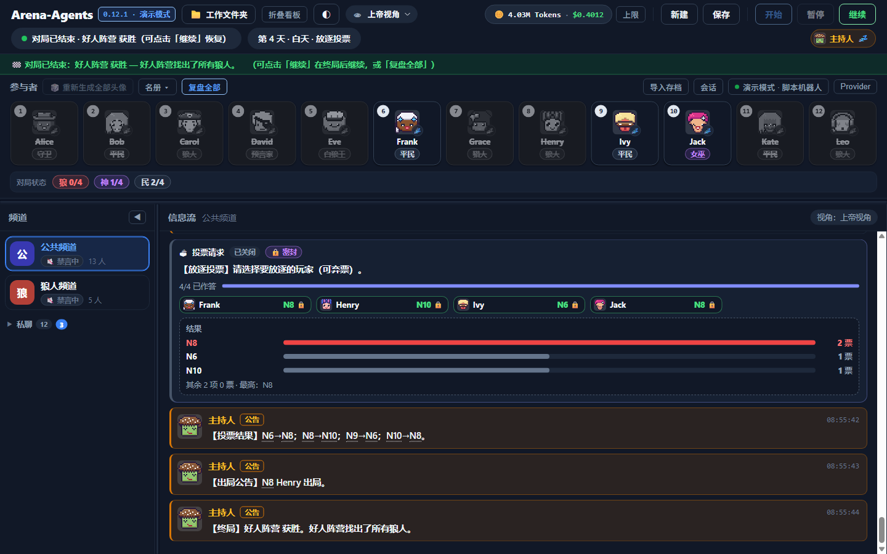 | 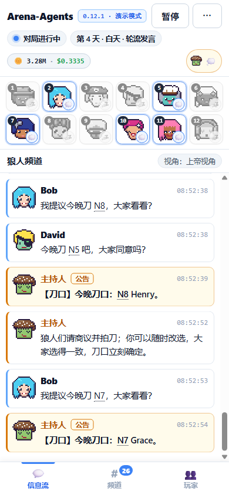 |
| **token / 费用上限（按局，可强制停止）** | **Provider 管理：价格源与四个价格** |
| 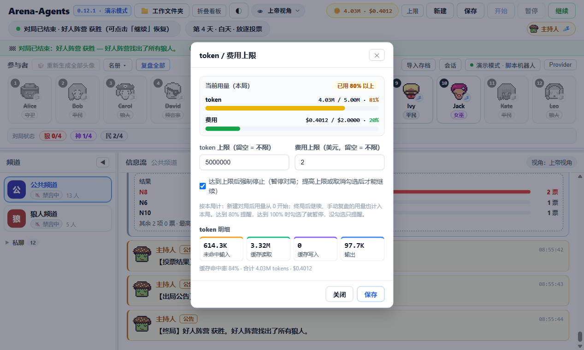 | 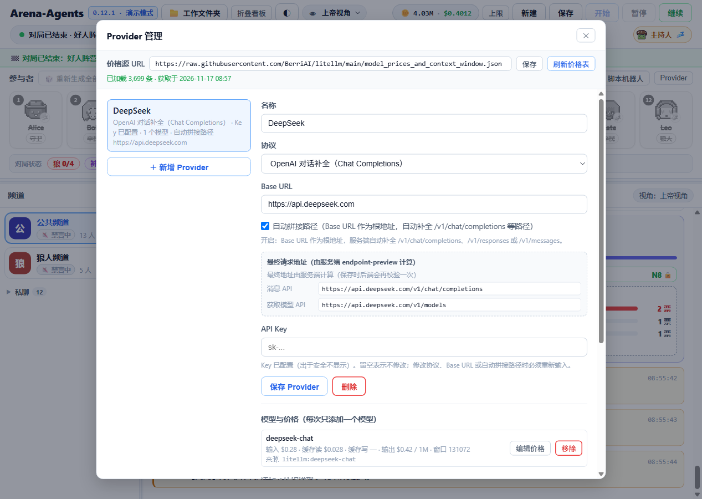 |
| **工作文件夹** | **模型模板与玩家绑定** |
| 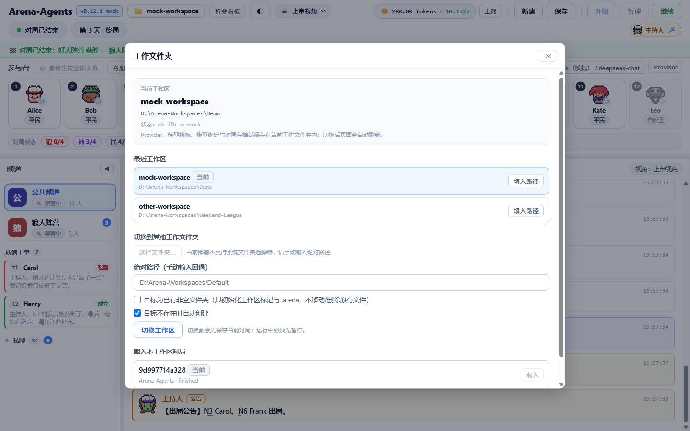 | 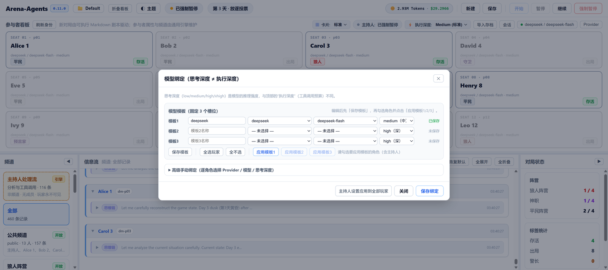 |

> 截图来自本地**演示模式**对局（脚本化机器人）；Provider 是一个演示用的示例（密钥为占位符），不包含任何真实凭据。
> 工作文件夹与模板绑定两张图来自模拟服务（`tools/mock_ui_server.py`），其中的路径和名称都是虚构的。

详细操作见 [docs/ui-guide.md](docs/ui-guide.md)。

## 架构：Actor + Worker

引擎的核心只有一个想法：**每个角色（12 名玩家 + 主持人）都是一个异步 agent，由前台的 Actor 和后台的 Worker 两半组成。**

- **Actor 永远在线。** 它是 agent 的信箱：同步、不阻塞、从不调用模型。世界里每提交一条记录，就给每个能看到它的 agent 投递一个 Envelope；休眠的 agent 立刻被唤醒——没有防抖，没有“只唤醒重要消息”的省钱规则。
- **Worker 负责思考。** 一次激活 = 一个 asyncio 任务：打开（或延续）这个 agent 的**那一条持久对话** → 调用模型 → 执行工具 → 合并运行中到达的新消息 → 再调用模型……直到 agent 自己调用 `sleep`。一次激活里没有轮数上限，唯一的刹车是你设的预算。
- **世界只认“提交”。** agent 的每个动作（发言、投票、能力、质询……）都是一个 Intent，在**提交的那一刻**由世界的提交闸门重新校验（发言权、成员、字数、是否过时……）。所以“agent 想的时候世界变了”不会写出错误的东西；取消在途的调用只是为了不浪费 token，不是正确性的保证。

### 整体

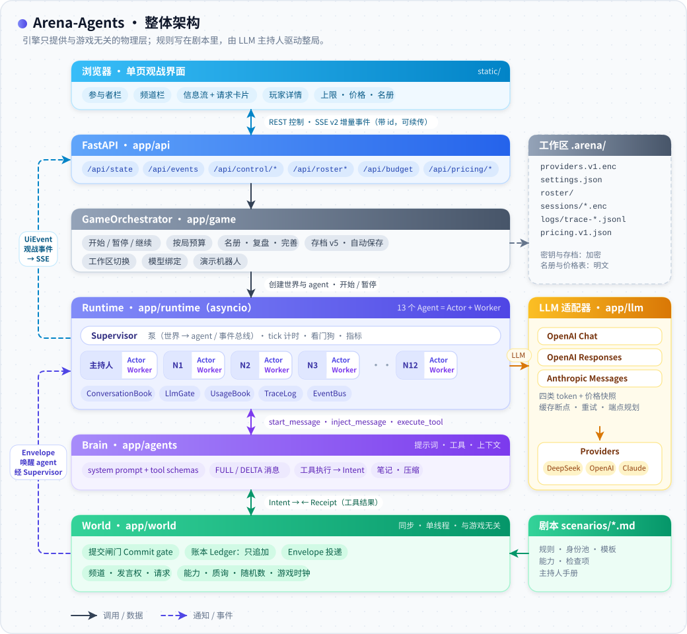

自上而下：浏览器用 REST 控制、用 SSE v2 观战 → FastAPI → **GameOrchestrator** 管理一局的生命周期（创建世界和 13 个 agent、预算、名册、加密存档）→ **Runtime** 里每个 agent 是 Actor + Worker，**Supervisor** 把世界的投递泵给它们 → **Brain** 把世界翻译成模型读得懂的提示词和工具，再把工具调用翻译回 Intent → **World** 的提交闸门与只追加的账本。实线是调用与数据，虚线是通知（Envelope 唤醒 agent，UiEvent 推给浏览器）。

### Actor：永远在线的信箱

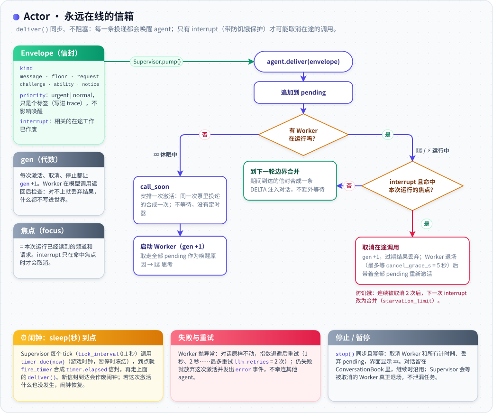

- 休眠的 agent 收到信封 → **安排一次激活**（同一次泵里投递的合成一次，没有定时器）。
- 运行中的 agent 收到信封 → **留在 pending，下一轮边界合并**成一条 DELTA，不打断。只有 `interrupt`（发言权被收回、请求被取消……）**并且**命中当前运行读过的频道或请求，才取消在途的模型调用；连续被取消 2 次后改为合并（防饥饿）。
- `gen`（代数）让过期的运行**什么都写不进世界**；`sleep(秒数)` 的闹钟用游戏时钟（暂停时冻结）；失败只影响这个 agent（指数退避重试 2 次后放弃）；停止是同步、幂等的。

### Worker：一次激活

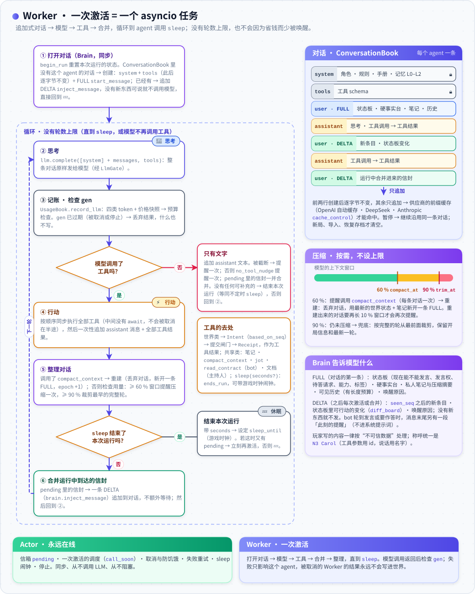

- **持久对话**：每个 agent 一条只追加的对话（`system` 与工具 schema 创建后逐字节不变），所以供应商的前缀缓存能命中；暂停 → 继续沿用同一条对话。
- 一轮的工具在**没有 `await`** 的一段里执行，不可能被取消在半路；assistant 消息和全部工具结果一起追加。
- **三种状态**：💭 思考（LLM 调用在途）· ⚡ 行动（执行工具）· 💤 休眠。
- **按需压缩**：用量达到模型窗口的 60% 提醒 agent 压缩，90% 仍未压缩就裁剪最早的完整轮；没有别的限制。

### 时间线：一条消息怎样唤醒所有人

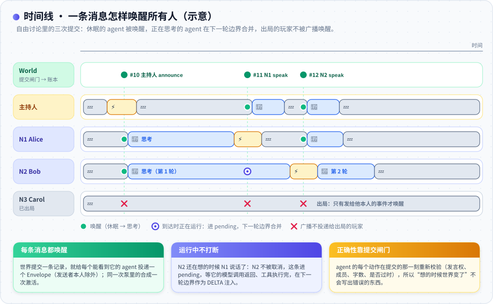

每条消息都唤醒（发出者除外）；正在思考的 agent 不被打断，新消息在它下一轮边界并入；出局的玩家不被广播唤醒。

引擎本身不理解“狼人”“警长”“第 2 夜”等游戏概念（`tests/v12/test_neutrality.py` 会扫描）。
剧本给出规则和手册，**主持人 Agent** 用工具推进流程；玩家用 `speak` / `respond` / `use_ability` /
`challenge_moderator` 行动。思维链和工具调用只写进明文 trace 日志，前端不展示。逐层的说明见
[docs/architecture.md](docs/architecture.md)（English: [architecture.en.md](docs/architecture.en.md)），
实现契约见 [docs/v0.12-contracts.md](docs/v0.12-contracts.md)。图由 `tools/make_diagrams.py` 生成（SVG，中英文各一份）。

## 快速开始

### 环境要求

- Python 3.12
- Node.js 20（仅前端测试需要）
- 一个 Provider API Key（OpenAI 兼容、OpenAI Responses 或 Anthropic）

### 本机运行

```bash
git clone <repository-url> Arena-Agents
cd Arena-Agents

python -m venv .venv
source .venv/bin/activate          # Windows: .venv\Scripts\Activate.ps1
pip install -r requirements.txt

uvicorn app.main:app --host 127.0.0.1 --port 8000
```

打开 <http://127.0.0.1:8000>。

首次启动会创建默认工作区：

```text
Windows: %USERPROFILE%\Arena-Agents\Default
macOS:   ~/Arena-Agents/Default
Linux:   <应用数据目录>/workspace/default
```

Provider 配置在界面中完成，本地使用不需要 `.env`。

### 演示模式（无需模型 / API Key）

```bash
ARENA_DEMO=1 ARENA_DISABLE_WORKSPACE=1 uvicorn app.main:app --host 127.0.0.1 --port 8000
```

演示模式用脚本化机器人扮演主持人和 12 名玩家，走真实的引擎、频道、发言权、请求和界面，
但没有任何网络请求和费用；演示局不支持从存档继续（需要新建对局）。

### 隔离的开发实例与真实模型冒烟

```bash
# 与你的真实工作区完全隔离的实例（数据在 .demo-data/，已被 git 忽略）
python tools/dev_server.py --demo --port 8123
python tools/dev_server.py --copy-providers-from "<工作区>/.arena" --port 8124   # 复制 Provider 与绑定，会调用真实模型并产生费用

# 带硬性调用上限的真实模型冒烟（会产生费用），结束后打印工具使用、被拒绝的调用和发言权时间线
python tools/real_smoke.py --from "<工作区>/.arena" --scenario scenarios/minimal_test.md --players 4 --max-calls 60
```

### Docker Compose

```bash
cp .env.example .env
# 建议设置 ARENA_API_TOKEN，保护配置写接口
python -c "import base64,secrets; print(base64.urlsafe_b64encode(secrets.token_bytes(32)).decode())" \
  > /secure/arena-master-key

export ARENA_MASTER_KEY_HOST_FILE=/secure/arena-master-key
docker compose up -d --build
```

容器以非 root 用户运行，默认只把 `127.0.0.1:${PORT:-8000}` 映射到宿主机；运行数据位于
`/data/workspace/default/.arena`。主密钥通过 Docker Secret 或独立密钥文件提供，缺失时应用
拒绝写入，不会回退到明文。

## 配置模型

1. 打开 **Provider → 新增 Provider**。
2. 选择协议：OpenAI Chat Completions / OpenAI Responses / Anthropic Messages。
3. 填写名称、Base URL、API Key。
4. 选择是否自动拼接 API 路径：
   - **开启**：Base URL 视为根地址，最终使用 `/v1/chat/completions`、`/v1/responses` 或
     `/v1/messages`，模型发现使用 `/v1/models`。
   - **关闭**：Base URL 就是完整消息地址，原样发送；模型发现关闭，只能手动填写模型 ID。
5. 获取模型（自动拼接开启时可用），每次选择一个模型。价格是**四个**（美元/1M tokens）：输入（未命中缓存）、
   输出、缓存读、缓存写（后两个留空 = 按输入价计）。对话框里的**价格源**（默认 LiteLLM 的价格表）可以
   自动匹配并填入这四个价格和上下文窗口，你仍可手动修改；没有匹配就不填，不会猜。
6. 在 **模型绑定** 中创建模板 1/2/3，或逐人选择 Provider/模型/思考深度。

完整说明见 [docs/providers.md](docs/providers.md)。

## 工作文件夹

工作文件夹是一个普通目录，所有私有运行状态位于 `.arena/`：

```text
<workspace>/
├─ .arena-workspace.json      工作区标记
└─ .arena/
   ├─ master.v1.dpapi         Windows DPAPI 包装的工作区密钥
   ├─ providers.v1.enc        加密 Provider 注册表
   ├─ providers.v1.backup.enc 已知良好备份
   ├─ settings.json           默认绑定、模板、上次对局、默认预算上限
   ├─ pricing.v1.json         下载的价格表（公开数据，明文）
   ├─ roster/                 名册：名字、头像、性格设定、记忆（明文文件，不含密钥）
   ├─ sessions/<id>/          当前与上一版加密对局
   ├─ logs/  exports/
   └─ workspace.lock
```

- 只有对局处于 idle/paused/finished 时才允许切换工作区；运行中返回 409。
- 切换前会先保存当前对局；保存失败或目标无效时保持当前工作区。
- 选择和切换工作区只允许本机回环客户端（即使设置了 `ARENA_API_TOKEN`）；原生文件夹选择器需要桌面环境，
  没有桌面时在对话框里输入绝对路径。Docker 部署固定使用 `/data/workspace/default`，不能在界面里切换。
- 代码资源（`config.yml`、`scenarios/`、`prompts/`）由所有工作区共享。
- 早期单目录数据会复制到默认工作区并验证，原文件不会删除。

完整说明见 [docs/workspaces.md](docs/workspaces.md)。

## 界面操作

- **参与者栏**：每名玩家一张卡片——像素头像 + 名字 + 一个身份标签，头像角上是状态（💭 思考 / ⚡ 行动 /
  💤 休眠，休眠到点醒来的悬停提示会写剩余秒数）。点击卡片查看该 Agent 的工具调用、思考、LLM 调用、
  四类 token、缓存命中率和费用，以及它的性格设定与记忆。出局者置灰。
- **信息流**：只显示发言、公告和**请求卡片**（投票、选择、问答；带进度和结果），整条渲染；没有思维链、
  工具调用和流式输出。
- **观战视角**：顶栏下拉框切换“上帝视角”或某名玩家的视角（只显示该玩家有权看到的频道与消息）。
- **频道栏**：显示每个频道的发言权状态（🎤 轮流发言 / 📋 队列 / 💬 自由讨论 / ❄ 已冻结 / 👁 只听 /
  🔇 禁言中）；“质询工单”单独成组；私聊按对方的名字显示。
- **预算**：顶栏 token / 费用统计旁的上限按钮，按局设置 token 和 / 或美元上限，可选“达到上限后强制停止”。
- **对局控制**：开始 / 暂停 / 继续；对局结束后仍可点击“继续”恢复（主持人会收到通知）；赛后可手动“复盘”。
- **自适应布局**：宽屏、窄屏、平板和手机竖屏（迷你卡片 + 底部标签栏）按平台与宽度自动切换。看板可整体折叠，
  分隔条可拖动，双击恢复默认；布局保存在浏览器 `localStorage`。

每个控件的详细行为见 [docs/ui-guide.md](docs/ui-guide.md)。

## 环境变量

| 变量 | 默认值 | 用途 |
|---|---|---|
| `ARENA_WORKSPACE_DIR` | `%USERPROFILE%\Arena-Agents\Default`（Windows/macOS） | 初始/默认工作区 |
| `ARENA_DISABLE_WORKSPACE` | 未设置 | 设为 1 禁用工作区，退回单目录兼容模式 |
| `ARENA_DATA_DIR` | 平台应用目录 | 应用状态/兼容数据目录 |
| `ARENA_MASTER_KEY_FILE` / `ARENA_MASTER_KEY` | 未设置（Windows 用 DPAPI） | Linux/Docker 的 32 字节工作区主密钥 |
| `ARENA_API_TOKEN` | 未设置 | `/api/*` 访问令牌；SSE 也支持 `?token=` |
| `ARENA_ALLOWED_ORIGINS` | 未设置 | 额外允许的跨源来源 |
| `ARENA_ALLOWED_BASE_HOSTS` | 未设置 | Provider 主机白名单（可选） |
| `ARENA_ALLOW_PRIVATE_PROVIDERS` | `false` | 允许本机/内网 Provider（如 Ollama） |
| `ARENA_MAX_IMPORT_BYTES` | `20971520` | 导入存档大小上限 |
| `ARENA_BIND` | `127.0.0.1` | Docker 宿主机绑定地址 |
| `ARENA_DEMO` | 未设置 | 设为 1 启用演示模式（脚本化机器人，不调用模型） |
| `ARENA_DISABLE_LEGACY_MIGRATION` | 未设置 | 设为 1 跳过旧版 `.env` / `saves` 的迁移 |

`config.yml` 只放剧本路径、运行时参数（`runtime:`，见 [实现契约](docs/v0.12-contracts.md) §6）、知识库目录、
座位的默认名字、标签样式、提示词路径和旧版的 LLM 默认值；Provider 注册表是加密的，不会写进 YAML 或 `.env`。

## 安全

- Provider Key 加密保存，API 永不返回；修改协议、Base URL 或拼接模式必须重新输入 Key。
- 非 GET 请求校验同源 `Origin`；无 token 时配置写接口仅允许回环客户端。
- Provider URL 阻止云元数据/链路本地地址；本机/内网 Provider 需要显式开启。
- 工作区切换和原生文件夹选择仅限本机；运行中不允许切换。
- 导入存档有大小与结构校验，替换前不会破坏当前对局。
- 默认监听 `127.0.0.1`；对外暴露请配置 TLS 反向代理与 `ARENA_API_TOKEN`。

## 测试

```bash
pip install -r requirements-dev.txt
python -m pytest -q tests
```

测试完全离线，不调用真实 LLM（引擎测试用脚本化的 FakeLLM / 演示机器人）。安装 Node.js 后会运行前端
测试，否则自动跳过。CI 覆盖 Ubuntu 与 Windows。`tests/test_docs.py` 检查文档：每个相对链接和图片都存在、
版本号一致、架构图与 `tools/make_diagrams.py` 生成的一致。

## 目录结构

```text
app/
├─ world/        物理层：提交闸门、账本、频道、发言权、请求、模板、能力、质询（同步、游戏无关）
├─ runtime/      异步运行时：Actor/Worker、Supervisor、LLM 闸门、trace 日志、事件总线、游戏时钟
├─ agents/       Brain：工具 schema、上下文构建、笔记与压缩、提示注入防护
├─ game/         编排器、会话容器（存档 v4）、名册 / 预算 / 复盘、绑定、工作区切换、演示机器人
├─ api/          REST + SSE v2、Provider、模板、工作区
├─ engine/       LLM 客户端、表达式引擎
├─ llm/          三协议适配器与 API 端点规划
├─ providers/    加密 Provider 注册表、模型的四个价格、价格源
├─ avatars.py    像素头像（素材库 static/avatar/parts.json 由 tools/avatar_lab.py 生成）
├─ storage/      工作区、设置、名册、对局、加密
└─ migration.py  旧数据迁移
scenarios/       Markdown 剧本（schema v2）
prompts/         主持人 / 玩家提示词模板
knowledge/       主持人指南与策略资料
static/          单页观战界面（static/js 前端模块、static/avatar 头像素材库）
tools/           开发工具：dev_server（隔离实例）、real_smoke（真实模型冒烟）、mock_ui_server（模拟服务）、
                 live_replay（事件回放校验）、avatar_lab（头像素材库）、make_diagrams（架构图）
tests/           离线回归、API、存储、文档与 UI 测试
docs/            架构、契约、Provider、工作区与 UI 文档，docs/images 是截图和架构图
```

## 版本说明

当前开发版本为 **0.12.1**：在 0.12 的异步 Agent 之上，去掉引擎里所有“替用户省钱”的限制，
改为持久会话 + 缓存 + 合并 + 压缩的编排，并加入按局预算、四价计费与价格源、角色名册（像素头像、性格与记忆）
和自适应界面。**v0.12.1 不兼容 v0.12.0 及更早的对局存档**（旧存档会保留在存档列表中、不会被改动）。
最近的稳定版本是 0.11.0。高层发布说明见 [CHANGELOG.md](CHANGELOG.md)。

## 文档

- [架构（Actor + Worker）](docs/architecture.md) · [English](docs/architecture.en.md)
- [实现契约](docs/v0.12-contracts.md)（现行）· [v0.12.1 方案](docs/v0.12.1-plan.md)（决策 E1–E26）· [v0.12 方案](docs/v0.12-async-agents-plan.md)（历史，部分已被取代）
- [Provider 与模型](docs/providers.md)
- [工作区与加密数据](docs/workspaces.md)
- [界面操作指南](docs/ui-guide.md)
- [English README](README.en.md)
- [发布说明](CHANGELOG.md)

## 贡献

欢迎提交 Issue 和 Pull Request。提交前请：

1. 游戏规则放在 `scenarios/`，引擎保持游戏无关。
2. 行为变更附带离线测试。
3. 不要提交 `.env`、API Key、工作区、本地路径或运行数据。
4. 运行 `python -m pytest -q tests` 和 `node --check static/js/*.js`。
5. 改了架构或界面，就同步更新文档；架构图的源头是 `tools/make_diagrams.py`，改完运行
   `python tools/make_diagrams.py` 重新生成（不要手改 SVG）。

## 许可证

MIT，见 [LICENSE](LICENSE)。
