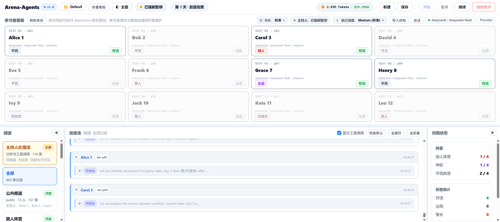

# Arena-Agents · AI 狼人杀（Werewolf）多智能体博弈沙盒

[English](README.en.md) | **简体中文**

**Arena-Agents 是一个开源的 AI 狼人杀、社交推理与多智能体博弈沙盒。** 游戏规则写在可执行
Markdown 剧本中，引擎负责玩家、发言、投票、频道、事件、变量与断点恢复。项目内置一套完整的
12 人狼人杀，也可以用同一引擎运行其他社交推理、剧本杀或桌游规则。

关键词：**AI 狼人杀、狼人杀、多智能体狼人杀、AI 多智能体博弈、社交推理、LLM 智能体、
AI 桌游、AI 剧本杀、social deduction、AI Werewolf、LLM Werewolf**。

[](LICENSE)
[](CHANGELOG.md)
[](https://www.python.org/)
[](https://fastapi.tiangolo.com/)



## 主要能力

- **可执行 Markdown 剧本**：角色、阶段、流程、事件钩子、胜负条件与看板规则都在
  `scenarios/*.md` 中，不写死在 Python 条件分支里。
- **多 Provider / 多模型**：支持 OpenAI Chat Completions、OpenAI Responses、Anthropic
  Messages；主持人及每位玩家可以使用不同模型和思考深度。
- **模型模板**：保存 3 个 Provider/模型/思考深度预设，勾选玩家后一键应用。
- **工作文件夹（Workspace）**：每个工作区独立保存 Provider、模板、绑定、对局、日志和加密密钥；
  不同游戏、不同 API 配置不会互相污染。
- **安全运行**：对局运行中锁定模型与工作区；切换工作区必须先暂停并保存成功。
- **本地加密**：Provider 密钥和对局存档使用 AES-256-GCM；Windows 工作区主密钥由 DPAPI 保护。
- **API 端点预览**：保存 Provider 前显示最终消息地址和模型列表地址；支持自动拼接 `/v1/...`
  或直接填写完整自定义 endpoint。
- **可调整的观战界面**：看板/左右栏可折叠，高度和宽度可拖动，玩家卡片提供 4 档尺寸。

## 界面截图

| 对局看板与实时信息流 | 工作文件夹 |
|---|---|
|  |  |
| **Provider 管理与 API 地址预览** | **模型模板与玩家绑定** |
|  |  |

> 截图来自本地演示对局；工作区路径和 Provider 主机名已做像素化脱敏，不包含任何真实凭据。

详细操作见 [docs/ui-guide.md](docs/ui-guide.md)。

## 工作原理

```text
浏览器
  │  REST + SSE
  ▼
FastAPI API ────────────── 工作文件夹
  │                          │
  ▼                          ▼
Game Orchestrator ◄──── Workspace (.arena/)
  │  ├─ 会话运行时           ├─ providers.v1.enc
  │  ├─ 剧本 Director        ├─ settings.json（模板 / 绑定）
  │  ├─ 参与者回合           ├─ sessions/*.enc
  │  └─ 主持人工具           └─ 工作区密钥
  │
  ▼
LLM Client ──► OpenAI Chat / OpenAI Responses / Anthropic Messages 适配器
  │
  └─ 加密用量、价格快照、重试与退避
```

引擎本身不理解“狼人”“警长”“第 2 夜”等游戏概念。Scenario Parser 负责校验 Markdown
剧本，Director 执行步骤、条件、循环、事件和终局判定。模块说明见
[docs/architecture.md](docs/architecture.md)。

## 快速开始

### 环境要求

- Python 3.12
- Node.js 20（仅前端测试需要）
- 一个 Provider API Key（OpenAI 兼容、OpenAI Responses 或 Anthropic）

### 本机运行

```bash
git clone <repository-url> Arena-Agents
cd Arena-Agents

python -m venv .venv
source .venv/bin/activate          # Windows: .venv\Scripts\Activate.ps1
pip install -r requirements.txt

uvicorn app.main:app --host 127.0.0.1 --port 8000
```

打开 <http://127.0.0.1:8000>。

首次启动会创建默认工作区：

```text
Windows: %USERPROFILE%\Arena-Agents\Default
macOS:   ~/Arena-Agents/Default
Linux:   <应用数据目录>/workspace/default
```

Provider 配置在界面中完成，本地使用不需要 `.env`。

### Docker Compose

```bash
cp .env.example .env
# 建议设置 ARENA_API_TOKEN，保护配置写接口
python -c "import base64,secrets; print(base64.urlsafe_b64encode(secrets.token_bytes(32)).decode())" \
  > /secure/arena-master-key

export ARENA_MASTER_KEY_HOST_FILE=/secure/arena-master-key
docker compose up -d --build
```

容器以非 root 用户运行，默认只把 `127.0.0.1:${PORT:-8000}` 映射到宿主机；运行数据位于
`/data/workspace/default/.arena`。主密钥通过 Docker Secret 或独立密钥文件提供，缺失时应用
拒绝写入，不会回退到明文。

## 配置模型

1. 打开 **Provider → 新增 Provider**。
2. 选择协议：OpenAI Chat Completions / OpenAI Responses / Anthropic Messages。
3. 填写名称、Base URL、API Key。
4. 选择是否自动拼接 API 路径：
   - **开启**：Base URL 视为根地址，最终使用 `/v1/chat/completions`、`/v1/responses` 或
     `/v1/messages`，模型发现使用 `/v1/models`。
   - **关闭**：Base URL 就是完整消息地址，原样发送；模型发现关闭，只能手动填写模型 ID。
5. 获取模型（自动拼接开启时可用），每次选择一个模型，手动填写输入/输出价格（美元/1M tokens）。
6. 在 **模型绑定** 中创建模板 1/2/3，或逐人选择 Provider/模型/思考深度。

完整说明见 [docs/providers.md](docs/providers.md)。

## 工作文件夹

工作文件夹是一个普通目录，所有私有运行状态位于 `.arena/`：

```text
<workspace>/
├─ .arena-workspace.json      工作区标记
└─ .arena/
   ├─ master.v1.dpapi         Windows DPAPI 包装的工作区密钥
   ├─ providers.v1.enc        加密 Provider 注册表
   ├─ providers.v1.backup.enc 已知良好备份
   ├─ settings.json           默认绑定、模板、上次对局
   ├─ sessions/<id>/          当前与上一版加密对局
   ├─ logs/  exports/
   └─ workspace.lock
```

- 只有对局处于 idle/paused/finished 时才允许切换工作区；运行中返回 409。
- 切换前会先保存当前对局；保存失败或目标无效时保持当前工作区。
- 原生文件夹选择器只允许本机回环使用；Docker/无桌面环境使用绝对路径输入。
- 代码资源（`config.yml`、`scenarios/`、`prompts/`）由所有工作区共享。
- 早期单目录数据会复制到默认工作区并验证，原文件不会删除。

完整说明见 [docs/workspaces.md](docs/workspaces.md)。

## 界面操作

- **看板**：顶栏按钮整体折叠；左右侧栏在各自头部折叠。
- **拖动**：看板下方横向分隔条改变高度；左右栏分隔条改变宽度；双击恢复默认。
- **卡片尺寸**：紧凑 / 标准 / 大 / 超大。
- 布局与卡片尺寸保存在浏览器 `localStorage`。

## 环境变量

| 变量 | 默认值 | 用途 |
|---|---|---|
| `ARENA_WORKSPACE_DIR` | `%USERPROFILE%\Arena-Agents\Default`（Windows/macOS） | 初始/默认工作区 |
| `ARENA_DISABLE_WORKSPACE` | 未设置 | 设为 1 禁用工作区，退回单目录兼容模式 |
| `ARENA_DATA_DIR` | 平台应用目录 | 应用状态/兼容数据目录 |
| `ARENA_MASTER_KEY_FILE` / `ARENA_MASTER_KEY` | 未设置（Windows 用 DPAPI） | Linux/Docker 的 32 字节工作区主密钥 |
| `ARENA_API_TOKEN` | 未设置 | `/api/*` 访问令牌；SSE 也支持 `?token=` |
| `ARENA_ALLOWED_ORIGINS` | 未设置 | 额外允许的跨源来源 |
| `ARENA_ALLOWED_BASE_HOSTS` | 未设置 | Provider 主机白名单（可选） |
| `ARENA_ALLOW_PRIVATE_PROVIDERS` | `false` | 允许本机/内网 Provider（如 Ollama） |
| `ARENA_MAX_IMPORT_BYTES` | `20971520` | 导入存档大小上限 |
| `ARENA_BIND` | `127.0.0.1` | Docker 宿主机绑定地址 |

## 安全

- Provider Key 加密保存，API 永不返回；修改协议、Base URL 或拼接模式必须重新输入 Key。
- 非 GET 请求校验同源 `Origin`；无 token 时配置写接口仅允许回环客户端。
- Provider URL 阻止云元数据/链路本地地址；本机/内网 Provider 需要显式开启。
- 工作区切换和原生文件夹选择仅限本机；运行中不允许切换。
- 导入存档有大小与结构校验，替换前不会破坏当前对局。
- 默认监听 `127.0.0.1`；对外暴露请配置 TLS 反向代理与 `ARENA_API_TOKEN`。

## 测试

```bash
pip install -r requirements-dev.txt
python -m pytest -q tests
```

测试完全离线，不调用真实 LLM。安装 Node.js 后会运行前端纯函数测试，否则自动跳过。
CI 覆盖 Ubuntu 与 Windows。

当前本地验证：**899 passed, 3 skipped, 101 subtests**。

## 目录结构

```text
app/
├─ api/          REST + SSE、Provider、模板、工作区
├─ engine/       编排、剧本 Director、参与者回合、恢复
├─ llm/          三协议适配器与 API 端点规划
├─ providers/    加密 Provider 注册表与模型元数据
├─ storage/      工作区、设置、对局、加密
└─ migration.py  旧数据迁移
scenarios/       可执行 Markdown 剧本
prompts/         提示词模板
knowledge/       可选策略资料
static/          单页观战界面
tests/           离线回归、API、存储与 UI 测试
docs/            架构、Provider、工作区与 UI 文档
```

## 版本说明

当前稳定版本为 **0.11.0**，重点是多 Provider/多模型、加密工作区、模板、可调整布局和端点预览。
更早的发布仅做概括，不展开逐项版本历史；高层发布说明见 [CHANGELOG.md](CHANGELOG.md)。

## 文档

- [架构](docs/architecture.md)
- [Provider 与模型](docs/providers.md)
- [工作区与加密数据](docs/workspaces.md)
- [界面操作指南](docs/ui-guide.md)
- [English README](README.en.md)
- [发布说明](CHANGELOG.md)

## 贡献

欢迎提交 Issue 和 Pull Request。提交前请：

1. 游戏规则放在 `scenarios/`，引擎保持游戏无关。
2. 行为变更附带离线测试。
3. 不要提交 `.env`、API Key、工作区、本地路径或运行数据。
4. 运行 `python -m pytest -q tests` 和 `node --check static/js/*.js`。

## 许可证

MIT，见 [LICENSE](LICENSE)。
