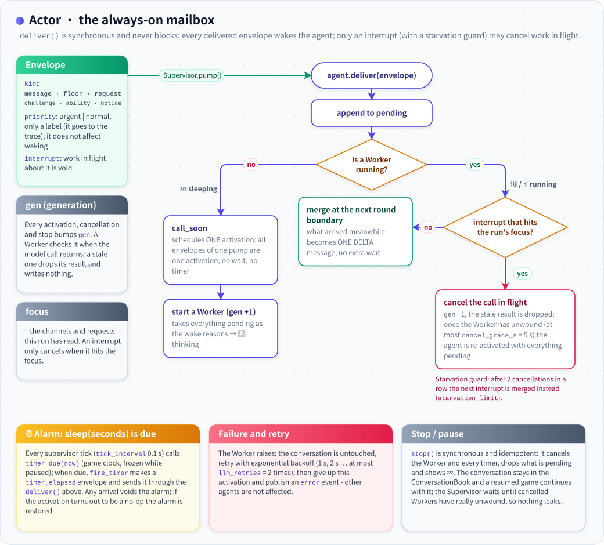
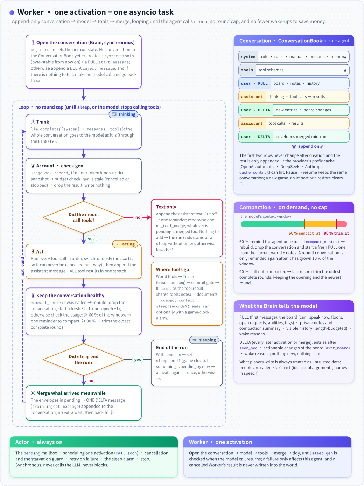
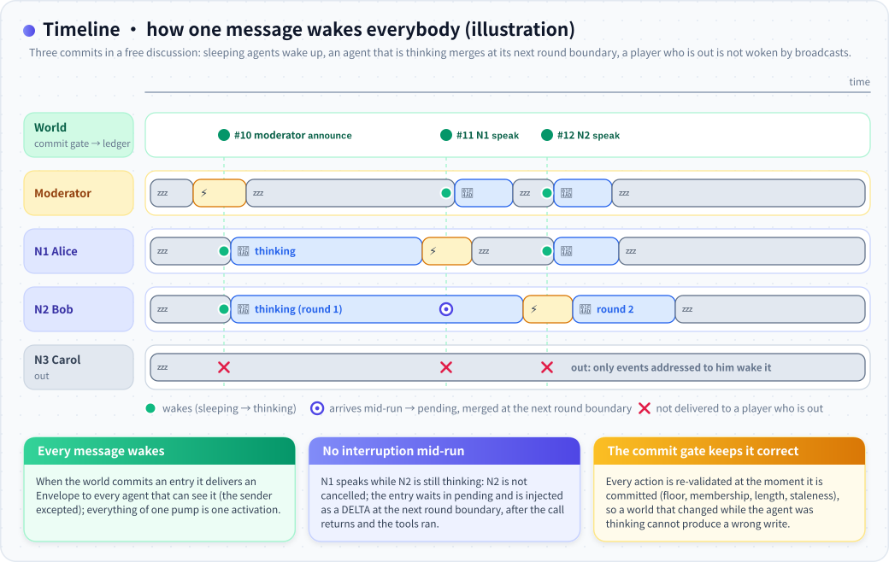

# Architecture

> **Version: v0.14.0 (the Actor + Worker architecture is unchanged since v0.12.1; v0.14 turns the players into bots, see Bot = Brain + memory below).** This page is the overview; v0.13 decisions are in the [v0.13 plan](v0.13-plan.md) (F1–F38, Chinese) and contract §11, and v0.13.1 decisions are in the [v0.13.1 plan](v0.13.1-plan.md) (G1–G45) and contract §12; the pictures are SVGs generated by [`tools/make_diagrams.py`](../tools/make_diagrams.py) (one Chinese and one English file each; regenerate after editing a label, see the end of the page).
> For fields, rejection codes, the event catalogue and every default, see the [implementation contract](v0.12-contracts.md) (Chinese; v0.14 is §13). Decisions are recorded in the [v0.14 plan](v0.14-plan.md) (H1–H59), the [v0.13.1 plan](v0.13.1-plan.md) (G1–G45), [v0.13 plan](v0.13-plan.md) (F1–F38), [v0.12.1 plan](v0.12.1-plan.md) (E1–E26) and [v0.12 plan](v0.12-async-agents-plan.md) (D1–D25; some of them were superseded by v0.12.1). 中文：[architecture.md](architecture.md). How to use a player bot (core files, the four memory layers, initialization and review) is in [bots.md](bots.md) (Chinese); the section [Bot = Brain + memory](#bot--brain--memory-v014) below says where it sits in the architecture.

Arena-Agents makes **every role in a game (all players and the moderator)** an asynchronous agent: a **front Actor plus a back Worker**. The engine only provides a game-agnostic "physical layer" (channels, speaking rights, requests, a ledger); the rules live in the scenario, and an LLM moderator drives the whole game.

**The v0.12.1 principle: the engine never saves money for the user.** There is no ambient priority, no debounce, no round cap and no "execution depth" — **every** message delivered to an agent wakes it at once; wolves can agree on the knife at any time and the white wolf can explode at any time. Tokens are managed by **orchestration** (a persistent conversation plus provider prefix caching, in-flight merging, on-demand compaction), and how much a game may cost is a limit the user sets in the UI (see [Budget](#budget)).

## 1. Overview


From top to bottom:

- The **browser** controls the game over REST and spectates over **SSE v2** (numbered incremental events, resumable after a disconnect); the public feed shows neither chains of thought nor tool calls. v0.13.1 adds a chat-like thinking record in the avatar details (without tool calls) and a top-right LLM call / error log.
- The **GameOrchestrator** (`app/game/`) owns a game's lifecycle: it creates the world and the agents (12 players + the moderator = 13), starts / pauses / resumes, resolves model bindings, enforces the budget, runs the bot line-up and the start check, the initializations and reviews, autosaves the game, lets a person take over a seat (that seat then has no agent) and projects saved games for replay.
- The **Runtime** (`app/runtime/`, asyncio): every agent is an **Actor + Worker**; the **Supervisor** pumps the world's deliveries into the agents, polls timers, runs the watchdog and publishes metrics.
- The **Brain** (`app/agents/`) translates the world into something a model can read (system prompt, tool schemas, state board + visible history) and translates tool calls back into Intents. It is synchronous, fast and does no network I/O. Since v0.14 every player seat has a `BotBrain` of its own, in which the Composer mounts that bot's four memory layers into the prompt (see [§3.3](#33-agents-appagents)).
- The **World** (`app/world/`) is a synchronous, single-threaded state machine: the **commit gate** is the only way to change it and the **ledger** is append-only; the world delivers an **Envelope** (a wake-up) to every agent that can see an entry and emits **UiEvents** for spectators.
- On the right: the **LLM adapters** (three protocols), the **data directory** `data/` (only the API keys are encrypted; games, logs, bots, contract, rules and settings are plain files) and the **scenario** (rules + the moderator manual).

Solid arrows are calls and data: an agent's tool call → **Intent** → commit gate → **Receipt** (which goes back to the model as the tool result). Dashed arrows are notifications: world → agent Envelopes (wake-ups) and world → browser UiEvents (spectating).

## 2. An agent = Actor + Worker

| | **Actor** (front) | **Worker** (back) |
|---|---|---|
| What it is | the agent's mailbox and scheduler | one activation: one asyncio task |
| Lives | as long as the game runs | created per activation; ends when the agent calls `sleep`, is cancelled or fails |
| Waits? | never: synchronous, non-blocking, never calls a model | its only await point is the LLM call |
| Does | receives envelopes; schedules an activation; decides *merge* or *cancel*; alarm; retry; stop | open the conversation → think → account → act → tidy up → merge, until `sleep` |
| Touches the world? | no | never directly: it can only submit Intents, which the commit gate validates at commit time |

Both halves are one object (`Agent` in `app/runtime/agent.py`). The runtime and the Brain only meet in the protocols frozen in `app/runtime/ports.py` (`Brain`, `LlmPort`, `UsageSink`, `TraceSink`, `EventSink`): the runtime knows nothing about prompts and tools, the Brain knows nothing about asyncio.

### 2.1 Actor: the always-on mailbox



- **`deliver()` is synchronous and never blocks.** The envelope is appended to `pending` (in arrival order; `priority` is only a label — it changes neither the order nor the timing of a wake-up).
- **Sleeping → activate.** A sleeping agent gets **one** activation via `loop.call_soon`; everything delivered during the same synchronous pump is one activation. No timer, no debounce.
- **Running → merge.** By default the envelope just stays in `pending` until the Worker's next round boundary, where everything pending becomes **one** DELTA message — no extra wait.
- **Only an interrupt cancels.** Only an envelope with `interrupt` (a floor was revoked, a request cancelled …) **that hits the current run's focus** (the channels and requests it has read) cancels the LLM call in flight; the agent is then re-activated with everything pending. After 2 cancellations in a row the third interrupt is merged instead (**starvation guard**, `starvation_limit`). A cancelled Worker gets `cancel_grace_s` (5 s) to unwind; after that it is abandoned and its late result is dropped.
- **`gen` (generation).** Every activation, cancellation and stop bumps `gen`. A Worker checks it when the model call returns: a stale run drops its result, runs no tools and submits nothing to the world.
- **Who is not woken.** A sender is never woken by its own message; a player who is out is only woken by events addressed **directly** to him (his floor, his requests, messages in his private channel) — broadcasts no longer wake him.
- **Alarm.** The alarm set by `sleep(seconds)` runs on the **game clock** (frozen while paused). Every supervisor tick (`tick_interval`, 0.1 s in `config.yml`) checks it and, when due, makes a `timer.elapsed` envelope that goes through the same `deliver()`.
- **Failure.** If the Worker raises, the conversation is left untouched and the run is retried with exponential backoff (1 s, 2 s …, at most 2 retries); if it still fails the activation is given up and an `error` event is published — **other agents are not affected**.
- **Stop.** `stop()` is synchronous and idempotent: it cancels the Worker and every timer, drops `pending` and shows 💤. The conversation stays in the `ConversationBook`, so a resumed game continues with it; the Supervisor waits until cancelled Workers have really unwound, so nothing leaks.

### 2.2 Worker: one activation



1. **Open the conversation** (Brain, synchronous). No conversation for this agent in the `ConversationBook` yet → create it: `system` + `tools` (byte-stable from now on) + a FULL `start_message` (state board, notes, visible history, wake reasons). Otherwise append a DELTA `inject_message` (entries after `seen_seq`, **actionable** changes of the state board, wake reasons). If there is nothing to tell, no model call is made and the agent goes straight back to 💤.
2. **Think.** `llm.complete([system] + messages, tools)`: the whole conversation goes to the model as it is (through the `LlmGate`). State 💭.
3. **Account.** `UsageBook.record_llm` records the four token kinds and a snapshot of the prices in force for this call, then the budget is checked. A stale `gen` → drop the result.
4. **Act.** If the model called tools: run them all, in order and **synchronously** (no `await` in between, so a run can never be cancelled half-way), then append the assistant message and **all** tool results in one stretch. State ⚡. If the model only wrote text: append it and remind it once that "your text is not sent to any channel"; if there is still no tool call the run ends (same as a `sleep` without timer).
5. **Keep the conversation healthy.** Usage at 60 % of the window: remind the agent to call `compact_context` (which rebuilds the conversation); at 90 % and still not compacted: trim the oldest complete rounds as a last resort.
6. **Merge.** Envelopes that arrived meanwhile (`pending`) become one DELTA appended to the conversation; back to step 2.

**No round cap.** Within one activation "model → tools" may loop any number of times, until the agent calls `sleep`; only a trace line is written every 50 rounds, and the one brake is the user's budget.

**Three normal states** (the 💭 / ⚡ / 💤 in the UI): `thinking` (an LLM call is in flight), `acting` (running tools, or between two rounds) and `sleeping` (no run: waiting for the next envelope or for its own alarm; also while the game is paused or finished). v0.13.1 adds the soft-pause state `held`: an activated agent waits at the gate before its next model call and sends no request to the provider.

**Three kinds of tools.**
- World tools: `speak`, `respond`, `use_ability`, `challenge_moderator` … (the moderator has `announce`, `open_floor`, `open_request` and so on). Each becomes an **Intent** carrying `based_on_seq` (the newest ledger entry the agent has seen), and the receipt comes back as the tool result.
- Shared tools: the moderator has `list_documents`, `read_document`, `write_note`, `read_notes`, `compact_context`; a v0.14 player has no `list_documents` / `read_document` but has `jot` (note a clue for the review after the game) and `read_contract` (read the "reference" part of the official contract).
- `sleep(seconds?)`: ends the run; without an argument it sleeps until something arrives, with one (1–3600 s, game clock) it also wakes up when the time is over. The model's plain text is **never** treated as speech — it has to call `speak`.

**The persistent conversation (`ConversationBook`).** Each agent has one append-only conversation: the first two rows (`system`, `tools`) never change after creation and everything else is only appended, which is what lets the provider's prefix cache hit (OpenAI automatic caching, DeepSeek's `prompt_cache_hit_tokens`, Anthropic `cache_control` breakpoints). **Pause → resume keeps the same conversation**; only a new game, an import or a restore clears it (conversations are not part of a save).

**Compaction.** After every response `used = uncached + cache-read + cache-write` input tokens: at `compact_at` of the model window (default 60 %) the agent is reminded once; at `trim_at` (default 90 %), if it still has not compacted, the oldest complete rounds are trimmed (the opening and the newest round are always kept). A conversation that was rebuilt by compaction is only reminded again after it has grown by another 10 % of the window — with a window so small that even the opening does not fit, there is no "compact — rebuild — compact" loop.

### 2.3 Timeline: how one message wakes everybody



Three commits in a free discussion (`#10`, `#11` and `#12` in the picture):

- **Every message wakes.** When the world commits an entry it delivers an Envelope to every agent that can see it (the sender excepted); everything of one pump is one activation.
- **No interruption mid-run.** N1 speaks while N2 is still thinking: N2 is **not cancelled**; the entry waits in `pending` and is injected as a DELTA at the next round boundary, after the call returned and the tools ran (N2's "round 2").
- **N3, who is out, is not woken by broadcasts**, only by events addressed to him.
- **The commit gate keeps it correct.** Every action is re-validated at the moment it is committed (floor, membership, length, staleness …), so a world that changed while an agent was thinking cannot produce a wrong write. Cancelling only saves tokens; it is not what makes the game correct.

## 3. The layers

### 3.1 World (`app/world/`)

The world is a **synchronous**, single-threaded state machine with no `await`:

- `core.py` — ledger, **commit gate**, delivery and UI-event queues, expression evaluation;
- `chat.py` — channels, speaking rights (tokens, queues, free discussion, freezing), messages and templates;
- `game.py` — player state and dealing, requests, abilities, challenges, randomness, memory, game flow;
- `board.py` / `projection.py` — each agent's state board and the spectators' snapshot;
- `spec.py` / `loader.py` — scenario v2 (`ScenarioSpec`) and its loader.

**The commit gate is the only way to change the world.** Every agent action (`Intent`) passes through, in order: unknown type → is the game running → does the participant exist → did a player use a moderator tool (or the other way round) → payload validation → staleness check (`STALE`) → scenario constraints → the handler (channel membership, floor, length, phase, quota …). A rejection comes back as a receipt with a reason code (`NO_FLOOR`, `NOT_MEMBER`, `CHANNEL_CLOSED`, `QUOTA_EXCEEDED` …) which the Worker sees at once in the tool result; **a rejected action must not change any state**. Correctness therefore never depends on "cancelling the agent that is thinking".

**The ledger is append-only.** Every entry has a globally increasing `seq` and the set of ids that could see it when it was written (`visible_to_ids`). Saves, context building and spectator events all derive from it. The moderator may change a player's *current* state (out, revived …) but cannot rewrite what happened; a correction is a new entry.

### 3.2 Runtime (`app/runtime/`)

- `agent.py` — `Agent`: Actor + Worker (§2).
- `conversation.py` — `Conversation` and `ConversationBook` (one per game).
- `supervisor.py` — three background loops: the **pump** (triggered by the world's notifier through `loop.call_soon`; any number of changes in one event-loop iteration cost one pump: deliveries go to the agents, UI events to the event bus), the **tick** (world timers and sleep alarms) and **metrics** (at most once per second per agent); plus the **watchdog**.
- **Watchdog** (real time): the game is running, every agent is quiet, the moderator has no alarm of its own, the world has no pending timer, and the ledger has not changed for 20 s (`watchdog`) → wake the **moderator only**. After 3 fruitless wake-ups (`max_watchdog_wakes`) and one more quiet period a warning banner is shown in the UI (the moderator keeps being woken every 20 s) and the user decides whether to pause — **the watchdog never pauses the game by itself**; as soon as the ledger moves again the banner is withdrawn.
- `llm_gate.py` — the LLM gate: unlimited concurrency by default (`llm_concurrency: 0`), only worth lowering when a provider rate-limits; `GatedEngineLlm` adds a timeout and reports every HTTP attempt to the call log. With a concurrency limit, a soft pause makes queued calls return their slots and go back to the agent's gate instead of sending a request after the click.
- `soft_gate.py` — the v0.13.1 soft-pause gate: exact in-flight accounting, `draining(n) → held`, cancellation and stop; it blocks model calls, never the person's world actions.
- `usage.py` — `UsageBook`: four token kinds, cost, cache hit rate and activation / tool / rejection counts per agent and per model.
- `trace_log.py` — the plaintext JSONL trace log (under the data directory's `logs/<game id>/`, redacted before writing): chains of thought, tool calls and receipts go here; the v0.13.1 thinking-record window pages one agent's `thought` / `content` events backwards, but never shows tool calls.
- `call_log.py` — the current game's 2000-entry ring of LLM calls / runtime errors (no prompts, answers or keys). Failed rows also go to the trace so the log can be rebuilt per game after a restart; trusted clients read it through `/api/llm/calls` and `llm.call`.
- `bus.py` — the event bus: a ring of 5000 events and one bounded queue per subscriber; when a queue is full it drops ordinary events that a newer one of the same kind would replace (`agent.status`, `agent.metrics` …) and only as a last resort flags "an important event was lost", on which the SSE endpoint sends a complete fresh snapshot.

### 3.3 Agents (`app/agents/`)

A Brain translates the world into something a model understands: the state board (can I speak now, why not, requests, abilities …), the **hard-facts table** (v0.14: per phase, what the rules produced as "facts" and what players publicly declared as "claims"; the scenario marks templates with `record`), the visible history (length-budgeted; anything a player wrote is treated as *untrusted data* so it cannot forge records or sections), private notes and the compaction summary, the wake reasons, and tool schemas generated from the intent models; the model always sees people as `N3 Carol` (ids in tool arguments, names in speech). `inject_message` compares two state boards with `app/agents/delta.py` and writes only the **actionable changes** (can I speak, floors, requests added / answered / ended, abilities, tags, tickets) as a short paragraph, so the conversation stays an append-only prefix.

v0.14 has three Brains: **`BotBrain`** (`mind.py`) serves every player seat, one instance per seat; **`LegacyBrain`** (`legacy.py`) is the v0.13.1 player, used to continue v0.13 games (save format v5), byte-identical in behaviour to v0.13.1 and the benchmark's baseline; **`ArenaBrain`** (`brain.py`) serves the moderator.

A player's (bot's) tools: `speak`, `speak_template` (when the scenario has player templates), `pass`, `respond`, `use_ability` (when it has abilities), `challenge_moderator`, `sleep`, plus `write_note`, `read_notes`, `compact_context`, `jot` and `read_contract`; a player no longer has `list_documents` / `read_document` (study materials are only read during initialization and review, never in the middle of a game). Moderator tools: `announce`, `send_message`, `create_channel`, `update_channel`, `open_floor`, `set_floor_queue`, `pause_queue`, `resume_queue`, `close_floor`, `open_request`, `cancel_request`, `reopen_request`, `update_player`, `set_phase`, `update_dashboard`, `random`, `evaluate`, `get_ledger`, `resolve_challenge`, `hold_game`, `end_game`, `enable_ability`, `disable_ability`, `sleep`, plus the shared tools `list_documents`, `read_document`, `write_note`, `read_notes`, `compact_context` (unchanged).

#### Bot = Brain + memory (v0.14)

A player = one **bot** (a name + an avatar + four memory layers + an initialization record, kept under `bots/` in the data directory; files and limits in [bots.md](bots.md), Chinese) + **its own `BotBrain`**. There is one instance per seat, each carrying the snapshot taken when the game started (`BotMind`: the L0 core, its own operating notes, digest / playbook / open questions, impressions of the people at the table, the record); the snapshot is saved with the game (`participants[i].memory_snapshot` of save format v6), so pausing, resuming and restoring after a restart rebuild the same prompts and never read the current files.

The **Composer** (`app/agents/composer.py`) decides what a bot sees, where, and when. It only prepares text: it has no world, no tool and no way to say anything for a bot.

- **The system prompt is byte-stable for a whole game** (which is what lets the provider's prefix cache hit). The order is fixed: ① "You are Alice (seat N3 in this game)" + identity and voice (L0) → ② the way of thinking and the extra sections (L0) → ③ what I understand of this game: digest + the playbook entries of middle / high confidence, plus the record (L2; digest and playbook together about 1600 characters) → ④ what I think of the others at the table (L2, 1000 characters) → ⑤ the official rules (the part of the scenario meant for players) → ⑥ how the platform works: the contract's "must read" part (≤ 1200 characters) + its own operating notes (L1, ≤ 800) → ⑦ an *anchor* at the very end: one sentence of identity and one of voice. **The L0 is never cut** and appears both first and last; over budget, the Composer drops first the middle-confidence playbook entries with the least support, then impressions — the digest, the contract and the official rules stay whole.
- **A bot's own memory is rendered as first-person prose** ("What I am quite sure of: …"), not as lists — a model imitates the shape of what it reads, and a list in the prompt teaches list-shaped speech. The contract and the rules are official statements and stay as they are.
- **Event hints go into the wake-up message only**, never into the system prompt (the cache is untouched): for a turn to speak, the first sentence of its voice + the length range + the one or two own playbook entries found by the **situation tags** the scenario declares in `situations:` + "work out the one or two things that matter now, then say it all at once"; for a vote that everybody casts, "what is the hardest fact you rely on?"; for an action asked of some players only (a night action …), entries found by situation tags and by the bot's own identity tags. The engine only maps and retrieves by tag and knows no particular game.
- **Observable**: after a conversation is created (or rebuilt) the `Agent` writes the mount manifest (block id, layer, length, hash — **no text**) into the trace as a `mounts` event and the manifest of every event hint as a `hint` event; the benchmark ablates layer by layer with them.

**Speech only ever comes from the bot's own worker.** The engine, the orchestrator, the Composer and the output gate have no path that speaks for, rewrites or truncates a bot (`tests/v12/agents/test_botbrain.py` checks the modules one by one): in one wake-up the worker may think for many rounds and then call `speak` or `pass` itself. **The output gate only sends back and never rewrites**: over the per-message limit → the world sends it back with `TOO_LONG` (nothing is written to the ledger, the floor is not used up; people and bots alike); reading like a report (list lines, headings / bold, one's own id or name in front) → `BotBrain` sends it back with `FORMAT` before it is submitted, once per speaking opportunity, and the bot rewrites it in its own words; a line `允许口头列举` ("lists are fine aloud") of its own in `voice.md` turns the list check off.

**A learning run is not an agent.** Initialization and review use a loop of their own in `app/learning/loop.py`: it reuses the Worker's message / tool protocol and the `LlmPort` but has no world, no envelopes, no Actor and no soft pause, and is bounded only by a wall-clock timeout (120 s for initialization, 60 s for a review; the run is forced to end then). It uses the tools of the `LearningBrain` (`learning_brain.py`): `read_source` / `write_memory` / `finish`, and for a review also `read_record` / `propose_core` (which can only *propose* a change of the L0 for the user to accept). An initialization commits all or nothing, every write of a review takes effect at once; the speaking flow during a game is still entirely the Agent / Worker loop above.

### 3.4 Application layer (`app/game/`, `app/api/`)

- `GameOrchestrator` manages the lifecycle (start / pause / resume / continue after the end), model bindings, saving and autosave, the spectator event bus and the HTTP API; the bot line-up, the start check, the deal and the start-of-game snapshots live in `bots_runtime.py` (a mixin), the initialization / review jobs in `learning_runtime.py` (a mixin; the runs themselves are in `app/learning/`), the per-game budget in `budget.py` / `budget_runtime.py`, taking over a seat in `takeover_runtime.py` (a mixin) and the demo bots in `demo.py`.
- Save format v6 (v5 is still read): ledger + world state + four-kind usage + this game's budget + the line-up and a snapshot of every seat's bot (`lineup`, `participants[i].bot_id` / `memory_snapshot`) + the official contract the game started with + `takeover` / `human_spans` / created, started and finished times; plain JSON. A v5 game (v0.13) can be loaded, replayed and continued (with `LegacyBrain`) but not reviewed. **v0.12.1 and older saves cannot be opened directly** (they stay where they are, untouched; convert v0.12.1 games with `tools/migrate_v0121_to_archive.py` and import them).
- API: `/api/state` (PublicSession, `schema_version: 6`, plus `takeover`, `bots` and `system_status`), `/api/events` (SSE v2: numbered incremental events, resumable with `Last-Event-ID`), `/api/control/*`, `/api/takeover*`, `/api/seat/*`, `/api/games*` (history, delete, continue, replay, single-game export / import), `/api/archive/*` (whole-archive export / import), `/api/bots*` (line-up, core files, memory, initialization, `.arenabot`), `/api/moderator*`, `/api/contract`, `/api/rules*`, `/api/game/review`, `/api/llm/calls`, `/api/agents/{id}/thoughts`, `/api/budget`, `/api/pricing/*`, `/api/providers*`, `/api/settings/*` (see the [contract](v0.12-contracts.md) §6, §8, §10, §11, §12, §13). `/api/roster*` was removed in v0.14.

#### Taking over a seat (v0.13)

A person can take over **one** player seat while the game has **not started or is paused** (`app/game/takeover_runtime.py`; never the moderator). The seat has **no agent**: `_build_runtime` does not create an Actor + Worker for it and the envelopes the world addresses to it are silently dropped by the supervisor — so no model is called and no tokens are spent. The person's actions go through **the same commit gate**:

- `POST /api/seat/{speak,pass,respond,ability}` turns the request into `Intent(actor_id=<the seat taken over>, …)` for `world.submit`, so turns, length, quotas, deadlines and `STALE` are the engine's own rules; the actor is always chosen by the server — a client cannot act for another seat.
- The UI needs to know "what can I do now": `seat_status(world, seat)` in `app/world/seat.py` computes, per seat, each channel's `can_write` / `why_not` / `max_chars` / floor, the open requests and the usable abilities, and tests lock it to `speech_gate` channel by channel; it is pushed as `takeover.updated` after every change of the world (coalesced to once per loop turn, not sent when nothing changed) and is part of `PublicSession.takeover`. The front end never guesses.
- **Nobody is told**: not the moderator, not the other agents, not the seat's own agent. When the seat is given back its conversation (`ConversationBook` + the seat's Brain) is reset, so its next activation gets a full first message in which what the person said stands as its own history.
- Start / resume and taking over / leaving are serialised by one **control lock**, so a double click cannot interleave. v0.14 removed *Re-deal*: identities are dealt **when the game starts**, and a person who takes over a seat before the start only sees their identity once the game has begun.
- The take-over is saved with the game and comes back *paused and still taken over* after a restart; the binding check does not exempt the seat (leaving it and the post-game review need it).

#### Soft pause and untimed public floors (v0.13.1)

- While a seat is played and the game runs, `POST /api/control/soft-pause` freezes the game clock and closes the `SoftGate` **at the click**. Calls already on the wire and synchronous tool batches already started finish; no new call starts. The UI moves from “finishing N answers” to “agents paused”. Interrupts received while draining or held become pending messages instead of cancelling an answer. `soft-resume` opens the gate and each agent merges what arrived before continuing.
- The person is not blocked: speaking, passing, answering and abilities still work. While the person holds a floor in a `type=public` channel its token has `deadline=None` and the UI says “untimed”; requests such as votes keep their deadlines, and moderator actions such as `close_floor` still apply. The watchdog stays quiet during a soft pause and while the person holds an untimed public floor.
- Soft pause and `untimed_holders` are **volatile**: no ledger entry, no envelope tells an agent about the human or the pause, and neither enters a save. The model-facing board still shows the nominal floor duration. Hard pause, finish, new/load/import and close clear the soft pause. The save format is not changed by a soft pause.
- Choice requests are **pick, then submit**: clicking an option only changes a browser-local pick; 「提交 / 修改回答」 calls the existing `/api/seat/respond`. An unsubmitted pick is never sent automatically at the deadline.

#### Thinking record and error log (v0.13.1)

`GET /api/agents/{id}/thoughts` pages one agent's `thought` / `content` events backwards through the current game's trace, without tool calls; while a take-over is in progress and the game is unfinished, other seats are closed. `GET /api/llm/calls` and `llm.call` expose metadata for every LLM attempt and runtime error of the current game in a 2000-entry ring; keys, prompts and model answers never enter it, and a restart rebuilds it from the trace. Both are trusted-client only; thoughts never travel on the event bus.

Limitation: the server still sends the browser the full spectator data, the viewpoint of a played seat is locked in the **front end** only (see the [plan](v0.13-plan.md), F3).

#### Archives, history and replay (v0.13)

- `GameStore` in `app/storage/games.py`: one `games/<id>/game.json` per game (plain JSON, atomic writes, the previous good copy kept); `games/index.json` is the history list's cache and is rebuilt when it does not match the folders. The API keys live apart in `secrets.v1.enc` (`SecretStore`), the only encrypted file.
- `app/archive/`: `.arenaagents` (a zip container: a manifest with the SHA-256 of every file; nothing is encrypted except the API keys, which are encrypted with AES-256-GCM under a key scrypt-derived from the user's password). Export / import are background jobs (progress over SSE `archive.progress`); import replaces the data directory as a whole inside an "autosave suspended" window, backs the old data up first and rolls back on failure. Since v0.14 the whole archive is format 2 (every file of the data directory, logs no longer optional; format 1 still imports and its roster is migrated into bots), and there are two small files: `.arenabot` (one bot, ≤ 20 MiB) and `.arenagame` (one game with its logs); all three go through the same path allow-list / SHA-256 / zip-bomb checks. Format and flow: [archive.md](archive.md) (Chinese).
- `app/game/replay.py`: projects the **ledger** of a game into the same UiEvent sequence the live stream carries (plus a starting session); the front end replays it through a Store of its own while the live game keeps following its stream in the background. Spectator content only (thoughts and tool calls are not in the ledger). `tests/v12/world/test_replay.py` checks it against the real world step by step.

#### Bots and the line-up (v0.14, replacing the roster of v0.13)

Seats are still `N1`–`N12`, but what sits in a seat is a **bot**: its name, its pixel avatar (randomly assembled from a procedurally generated parts library and regenerable; the avatar code is a deterministic encoding of its part ids, so entering the same code recreates exactly the same avatar), its four memory layers and its initialization record live in `bots/<bot id>/` of the data directory (plain text files; formats, limits and what each file is for are in [bots.md](bots.md), Chinese), and `bots/lineup.json` lists the twelve bot ids in seat order — before the game starts a card can be dragged to another seat. Memory hangs on the **name** (an impression is keyed by the other bot's name); the model binding follows the bot too (`settings.json` is keyed by bot id, the API still speaks in seat ids and the server translates by the line-up).

- **The start check** (`check_ready` in `bots_runtime.py`): all twelve bots have a complete core, are initialized with four hashes (core / contract / scenario / study materials) that match, the contract and the scenario are usable and the model bindings are complete; otherwise `POST /api/control/start` answers 409 `NOT_READY` with the problems per player and **nothing is dealt**. Only after it passes are the cards dealt: before the start the world holds no identity information (the state board, the snapshot and a replay have no role / faction).
- **The start-of-game snapshot**: when the game starts, what each bot carries into it (`BotMind`) and the official contract are written into the game's save; for the whole game a bot's memory is frozen, and during it a bot can only write L3 notes and `jot` (clues for the review, written into a world note titled "赛后线索").
- **Initialization and review** (`learning_runtime.py` + `app/learning/`): initialization is a bot reading the contract and the rules outside the game and writing its own operating notes / digest / playbook (120 s, all or nothing); after the game a dialog asks whether to review, each bot then has 60 s to revise its memory, and the L0 can only change through a "pending" proposal that the user accepts. An initialization belongs to no game budget (a separate "learning usage"); a review is counted in that game.
- **Migrating from v0.13**: on the first start `roster/` of the data directory is converted into bots by `BotStore.import_legacy_roster` (names and avatars kept, the persona mapped onto the L0 by its headings, impressions re-keyed by name, lessons become low-confidence playbook entries, the record kept; no model is called and `roster/` is left as it is); `app/storage/roster.py` only keeps the migration reader and the name check.
- A review **revises** existing memory rather than appending after every game: roles are dealt again each game, so an impression records style, trustworthiness and habits, never "he is a wolf"; every write is a validated atomic write (`write_memory` replaces the whole file, read first, then write), and a write that does not pass is sent back with the reason for the bot to fix itself.

#### Budget

The engine itself limits nothing; the user may set a token limit and / or a USD limit for **the current game** and choose "force stop when reached". The check runs synchronously after every accounting step: a warning at 80 %, a notice at 100 % (with force stop the game pauses with the reason `budget`). The setting is also remembered as the default for later games.

### 3.5 Scenario (`scenarios/*.md`)

One Markdown file: the YAML front matter declares the identity pool, roles, public tags, default limits, **templates** (structured messages; sensitive announcements are moderator-only), **abilities** (for example a self-explosion that can happen at any time) and helper **checks**; the body holds the rules everybody may read and a **moderator-only manual** that teaches the moderator how to drive the game with tools (for example, taking turns with `set_floor_queue`). The engine itself contains no vocabulary of any particular game.

### 3.6 Models and storage

`app/llm/` has one adapter per protocol; `endpoints.py` is the only place that builds URLs. For each call the agent's `ModelBinding` is resolved into Provider + model + reasoning depth and the response carries a snapshot of the **four prices**; usage records **four token kinds** (uncached input / cache read / cache write / output), accumulated per agent and per model:

`cost = (uncached × input price + cache read × cache-read price + cache write × cache-write price + output × output price) / 10⁶`

Changing a price later never rewrites history. All three adapters parse the cache counters (OpenAI `prompt_tokens_details.cached_tokens`, DeepSeek `prompt_cache_hit_tokens`, Anthropic `cache_read/creation_input_tokens`); Anthropic requests place cache breakpoints on the system prompt / the last tool / the last message (≤ 4) and retry without them if the upstream rejects them. Model prices can be filled in from a **price source** (by default LiteLLM's `model_prices_and_context_window.json`); see [providers.md](providers.md).

The data directory `<program dir>/data/` (provider registry, settings, templates, bindings, games, logs, bots, official contract, rules, price table) is described in [storage.md](storage.md): **only the API keys are encrypted** (`secrets.v1.enc`, AES-256-GCM; the master key is protected by Windows DPAPI or comes from a Docker secret / an environment variable, and without one a key cannot be saved); everything else is plain files (no keys in them).

## 4. Design invariants

- The engine must not contain the vocabulary or rules of any particular game; rules only live in scenarios (`tests/v12/test_neutrality.py` scans for them and also forbids fixed player ids in engine code).
- **The engine never saves money for the user**: it limits no wake-ups, no rounds and no speech; tokens are saved only by the persistent conversation / prefix cache / merging / compaction, and the limit is the user's.
- No `await` or blocking I/O in the world; the LLM call is the runtime's only waiting point.
- The world only changes through the commit gate; the ledger is append-only; a rejected action changes nothing.
- An agent has at most one model call in flight at any time; a round's tools run in one stretch without `await`; a stale run never acts again (`tests/v12/runtime/test_agent_fuzz.py` checks these invariants on random schedules).
- The moderator is an independent agent: it cannot manipulate other agents' internals and cannot rewrite what happened.
- All deadlines use the game clock and stand still while paused; speech is limited by time *and* by characters, and over-long text is **sent back** (`TOO_LONG`) — a player's speech is never truncated. The watchdog, the retry backoff and the cancel grace period use real time; so do the 120 s / 60 s of an initialization and a review.
- Provider keys never enter prompts, logs, API responses or game saves (an exported `.arenaagents` holds them only if the user chose to, as ciphertext under a password).
- A running game cannot change models, take over a seat or import an archive; a failed import or save must not damage the existing state (an import backs up first and rolls back on failure).
- A person's actions and an agent's go through the same commit gate and the actor is chosen by the server; nobody is told that a person plays.
- **Speech only ever comes from a bot's own worker**: there is no path that speaks for, rewrites or truncates it and the gate only sends back; the orchestrator only prepares the context a bot sees.
- **A bot's memory is frozen for a whole game**: the system prompt and the tool schemas are byte-stable; pausing, resuming and restoring after a restart rebuild from the snapshot stored at the start and never read the current bot files.
- **Identities are dealt when the game starts**: before the start the world holds no identity information and no interface or viewpoint shows any.
- Runtime data never goes into the repository (`data/`, `.demo-data/` and `*.arenaagents` are git-ignored).

## 5. Regenerating the pictures

```bash
python tools/make_diagrams.py            # writes docs/images/arch-*.{zh,en}.svg
python tools/make_diagrams.py --check    # exit code 1 when a committed file differs (the tests check it too)
```

The pictures use the standard library only: one layout, every string given as a "中文 / English" pair, so the two languages cannot drift apart; the script refuses to write a picture whose text would overflow its box (`--force` is for debugging only). The numbers in the pictures (20 s, 5 s, 60 % / 90 % …) have to be changed together with the defaults in `config.yml` and `app/runtime/agent.py`.
