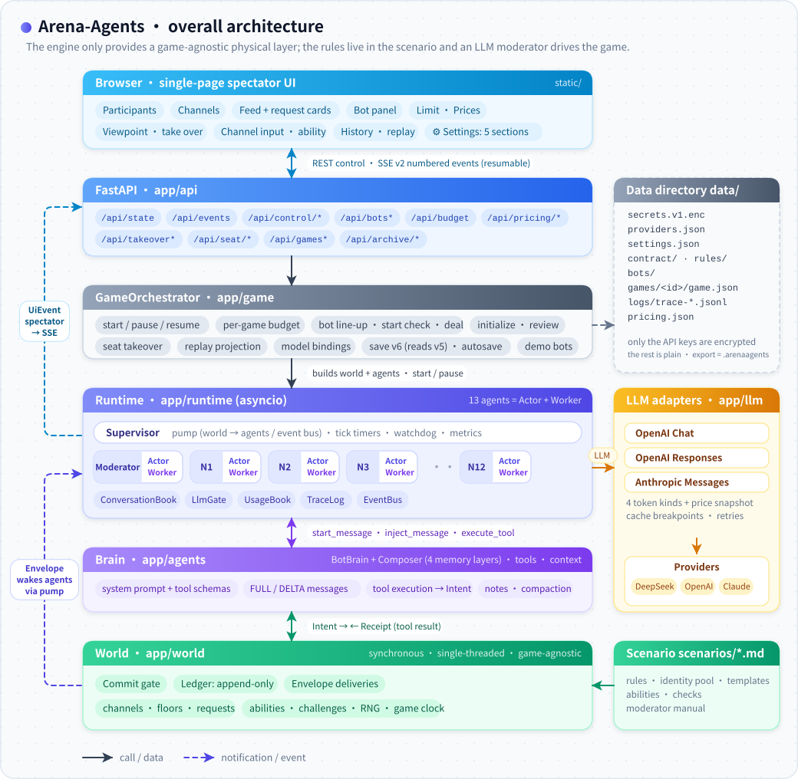

# Architecture

> **Version: v0.13.0 (the Actor + Worker architecture is unchanged since v0.12.1).** This page is the overview; v0.13 decisions are in the [v0.13 plan](v0.13-plan.md) (F1–F38, Chinese) and contract §11; the pictures are SVGs generated by [`tools/make_diagrams.py`](../tools/make_diagrams.py) (one Chinese and one English file each; regenerate after editing a label, see the end of the page).
> For fields, rejection codes, the event catalogue and every default, see the [implementation contract](v0.12-contracts.md) (Chinese). Decisions are recorded in the [v0.12.1 plan](v0.12.1-plan.md) (E1–E26) and the [v0.12 plan](v0.12-async-agents-plan.md) (D1–D25; some of them were superseded by v0.12.1). 中文：[architecture.md](architecture.md).

Arena-Agents makes **every role in a game (all players and the moderator)** an asynchronous agent: a **front Actor plus a back Worker**. The engine only provides a game-agnostic "physical layer" (channels, speaking rights, requests, a ledger); the rules live in the scenario, and an LLM moderator drives the whole game.

**The v0.12.1 principle: the engine never saves money for the user.** There is no ambient priority, no debounce, no round cap and no "execution depth" — **every** message delivered to an agent wakes it at once; wolves can agree on the knife at any time and the white wolf can explode at any time. Tokens are managed by **orchestration** (a persistent conversation plus provider prefix caching, in-flight merging, on-demand compaction), and how much a game may cost is a limit the user sets in the UI (see [Budget](#budget)).

## 1. Overview



From top to bottom:

- The **browser** controls the game over REST and spectates over **SSE v2** (numbered incremental events, resumable after a disconnect); the UI never shows chains of thought or tool calls.
- The **GameOrchestrator** (`app/game/`) owns a game's lifecycle: it creates the world and the agents (12 players + the moderator = 13), starts / pauses / resumes, resolves model bindings, enforces the budget, runs roster and review, autosaves the game, lets a person take over a seat (that seat then has no agent) and projects saved games for replay.
- The **Runtime** (`app/runtime/`, asyncio): every agent is an **Actor + Worker**; the **Supervisor** pumps the world's deliveries into the agents, polls timers, runs the watchdog and publishes metrics.
- The **Brain** (`app/agents/`) translates the world into something a model can read (system prompt, tool schemas, state board + visible history) and translates tool calls back into Intents. It is synchronous, fast and does no network I/O.
- The **World** (`app/world/`) is a synchronous, single-threaded state machine: the **commit gate** is the only way to change it and the **ledger** is append-only; the world delivers an **Envelope** (a wake-up) to every agent that can see an entry and emits **UiEvents** for spectators.
- On the right: the **LLM adapters** (three protocols), the **data directory** `data/` (only the API keys are encrypted; games, logs, roster and settings are plain files) and the **scenario** (rules + the moderator manual).

Solid arrows are calls and data: an agent's tool call → **Intent** → commit gate → **Receipt** (which goes back to the model as the tool result). Dashed arrows are notifications: world → agent Envelopes (wake-ups) and world → browser UiEvents (spectating).

## 2. An agent = Actor + Worker

| | **Actor** (front) | **Worker** (back) |
|---|---|---|
| What it is | the agent's mailbox and scheduler | one activation: one asyncio task |
| Lives | as long as the game runs | created per activation; ends when the agent calls `sleep`, is cancelled or fails |
| Waits? | never: synchronous, non-blocking, never calls a model | its only await point is the LLM call |
| Does | receives envelopes; schedules an activation; decides *merge* or *cancel*; alarm; retry; stop | open the conversation → think → account → act → tidy up → merge, until `sleep` |
| Touches the world? | no | never directly: it can only submit Intents, which the commit gate validates at commit time |

Both halves are one object (`Agent` in `app/runtime/agent.py`). The runtime and the Brain only meet in the protocols frozen in `app/runtime/ports.py` (`Brain`, `LlmPort`, `UsageSink`, `TraceSink`, `EventSink`): the runtime knows nothing about prompts and tools, the Brain knows nothing about asyncio.

### 2.1 Actor: the always-on mailbox


- **`deliver()` is synchronous and never blocks.** The envelope is appended to `pending` (in arrival order; `priority` is only a label — it changes neither the order nor the timing of a wake-up).
- **Sleeping → activate.** A sleeping agent gets **one** activation via `loop.call_soon`; everything delivered during the same synchronous pump is one activation. No timer, no debounce.
- **Running → merge.** By default the envelope just stays in `pending` until the Worker's next round boundary, where everything pending becomes **one** DELTA message — no extra wait.
- **Only an interrupt cancels.** Only an envelope with `interrupt` (a floor was revoked, a request cancelled …) **that hits the current run's focus** (the channels and requests it has read) cancels the LLM call in flight; the agent is then re-activated with everything pending. After 2 cancellations in a row the third interrupt is merged instead (**starvation guard**, `starvation_limit`). A cancelled Worker gets `cancel_grace_s` (5 s) to unwind; after that it is abandoned and its late result is dropped.
- **`gen` (generation).** Every activation, cancellation and stop bumps `gen`. A Worker checks it when the model call returns: a stale run drops its result, runs no tools and submits nothing to the world.
- **Who is not woken.** A sender is never woken by its own message; a player who is out is only woken by events addressed **directly** to him (his floor, his requests, messages in his private channel) — broadcasts no longer wake him.
- **Alarm.** The alarm set by `sleep(seconds)` runs on the **game clock** (frozen while paused). Every supervisor tick (`tick_interval`, 0.1 s in `config.yml`) checks it and, when due, makes a `timer.elapsed` envelope that goes through the same `deliver()`.
- **Failure.** If the Worker raises, the conversation is left untouched and the run is retried with exponential backoff (1 s, 2 s …, at most 2 retries); if it still fails the activation is given up and an `error` event is published — **other agents are not affected**.
- **Stop.** `stop()` is synchronous and idempotent: it cancels the Worker and every timer, drops `pending` and shows 💤. The conversation stays in the `ConversationBook`, so a resumed game continues with it; the Supervisor waits until cancelled Workers have really unwound, so nothing leaks.

### 2.2 Worker: one activation


1. **Open the conversation** (Brain, synchronous). No conversation for this agent in the `ConversationBook` yet → create it: `system` + `tools` (byte-stable from now on) + a FULL `start_message` (state board, notes, visible history, wake reasons). Otherwise append a DELTA `inject_message` (entries after `seen_seq`, **actionable** changes of the state board, wake reasons). If there is nothing to tell, no model call is made and the agent goes straight back to 💤.
2. **Think.** `llm.complete([system] + messages, tools)`: the whole conversation goes to the model as it is (through the `LlmGate`). State 💭.
3. **Account.** `UsageBook.record_llm` records the four token kinds and a snapshot of the prices in force for this call, then the budget is checked. A stale `gen` → drop the result.
4. **Act.** If the model called tools: run them all, in order and **synchronously** (no `await` in between, so a run can never be cancelled half-way), then append the assistant message and **all** tool results in one stretch. State ⚡. If the model only wrote text: append it and remind it once that "your text is not sent to any channel"; if there is still no tool call the run ends (same as a `sleep` without timer).
5. **Keep the conversation healthy.** Usage at 60 % of the window: remind the agent to call `compact_context` (which rebuilds the conversation); at 90 % and still not compacted: trim the oldest complete rounds as a last resort.
6. **Merge.** Envelopes that arrived meanwhile (`pending`) become one DELTA appended to the conversation; back to step 2.

**No round cap.** Within one activation "model → tools" may loop any number of times, until the agent calls `sleep`; only a trace line is written every 50 rounds, and the one brake is the user's budget.

**Three states** (the 💭 / ⚡ / 💤 in the UI): `thinking` (an LLM call is in flight), `acting` (running tools, or between two rounds) and `sleeping` (no run: waiting for the next envelope or for its own alarm; also while the game is paused or finished).

**Three kinds of tools.**
- World tools: `speak`, `respond`, `use_ability`, `challenge_moderator` … (the moderator has `announce`, `open_floor`, `open_request` and so on). Each becomes an **Intent** carrying `based_on_seq` (the newest ledger entry the agent has seen), and the receipt comes back as the tool result.
- Shared tools: `list_documents`, `read_document`, `write_note`, `read_notes`, `compact_context`.
- `sleep(seconds?)`: ends the run; without an argument it sleeps until something arrives, with one (1–3600 s, game clock) it also wakes up when the time is over. The model's plain text is **never** treated as speech — it has to call `speak`.

**The persistent conversation (`ConversationBook`).** Each agent has one append-only conversation: the first two rows (`system`, `tools`) never change after creation and everything else is only appended, which is what lets the provider's prefix cache hit (OpenAI automatic caching, DeepSeek's `prompt_cache_hit_tokens`, Anthropic `cache_control` breakpoints). **Pause → resume keeps the same conversation**; only a new game, an identity shuffle, an import or a restore clears it (conversations are not part of a save).

**Compaction.** After every response `used = uncached + cache-read + cache-write` input tokens: at `compact_at` of the model window (default 60 %) the agent is reminded once; at `trim_at` (default 90 %), if it still has not compacted, the oldest complete rounds are trimmed (the opening and the newest round are always kept). A conversation that was rebuilt by compaction is only reminded again after it has grown by another 10 % of the window — with a window so small that even the opening does not fit, there is no "compact — rebuild — compact" loop.

### 2.3 Timeline: how one message wakes everybody


Three commits in a free discussion (`#10`, `#11` and `#12` in the picture):

- **Every message wakes.** When the world commits an entry it delivers an Envelope to every agent that can see it (the sender excepted); everything of one pump is one activation.
- **No interruption mid-run.** N1 speaks while N2 is still thinking: N2 is **not cancelled**; the entry waits in `pending` and is injected as a DELTA at the next round boundary, after the call returned and the tools ran (N2's "round 2").
- **N3, who is out, is not woken by broadcasts**, only by events addressed to him.
- **The commit gate keeps it correct.** Every action is re-validated at the moment it is committed (floor, membership, length, staleness …), so a world that changed while an agent was thinking cannot produce a wrong write. Cancelling only saves tokens; it is not what makes the game correct.

## 3. The layers

### 3.1 World (`app/world/`)

The world is a **synchronous**, single-threaded state machine with no `await`:

- `core.py` — ledger, **commit gate**, delivery and UI-event queues, expression evaluation;
- `chat.py` — channels, speaking rights (tokens, queues, free discussion, freezing), messages and templates;
- `game.py` — player state and dealing, requests, abilities, challenges, randomness, memory, game flow;
- `board.py` / `projection.py` — each agent's state board and the spectators' snapshot;
- `spec.py` / `loader.py` — scenario v2 (`ScenarioSpec`) and its loader.

**The commit gate is the only way to change the world.** Every agent action (`Intent`) passes through, in order: unknown type → is the game running → does the participant exist → did a player use a moderator tool (or the other way round) → payload validation → staleness check (`STALE`) → scenario constraints → the handler (channel membership, floor, length, phase, quota …). A rejection comes back as a receipt with a reason code (`NO_FLOOR`, `NOT_MEMBER`, `CHANNEL_CLOSED`, `QUOTA_EXCEEDED` …) which the Worker sees at once in the tool result; **a rejected action must not change any state**. Correctness therefore never depends on "cancelling the agent that is thinking".

**The ledger is append-only.** Every entry has a globally increasing `seq` and the set of ids that could see it when it was written (`visible_to_ids`). Saves, context building and spectator events all derive from it. The moderator may change a player's *current* state (out, revived …) but cannot rewrite what happened; a correction is a new entry.

### 3.2 Runtime (`app/runtime/`)

- `agent.py` — `Agent`: Actor + Worker (§2).
- `conversation.py` — `Conversation` and `ConversationBook` (one per game).
- `supervisor.py` — three background loops: the **pump** (triggered by the world's notifier through `loop.call_soon`; any number of changes in one event-loop iteration cost one pump: deliveries go to the agents, UI events to the event bus), the **tick** (world timers and sleep alarms) and **metrics** (at most once per second per agent); plus the **watchdog**.
- **Watchdog** (real time): the game is running, every agent is quiet, the moderator has no alarm of its own, the world has no pending timer, and the ledger has not changed for 20 s (`watchdog`) → wake the **moderator only**. After 3 fruitless wake-ups (`max_watchdog_wakes`) and one more quiet period a warning banner is shown in the UI (the moderator keeps being woken every 20 s) and the user decides whether to pause — **the watchdog never pauses the game by itself**; as soon as the ledger moves again the banner is withdrawn.
- `llm_gate.py` — the LLM gate: unlimited concurrency by default (`llm_concurrency: 0`), only worth lowering when a provider rate-limits; `GatedEngineLlm` adds a timeout to every call.
- `usage.py` — `UsageBook`: four token kinds, cost, cache hit rate and activation / tool / rejection counts per agent and per model.
- `trace_log.py` — the plaintext JSONL trace log (under the data directory's `logs/<game id>/`, redacted before writing): chains of thought, tool calls and receipts go here only; the front end never shows them.
- `bus.py` — the event bus: a ring of 5000 events and one bounded queue per subscriber; when a queue is full it drops ordinary events that a newer one of the same kind would replace (`agent.status`, `agent.metrics` …) and only as a last resort flags "an important event was lost", on which the SSE endpoint sends a complete fresh snapshot.

### 3.3 Agents (`app/agents/`)

`ArenaBrain` translates the world into something a model understands: the state board (can I speak now, why not, requests, abilities …), the visible history (length-budgeted; anything a player wrote is treated as *untrusted data* so it cannot forge records or sections), private notes and the compaction summary, the wake reasons, and tool schemas generated from the intent models. The system prompt contains the player's **persona** and **long-term memory** (from the roster, below); the model always sees people as `N3 Carol` (ids in tool arguments, names in speech). `inject_message` compares two state boards with `app/agents/delta.py` and writes only the **actionable changes** (can I speak, floors, requests added / answered / ended, abilities, tags, tickets) as a short paragraph, so the conversation stays an append-only prefix.

Player tools: `speak`, `speak_template` (when the scenario has player templates), `pass`, `respond`, `use_ability` (when it has abilities), `challenge_moderator`, `sleep`, plus the shared tools. Moderator tools: `announce`, `send_message`, `create_channel`, `update_channel`, `open_floor`, `set_floor_queue`, `pause_queue`, `resume_queue`, `close_floor`, `open_request`, `cancel_request`, `reopen_request`, `update_player`, `set_phase`, `update_dashboard`, `random`, `evaluate`, `get_ledger`, `resolve_challenge`, `hold_game`, `end_game`, `enable_ability`, `disable_ability`, `sleep`, plus the shared tools.

### 3.4 Application layer (`app/game/`, `app/api/`)

- `GameOrchestrator` manages the lifecycle (start / pause / resume / continue after the end), model bindings, saving and autosave, the spectator event bus and the HTTP API; roster / budget / review / "complete it" live in `roster_runtime.py` (a mixin), the per-game budget in `budget.py`, taking over a seat in `takeover_runtime.py` (a mixin) and the demo bots in `demo.py`.
- Save format v5: ledger + world state + four-kind usage + this game's budget and roster snapshot + `takeover` / `human_spans` / created, started and finished times; plain JSON. **v0.12.1 and older saves cannot be opened directly** (they stay where they are, untouched; convert v0.12.1 games with `tools/migrate_v0121_to_archive.py` and import them).
- API: `/api/state` (PublicSession v3, plus `takeover`), `/api/events` (SSE v2: numbered incremental events, resumable with `Last-Event-ID`), `/api/control/*`, `/api/takeover*`, `/api/seat/*`, `/api/games*` (history, delete, continue, replay), `/api/archive/*` (export / import), `/api/roster*`, `/api/budget`, `/api/game/review`, `/api/pricing/*`, `/api/providers*`, `/api/settings/*` (see the [contract](v0.12-contracts.md) §6, §8, §10, §11).

#### Taking over a seat (v0.13)

A person can take over **one** player seat while the game has **not started or is paused** (`app/game/takeover_runtime.py`; never the moderator). The seat has **no agent**: `_build_runtime` does not create an Actor + Worker for it and the envelopes the world addresses to it are silently dropped by the supervisor — so no model is called and no tokens are spent. The person's actions go through **the same commit gate**:

- `POST /api/seat/{speak,pass,respond,ability}` turns the request into `Intent(actor_id=<the seat taken over>, …)` for `world.submit`, so turns, length, quotas, deadlines and `STALE` are the engine's own rules; the actor is always chosen by the server — a client cannot act for another seat.
- The UI needs to know "what can I do now": `seat_status(world, seat)` in `app/world/seat.py` computes, per seat, each channel's `can_write` / `why_not` / `max_chars` / floor, the open requests and the usable abilities, and tests lock it to `speech_gate` channel by channel; it is pushed as `takeover.updated` after every change of the world (coalesced to once per loop turn, not sent when nothing changed) and is part of `PublicSession.takeover`. The front end never guesses.
- **Nobody is told**: not the moderator, not the other agents, not the seat's own agent. When the seat is given back its conversation (`ConversationBook` + `ArenaBrain`) is reset, so its next activation gets a full first message in which what the person said stands as its own history.
- Start / resume, **re-deal** and taking over / leaving are serialised by one **control lock**, so a re-deal can never happen after a start and a double click cannot interleave; the server refuses (409) whenever the game is not `idle` or its ledger holds a start record.
- The take-over is saved with the game and comes back *paused and still taken over* after a restart; the binding check does not exempt the seat (leaving it and the post-game review need it).

Limitation: the server still sends the browser the full spectator data, the viewpoint of a played seat is locked in the **front end** only (see the [plan](v0.13-plan.md), F3).

#### Archives, history and replay (v0.13)

- `GameStore` in `app/storage/games.py`: one `games/<id>/game.json` per game (plain JSON, atomic writes, the previous good copy kept); `games/index.json` is the history list's cache and is rebuilt when it does not match the folders. The API keys live apart in `secrets.v1.enc` (`SecretStore`), the only encrypted file.
- `app/archive/`: `.arenaagents` (a zip container: a manifest with the SHA-256 of every file; nothing is encrypted except the API keys, which are encrypted with AES-256-GCM under a key scrypt-derived from the user's password). Export / import are background jobs (progress over SSE `archive.progress`); import replaces the data directory as a whole inside an "autosave suspended" window, backs the old data up first and rolls back on failure. Format and flow: [archive.md](archive.md) (Chinese).
- `app/game/replay.py`: projects the **ledger** of a game into the same UiEvent sequence the live stream carries (plus a starting session); the front end replays it through a Store of its own while the live game keeps following its stream in the background. Spectator content only (thoughts and tool calls are not in the ledger). `tests/v12/world/test_replay.py` checks it against the real world step by step.

#### Roster

Seats are fixed as `N1`–`N12` with the default names Alice…Leo, which you can rename and **keep**; every seat (and the moderator) has a **pixel avatar** randomly assembled from a procedurally generated parts library, which can be regenerated for one seat or for all. Persona and memory are plain text files in the data directory (`data/roster/N1.persona.md`, `N1.memory.md`), empty by default, editable / clearable in the UI, and the moderator's model can turn a few notes into a draft ("complete it"; a draft is only saved when you confirm). Memory has three sections: `## 战绩` (the record, kept by the engine), `## 对局记忆` (post-game review) and `## 经验与印象` (handwritten). **There is no automatic review** — after a game you click "Review" yourself and every player writes a first-person note with his own model; whether memory is loaded is a per-game choice. A game takes a copy of the roster when it is created (names, avatars, the moderator's avatar) and re-reads the persona and memory files when it starts.

#### Budget

The engine itself limits nothing; the user may set a token limit and / or a USD limit for **the current game** and choose "force stop when reached". The check runs synchronously after every accounting step: a warning at 80 %, a notice at 100 % (with force stop the game pauses with the reason `budget`). The setting is also remembered as the default for later games.

### 3.5 Scenario (`scenarios/*.md`)

One Markdown file: the YAML front matter declares the identity pool, roles, public tags, default limits, **templates** (structured messages; sensitive announcements are moderator-only), **abilities** (for example a self-explosion that can happen at any time) and helper **checks**; the body holds the rules everybody may read and a **moderator-only manual** that teaches the moderator how to drive the game with tools (for example, taking turns with `set_floor_queue`). The engine itself contains no vocabulary of any particular game.

### 3.6 Models and storage

`app/llm/` has one adapter per protocol; `endpoints.py` is the only place that builds URLs. For each call the agent's `ModelBinding` is resolved into Provider + model + reasoning depth and the response carries a snapshot of the **four prices**; usage records **four token kinds** (uncached input / cache read / cache write / output), accumulated per agent and per model:

`cost = (uncached × input price + cache read × cache-read price + cache write × cache-write price + output × output price) / 10⁶`

Changing a price later never rewrites history. All three adapters parse the cache counters (OpenAI `prompt_tokens_details.cached_tokens`, DeepSeek `prompt_cache_hit_tokens`, Anthropic `cache_read/creation_input_tokens`); Anthropic requests place cache breakpoints on the system prompt / the last tool / the last message (≤ 4) and retry without them if the upstream rejects them. Model prices can be filled in from a **price source** (by default LiteLLM's `model_prices_and_context_window.json`); see [providers.md](providers.md).

The data directory `<program dir>/data/` (provider registry, settings, templates, bindings, games, logs, roster, price table) is described in [storage.md](storage.md): **only the API keys are encrypted** (`secrets.v1.enc`, AES-256-GCM; the master key is protected by Windows DPAPI or comes from a Docker secret / an environment variable, and without one a key cannot be saved); everything else is plain files (no keys in them).

## 4. Design invariants

- The engine must not contain the vocabulary or rules of any particular game; rules only live in scenarios (`tests/v12/test_neutrality.py` scans for them and also forbids fixed player ids in engine code).
- **The engine never saves money for the user**: it limits no wake-ups, no rounds and no speech; tokens are saved only by the persistent conversation / prefix cache / merging / compaction, and the limit is the user's.
- No `await` or blocking I/O in the world; the LLM call is the runtime's only waiting point.
- The world only changes through the commit gate; the ledger is append-only; a rejected action changes nothing.
- An agent has at most one model call in flight at any time; a round's tools run in one stretch without `await`; a stale run never acts again (`tests/v12/runtime/test_agent_fuzz.py` checks these invariants on random schedules).
- The moderator is an independent agent: it cannot manipulate other agents' internals and cannot rewrite what happened.
- All deadlines use the game clock and stand still while paused; speech is limited by time *and* by characters, and over-long text is truncated. The watchdog, the retry backoff and the cancel grace period use real time.
- Provider keys never enter prompts, logs, API responses or game saves (an exported `.arenaagents` holds them only if the user chose to, as ciphertext under a password).
- A running game cannot change models, take over a seat or import an archive; a failed import or save must not damage the existing state (an import backs up first and rolls back on failure).
- A person's actions and an agent's go through the same commit gate and the actor is chosen by the server; nobody is told that a person plays.
- Runtime data never goes into the repository (`data/`, `.demo-data/` and `*.arenaagents` are git-ignored).

## 5. Regenerating the pictures

```bash
python tools/make_diagrams.py            # writes docs/images/arch-*.{zh,en}.svg
python tools/make_diagrams.py --check    # exit code 1 when a committed file differs (the tests check it too)
```

The pictures use the standard library only: one layout, every string given as a "中文 / English" pair, so the two languages cannot drift apart; the script refuses to write a picture whose text would overflow its box (`--force` is for debugging only). The numbers in the pictures (20 s, 5 s, 60 % / 90 % …) have to be changed together with the defaults in `config.yml` and `app/runtime/agent.py`.
