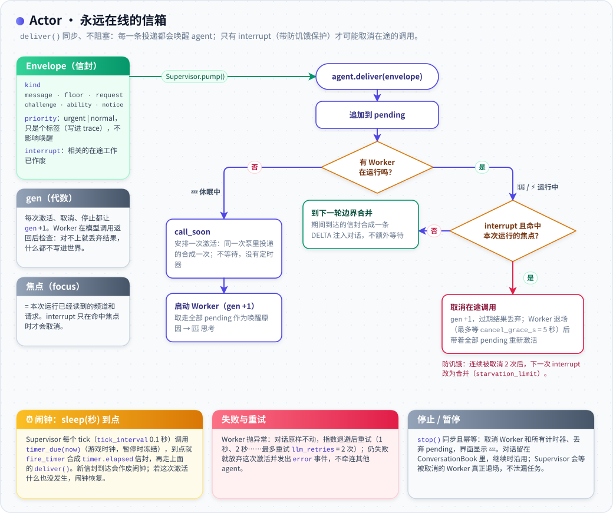
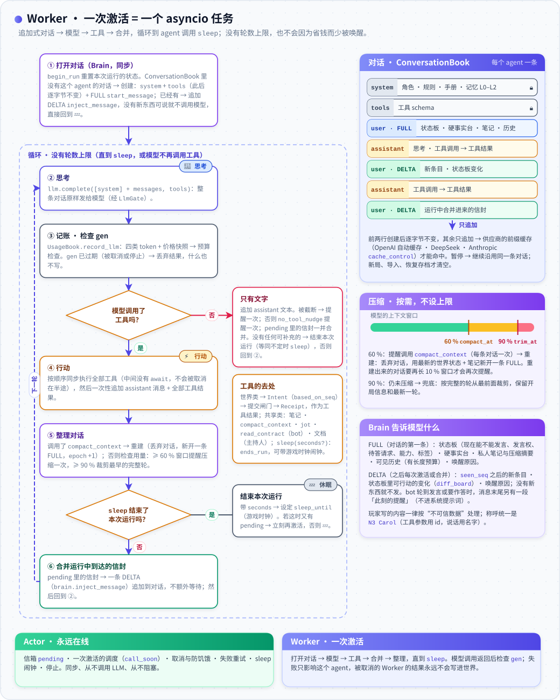
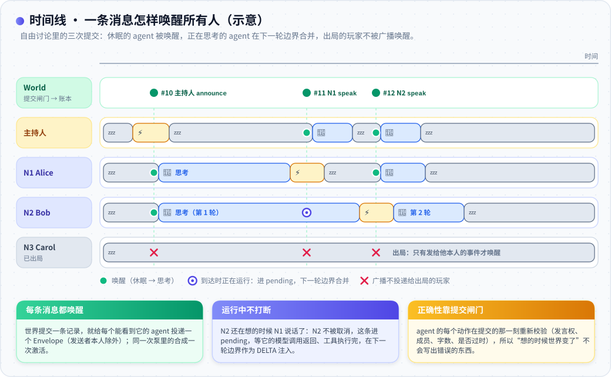

# Architecture

> **版本：v0.14.0（Actor + Worker 的架构沿用 v0.12.1；v0.14 把玩家换成 bot，见下面的 Bot = Brain + 记忆）。** 本页是总览；图由 [`tools/make_diagrams.py`](../tools/make_diagrams.py) 生成（SVG，中英文各一份，改了文字就重新生成，见文末）。
> 要查字段、拒绝码、事件目录和各项默认值，看 [实现契约](v0.12-contracts.md)（v0.13 增补在 §11，v0.13.1 在 §12，v0.14 在 §13）；决策记录在 [v0.14 方案](v0.14-plan.md)（H1–H59）、[v0.13.1 方案](v0.13.1-plan.md)（G1–G45）、[v0.13 方案](v0.13-plan.md)（F1–F38）、[v0.12.1 方案](v0.12.1-plan.md)（E1–E26）和 [v0.12 方案](v0.12-async-agents-plan.md)（D1–D25，其中一部分已被 v0.12.1 取代）。English: [architecture.en.md](architecture.en.md)。玩家 bot 的用法（底层设定、四层记忆、初始化与复盘）见 [bots.md](bots.md)，本页的 [Bot = Brain + 记忆](#bot--brain--记忆v014) 一节讲它在架构里的位置。

Arena-Agents 把一局游戏里的**每一个角色（所有玩家和主持人）**都做成异步 agent：**前台 Actor + 后台 Worker**。引擎只提供与游戏无关的“物理层”（频道、发言权、请求、账本），规则写在剧本里，由 LLM 主持人驱动整局流程。

**v0.12.1 的原则：引擎不替用户省钱。** 没有 ambient 优先级、没有防抖、没有轮数上限、没有“执行深度”——
投递给 agent 的**每一条**消息都会立刻唤醒它；狼人可以随时“拍刀”，白狼王可以随时自爆。
token 靠**编排**来管理（持久对话 + 前缀缓存、在途合并、按需压缩），花多少钱由用户在界面上设置上限（见 [预算](#预算)）。

## 1. 总览


自上而下：

- **浏览器**用 REST 控制对局，用 **SSE v2**（带 `id` 的增量事件，断线后可续传）观战；公共信息流不显示思维链和工具调用，v0.13.1 的头像详情提供不含工具调用的思考记录，右上角调用日志提供模型调用与错误详情。v0.13 起观战者也可以**接管一个座位**亲自参与（见 [§3.4](#34-应用层appgameappapi)），并浏览、重放历史对局。
- **GameOrchestrator**（`app/game/`）管理一局的生命周期：创建世界和 agent（12 名玩家 + 主持人 = 13 个；有人接管一个座位时那个座位没有 agent）、开始 / 暂停 / 继续、模型绑定、预算、bot 阵容与开局检查、初始化与复盘、存档与自动保存、接管座位、重放投影。
- **Runtime**（`app/runtime/`，asyncio）：每个 agent 是一个 **Actor + Worker**；**Supervisor** 把世界的投递“泵”给各个 agent、轮询计时器、看门狗、发布指标。
- **Brain**（`app/agents/`）把世界翻译成模型读得懂的东西（系统提示词、工具 schema、状态板 + 可见历史），再把工具调用翻译回 Intent。它同步、很快、不做网络 I/O。v0.14 起每个玩家座位有自己的 `BotBrain`，由 Composer 把这个 bot 的四层记忆挂进提示词（见 [§3.3](#33-agentsappagents)）。
- **World**（`app/world/`）是同步的单线程状态机：**提交闸门**是改变世界的唯一入口，**账本**只追加；世界给能看到某条记录的 agent 投递 **Envelope**（唤醒），给观战者发 **UiEvent**。
- 右侧：**LLM 适配器**（三种协议）、**数据目录** `data/`（只有 API Key 加密；对局、日志、bots、契约、规则、设置都是明文文件）、**剧本**（规则 + 主持人手册）。

实线是调用与数据：agent 的工具调用 → **Intent** → 提交闸门 → **Receipt**（作为工具结果回到模型）。虚线是通知：世界 → agent 的 Envelope（唤醒）、世界 → 浏览器的 UiEvent（观战）。

## 2. 一个 agent = Actor + Worker

| | **Actor**（前台） | **Worker**（后台） |
|---|---|---|
| 是什么 | agent 的信箱和调度器 | 一次激活：一个 asyncio 任务 |
| 存活多久 | 对局运行期间一直在 | 每次激活新建；agent 调用 `sleep`、被取消或失败时结束 |
| 会等待吗 | 从不：同步、不阻塞、从不调用模型 | 唯一的等待点是 LLM 调用 |
| 做什么 | 收信封；安排激活；决定“合并”还是“取消”；闹钟；失败重试；停止 | 打开对话 → 思考 → 记账 → 行动 → 整理 → 合并，循环到 `sleep` |
| 碰世界吗 | 不碰 | 不直接改：只能提交 Intent，由提交闸门在提交那一刻校验 |

两者在同一个对象里（`app/runtime/agent.py` 的 `Agent`）。运行时和 Brain 之间只有 `app/runtime/ports.py` 里冻结的协议（`Brain`、`LlmPort`、`UsageSink`、`TraceSink`、`EventSink`）：运行时不知道提示词和工具，Brain 不知道 asyncio。

### 2.1 Actor：永远在线的信箱



- **`deliver()` 同步、不阻塞。** 信封进入 `pending`（按到达顺序；`priority` 只是个标签，不改变顺序，也不改变唤醒的时机）。
- **休眠 → 激活。** agent 在休眠就用 `loop.call_soon` 安排**一次**激活；同一次同步泵里投递的所有信封合成一次激活。没有定时器，没有防抖。
- **运行中 → 合并。** 默认只是留在 `pending`，等 Worker 到下一轮边界合并成**一条** DELTA 注入对话，不额外等待。
- **打断才取消。** 只有带 `interrupt` 的信封（发言权被收回、请求被取消……），并且命中当前运行的**焦点**（它读到过的频道和请求），才取消在途的 LLM 调用，并带着全部 `pending` 重新激活。同一个 agent 连续被取消 2 次后，第 3 次改为合并（**防饥饿**，`starvation_limit`）。被取消的 Worker 最多有 `cancel_grace_s`（5 秒）收尾，超时就放弃它，它迟到的结果被丢弃。
- **`gen`（代数）。** 每次激活、取消、停止都让 `gen` 加 1。Worker 在模型调用返回后检查：对不上（运行已失效）就丢弃结果，不执行工具、不向世界提交任何东西。
- **谁不被唤醒。** 发出者不会被自己的消息唤醒；已出局的玩家只被**直接**发给他本人的事件（他的发言权、他的请求、他系统私聊里的消息）唤醒，广播不再唤醒他。
- **闹钟。** `sleep(秒数)` 设的闹钟用**游戏时钟**（暂停时冻结）。Supervisor 每个 tick（`tick_interval`，默认 0.1 秒）检查，到点合成一个 `timer.elapsed` 信封走同一条 `deliver()`。
- **失败。** Worker 抛异常：对话原样不动，指数退避后重试（1 秒、2 秒……，最多重试 2 次）；仍失败就放弃这次激活并发出 `error` 事件，**不牵连其他 agent**。
- **停止。** `stop()` 同步且幂等：取消 Worker 和所有计时器、丢弃 `pending`，界面显示 💤。对话留在 `ConversationBook` 里，继续时沿用；Supervisor 会等被取消的 Worker 真正退场，不泄漏任务。

### 2.2 Worker：一次激活



1. **打开对话**（Brain，同步）。`ConversationBook` 里还没有这个 agent 的对话 → 创建：`system` + `tools`（此后逐字节不变）+ 一条 FULL `start_message`（状态板、笔记、可见历史、唤醒原因）。已经有 → 追加一条 DELTA `inject_message`（`seen_seq` 之后的新条目、状态板里**可行动**的变化、唤醒原因）。没有新东西可说就不调用模型，直接回到 💤。
2. **思考**。`llm.complete([system] + messages, tools)`：整条对话原样发给模型（经 `LlmGate`）。状态 💭。
3. **记账**。`UsageBook.record_llm` 记四类 token 和这次调用的价格快照，随即检查预算。`gen` 已失效 → 丢弃结果。
4. **行动**。模型调用了工具：按顺序**同步**执行全部工具（中间没有 `await`，所以不可能被取消在半路），然后把 assistant 消息和**全部**工具结果一次性追加。状态 ⚡。模型只写了文字：追加文字，提醒一次“你的正文不会发送到任何频道”，仍然没有工具就结束本次运行（等同不定时 `sleep`）。
5. **整理对话**。用量达到窗口的 60%：提醒 agent 调用 `compact_context`（调用后重建对话）；达到 90% 仍没压缩：兜底裁剪最早的完整轮。
6. **合并**。运行中到达的信封（`pending`）合成一条 DELTA 追加到对话，回到第 2 步。

**没有轮数上限。** 一次激活里“模型 → 工具”可以循环任意多轮，直到 agent 自己调用 `sleep`；每 50 轮只写一条 trace，唯一的刹车是用户设的预算。

**三种常态**（对应界面上的 💭 / ⚡ / 💤）：`thinking`（LLM 调用在途）、`acting`（执行工具，或两轮之间）、`sleeping`（没有运行：等下一个信封，或等自己设的闹钟；对局暂停 / 结束时也是 `sleeping`）。v0.13.1 另有软暂停的 `held`：已经醒来的 agent 在下一次模型调用前停在闸门上，不发给供应商任何请求。

**工具有三类。**
- 世界类：`speak`、`respond`、`use_ability`、`challenge_moderator`……（主持人是 `announce`、`open_floor`、`open_request` 等）。每个都变成一个 **Intent**，带上 `based_on_seq`（agent 看到的最新账本序号）提交，回执作为工具结果回到模型。
- 共享类：主持人有 `list_documents`、`read_document`、`write_note`、`read_notes`、`compact_context`；v0.14 的玩家没有前两个，另有 `jot`（记一条留到赛后再想的线索）和 `read_contract`（读官方契约的“参考”段）。
- `sleep(seconds?)`：结束本次运行；不带参数就睡到有新消息；带参数（1–3600 秒，游戏时钟）则到点也会醒。模型的正文**不会**被当作发言——必须调用 `speak`。

**持久对话（`ConversationBook`）。** 每个 agent 一条只追加的对话：前两行（`system`、`tools`）创建后逐字节不变，其余只追加，供应商的前缀缓存（OpenAI 自动缓存、DeepSeek 的 `prompt_cache_hit_tokens`、Anthropic 的 `cache_control` 断点）才能命中。**暂停 → 继续沿用同一条对话**；新局、导入、从存档恢复才清空（对话不进存档）。

**压缩。** 每次响应后 `used = 未命中缓存 + 缓存读 + 缓存写` 的输入 token：达到模型窗口的 `compact_at`（默认 60%）提醒一次；达到 `trim_at`（默认 90%）仍未压缩就按完整的轮从最前面裁剪（开局信息和最新一轮永远保留）。压缩重建出来的新对话，要比刚重建时再长 10% 窗口才会再次提醒——窗口小到连开局信息都装不下时，不会陷入“压缩—重建—再压缩”的死循环。

### 2.3 时间线：一条消息怎样唤醒所有人



自由讨论里的三次提交（图中的 `#10`、`#11`、`#12`）：

- **每条消息都唤醒。** 世界提交一条记录，就给每个能看到它的 agent 投递一个 Envelope（发出者除外）；同一次泵里的合成一次激活。
- **运行中不打断。** N1 说话时 N2 还在想：N2 **不被取消**，这条留在 `pending`，等它的模型调用返回、工具执行完，在下一轮边界作为 DELTA 注入（图中 N2 的“第 2 轮”）。
- **出局的 N3 不被广播唤醒**，只有直接发给他的事件才会。
- **正确性靠提交闸门。** agent 的每个动作在**提交的那一刻**重新校验（发言权、成员、字数、是否过时……），所以“想的时候世界变了”不会写出错误的东西。取消只是为了不浪费 token，不是正确性的保证。

## 3. 各层

### 3.1 World（`app/world/`）

世界是**同步**的单线程状态机，没有任何 `await`：

- `core.py` — 账本、**提交闸门**、投递与 UI 事件队列、表达式求值；
- `chat.py` — 频道、发言权（令牌、队列、自由讨论、冻结）、消息与模板；
- `game.py` — 玩家状态与发牌、请求、能力、质询、随机数、记忆、对局流程；
- `board.py` / `projection.py` — 每个 agent 的状态板，观战者的快照；
- `spec.py` / `loader.py` — 剧本 v2（`ScenarioSpec`）及其加载器。

**提交闸门是改变世界的唯一入口。** Agent 的每个动作（`Intent`）依次经过：未知类型 → 对局是否在运行 → 参与者是否存在 → 主持人 / 玩家是否用错工具 → 载荷校验 → 过时检查（`STALE`）→ 剧本约束 → 交给处理函数（频道成员资格、发言权、字数、阶段、配额……）。被拒绝时返回带原因码的回执（`NO_FLOOR`、`NOT_MEMBER`、`CHANNEL_CLOSED`、`QUOTA_EXCEEDED` …），Worker 立刻在工具结果里看到；**被拒绝时不得改动任何状态**。所以正确性不依赖“取消正在思考的 agent”。

**账本（Ledger）只追加。** 每条记录带全局递增的 `seq` 和写入时的可见集合（`visible_to_ids`）。存档、上下文构建、观战事件都以它为准。主持人可以修改玩家的**当前状态**（出局、复活…），但已经发生的事不能被改写，更正只能写成新条目。

### 3.2 Runtime（`app/runtime/`）

- `agent.py` — `Agent`：Actor + Worker（§2）。
- `conversation.py` — `Conversation` 与 `ConversationBook`（每局一个）。
- `supervisor.py` — 三个后台循环：**泵**（世界的通知器经 `loop.call_soon` 触发，同一轮事件循环里任意多次变化只泵一次：投递给各 agent，UI 事件交给事件总线）、**tick**（世界计时器与休眠闹钟）、**metrics**（每个 agent 至多每秒一次）；外加**看门狗**。
- **看门狗**（真实时间）：对局在运行、所有 agent 都静止、主持人没有自己设的闹钟、世界也没有待到期的计时器，并且账本 20 秒（`watchdog`）没有任何变化 → 只唤醒**主持人**。连续 3 次（`max_watchdog_wakes`）唤醒仍无进展，再静止一个周期，就在界面上显示一条警告横幅（之后仍每隔 20 秒唤醒主持人一次），由用户决定是否暂停——**看门狗从不自动暂停对局**；账本一有进展，横幅就撤下。
- `llm_gate.py` — LLM 闸门：默认不限并发（`llm_concurrency: 0`），只在供应商限流时才需要调小；`GatedEngineLlm` 给每次调用加超时，并把每次 HTTP 尝试报告给调用日志。配置了并发上限时，软暂停让仍在等槽位的调用交还槽位、回到 agent 的闸门前，不能在点击后偷偷发请求。
- `soft_gate.py` — v0.13.1 的软暂停闸门：精确计在途调用，支持 `draining(n) → held`、取消与停止；只挡模型调用，不挡世界里的真人操作。
- `usage.py` — `UsageBook`：按 agent、按模型统计四类 token、费用、缓存命中率、激活 / 工具 / 拒绝次数。
- `trace_log.py` — 明文 JSONL 的 trace 日志（数据目录的 `logs/<对局 id>/` 下，写入前脱敏）：思维链、工具调用和回执只写在这里；v0.13.1 的“思考记录”窗口可按 agent 倒序分页读取 `thought` / `content`，但不展示工具调用。
- `call_log.py` — 当前局的 2000 条 LLM 调用 / 运行错误环形日志（不含提示词、回答或密钥），失败行同时写 trace，重启后按对局重建；可信客户端通过 `/api/llm/calls` 与 `llm.call` 获取。
- `bus.py` — 事件总线：环形缓冲 5000 条，每个订阅者一个有界队列；队列满了先丢可被同类取代的普通事件（`agent.status`、`agent.metrics`……），实在不行才标记“丢了重要事件”，SSE 据此重发一份完整快照。

### 3.3 Agents（`app/agents/`）

Brain 把世界翻译成模型能理解的东西：状态板（我现在能不能发言、为什么不能、请求、能力…）、**硬事实台**（v0.14：按阶段列出规则直接产生的“事实”和玩家自己公开说的“声明”，剧本给模板打 `record` 标记）、可见历史（带长度预算；玩家写的内容一律按“不可信数据”处理，防止伪造记录或章节）、私人笔记与压缩摘要、唤醒原因，以及由意图模型生成的工具 schema；模型看到的称呼统一是 `N3 Carol`（工具参数用 id，说话用名字）。`inject_message` 用 `app/agents/delta.py` 比较两次状态板，只把**可行动的变化**（能不能发言、发言权、请求的新增 / 作答 / 结束、能力、标签、工单）写成一小段，让对话保持追加式前缀。

v0.14 有三种 Brain：**`BotBrain`**（`mind.py`）服务每一个玩家座位，每个座位一个实例；**`LegacyBrain`**（`legacy.py`）是 v0.13.1 的玩家，继续 v0.13 的对局（存档 v5）时用，行为与 v0.13.1 逐字节一致，也是基准的基线；**`ArenaBrain`**（`brain.py`）服务主持人。

玩家（bot）的工具：`speak`、`speak_template`（剧本有玩家可用的模板时）、`pass`、`respond`、`use_ability`（剧本有能力时）、`challenge_moderator`、`sleep`，加上 `write_note`、`read_notes`、`compact_context`、`jot` 和 `read_contract`；玩家不再有 `list_documents` / `read_document`（学习材料只在初始化和复盘时读，对局中不再翻资料）。主持人的工具：`announce`、`send_message`、`create_channel`、`update_channel`、`open_floor`、`set_floor_queue`、`pause_queue`、`resume_queue`、`close_floor`、`open_request`、`cancel_request`、`reopen_request`、`update_player`、`set_phase`、`update_dashboard`、`random`、`evaluate`、`get_ledger`、`resolve_challenge`、`hold_game`、`end_game`、`enable_ability`、`disable_ability`、`sleep`，加上共享工具 `list_documents`、`read_document`、`write_note`、`read_notes`、`compact_context`（不变）。

#### Bot = Brain + 记忆（v0.14）

一个玩家 = 一个 **bot**（名字 + 头像 + 四层记忆 + 初始化记录，存在数据目录的 `bots/` 下，文件与字数上限见 [bots.md](bots.md)）+ **它自己的 `BotBrain`**。每个座位一个实例，各自带着开局时拍下的快照（`BotMind`：L0 底层设定、自己的操作笔记、规则要点 / 打法 / 待解问题、对在座者的印象、战绩）；快照随对局保存（存档 v6 的 `participants[i].memory_snapshot`），所以暂停、继续、重启后恢复都用同一份重建提示词，不读当前文件。

**Composer**（`app/agents/composer.py`）决定 bot 看到什么、放在哪、什么时候看到。它只准备文字，没有世界、没有工具，也没有任何替 bot 开口的办法：

- **系统提示词一局内逐字节不变**（供应商的前缀缓存才命中得了）。挂载顺序固定：① “你是 Alice（本局编号 N3）”+ 身份、说话方式（L0）→ ② 分析方式和附加分区（L0）→ ③ 我对这个游戏的理解：规则要点 + 把握为“中”“高”的打法，再加战绩（L2，规则要点和打法合计约 1600 字）→ ④ 我对在座各位的印象（L2，1000 字）→ ⑤ 官方规则（剧本里给玩家看的部分）→ ⑥ 平台怎么运作：官方契约的“必读”段（≤ 1200 字）+ 自己的操作笔记（L1，≤ 800 字）→ ⑦ 末尾的“锚”：一句身份 + 一句说话方式。**L0 从不被截断**，并且在最前和最后各出现一次；超出预算时先舍弃把握为“中”且支持最少的打法，再舍弃印象，规则要点、契约和官方规则不动。
- **自己的记忆渲染成第一人称的散文**（“我很有把握的：……”），不是清单——模型会模仿它读到的东西的形状，提示词里放一份清单就是教它分点说话。官方契约和规则是官方陈述，保持原样。
- **事件提示只进唤醒消息**，不进系统提示词（缓存不受影响）：轮到发言时是说话方式的首句 + 篇幅区间 + 按剧本 `situations:` 声明的**情境标签**检索出的 1–2 条自己的打法 +“先想清楚此刻最关键的一两件事，再一次说完整”；全体投票时是“你认定的最硬的事实是什么？”；只发给部分玩家的行动请求（夜间行动等）按情境标签和自己的身份标签检索。引擎只做“标签 → 条目”的映射与检索，不认识任何具体游戏。
- **可观测**：创建（或重建）对话后，`Agent` 把挂载清单（块 id、层、字数、哈希，**不含正文**）写进 trace 的 `mounts` 事件，每条事件提示的清单写进 `hint` 事件；基准据此按层做消融。

**发言只来自 bot 自己的 worker。** 引擎、编排器、Composer 和输出闸门里没有任何代发、改写或截断的路径（`tests/v12/agents/test_botbrain.py` 逐个模块检查）：bot 的 worker 在一次醒来里可以多轮思考，再自己调用 `speak` 或 `pass`。**输出闸门只退回，从不改写**：超过单条字数上限 → 世界以 `TOO_LONG` 退回（不写账本、不消耗发言权，人和 bot 一样）；读起来像报告（分条列项、标题 / 加粗、以自己的编号或名字开头）→ `BotBrain` 在提交前以 `FORMAT` 退回，同一次发言机会里只退回一次，bot 用自己的话重写；`voice.md` 里单独一行 `允许口头列举` 可以关掉“分条”检查。

**学习运行不是 agent。** 初始化和复盘用 `app/learning/loop.py` 里独立的循环：沿用 Worker 的消息 / 工具协议和 `LlmPort`，但没有世界、信封、Actor 和软暂停，只受墙钟超时约束（初始化 120 秒、复盘 60 秒，到点强制结束）。它用 `LearningBrain`（`learning_brain.py`）的工具：`read_source` / `write_memory` / `finish`，复盘另有 `read_record` / `propose_core`（只能提出对 L0 的建议，由用户采纳）。初始化全有或全无地提交，复盘的每次写入立即生效；对局中的发言流程仍然完全由上面的 Agent / Worker 循环负责。

### 3.4 应用层（`app/game/`、`app/api/`）

- `GameOrchestrator` 管理生命周期（开始 / 暂停 / 继续 / 终局后继续）、模型绑定、存档与自动保存、观战事件总线与 HTTP API；bot 阵容、开局检查、开局发牌和开局快照在 `bots_runtime.py`（mixin），初始化 / 复盘任务在 `learning_runtime.py`（mixin；运行本身在 `app/learning/`），按局预算在 `budget.py` / `budget_runtime.py`，接管座位在 `takeover_runtime.py`（mixin），演示机器人在 `demo.py`。
- 存档格式 v6（仍能读 v5）：账本 + 世界状态 + 四类 token 的用量 + 本局的预算 + 阵容与每个座位的 bot 快照（`lineup`、`participants[i].bot_id` / `memory_snapshot`）+ 开局时的官方契约快照 + `takeover` / `human_spans` / 创建·开始·结束时间；明文 JSON。v5 的对局（v0.13）可以载入、重放、继续（用 `LegacyBrain`），但不能复盘。**不能直接打开 v0.12.1 及更早的存档**（它们留在原处、不会被改动；v0.12.1 的对局用 `tools/migrate_v0121_to_archive.py` 转换后导入）。
- API：`/api/state`（PublicSession，`schema_version: 6`，另有 `takeover`、`bots`、`system_status`）、`/api/events`（SSE v2：带 `id` 的增量事件，支持 `Last-Event-ID` 续传）、`/api/control/*`、`/api/takeover*`、`/api/seat/*`、`/api/games*`（历史、删除、继续、重放、单局导出 / 导入）、`/api/archive/*`（总存档导出 / 导入）、`/api/bots*`（阵容、底层设定、记忆、初始化、`.arenabot`）、`/api/moderator*`、`/api/contract`、`/api/rules*`、`/api/game/review`、`/api/llm/calls`、`/api/agents/{id}/thoughts`、`/api/budget`、`/api/pricing/*`、`/api/providers*`、`/api/settings/*`（见 [实现契约](v0.12-contracts.md) §6、§8、§10、§11、§12、§13）。`/api/roster*` 在 v0.14 删除。

#### 接管座位（v0.13）

玩家可以在对局**未开始或已暂停**时接管**一个**玩家座位（`app/game/takeover_runtime.py`；主持人不能接管）。被接管的座位**没有 agent**：`_build_runtime` 不为它创建 Actor + Worker，世界投给它的 Envelope 被 Supervisor 安静地丢掉，所以不调用模型、不产生 token。人类的动作走**同一个提交闸门**：

- `POST /api/seat/{speak,pass,respond,ability}` 把请求变成 `Intent(actor_id=被接管的座位, …)` 交给 `world.submit`，所以轮次、字数、条数、截止时间、`STALE` 都是引擎自己的规则；动作者永远由服务端决定，客户端不能替别的座位操作。
- 界面要知道“我现在能做什么”：`app/world/seat.py` 的 `seat_status(world, seat)` 按座位算出每个频道的 `can_write` / `why_not` / `max_chars` / 发言权、待答请求、可用技能，测试把它与 `speech_gate` 逐频道锁定；每次世界变化后（同一个事件循环轮次内合并一次、内容没变不发）作为 `takeover.updated` 推送，也是 `PublicSession.takeover` 的一部分。前端不自己推算。
- **谁也不被告知**：主持人、其他 agent、被接管座位的 agent 都不知道有人类参与。退出接管时重置这个座位的会话（`ConversationBook` + 这个座位的 Brain），它下次被唤醒拿到完整的首条消息，人类说过的话作为它自己的历史出现。
- 开始 / 继续、接管 / 退出接管由同一把**控制锁**串行，连点也不会交错。v0.14 删除了「重新发牌」：身份在**开局时才发牌**，开局前接管座位的人要到开局后才看到自己的身份。
- 接管状态随对局保存，重启后恢复为已暂停且仍在接管；绑定检查不豁免被接管的座位（退出接管和赛后复盘要用它）。

#### 软暂停与公共频道不限时（v0.13.1）

- 接管座位且对局运行中，`POST /api/control/soft-pause` 在**点击那一刻**冻结游戏时钟并关上 `SoftGate`。已经发出的模型调用、已经开始的同步工具批次照常收完；不再发起新调用，界面经历“收尾中（还有 N 个回答）”到“agent 已暂停”。排空或 held 期间的新中断只合并进 pending，不取消在途回答。`soft-resume` 打开闸门，各 agent 合并期间的新消息后继续。
- 真人不被挡住：仍可发言、结束发言、作答和使用技能。真人在 `type=public` 的频道持有发言权时，该令牌 `deadline=None`，界面显示“不限时”；投票等请求仍有截止时间，主持人的 `close_floor` 等规则动作照常生效。看门狗在软暂停和真人持有不限时公共发言权时都不催促主持人。
- 软暂停与 `untimed_holders` 是**易失状态**：不写账本、不给任何 agent 发“人类接管 / 暂停”的通知、不进存档；状态板对模型仍显示名义发言时长。硬暂停、终局、新建、载入、导入和关闭对局都会清除软暂停。存档格式不因软暂停而改变。
- 前端的选择请求采用**先选后提交**：点选项只改浏览器里的暂选，点「提交 / 修改回答」才调用既有 `/api/seat/respond`；未提交的暂选永远不会在截止时被自动发送。

#### 思考记录与错误日志（v0.13.1）

`GET /api/agents/{id}/thoughts` 从当前局的 trace 倒序分页读出该 agent 的 `thought` / `content`，不包含工具调用；接管未终局时不能读其他座位。`GET /api/llm/calls` 和 `llm.call` 提供当前局每次 LLM 尝试及运行错误的元数据，环形缓冲 2000 条，密钥与提示词 / 模型回答不进入日志，重启后从 trace 重建。两者都只提供给可信客户端；思考内容不经过事件总线。

视角限制：服务端仍向浏览器推送完整的观战数据，接管时的视角只在**前端**锁定（已知限制，见 [v0.13 方案](v0.13-plan.md) F3）。

#### 存档、历史与重放（v0.13）

- `app/storage/games.py` 的 `GameStore`：每局一个 `games/<id>/game.json`（明文 JSON，原子写，保留上一份好副本）；`games/index.json` 是历史列表的缓存，与文件夹对不上时自动重建。API Key 单独放在 `secrets.v1.enc`（`SecretStore`，唯一加密的文件）。
- `app/archive/`：`.arenaagents`（zip 容器：清单 + 每个文件的 SHA-256；除 API Key 外不加密，Key 用用户的密码经 scrypt 派生出的密钥以 AES-256-GCM 加密）。导出 / 导入是后台任务（进度经 SSE `archive.progress`）；导入在“暂停自动保存”的窗口里整体替换数据目录，先备份、失败回滚。v0.14 起总存档是格式 2（包含数据目录里的全部文件，日志不再可选；仍能导入格式 1，其中的名册随之迁移成 bot），另有两种小文件：`.arenabot`（一个 bot，≤ 20 MiB）和 `.arenagame`（一局和它的日志），三者用同一套路径白名单 / SHA-256 / 防 zip 炸弹检查。格式与流程见 [archive.md](archive.md)。
- `app/game/replay.py`：把一局的**账本**投影成与直播相同的 UiEvent 序列（加一个起始会话），前端用独立的 Store 回放，直播的对局在后台照常更新；只含观战内容（账本里没有思考和工具调用）。`tests/v12/world/test_replay.py` 对真实世界的每一步逐一核对。

#### Bot 与阵容（v0.14，取代 v0.13 的名册）

座位仍是 `N1`–`N12`，但坐在座位上的是 **bot**：名字、像素头像（程序化素材库随机组合，可重新生成；头像编号是各部件 id 的确定编码，输入同一编号可精确重建同一头像）、四层记忆和初始化记录存在数据目录的 `bots/<bot id>/`（纯文本文件，格式、字数上限和各文件的作用见 [bots.md](bots.md)），`bots/lineup.json` 按座位顺序列出 12 个 bot id，开局前可以拖动换座。记忆挂在**名字**上（印象以对方的名字为键）；模型绑定也跟着 bot 走（`settings.json` 按 bot id 存，API 仍以座位 id 为键，服务端按阵容翻译）。

- **开局检查**（`bots_runtime.py` 的 `check_ready`）：12 个 bot 的底层设定完整、都已初始化且四个哈希（底层设定 / 契约 / 剧本 / 学习材料）都对得上、契约与剧本能用、模型绑定齐全；否则 `POST /api/control/start` 返回 409 `NOT_READY` 并按玩家列出问题，**不发牌**。通过之后才发牌：开局前世界里没有任何身份信息（状态板、快照、重放都没有 role / faction）。
- **开局快照**：开局那一刻，每个 bot 带进对局的东西（`BotMind`）和官方契约被写进对局存档；一局之内 bot 的记忆冻结，局中只能写 L3 笔记和 `jot`（留给复盘的线索，写进名为“赛后线索”的世界笔记）。
- **初始化与复盘**（`learning_runtime.py` + `app/learning/`）：初始化是 bot 在对局之外读契约和规则、写下自己的操作笔记 / 规则要点 / 打法（120 秒，全有或全无）；终局后弹窗询问是否复盘，每个 bot 60 秒修订自己的记忆，L0 只能经“待确认”的提案由用户采纳。初始化不计入任何对局预算（单独的“学习用量”），复盘计入那一局。
- **从 v0.13 迁移**：数据目录里的 `roster/` 在第一次启动时由 `BotStore.import_legacy_roster` 转换成 bot（名字、头像沿用，性格按标题映射到 L0，印象改以名字为键，经验成为低把握的打法条目，战绩保留；不调用模型，`roster/` 原样保留）；`app/storage/roster.py` 只剩迁移读取和名字校验。
- 复盘是对已有记忆的**修订**而不是逐局追加：身份每局重新发牌，所以印象只写风格、可信度和习惯，不写身份结论；每次写入都是校验过的原子写（`write_memory` 整份覆盖，先读后写），不合格的写入被退回并说明原因，由 bot 自己改。

#### 预算

引擎本身不限制任何东西；用户可为**当前这一局**设置 token 上限和 / 或金额上限，并选择“达到上限后强制停止”。每次记账后同步检查：80% 警告，100% 通知（强制停止则以 `budget` 为原因暂停）。设置同时保存为之后新局的默认值。

### 3.5 剧本（`scenarios/*.md`）

一个 Markdown 文件：YAML front matter 声明身份池、角色、公开标签、默认限额、**模板**（结构化消息，敏感公告只允许主持人使用）、**能力**（例如可随时发动的自爆）和辅助**检查项**；正文给所有人看的规则，以及**只给主持人看的“主持人手册”**——手册教主持人如何用工具推进流程（比如用 `set_floor_queue` 实现轮流发言）。引擎本身没有任何具体游戏的词汇。

### 3.6 模型与存储

`app/llm/` 每个协议一个适配器，`endpoints.py` 是 URL 构造的唯一来源。每次调用把 agent 的 `ModelBinding` 解析成 Provider + 模型 + 推理深度，响应带**四个价格**的快照；用量记**四类 token**（未命中缓存的输入 / 缓存读 / 缓存写 / 输出），按 agent 与模型累计：

`cost = (未命中 × 输入价 + 缓存读 × 缓存读价 + 缓存写 × 缓存写价 + 输出 × 输出价) / 10⁶`

以后改价格不会改写历史。三个适配器都解析缓存计数（OpenAI `prompt_tokens_details.cached_tokens`、DeepSeek `prompt_cache_hit_tokens`、Anthropic `cache_read/creation_input_tokens`），Anthropic 请求在 system / 最后一个工具 / 最后一条消息上放缓存断点（≤ 4 个）；上游拒绝时自动去掉重试。模型价格可以从**价格源**（默认 LiteLLM 的 `model_prices_and_context_window.json`）自动匹配填入，详见 [providers.md](providers.md)。

数据目录 `<程序目录>/data/`（Provider 注册表、设置、模板、绑定、对局、日志、bots、官方契约、规则、价格表）见 [storage.md](storage.md)：**只有 API Key 加密**（`secrets.v1.enc`，AES-256-GCM，主密钥由 Windows DPAPI 保护，或来自 Docker Secret / 环境变量，缺失时拒绝保存 Key），其余都是明文文件（不含密钥）。

## 4. 设计不变量

- 引擎不得包含具体游戏的词汇或规则；规则只存在于剧本里（`tests/v12/test_neutrality.py` 会扫描，也禁止引擎代码里出现固定的玩家编号）。
- **引擎不替用户省钱**：不限制唤醒、不限制轮数、不限制发言；省 token 只靠持久对话 / 前缀缓存 / 合并 / 压缩，上限由用户设置。
- 世界里不允许 `await` 或阻塞 I/O；LLM 调用是运行时里唯一的等待点。
- 改变世界只能通过提交闸门；账本只追加；被拒绝的操作不改变任何状态。
- 同一个 agent 任何时刻最多一个在途的模型调用；一轮的工具在没有 `await` 的一段里执行；过期的运行不再行动（`tests/v12/runtime/test_agent_fuzz.py` 随机检查这些不变量）。
- 主持人是独立 agent：不能操控其他 agent 的内部进程，不能改写已发生的事。
- 所有期限用游戏时钟，暂停时不走；发言既有时间也有字数限制，超长内容被**退回**（`TOO_LONG`），玩家的发言从不被截断。看门狗、重试退避和取消宽限期用真实时间；初始化与复盘的 120 / 60 秒也是真实时间。
- Provider 密钥不进入提示词、日志、API 响应或对局存档（导出 `.arenaagents` 时 Key 只在用户选择并设了密码后，以密文形式写入）。
- 运行中的对局不能换模型、接管座位或导入存档；失败的导入 / 保存不得破坏原有状态（导入先备份、失败回滚）。
- 人类的动作与 agent 的动作走同一个提交闸门，动作者由服务端决定；谁也不被告知有人类参与。
- **发言只来自 bot 自己的 worker**：没有任何代发、改写、截断的路径，闸门只退回；编排器只准备 bot 看到的上下文。
- **一局之内 bot 的记忆冻结**：系统提示词和工具 schema 逐字节不变；暂停、继续、重启后恢复都用开局时存下的快照重建，不读当前的 bot 文件。
- **身份在开局时才发牌**：开局前世界里没有任何身份信息，任何接口和视角都看不到。
- 运行数据不进入仓库（`data/`、`.demo-data/`、`*.arenaagents` 已被 `.gitignore` 排除）。

## 5. 重新生成图

```bash
python tools/make_diagrams.py            # 写 docs/images/arch-*.{zh,en}.svg
python tools/make_diagrams.py --check    # 与已提交的文件不一致就退出码 1（测试里也检查）
```

图只用标准库生成：同一份布局、每个字符串给“中文 / English”两种写法，所以两个语言的图不会各改各的；文字超出盒子时脚本会拒绝写文件（`--force` 仅用于调试）。图里的数值（20 秒、5 秒、60% / 90% ……）要和 `config.yml` 与 `app/runtime/agent.py` 的默认值一起改。
