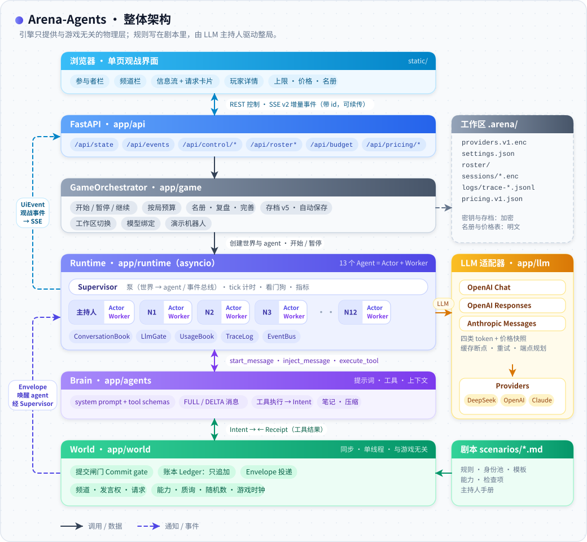

# Architecture

> **版本：v0.12.1。** 本页是总览；图由 [`tools/make_diagrams.py`](../tools/make_diagrams.py) 生成（SVG，中英文各一份，改了文字就重新生成，见文末）。
> 要查字段、拒绝码、事件目录和各项默认值，看 [实现契约](v0.12-contracts.md)；决策记录在 [v0.12.1 方案](v0.12.1-plan.md)（E1–E26）和 [v0.12 方案](v0.12-async-agents-plan.md)（D1–D25，其中一部分已被 v0.12.1 取代）。English: [architecture.en.md](architecture.en.md)。

Arena-Agents 把一局游戏里的**每一个角色（所有玩家和主持人）**都做成异步 agent：**前台 Actor + 后台 Worker**。引擎只提供与游戏无关的“物理层”（频道、发言权、请求、账本），规则写在剧本里，由 LLM 主持人驱动整局流程。

**v0.12.1 的原则：引擎不替用户省钱。** 没有 ambient 优先级、没有防抖、没有轮数上限、没有“执行深度”——
投递给 agent 的**每一条**消息都会立刻唤醒它；狼人可以随时“拍刀”，白狼王可以随时自爆。
token 靠**编排**来管理（持久对话 + 前缀缓存、在途合并、按需压缩），花多少钱由用户在界面上设置上限（见 [预算](#预算)）。

## 1. 总览



自上而下：

- **浏览器**用 REST 控制对局，用 **SSE v2**（带 `id` 的增量事件，断线后可续传）观战；界面永远看不到思维链和工具调用。
- **GameOrchestrator**（`app/game/`）管理一局的生命周期：创建世界和 agent（12 名玩家 + 主持人 = 13 个）、开始 / 暂停 / 继续、模型绑定、预算、名册与复盘、加密存档、工作区切换。
- **Runtime**（`app/runtime/`，asyncio）：每个 agent 是一个 **Actor + Worker**；**Supervisor** 把世界的投递“泵”给各个 agent、轮询计时器、看门狗、发布指标。
- **Brain**（`app/agents/`）把世界翻译成模型读得懂的东西（系统提示词、工具 schema、状态板 + 可见历史），再把工具调用翻译回 Intent。它同步、很快、不做网络 I/O。
- **World**（`app/world/`）是同步的单线程状态机：**提交闸门**是改变世界的唯一入口，**账本**只追加；世界给能看到某条记录的 agent 投递 **Envelope**（唤醒），给观战者发 **UiEvent**。
- 右侧：**LLM 适配器**（三种协议）、**工作区**（加密的 Provider 与存档；名册和价格表是明文文件）、**剧本**（规则 + 主持人手册）。

实线是调用与数据：agent 的工具调用 → **Intent** → 提交闸门 → **Receipt**（作为工具结果回到模型）。虚线是通知：世界 → agent 的 Envelope（唤醒）、世界 → 浏览器的 UiEvent（观战）。

## 2. 一个 agent = Actor + Worker

| | **Actor**（前台） | **Worker**（后台） |
|---|---|---|
| 是什么 | agent 的信箱和调度器 | 一次激活：一个 asyncio 任务 |
| 存活多久 | 对局运行期间一直在 | 每次激活新建；agent 调用 `sleep`、被取消或失败时结束 |
| 会等待吗 | 从不：同步、不阻塞、从不调用模型 | 唯一的等待点是 LLM 调用 |
| 做什么 | 收信封；安排激活；决定“合并”还是“取消”；闹钟；失败重试；停止 | 打开对话 → 思考 → 记账 → 行动 → 整理 → 合并，循环到 `sleep` |
| 碰世界吗 | 不碰 | 不直接改：只能提交 Intent，由提交闸门在提交那一刻校验 |

两者在同一个对象里（`app/runtime/agent.py` 的 `Agent`）。运行时和 Brain 之间只有 `app/runtime/ports.py` 里冻结的协议（`Brain`、`LlmPort`、`UsageSink`、`TraceSink`、`EventSink`）：运行时不知道提示词和工具，Brain 不知道 asyncio。

### 2.1 Actor：永远在线的信箱


- **`deliver()` 同步、不阻塞。** 信封进入 `pending`（按到达顺序；`priority` 只是个标签，不改变顺序，也不改变唤醒的时机）。
- **休眠 → 激活。** agent 在休眠就用 `loop.call_soon` 安排**一次**激活；同一次同步泵里投递的所有信封合成一次激活。没有定时器，没有防抖。
- **运行中 → 合并。** 默认只是留在 `pending`，等 Worker 到下一轮边界合并成**一条** DELTA 注入对话，不额外等待。
- **打断才取消。** 只有带 `interrupt` 的信封（发言权被收回、请求被取消……），并且命中当前运行的**焦点**（它读到过的频道和请求），才取消在途的 LLM 调用，并带着全部 `pending` 重新激活。同一个 agent 连续被取消 2 次后，第 3 次改为合并（**防饥饿**，`starvation_limit`）。被取消的 Worker 最多有 `cancel_grace_s`（5 秒）收尾，超时就放弃它，它迟到的结果被丢弃。
- **`gen`（代数）。** 每次激活、取消、停止都让 `gen` 加 1。Worker 在模型调用返回后检查：对不上（运行已失效）就丢弃结果，不执行工具、不向世界提交任何东西。
- **谁不被唤醒。** 发出者不会被自己的消息唤醒；已出局的玩家只被**直接**发给他本人的事件（他的发言权、他的请求、他系统私聊里的消息）唤醒，广播不再唤醒他。
- **闹钟。** `sleep(秒数)` 设的闹钟用**游戏时钟**（暂停时冻结）。Supervisor 每个 tick（`tick_interval`，默认 0.1 秒）检查，到点合成一个 `timer.elapsed` 信封走同一条 `deliver()`。
- **失败。** Worker 抛异常：对话原样不动，指数退避后重试（1 秒、2 秒……，最多重试 2 次）；仍失败就放弃这次激活并发出 `error` 事件，**不牵连其他 agent**。
- **停止。** `stop()` 同步且幂等：取消 Worker 和所有计时器、丢弃 `pending`，界面显示 💤。对话留在 `ConversationBook` 里，继续时沿用；Supervisor 会等被取消的 Worker 真正退场，不泄漏任务。

### 2.2 Worker：一次激活


1. **打开对话**（Brain，同步）。`ConversationBook` 里还没有这个 agent 的对话 → 创建：`system` + `tools`（此后逐字节不变）+ 一条 FULL `start_message`（状态板、笔记、可见历史、唤醒原因）。已经有 → 追加一条 DELTA `inject_message`（`seen_seq` 之后的新条目、状态板里**可行动**的变化、唤醒原因）。没有新东西可说就不调用模型，直接回到 💤。
2. **思考**。`llm.complete([system] + messages, tools)`：整条对话原样发给模型（经 `LlmGate`）。状态 💭。
3. **记账**。`UsageBook.record_llm` 记四类 token 和这次调用的价格快照，随即检查预算。`gen` 已失效 → 丢弃结果。
4. **行动**。模型调用了工具：按顺序**同步**执行全部工具（中间没有 `await`，所以不可能被取消在半路），然后把 assistant 消息和**全部**工具结果一次性追加。状态 ⚡。模型只写了文字：追加文字，提醒一次“你的正文不会发送到任何频道”，仍然没有工具就结束本次运行（等同不定时 `sleep`）。
5. **整理对话**。用量达到窗口的 60%：提醒 agent 调用 `compact_context`（调用后重建对话）；达到 90% 仍没压缩：兜底裁剪最早的完整轮。
6. **合并**。运行中到达的信封（`pending`）合成一条 DELTA 追加到对话，回到第 2 步。

**没有轮数上限。** 一次激活里“模型 → 工具”可以循环任意多轮，直到 agent 自己调用 `sleep`；每 50 轮只写一条 trace，唯一的刹车是用户设的预算。

**三种状态**（对应界面上的 💭 / ⚡ / 💤）：`thinking`（LLM 调用在途）、`acting`（执行工具，或两轮之间）、`sleeping`（没有运行：等下一个信封，或等自己设的闹钟；对局暂停 / 结束时也是 `sleeping`）。

**工具有三类。**
- 世界类：`speak`、`respond`、`use_ability`、`challenge_moderator`……（主持人是 `announce`、`open_floor`、`open_request` 等）。每个都变成一个 **Intent**，带上 `based_on_seq`（agent 看到的最新账本序号）提交，回执作为工具结果回到模型。
- 共享类：`list_documents`、`read_document`、`write_note`、`read_notes`、`compact_context`。
- `sleep(seconds?)`：结束本次运行；不带参数就睡到有新消息；带参数（1–3600 秒，游戏时钟）则到点也会醒。模型的正文**不会**被当作发言——必须调用 `speak`。

**持久对话（`ConversationBook`）。** 每个 agent 一条只追加的对话：前两行（`system`、`tools`）创建后逐字节不变，其余只追加，供应商的前缀缓存（OpenAI 自动缓存、DeepSeek 的 `prompt_cache_hit_tokens`、Anthropic 的 `cache_control` 断点）才能命中。**暂停 → 继续沿用同一条对话**；新局、洗牌身份、导入、从存档恢复才清空（对话不进存档）。

**压缩。** 每次响应后 `used = 未命中缓存 + 缓存读 + 缓存写` 的输入 token：达到模型窗口的 `compact_at`（默认 60%）提醒一次；达到 `trim_at`（默认 90%）仍未压缩就按完整的轮从最前面裁剪（开局信息和最新一轮永远保留）。压缩重建出来的新对话，要比刚重建时再长 10% 窗口才会再次提醒——窗口小到连开局信息都装不下时，不会陷入“压缩—重建—再压缩”的死循环。

### 2.3 时间线：一条消息怎样唤醒所有人


自由讨论里的三次提交（图中的 `#10`、`#11`、`#12`）：

- **每条消息都唤醒。** 世界提交一条记录，就给每个能看到它的 agent 投递一个 Envelope（发出者除外）；同一次泵里的合成一次激活。
- **运行中不打断。** N1 说话时 N2 还在想：N2 **不被取消**，这条留在 `pending`，等它的模型调用返回、工具执行完，在下一轮边界作为 DELTA 注入（图中 N2 的“第 2 轮”）。
- **出局的 N3 不被广播唤醒**，只有直接发给他的事件才会。
- **正确性靠提交闸门。** agent 的每个动作在**提交的那一刻**重新校验（发言权、成员、字数、是否过时……），所以“想的时候世界变了”不会写出错误的东西。取消只是为了不浪费 token，不是正确性的保证。

## 3. 各层

### 3.1 World（`app/world/`）

世界是**同步**的单线程状态机，没有任何 `await`：

- `core.py` — 账本、**提交闸门**、投递与 UI 事件队列、表达式求值；
- `chat.py` — 频道、发言权（令牌、队列、自由讨论、冻结）、消息与模板；
- `game.py` — 玩家状态与发牌、请求、能力、质询、随机数、记忆、对局流程；
- `board.py` / `projection.py` — 每个 agent 的状态板，观战者的快照；
- `spec.py` / `loader.py` — 剧本 v2（`ScenarioSpec`）及其加载器。

**提交闸门是改变世界的唯一入口。** Agent 的每个动作（`Intent`）依次经过：未知类型 → 对局是否在运行 → 参与者是否存在 → 主持人 / 玩家是否用错工具 → 载荷校验 → 过时检查（`STALE`）→ 剧本约束 → 交给处理函数（频道成员资格、发言权、字数、阶段、配额……）。被拒绝时返回带原因码的回执（`NO_FLOOR`、`NOT_MEMBER`、`CHANNEL_CLOSED`、`QUOTA_EXCEEDED` …），Worker 立刻在工具结果里看到；**被拒绝时不得改动任何状态**。所以正确性不依赖“取消正在思考的 agent”。

**账本（Ledger）只追加。** 每条记录带全局递增的 `seq` 和写入时的可见集合（`visible_to_ids`）。存档、上下文构建、观战事件都以它为准。主持人可以修改玩家的**当前状态**（出局、复活…），但已经发生的事不能被改写，更正只能写成新条目。

### 3.2 Runtime（`app/runtime/`）

- `agent.py` — `Agent`：Actor + Worker（§2）。
- `conversation.py` — `Conversation` 与 `ConversationBook`（每局一个）。
- `supervisor.py` — 三个后台循环：**泵**（世界的通知器经 `loop.call_soon` 触发，同一轮事件循环里任意多次变化只泵一次：投递给各 agent，UI 事件交给事件总线）、**tick**（世界计时器与休眠闹钟）、**metrics**（每个 agent 至多每秒一次）；外加**看门狗**。
- **看门狗**（真实时间）：对局在运行、所有 agent 都静止、主持人没有自己设的闹钟、世界也没有待到期的计时器，并且账本 20 秒（`watchdog`）没有任何变化 → 只唤醒**主持人**。连续 3 次（`max_watchdog_wakes`）唤醒仍无进展，再静止一个周期，就在界面上显示一条警告横幅（之后仍每隔 20 秒唤醒主持人一次），由用户决定是否暂停——**看门狗从不自动暂停对局**；账本一有进展，横幅就撤下。
- `llm_gate.py` — LLM 闸门：默认不限并发（`llm_concurrency: 0`），只在供应商限流时才需要调小；`GatedEngineLlm` 给每次调用加超时。
- `usage.py` — `UsageBook`：按 agent、按模型统计四类 token、费用、缓存命中率、激活 / 工具 / 拒绝次数。
- `trace_log.py` — 明文 JSONL 的 trace 日志（工作区 `logs/` 下，写入前脱敏）：思维链、工具调用和回执只写在这里，前端不展示。
- `bus.py` — 事件总线：环形缓冲 5000 条，每个订阅者一个有界队列；队列满了先丢可被同类取代的普通事件（`agent.status`、`agent.metrics`……），实在不行才标记“丢了重要事件”，SSE 据此重发一份完整快照。

### 3.3 Agents（`app/agents/`）

`ArenaBrain` 把世界翻译成模型能理解的东西：状态板（我现在能不能发言、为什么不能、请求、能力…）、可见历史（带长度预算；玩家写的内容一律按“不可信数据”处理，防止伪造记录或章节）、私人笔记与压缩摘要、唤醒原因，以及由意图模型生成的工具 schema。系统提示词里有该玩家的**性格设定**与**长期记忆**（来自名册，见下文）；模型看到的称呼统一是 `N3 Carol`（工具参数用 id，说话用名字）。`inject_message` 用 `app/agents/delta.py` 比较两次状态板，只把**可行动的变化**（能不能发言、发言权、请求的新增 / 作答 / 结束、能力、标签、工单）写成一小段，让对话保持追加式前缀。

玩家的工具：`speak`、`speak_template`（剧本有玩家可用的模板时）、`pass`、`respond`、`use_ability`（剧本有能力时）、`challenge_moderator`、`sleep`，加上共享工具。主持人的工具：`announce`、`send_message`、`create_channel`、`update_channel`、`open_floor`、`set_floor_queue`、`pause_queue`、`resume_queue`、`close_floor`、`open_request`、`cancel_request`、`reopen_request`、`update_player`、`set_phase`、`update_dashboard`、`random`、`evaluate`、`get_ledger`、`resolve_challenge`、`hold_game`、`end_game`、`enable_ability`、`disable_ability`、`sleep`，加上共享工具。

### 3.4 应用层（`app/game/`、`app/api/`）

- `GameOrchestrator` 管理生命周期（开始 / 暂停 / 继续 / 终局后继续）、模型绑定、加密存档、观战事件总线与 HTTP API；名册 / 预算 / 复盘 / “完善”在 `roster_runtime.py`（mixin），按局预算在 `budget.py`，演示机器人在 `demo.py`。
- 存档格式 v4：账本 + 世界状态 + 四类 token 的用量 + 本局的预算与名册快照；**不兼容 v0.12.0 及更早的存档**（它们保留在存档列表中，不会被改动）。
- API：`/api/state`（PublicSession v3）、`/api/events`（SSE v2：带 `id` 的增量事件，支持 `Last-Event-ID` 续传）、`/api/control/*`、`/api/roster*`、`/api/budget`、`/api/game/review`、`/api/pricing/*`、`/api/providers*`、`/api/settings/*`、`/api/sessions*`、`/api/workspaces*`（见 [实现契约](v0.12-contracts.md) §6、§8、§10）。

#### 名册

座位固定为 `N1`–`N12`，默认名字 Alice…Leo，可改名并**持久保存**；每个座位（和主持人）有一个由程序化素材库随机组合的**像素头像**，可重新生成全部 / 单个。性格设定与记忆是工作区里的纯文本文件（`roster/N1.persona.md`、`N1.memory.md`），默认为空，可导入 / 导出 / 清空，也可以让主持人的模型把几句要点“完善”成草稿（草稿由用户确认才保存）。记忆分三段：`## 战绩`（引擎维护）、`## 对局记忆`（赛后复盘）、`## 经验与印象`（用户手写）。**默认不自动复盘**——对局结束后手动点“复盘”，每位玩家用自己的模型写一份第一人称笔记；每局可以选择是否加载记忆。一局创建时拿走名册的一份拷贝（名字、头像、主持人头像），开始时重新读取性格与记忆文件。

#### 预算

引擎本身不限制任何东西；用户可为**当前这一局**设置 token 上限和 / 或金额上限，并选择“达到上限后强制停止”。每次记账后同步检查：80% 警告，100% 通知（强制停止则以 `budget` 为原因暂停）。设置同时保存为之后新局的默认值。

### 3.5 剧本（`scenarios/*.md`）

一个 Markdown 文件：YAML front matter 声明身份池、角色、公开标签、默认限额、**模板**（结构化消息，敏感公告只允许主持人使用）、**能力**（例如可随时发动的自爆）和辅助**检查项**；正文给所有人看的规则，以及**只给主持人看的“主持人手册”**——手册教主持人如何用工具推进流程（比如用 `set_floor_queue` 实现轮流发言）。引擎本身没有任何具体游戏的词汇。

### 3.6 模型与存储

`app/llm/` 每个协议一个适配器，`endpoints.py` 是 URL 构造的唯一来源。每次调用把 agent 的 `ModelBinding` 解析成 Provider + 模型 + 推理深度，响应带**四个价格**的快照；用量记**四类 token**（未命中缓存的输入 / 缓存读 / 缓存写 / 输出），按 agent 与模型累计：

`cost = (未命中 × 输入价 + 缓存读 × 缓存读价 + 缓存写 × 缓存写价 + 输出 × 输出价) / 10⁶`

以后改价格不会改写历史。三个适配器都解析缓存计数（OpenAI `prompt_tokens_details.cached_tokens`、DeepSeek `prompt_cache_hit_tokens`、Anthropic `cache_read/creation_input_tokens`），Anthropic 请求在 system / 最后一个工具 / 最后一条消息上放缓存断点（≤ 4 个）；上游拒绝时自动去掉重试。模型价格可以从**价格源**（默认 LiteLLM 的 `model_prices_and_context_window.json`）自动匹配填入，详见 [providers.md](providers.md)。

工作区（Provider 注册表、设置、模板、绑定、存档、日志、名册、价格表）见 [workspaces.md](workspaces.md)：Provider 与存档用 AES-256-GCM 加密，主密钥由 Windows DPAPI 保护，或来自 Docker Secret / 环境变量；名册和价格表是明文文件（不含密钥）。

## 4. 设计不变量

- 引擎不得包含具体游戏的词汇或规则；规则只存在于剧本里（`tests/v12/test_neutrality.py` 会扫描，也禁止引擎代码里出现固定的玩家编号）。
- **引擎不替用户省钱**：不限制唤醒、不限制轮数、不限制发言；省 token 只靠持久对话 / 前缀缓存 / 合并 / 压缩，上限由用户设置。
- 世界里不允许 `await` 或阻塞 I/O；LLM 调用是运行时里唯一的等待点。
- 改变世界只能通过提交闸门；账本只追加；被拒绝的操作不改变任何状态。
- 同一个 agent 任何时刻最多一个在途的模型调用；一轮的工具在没有 `await` 的一段里执行；过期的运行不再行动（`tests/v12/runtime/test_agent_fuzz.py` 随机检查这些不变量）。
- 主持人是独立 agent：不能操控其他 agent 的内部进程，不能改写已发生的事。
- 所有期限用游戏时钟，暂停时不走；发言既有时间也有字数限制，超长内容被截断。看门狗、重试退避和取消宽限期用真实时间。
- Provider 密钥不进入提示词、日志、API 响应或存档。
- 运行中的对局不能换模型或换工作区；失败的切换 / 保存不得破坏原有状态。
- 运行数据不进入仓库。

## 5. 重新生成图

```bash
python tools/make_diagrams.py            # 写 docs/images/arch-*.{zh,en}.svg
python tools/make_diagrams.py --check    # 与已提交的文件不一致就退出码 1（测试里也检查）
```

图只用标准库生成：同一份布局、每个字符串给“中文 / English”两种写法，所以两个语言的图不会各改各的；文字超出盒子时脚本会拒绝写文件（`--force` 仅用于调试）。图里的数值（20 秒、5 秒、60% / 90% ……）要和 `config.yml` 与 `app/runtime/agent.py` 的默认值一起改。
