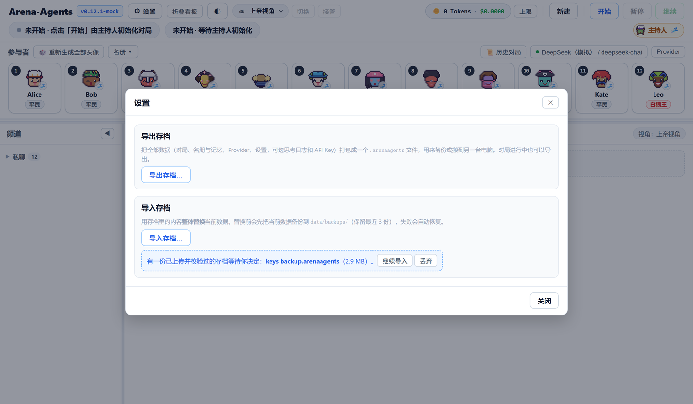
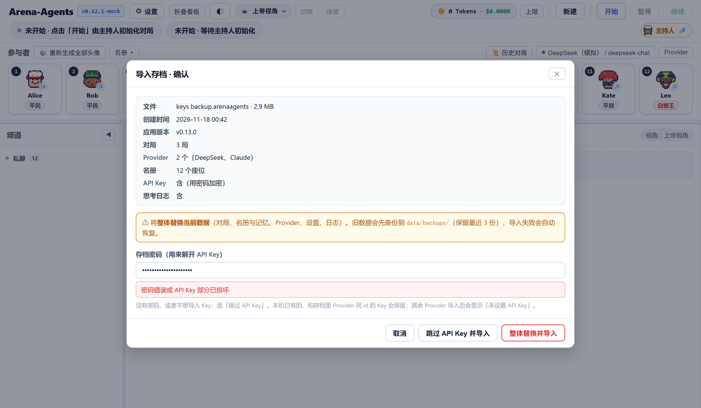

# 存档：导出、导入与转换（v0.13）

> 决策见 [v0.13-plan.md](v0.13-plan.md) 的 F24、F26–F33；接口与载荷细节在 [v0.12-contracts.md](v0.12-contracts.md) §11.9（**代码是权威**）。数据目录的布局与存储规则见 [storage.md](storage.md)。

v0.13 没有“工作文件夹”：全部数据在程序目录下的 `data/`。唯一的导出 / 导入入口是顶栏的 **⚙ 设置**，对象是一个 `.arenaagents` 文件——它既是备份，也是搬家（换电脑、换目录、从 v0.12.1 升级）的载体。

| 想做什么 | 怎么做 |
|---|---|
| 备份 / 搬到另一台电脑 | ⚙ 设置 → **导出存档**，到 `data/exports/` 取文件（或点“下载”） |
| 用存档恢复 / 在新机器上继续 | ⚙ 设置 → **导入存档**（整体替换当前数据，旧数据先备份） |
| 从 v0.12.1 升级 | 运行 `tools/migrate_v0121_to_archive.py`，再导入它生成的存档（见 [转换脚本](#转换脚本v0121--存档)） |
| 不想让别人看到 API Key | 导出时选择“导出 Key”并设置密码，Key 用密码加密；或者不导出 Key |

## 1. 文件格式

`.arenaagents` 是一个 zip 容器（deflate 或 stored；超过 4 GiB 的成员用 ZIP64）。**除 API Key 外，内容都不加密**：对局、思考日志、名册、Provider（不含 Key）都是明文 JSON / 文本，用任何 zip 工具都能打开查看。

### 1.1 成员（路径白名单）

只允许下面这些路径，**别的一律拒绝**（包括看起来无害的文件）：

| 路径 | 内容 |
|---|---|
| `manifest.json` | 清单，最后写入（见 §1.2） |
| `settings.json` | 默认模型绑定、模板、上次对局、预算默认值、界面偏好 |
| `providers.json` | Provider 注册表，**不含任何 `api_key` 字段** |
| `pricing.json` | 价格表缓存 |
| `roster/roster.json`、`roster/N<k>.persona.md`、`roster/N<k>.memory.md` | 名册（`k` = 1–99） |
| `games/index.json` | 历史列表的摘要缓存（缺失 / 过期时由程序从对局文件重建） |
| `games/<id>/game.json` | 一局（存档格式 v5）；`games/<id>/game.prev.json` 是它的上一份副本，导入时接受并校验，**导出不写**（原件损坏时用它代替并给出警告） |
| `logs/<id>/trace-NNNN.jsonl` | 思考日志（导出时可不含） |
| `secrets.enc` | 用密码加密的 API Key（可选，见 §2） |

路径规则：只用 `/`；不能是绝对路径、盘符、`..` 或空段；不含控制字符；长度 ≤ 256；不能有只差大小写的重名；`<id>` 必须匹配 `^[A-Za-z0-9_-]{1,64}$` 且不是 Windows 保留名（`CON`、`NUL`、`COM1` …）。程序数据目录里的 `secrets.v1.enc`（本机加密的 Key）、`master.v1.dpapi`、`.lock`、`backups/`、`exports/`、`tmp/` **永远不会**进存档。

### 1.2 `manifest.json`

```json
{
  "format": "arenaagents",
  "format_version": 1,
  "app_version": "v0.13.0",
  "archive_id": "4f1c0c9e8a2b4d7c9e51a3b6d0f2c8aa",
  "created_at": "2026-11-18T00:42:07-08:00",
  "contents": {"games": 3, "providers": 2, "roster_seats": 12, "has_secrets": true, "has_logs": true},
  "files": [{"path": "games/ab12cd34ef56/game.json", "size": 1234567, "sha256": "…64 位小写十六进制…"}],
  "files_sha256": "…"
}
```

| 字段 | 含义 |
|---|---|
| `format` / `format_version` | 固定 `arenaagents` / 当前 `1`。**更新的格式版本被拒绝**，并提示升级程序（先于其他检查） |
| `app_version` | 写出它的程序版本（仅供显示） |
| `archive_id` | 32 位小写十六进制随机数；`secrets.enc` 的认证数据里绑定它 |
| `created_at` | 带时区的 ISO-8601 |
| `contents` | 对局数、Provider 数、名册座位数、是否含 Key、是否含日志；导入时必须与清单和实际内容一致 |
| `files` | 除清单自己外的**每一个**成员：`path`、解压后 `size`、`sha256`，按路径排序 |
| `files_sha256` | 对整份文件清单的 SHA-256，算法见下 |

`files_sha256`：把 `files` 按 `path` 排序，每项只取 `{"path","sha256","size"}`，用 `json.dumps(rows, sort_keys=True, separators=(",", ":"), ensure_ascii=False)` 序列化为 UTF-8 后取 SHA-256。任何人都可以用几行代码重算它。

### 1.3 校验顺序（导入前，`importer.inspect`）

每一步失败都会停下并说明原因，**此前没有任何东西写进数据目录**：

1. 文件是普通文件、不是空的；zip 的“条目数”和“目录大小”在 zip 库分配任何对象之前就按上限检查（防止伪造的条目数）；
2. 能按 zip 打开；每个成员：路径在白名单内、没有重名、没有 zip 密码加密、压缩方式只能是 stored / deflate、不是符号链接或特殊文件、声明大小在上限内、压缩比不超过 300:1（大于 1 MiB 的成员）、总解压量在上限内；
3. `manifest.json`：JSON、格式名、**格式版本**、字段模型、每个路径、重复、`files_sha256`、`contents` 与文件清单的一致性；
4. 清单与实际成员**一一对应**（不多、不少）、每个成员的大小与清单一致；
5. 逐个成员边读边算 SHA-256 和大小（读到的字节不会超过清单声明的数量），并检查内容：JSON 能解析；`providers.json` 里**任何位置**都没有 `api_key` 之类的字段、Provider id 不重复；每局 `game.json` 是存档格式 **v5**、能通过 `GameSession` 模型、`session_id` 与目录名一致；`secrets.enc` 的头部形状和固定的 KDF 参数；
6. 汇总：对局数 / Provider 数 / 名册座位数与 `contents` 一致；`game.prev.json` 必须有对应的 `game.json`。

### 1.4 限制

| 限制 | 默认值 |
|---|---|
| 上传大小 | 2 GiB（环境变量 `ARENA_MAX_ARCHIVE_BYTES`） |
| 成员数（含清单） | 50 000 |
| 单个成员解压后 | 8 GiB |
| 全部成员解压后 | 64 GiB |
| 压缩比（大于 1 MiB 的成员） | 300 : 1 |
| 需要整个读进内存解析的成员（对局、设置…） | 256 MiB |
| 清单 | 32 MiB |
| 解压前磁盘空闲 | 解压量 + 256 MiB |

## 2. API Key 的加密

`secrets.enc` 是一个 JSON 对象，**除密文外都是明文**（里面没有秘密）：

```json
{"format": "arenaagents", "version": 1,
 "kdf": "scrypt", "n": 131072, "r": 8, "p": 1, "salt": "<16 字节>",
 "cipher": "aes-256-gcm", "nonce": "<12 字节>",
 "aad": "<被认证的头部>", "ciphertext": "<密文>"}
```

（字节串是标准 base64。）

- **密钥派生**：`scrypt(NFC(密码), salt, n=2**17, r=8, p=1)` → 32 字节。n = 2^17、r = 8 需要约 128 MiB 内存、约一秒。参数是格式的一部分：文件里写了别的值就被拒绝（文件不能让读取方烧内存 / 时间）。
- **加密**：AES-256-GCM，12 字节随机 nonce，每次导出重新生成盐和 nonce。明文是 `{"schema_version": 1, "keys": {"<provider_id>": "<api_key>", …}, "endpoints": {"<provider_id>": {"protocol", "base_url", "auto_append_path"}, …}}`——**每个 Key 都和它所属 Provider 的地址封在一起**（见 §2.2）。
- **认证数据（AAD）**：`{"archive_id", "format", "format_version", "purpose": "secrets"}`（键排序、紧凑 JSON）。所以 `secrets.enc` 不能被搬进另一份存档，也不能被当作另一个格式版本读取。
- **错误**：密码错误、`secrets.enc` 被改动、搬来别的存档的 `secrets.enc`、头部损坏——**统一**抛出同一个错误“密码错误或 API Key 部分已损坏”（AES-GCM 本来也分不清它们，我们也不让使用者分清）。此时**不导入任何 Key**；也可以选择“跳过 API Key”，其余内容照常导入。一份上传的存档最多允许输错 10 次，之后需要重新选择文件。
- **密码永远不会**写进存档、日志、异常文本、事件或响应；派生出的密钥只在函数内存在。

### 2.1 密码规则

新密码（导出时、转换脚本里）：**至少 12 位，最多 256 位；大写字母、小写字母、数字、符号中至少三类；输入两次。** 先做 Unicode NFC 规范化再计数；除 `A-Z`、`a-z`、`0-9` 以外的任何字符（标点、空格、非 ASCII 字母、汉字、emoji）都算“符号”；不能含控制字符。位数按字符（码点）计。

规则只有一份：`app/archive/kdf.py` 的 `password_problem`；前端 `static/js/archive.js` 是同一个函数的 JavaScript 实现，两边用同一张用例表 `tests/archive/password_cases.json` 测试，规则不会各改各的。导入时**不**检查密码强度（旧存档的密码按当时的规则设置）。

### 2.2 Key 与地址绑定

`providers.json` 不加密。如果 Key 只靠密码保护，拿到存档的人可以把某个 Provider 的 `base_url` 改成自己的服务器、重算清单和 SHA-256（清单没有签名，见 §3），再把存档交给你——你输入正确的密码，Key 就会被解开，之后你用这个 Provider 发请求，Key 就送到了他的服务器。

所以每个 Key 连同它的 Provider 的 `protocol`、`base_url`、`auto_append_path` 一起放进密文（被 GCM 认证）。导入时（**在输入密码之后、写入任何东西之前**）把密文里的地址和 `providers.json` 里现在的地址逐字比较：只要有一个**有 Key 的** Provider 不一致，就**不导入任何 Key**，提示“存档在导出之后被改动过”（`keys_mismatch`，422）。上传的文件还在，可以选择“跳过 API Key”导入其余内容，再在 Provider 里重新填 Key。名称、模型列表、价格这些不影响请求去向的字段不参与比较；存档里已经没有的 Provider 的 Key 直接丢弃；密文里没有地址（不是本程序的导出器生成的）同样按不一致处理。

## 3. 校验的能力边界

- **能发现损坏**：传输 / 磁盘错误、被截断、被改了一个字节、少了或多了文件、路径穿越、压缩炸弹、版本太新、对局数据不符合 v5 ——都会在导入前被拒绝，当前数据保持原样。
- **防不住有意的改动**：清单和校验值都在存档里，**没有签名**。有人改了内容再重新计算清单和 SHA-256，存档仍然是“合法”的。所以请只导入你信任的存档。
- **Key 部分由 GCM 认证，并且绑定了 Provider 的地址**：改密文、盐、nonce 或认证数据，或者换一份存档的 `secrets.enc`，都会解密失败；改 `providers.json` 里有 Key 的 Provider 的协议 / `base_url` / `auto_append_path` 会被 §2.2 的比较发现，Key 不会被导入。**但**跳过 Key 的导入会照单全收 `providers.json`：来源不明的存档导入后，请先看一眼 Provider 的 Base URL，再给它填 Key。
- **内容是明文**：对局、思考日志（可能含 agent 的推理）、名册里的性格 / 记忆谁拿到文件谁能读；密码只保护 Key。需要保密就别把存档放在公共位置。

## 4. 导出



⚙ 设置 → **导出存档**：

1. 是否导出 API Key？“不导出”则直接到第 3 步；
2. 选择“导出”：输入两次密码（界面实时显示三条规则是否满足，不满足不能继续）；
3. 是否包含思考日志（默认包含；日志可能很大）；
4. 后台打包，显示进度；关闭对话框不会中断，完成后自动弹出结果；
5. 结果弹窗显示保存路径（`data/exports/arena-<YYYYmmdd-HHMMSS>.arenaagents`；本机访问时是完整路径，远程访问只显示相对位置）和**下载**按钮。

要点：

- **对局进行中也能导出**：先保存当前对局（`flush_autosave("pre-export")`），导出那一刻的快照；保存失败只是警告。
- 同一时间只允许一个导出 / 导入任务（再点会得到“已有任务正在进行”）。
- 流式写 zip，边写边算 SHA-256，**清单最后写入**；先写 `.part` 再原子改名，所以 `exports/` 里出现的 `.arenaagents` 一定是完整的。失败（磁盘满、没有权限、Key 文件读不出）时不留残文件。
- 损坏的对局不会让导出失败：该局（连同它的日志）被跳过并写进结果的 `warnings`；`game.json` 坏了而 `game.prev.json` 好的，用后者顶替。`providers.json` 里出现 `api_key` 则停止导出（不会把明文 Key 写进存档）。
- Key 只导出本机仍存在的 Provider 的；没有任何 Key 时存档不含 `secrets.enc`，结果里有一条提示。
- 符号链接不会被跟随；数据目录里不认识的文件被忽略。

## 5. 导入

⚙ 设置 → **导入存档**（对局运行中入口禁用，提示先暂停）：

1. **上传**：浏览器用 XHR 把文件作为请求体流式发送（有上传进度）；服务端边收边写到 `data/tmp/`，**不读进内存**，超过上限立即中止；
2. **校验**：服务端做完整的 §1.3 校验（有进度）；
3. **摘要**：创建时间、应用版本、几局对局、几个 Provider（名字）、名册座位数、是否含 Key / 日志、文件大小，以及校验时发现的提示；

   
4. 含 Key 时：输入密码，或“**跳过 API Key**”。密码在这一步就被检查：错了立刻提示并可重试，**不会开始导入**；密码对但 Key 与 Provider 地址对不上（§2.2）同样在这里被拦下，提示改选“跳过 API Key”；
5. **整体替换**（界面写明“旧数据会先备份，失败会自动恢复”）：显示进度；
6. 完成后页面自动刷新；导入的“上次对局”以**已暂停**恢复。

导入只在对局不在运行时允许（服务端同样检查：409）。上传后的文件在 2 小时内有效；取消、过期、成功或被判定损坏时都会删除；服务重启后 `data/tmp/` 里残留的会被清理。

### 5.1 整体替换、备份与回滚

`importer.commit` 的顺序（在保存被暂停的窗口 `persistence_suspended()` 里进行，所以不会有旧对局的自动保存写进新目录）：

1. 解压到 `data/tmp/import-<id>/stage/` 并**再校验一遍**（边解压边核对 SHA-256），解压出的文件带回导出时的修改时间；`settings.json` 必须能被真正的设置读取器接受；若其中的“上次对局”指向存档里没有的对局，则清为空（避免启动时进入“无法恢复上次对局”的保护模式）；
2. **备份**：把数据目录的顶层条目（`settings.json`、`providers.json`、`pricing.json`、`roster/`、`games/`、`logs/`、`secrets.v1.enc` …）**整体改名**搬进 `data/backups/<YYYYmmdd-HHMMSS>/`；`.lock`、`master.v1.dpapi`、`backups/`、`exports/`、`tmp/` 留在原地（`master.v1.dpapi` 另外复制一份到备份里）；
3. **替换**：把解压好的条目改名搬进数据目录；
4. **Key**：见 §5.2；
5. 清除各存储单例的缓存，调用 `orchestrator.reload_from_data_dir()`（重新读名册、设置、Provider，重建 LLM 客户端，恢复“上次对局”为已暂停，广播新的快照）；
6. 删除临时目录，只保留最近 **3** 份备份。

**任何一步失败都会回滚**：新放进来的条目被移走，备份里的条目搬回原位，再通知应用重新载入原来的数据；当前数据保持导入前的样子。回滚本身的问题只写日志（不含路径之外的内容），备份文件夹会留在 `data/backups/` 供手动恢复。

### 5.2 Key 与“跳过 API Key”

- 选择导入 Key：用密码解开，写入本机的 `secrets.v1.enc`（用本机的主密钥加密）。
- **跳过 Key（或存档不含 Key）**：本机已有的、与存档里 **Provider id 相同** 的 Key 保留（通常是导入自己导出的存档）；其余 Provider 导入后显示“未设置 API Key”，开始对局时会提示。结果里列出还缺 Key 的 Provider。
- 没有任何 Key 要写时不会动本机的密钥库，所以没有主密钥的机器（Linux 未设置 `ARENA_MASTER_KEY`）也能导入不含 Key 的存档。

### 5.3 手动恢复

界面没有“恢复备份”按钮。要退回导入前的数据：

1. 停止 Arena-Agents；
2. 看 `data/backups/`：每个文件夹是一次导入前的数据，名字是时间；
3. 把 `data/` 里除 `.lock`、`master.v1.dpapi`、`backups/`、`exports/`、`tmp/` 以外的条目删掉（或先移走）；
4. 把选中的备份文件夹里的条目（`settings.json`、`providers.json`、`games/`、`logs/`、`roster/`、`secrets.v1.enc` …）移回 `data/`；
5. 启动程序。

备份里的 `secrets.v1.enc` 仍用**本机**的主密钥加密，只能在原来的电脑 / 用户下使用；跨机器搬 Key 要用带密码的存档。

## 6. 进度事件与接口

进度通过 SSE 事件 `archive.progress` 推给所有打开的页面：

```json
{"job_id": "…", "kind": "export", "phase": "pack", "done": 6000000, "total": 12000000, "status": "running"}
```

| `kind` | 阶段（`phase`，按顺序） |
|---|---|
| `export` | `flush`（保存当前对局）→ `collect` → `encrypt`（含 Key 时，约一秒）→ `pack`（`done` / `total` 是字节）→ `finalize` |
| `import` | `verify`（字节）→ `validate` → `backup` → `replace` → `keys`（有 Key 要写时）→ `reload` → `finalize` |

`status` 是 `running` / `done` / `error`；`error` 带 `message`（中文原因）和 `code`；`done` 带 `result`（**不含服务器上的绝对路径**）。上传校验期间的 `verify` 事件用上传的 `import_id` 作 `job_id`。轮询 `GET /api/archive/jobs/{job_id}` 得到同样的内容（本机请求的导出结果多一个绝对 `path`），事件丢了也能补上。

| 接口 | 说明 |
|---|---|
| `POST /api/archive/export` `{include_keys, password?, include_logs}` → 202 `{job_id}` | 弱密码立即 422 `weak_password` |
| `GET /api/archive/status`、`GET /api/archive/jobs/{job_id}` | 当前任务、等待决定的上传、对局是否在运行 |
| `GET /api/archive/exports/{name}` | 下载，只接受 `arena-YYYYmmdd-HHMMSS.arenaagents` 且位于 `data/exports/` 内，`Content-Disposition: attachment`；下载链接不能带请求头，所以这一个接口也接受 `?token=` |
| `POST /api/archive/import`（请求体 = 文件，`?name=`） → `{import_id, name, size_bytes, summary, expires_in}` | 上传并校验 |
| `POST /api/archive/import/{import_id}/apply` `{password?, skip_keys}` → 202 `{job_id}` | 密码错 422 `wrong_password`（可重试） |
| `DELETE /api/archive/import/{import_id}` | 取消，删除上传的文件 |
| `POST /api/notices/legacy-data:dismiss` | 忽略旧数据提示 |

写操作要求“可信客户端”（本机，或带了 `ARENA_API_TOKEN` 的请求）。错误一律是 `{"detail": "中文原因", "code": "…"}`：`invalid_archive` / `unsupported_version` / `weak_password` / `wrong_password` / `keys_mismatch`（422）、`too_large`（413）、`busy` / `game_running`（409）、`not_found`（404）。

## 转换脚本（v0.12.1 → 存档）

v0.13 不会读取旧的工作文件夹。把旧数据带过来：

```
python tools/migrate_v0121_to_archive.py                      # 默认的旧工作文件夹，不含 Key
python tools/migrate_v0121_to_archive.py --workspace D:/Arena-Workspaces/Mine --output mine.arenaagents
python tools/migrate_v0121_to_archive.py --include-keys       # 询问密码（输入两次，规则同 §2.1），Key 用它加密
python tools/migrate_v0121_to_archive.py --no-logs            # 不含思考日志
```

然后在 ⚙ 设置里导入生成的文件。

| 参数 | 说明 |
|---|---|
| `--workspace <路径>` | 旧工作文件夹（也接受它里面的 `.arena` 文件夹）。默认：Windows / macOS 是用户文件夹下的 `Arena-Agents/Default`，Linux 是 `~/.local/share/Arena-Agent/workspace/default`，且必须有 `.arena-workspace.json` 和 `.arena/` |
| `--output <文件>` | 输出文件，默认当前目录下的 `arena-v0121-<时间>.arenaagents`。**已存在则拒绝，不会覆盖**；也不能放在旧工作文件夹里面 |
| `--include-keys` | 同时导出 Key，用 `getpass` 输入两遍密码（最多三次机会） |
| `--no-logs` | 不含思考日志（小很多） |

退出码：`0` 成功；`1` 出错（说明了怎么办）；`2` 参数问题（输出已存在 / 在旧工作文件夹内 / 密码没设成功），此时没有生成任何文件。

- **只读源目录**：不写、不移动、不加锁、不创建主密钥文件（缺主密钥时直接报错）。测试逐个文件对比字节、大小和修改时间。
- **解密旧数据需要旧的主密钥**：Windows 默认由 DPAPI 保护，必须用创建旧工作文件夹的**同一个 Windows 用户**运行；用环境变量 `ARENA_MASTER_KEY` / `ARENA_MASTER_KEY_FILE` 的（Linux、Docker）请先设置成 v0.12.1 用的同一个值。
- **转换了什么**：Provider 注册表（去掉 Key，只留在 `--include-keys` 的加密部分；环境变量 Provider 不转换）、对局（解密，v4 → v5）、`settings.json`、`pricing.v1.json` → `pricing.json`、`roster/`、`logs/`。设置里“上次对局”若指向没转换的对局则清空。
- **对局 v4 → v5**：`schema_version = 5`、`takeover = {"seat": null}`、`human_spans = []`；`created_at` = 账本第一条的 `ts`、`started_at` = 第一条 `game.status` 为 `running` 的 `ts`、`finished_at` = 最后一条 `finished` 的 `ts`（之后又继续了则为 `null`），都换算成 UTC；最后用 `GameSession` 校验。
- **跳过并列入报告**：v0.12.0 及更早（格式 < 4）的对局、解密失败的对局、内容不符合 v5 的对局。主文件读不出时用 `previous.json.enc`。
- **报告**（只写数量和原因，**不会打印任何 Key**）：转换了几局、跳过了哪些及原因、Provider 数、是否带 Key、日志是否包含、输出文件路径与大小、提示。

## 旧数据提示

数据目录是空的（没有 `providers.json`，`games/` 下也没有对局），而默认位置有 v0.12.1 的工作文件夹（Windows / macOS：`~/Arena-Agents/Default`；Linux：`~/.local/share/Arena-Agent/workspace/default`；要有 `.arena-workspace.json` 和 `.arena/`）时，`GET /api/state` 带 `legacy_data: {"found": true, "dismissed": false, "path"?}`，页面在顶栏下显示提示条：**检测到旧版（v0.12.1）的数据：请先运行转换脚本，再到「设置」里导入存档。**

- **查看说明**：弹出命令和步骤（本机访问时还写出找到的文件夹）；“打开设置”直达导入；
- **忽略**：`POST /api/notices/legacy-data:dismiss`，记在 `settings.json` 的 `ui.legacy_data_dismissed`，不再提示；
- `path` 只给本机的请求；程序不会自动转换，也不会改动旧文件夹。

## 测试

`tests/archive/`（格式、KDF、导出、导入校验、导入与回滚、任务与进度、HTTP 接口、旧数据提示）、`tests/test_migrate_tool.py`、前端 `tests/frontend/test_archive_ui.js` 与 `tests/frontend/test_mock_archive.py`（模拟服务的存档接口）。密码规则两端共用 `tests/archive/password_cases.json`。
