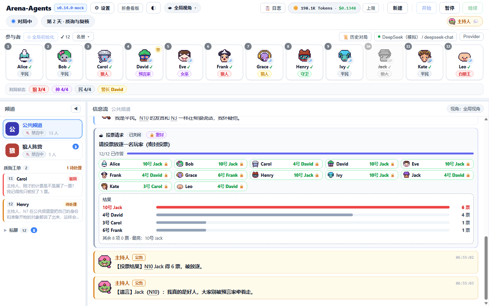
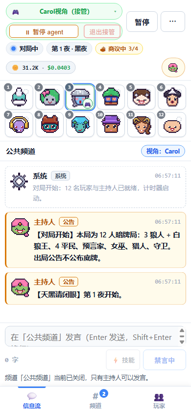
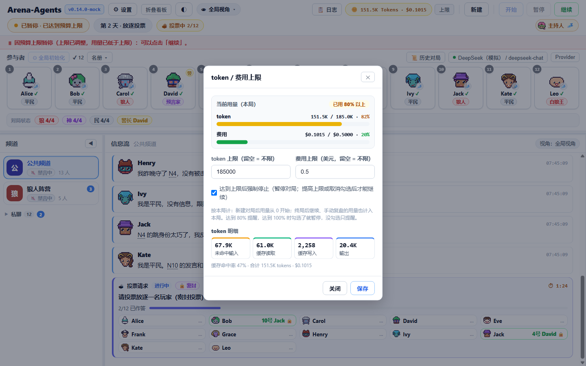
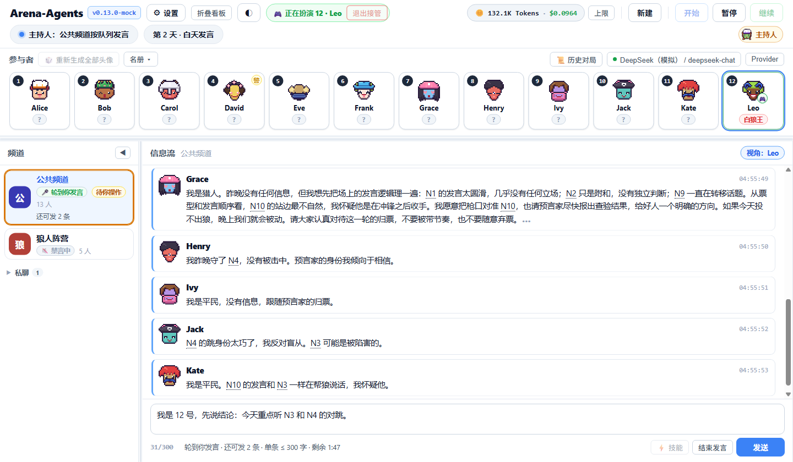
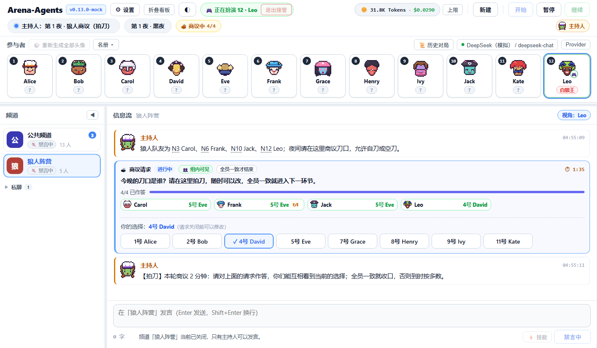
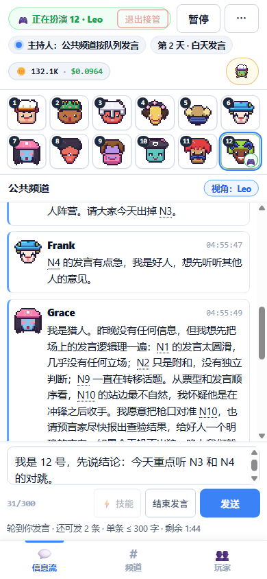

# UI Guide

This guide describes the **v0.14.0** web UI. The UI itself is in Chinese; the Chinese label of a
control is given in italics where it helps you find it. Everything below can be tried without an API
key: start the server with `ARENA_DEMO=1` (scripted bots) or run the UI mock (see
[Working on the UI](#working-on-the-ui)).



On a phone the same game looks like this (the viewpoint label and the take-over bar on top, mini cards, bottom tab bar; seat 3 is taken over here):



> **About the pictures.** The pictures of the main view, the phone, the limit dialog, the provider and the bindings dialogs were taken with v0.14.0 from the UI
> mock. The pictures in the take-over sections (`v013-takeover-*`) were taken with v0.13 and have not been taken again: where v0.14 looks different the text says so
> and the text is right — a card has a seat bubble and an initialization mark (✔ ⚠ ✖ ⏳ ○) and no identity tag before the start; the viewpoint is **one label**
> (not `[视角 ▾] [切换] [接管]`); there is no *重新发牌* bar. The layouts themselves are the same.

## Platforms and layouts

The page adapts itself to the device. A tiny script in `<head>` (`static/js/platform.js`) runs
before the first paint and writes these attributes on `<html>`; the CSS and the scripts only ever
look at them:

| Attribute | Values | Decided by |
|---|---|---|
| `data-platform` | `desktop` · `tablet` · `phone` | `phone`: narrower than 768 px, or a phone user agent held sideways (short side ≤ 500 px); `tablet`: a touch / mobile device (iPad, Android without `Mobile`, iPadOS reporting as a Mac with touch points, `(pointer: coarse)`, `userAgentData.mobile`) up to 1439 px wide; `desktop` otherwise |
| `data-layout` | `wide` · `compact` · `phone` | `phone` below 768 px (also a phone held sideways), `compact` up to 1023 px (up to 1024 px on a touch tablet), `wide` otherwise |
| `data-input` | `touch` · `mouse` | `(pointer: coarse)`, a mobile user agent, or an iPad posing as a Mac |
| `data-orientation` | `portrait` · `landscape` | viewport (taller than wide = portrait) |
| `data-os` | `ios` · `android` · `other` | user agent (informational: the stylesheet does not use it) |

The values are recomputed on resize and on rotation (no reload). For testing, the URL accepts
`?platform=phone|tablet|desktop` and `?input=touch|mouse`; `?nosse=1` switches the live event
stream off (no live updates then: the page shows what `/api/state` returned and only the answers to
your own clicks refresh it).

| Layout | Typical screens | What changes |
|---|---|---|
| **wide** | desktop ≥ 1024 px (touch tablets wider than 1024 px) | the 12 player cards sit in one row with a summary strip below; the channel column shows names and floor status; the detail card floats next to the clicked player |
| **compact** | touch tablets up to 1024 px, narrow windows (768 – 1023 px) | the cards are 6 × 2; the channel column shrinks to an **avatar rail** (names appear on hover / long-press; the rail is always on, so the **◀** fold button is hidden); everything else as wide |
| **phone** | < 768 px | the first row of the top bar only keeps the title and the [viewpoint label](#the-viewpoint-label-and-taking-a-seat-over) (while a [seat is played](#playing-a-seat) the label and the 🎮 bar take the title's place), the one enabled **Start / Pause / Resume** button and a **⋯** menu, the second row the [status label](#top-bar), the usage pill and the moderator chip; a bottom **tab bar** switches between *信息流* (feed, with 6 × 2 mini cards above it and — for a played seat — its input box below), *频道* (channels, full-width list with names) and *玩家* (players: the full cards, 3 per row, with the controls of the participant bar: *⚙ 全局初始化*, *名册 ▾*, *复盘全部*); the player details open as a **bottom drawer**; dialogs are full screen; every tap target is at least 40 px |

On touch devices (`data-input="touch"`) buttons, inputs and check boxes get a 40 px (check box rows
44 px) hit area.

## Live game

### Top bar

The first row (desktop / tablet):

1. **Title and version** — in demo mode the version badge gets a *· 演示模式* suffix.
2. **⚙ Settings** (*设置*) — opens the [settings dialog](#settings-dialog-archive-l0s-contract-rules-games): five
   columns — the archive (export / import everything), the L0s of the bots, the official contract, the rules (with
   their study materials) and the games (delete, export, import). (v0.12.1's *工作文件夹* button is gone: the data lives in
   `data/` next to the program and there is no folder to choose.)
3. **Collapse board** (*折叠看板*, then *展开看板*) — hides the whole participant bar, including the
   buttons in its header (see [Player cards](#player-cards)), to give the feed more room.
4. **Theme** (◐) — light / dark; the choice is not remembered after a reload.
5. **Viewpoint label** (v0.14) `[👁 全局视角 ▾]` · `[👁 Alice视角 ▾]` · `[🎮 Alice视角（接管） ▾]` — one label instead of v0.13's
   `[视角 ▾] [切换] [接管]`. Click it to open a menu: *全局视角*, *以 X 的视角观看* and *接管 X* for each of the twelve players, and *退出接管*
   (see [Spectating](#spectating) and [the viewpoint label and taking a seat over](#the-viewpoint-label-and-taking-a-seat-over)). The label
   is pure front-end state — worked out from the viewpoint you chose and the seat you play; the server has no such field. While a seat is
   played the label carries the 🎮 and is locked, and the **takeover bar** `正在扮演 3 · Carol`, *⏸ 暂停 agent* (the
   [soft pause](#thinking-time-the-soft-pause)) and *退出接管* sits next to it.
6. **📋 日志** (*日志*) — the [error log](#error-log): every model call and runtime error of the game. A
   red badge counts the **unread** timeouts and errors (below 1320 px wide the button shows the icon alone;
   the badge stays).
7. **Usage** and **Limit** (*上限*) — see [Usage and budget](#usage-and-budget).
8. **New** (*新建*) — starts a fresh game at once. There is no *Save* button any more: every change of
   the game is written to `data/` half a second later, so the game is always saved.
9. **Start / Pause / Resume** (*开始* / *暂停* / *继续*) — game lifecycle. **Start** is only enabled
   for a fresh game and runs the [start check](#the-start-check): every bot must be ready, and the contract, the scenario and the
   models must be in place - otherwise a dialog lists what is missing and nothing starts; the identities are dealt only when it
   passes. **Pause** while the game runs, **Resume** when it is paused — and after the
   end. Timers (speaking time, request deadlines) freeze while the game is paused. A **finished**
   game can still be resumed: the moderator is told that the game was continued after the end.

The second row starts with the **status label** (v0.14, `session.system_status`; it replaces the old status text): *未初始化* (some bot
is not initialized: ○ ⚠ ✖ on its card), *初始化中*, *对局前* (everything is ready, the game has not started), *对局中*, *已暂停 · 手动暂停* (a pause says why:
*主持人暂停了对局：…* for the moderator's `hold`, *已达到预算上限* for the budget, *对局长时间没有进展*, *运行出错*), *已结束* and *复盘中*. While a
[soft pause](#thinking-time-the-soft-pause) holds the agents it says *对局中 · agent 已暂停* (*对局中 · 收尾中（还有 N 个回答）* while the calls in flight
are still being finished). The order of priority is the server's: initializing / reviewing, then running / paused / finished, then uninitialized, then
*对局前*; a replay on screen says *重放中 · 0:41 / 0:41* instead. The dot is blue (pulsing while the system works), amber (uninitialized, paused),
grey, or green; **hover** it for the whole sentence (what the state means and what to do, the full reason of a pause, who won). After it come the **phase** text written by the
moderator, small **progress chips** for open requests (*🗳 投票中 7/12*, *🗳 商议中 3/4*,
*✍ 作答中 1/1*; at most three, then *+N*) and the **moderator chip** at the end of the row. The
moderator is not a player card: it is a small chip with its own random pixel avatar, its name and
its state icon; click it to open its details.

On a **phone** the first row holds the title and version, the **viewpoint label**, the one enabled lifecycle button and
the **⋯** menu (the label wraps into a line of its own when the title and the buttons leave no room; while a seat is played it takes the title's
place and the takeover bar goes into a line under it); the status row below keeps the status label, the usage pill and the moderator chip.
Settings, theme, limit, the error log (*日志*, with its badge, which then also sits
on the **⋯** button itself), new, history, bindings and Provider live in the
**⋯** menu (the very same buttons, moved there while the layout is `phone`; **Collapse board** is
not offered on a phone). The viewpoint label and the takeover bar of a played seat are the exceptions: they stay in the first row instead of moving into the menu.

### The start check

**Start** first checks that the game can be played. The server checks (and answers `409`), the page shows the answer: every one of the twelve
bots has a complete L0 and an initialization that is ✔ (⚠ does not count), the official contract and the scenario can be read, and the
moderator and every player have a model. When something is missing the server answers `409 {"detail", "code": "NOT_READY", "problems": [Problem…]}`,
**nothing is dealt and nothing starts**, and the page opens the dialog **还不能开局**:

- the problems are **grouped by what is not ready**: *官方契约*, *剧本*, then the players in seat order (*3 号 Carol* — a player's own problems and the missing
  model of its seat are one group), *主持人*;
- every item is the server's own sentence with a button that takes you to the place that fixes it, by the item's `fix`: *去初始化*, *去编辑底层设定* /
  *去导入底层设定*, *去绑定模型*, *去导入契约*, *去导入规则*. The button closes the dialog and calls `window.Bots.focus(botId, fix)` (see
  [the Bots interface](#interface-for-scripts-1): the player's details at the L0 editor or the initialization row, the bindings of that seat, the settings dialog at that
  column); an item whose `fix` the page does not know just shows its sentence, and without `window.Bots` the button closes the dialog and does nothing;
- when two or more players only need their initialization the dialog's own button is **⚙ 全局初始化** (`Bots.initAll()`), otherwise it says *知道了*;
- a refusal that carries no list is shown as a toast with the server's sentence.

The cards still have no identity tag afterwards (nothing was dealt) and **Start** works again as soon as the problems are fixed.

### Banners

A banner appears under the top bar when something needs attention (a phone shows a one-line version):

| Banner | When |
|---|---|
| **Hold** | the moderator paused the game and gave a reason (*确认后点击「继续」*) |
| **Budget** | the game is paused because of the limit (*因预算上限暂停*), or the limit is reached while *force stop* is off (the game keeps running); after the limit was raised while paused it says that **Resume** works again |
| **Stall warning** | the watchdog saw no progress (`session.stall_notice`); the game keeps running, and the warning goes away by itself when the game moves again |
| **Game over** | winner and summary, plus the hints *continue after the end* and *review all* |
| **Autosave error / connection lost** | the save failed (*自动保存失败*); the event stream is reconnecting (*连接断开，正在重连…*, a separate bar at the top of the window) |
| **Old data found** | a bar under the top bar while `data/` is still empty and a v0.12.1 workspace exists at its default place: *检测到旧版（v0.12.1）的数据：请先运行转换脚本，再到「设置」里导入存档*; buttons *查看说明* (the command and the steps, see [Settings dialog](#settings-dialog-archive-l0s-contract-rules-games)) and *忽略* (remembered: it never comes back) |
| **Restore notice** | a bar under the banner whenever the server has something to say about the game it started with: *已恢复上次对局（已暂停）* after a restart, *已导入存档（…）* after an import or loading a stored game, or why a fresh game was created instead (an old save that was kept, a save that could not be read, a data folder that could not be used); it also lists the actors that still need a model; buttons *查看模型绑定* and *知道了* |

### The question at the end of a game

When the game is **over** (*已结束*), can be reviewed (it has bots: a game of the old format cannot), nothing is being reviewed and **nobody
has been reviewed yet**, a window asks — once — **这局结束了，是否让 bot 复盘？**

- All twelve bots are listed in seat order, all of them selected (*全选* / *全不选*; *已选 12 / 12* counts what is ticked; *复盘* is off with nothing ticked).
- A seat a **person played** in this game is marked **有人类代打** and has the switch **学习接管者的风格** (on by default): then the bot may also learn how the person
  played its seat — a change of its voice is only *proposed* for its L0 and waits for you. The seats come from the game's `human_spans`
  (`GET /api/games/{id}/detail`) and from the seat that is played right now.
- **复盘** sends `POST /api/game/review {"ids": ["N1", …], "learn_style": {"N3": true}}` (only the seats a person played carry a switch) and gets
  `{"started": […], "deadline_s": 60}`. The same window then shows **every bot**: *排队中…*, then *⏳ 复盘中 · 还剩 43 秒* with a bar (the seconds of each
  `review.progress` event, counted down in the page between two events), and when it is done *✔ 已复盘* with what it changed — *改动了 2 个文件：打法、印象* —
  and *有 2 条对底层设定的修改建议，等你确认* with a button **去看看** that opens the player's details (the section *待确认*; the window goes first). A review that
  ran into its 60 seconds says *⏱ 时间到，已保存写好的部分*, a failed one *✖ 复盘失败：…*. Closing the window leaves the reviews running: the participant bar and each player's details show them.
  A refusal (`409`) is shown as a toast and the window stays a question.
- **暂不** (also the ✕ and Esc) is remembered **per game** in `localStorage["arena_review_dismissed_v1"]` = `{"<session id>": true}` (the last 100 games): the question does not
  come again for that game, not after a reload either. *Review all* (*复盘全部*) in the participant bar and *Review this player* in the details still work
  (see [Review](#review)).
- The question comes when the *live* game ends: while a [replay](#replay) is on screen it waits.

### Usage and budget

The **usage pill** shows the tokens of the game (all four kinds added: uncached input, cache read,
cache write, output) and the cost. Cost is accumulated from each call's price snapshot; editing a
model price later does not rewrite history. Clicking the pill opens the model bindings. The
**Limit** button next to it (*上限*; *token / 费用上限* in the **⋯** menu) opens the budget dialog:

- **Token limit** and **cost limit (USD)** (*token 上限*, *费用上限*) — empty means unlimited;
  positive numbers only (tokens must be whole numbers). The limits are saved with the game and
  remembered as the defaults of the next ones; the used amounts restart from 0 with every new game.
  Everything the game spends counts: continuing after the end, the manual review and *用主持人模型完善*
  too.
- **Force stop** (*达到上限后强制停止*) — when ticked, reaching a limit pauses the game (*因预算上限暂停*).
  **Resume** is refused until you raise the limit (or untick the box). When it is not ticked the game
  keeps running and only the colours, a banner and a toast tell you.
- Progress bars for each limit and the split of the used tokens into the four kinds, with the cache
  hit rate. The pill turns **yellow from 80 %** of a limit and **red at 100 %** (and pulses); the
  dialog updates live.



### Player cards

Every player is a card in the participant bar (wide layout):

```
(3)                     [警]    <- seat bubble over the corner · small badges (sheriff …)
        [ pixel avatar ]💤      <- agent state, on the avatar's lower-right corner
          Carol ✔               <- nickname (never the internal id) · initialization mark
        [ 狼人 ]                <- identity tag (none before the deal)
```

- **Seat bubble** (v0.14): the seat is a translucent round bubble with its number, laid over the card's
  top-left corner — the card is the bot, the bubble is the seat (the ids of the game are `N1`…`N12`; the UI only
  shows the seat number and the nickname — default nicknames are Alice, Bob, Carol …). It has one set of colours for
  the light and one for the dark theme and never takes a click (the card behind it does).
- **The identity is always the main tag.** The sheriff and other highlighted tags are small badges
  (the first character of the tag, e.g. *警*) in the top-right corner and never replace it. When
  the current viewpoint may not see the identity, the tag is a grey **`?`**.
- **No identity before the deal** (v0.14, H52): the identities are dealt when the game starts. While `session.dealt` is
  false a card has **no identity tag at all — not an identity, and not even the grey `?`** (whatever the viewpoint, the
  global one included) — no badges either, and the god view has no summary strip: there is nothing to count. A seat you take
  over before the start sees no identity either; it is dealt by *Start*. After the start the cards are as they always were.
- **Pixel avatar**: a 20 × 20 sprite composed from the avatar library (`static/avatar/parts.json`,
  generated by `tools/avatar_lab.py`), drawn with `image-rendering: pixelated`. Without the library
  the page falls back to a flat circle with the seat number.
- **Players who are out** are greyed with a strike-through name and tag.
- **Agent state** — a small round icon on the avatar's lower-right corner (on the card's
  bottom-right corner in the compact and phone layouts); an agent has three states, a seat that
  a person plays has a fourth, and the [soft pause](#thinking-time-the-soft-pause) adds a fifth:

  | Icon | State | Looks |
  |---|---|---|
  | 💭 | **thinking** (*思考中*) — a model call is running | pulses; the card gets a blue ring |
  | ⚡ | **acting** (*执行中*) — executing tools | flashes; the card gets an amber ring |
  | 💤 | **sleeping** (*休眠*) — nothing to do | still; the tooltip says *休眠：等待新消息* (waiting for a new message) or *休眠：定时醒来：剩余 N 秒* (timed wake-up, counted down on the game clock; *休眠：即将醒来* once it is due) |
  | 🎮 | **human** (*人类操作中*) — a person plays the seat, there is no agent | still; the card gets a green ring; it stays so while the game is paused (see [Playing a seat](#playing-a-seat)) |
  | ⏸ | **held** (*暂停中*) — the agent was woken up and now waits in front of the soft-pause gate (`agent.status` `held`) | still; the card gets an amber ring; it goes back to 💭 / ⚡ when the pause ends |

  There are no floor, request or *stopped* badges any more (a paused game puts every agent to sleep).
  The moderator chip shows the same states. In a player's viewpoint only that player's own state is
  shown (the moderator chip then shows none) — with one exception: once a soft pause has stopped
  *every* agent (*⏸ agent 已暂停*), every other card and the moderator chip say ⏸ 暂停中, whether the
  agent was awake or not. That is the state of the whole game, so it gives nothing away about who was
  busy; while the calls in flight are still being finished nothing is shown.
- **Colour marks** — while a seat is played, a card carries a small dot in its top-right corner (the
  sheriff's badge moves aside for it): it opens the palette, and a marked player gets a stripe along
  the top edge of the card, too. See [Colour marks on the players](#colour-marks-on-the-players).
- When a player uses an ability, its card flashes for three seconds and a toast says so
  (*⚡ Carol 发动了能力：…*); the declaration itself is in the feed.
- In the **god view** a **summary strip** (*对局状态*) ends the participant bar: faction counts and
  the sheriff (`狼 2/4 · 神 4/4 · 民 3/4 · 警长 Grace`). It is hidden information and is not shown
  in a player's viewpoint.

The **header of the participant bar** (*参与者*) holds the bar's own controls. On the left, above the
cards: **Initialize all** (*⚙ 全局初始化*, with the counts of the states next to it: `✔ 9 · ⚠ 1 · ✖ 1 · ○ 1`), the
**名册 ▾** menu (what a game loads of the bots' memory, new avatars, clearing what they learned; see
[Bots](#bots-initialization-editors-memory-and-review)) and, after the game ended,
**Review all** (*复盘全部*). On the right: **History** (*📜 历史对局*: the stored games - replay, continue; see
[History of games and replay](#history-of-games-and-replay)), the **model bindings** button (*模型绑定*: it shows the
moderator's Provider / model, *未绑定模型* when there is none, or *演示模式 · 脚本机器人* in demo mode)
and **Provider** (see [Provider and model setup](#provider-and-model-setup)). On a phone the
right-hand buttons live in the **⋯** menu and the left-hand ones in the *玩家* tab.

A card shows the state of the player's **initialization** next to its name: `✔` ready, `⚠` needs a new
initialization (the L0, the contract, the scenario or its materials changed), `✖` failed, `⏳` running (the
tooltip counts the seconds left and says which files are written), `○` never initialized. The tooltip of `⚠` / `✖`
says why. A game of the old format (v5) has no bots and no marks.

#### Moving the cards

While the game has **not started** — and nobody plays a seat, and no [replay](#replay) is on screen — the cards can be moved: the
seating *is* the line-up of the bots, so a bot's name, avatar, memory, initialization and model binding move with its card (the
seat numbers stay where they are). The cursor over the cards is a hand.

- **Mouse / pen**: press a card and move it. A movement of more than 6 px starts the drag (a press that does not move opens the
  card on its click, as before); the card follows the hand, the seat it would take is outlined with a dashed line, and on release the
  bot takes that seat and the bots in between move up (or down) by one. Released over no card, or on its own seat: nothing happens.
  **Esc** puts the card back.
- **Touch**: hold the card for about 0.4 s, then move it; a swipe before that scrolls the page as usual, and the page does not scroll
  while a card is carried.
- **Keyboard**: with the focus on a card (**Tab**), **Alt+←** / **Alt+→** moves it one seat; the focus goes with the card, so the keys
  can be pressed again. At the ends nothing moves, but the browser does not "go back". After the start the keys are not taken.
- The page shows the new seating **at once** and sends `PUT /api/bots/lineup {"order": [the twelve bot ids in seat order]}`; the answer
  (the table, as in the `bots.updated` event) is adopted. A refusal (`409 game_active` as the game has started in another tab, `422`) or a
  failed request **puts the cards back** and says why (*座位没有调整成功，已恢复原来的座位：…*). One move at a time: a second one while the
  first is on its way says *正在保存上一次的座位调整*.
- While a card is pressed or carried the cards are **not repainted** (an initialization's progress arrives every second and would replace
  the card under the finger); they are drawn when it is let go.
- After the start, while a seat is played and in a replay, the cards cannot be moved: the cursor is a plain pointer and a press opens the card on
  the mouse-down, as in v0.13.

### Player details

Click a card (or focus it and press Enter or Space) to open the details: a floating card just below
the player on desktop and tablet (Esc, the ✕ or a click outside close it), a **bottom drawer** with a
backdrop on a phone (drag the handle down, tap the backdrop or press Esc to close). The moderator
chip opens a reduced panel: the moderator is not a bot - its name is fixed and it has no L0, memory, initialization or review,
but it shows its random avatar with its [code](#avatar-code-and-the-dice-panel) (and the 🎲 panel before
the game starts), its state, its model, its metrics and a **🧠 思考记录** button (the
[thinking record](#thinking-record) of the moderator).

- **Name** — editable while the game has not started (1 – 20 characters, no colon (`:` or `：`), no quotes,
  backslashes or angle brackets, unique among the players ignoring case; saved with *保存名字* or Enter).
  The page checks a *new* name before it sends it and says what is wrong in the server's own words (*名字不能包含冒号（: 或 ：）。*:
  the name is the label in front of an impression); a name that is already stored with a colon, from an older version, is shown
  as it is and saving it unchanged does nothing. During a game the name is plain text. A **🔒** before the name says that the
  bot is *frozen*: see [Frozen bots](#frozen-bots-and-the-question-before-a-new-name-or-avatar).
- **Avatar and its code** — under the avatar: *头像编号* (`f03s05h12c07e04m02a09k03`) and *复制*. Before the
  game starts a **🎲** button opens a small panel: *随机生成* rolls a new avatar, *按编号生成* makes the avatar
  of a code you type. See [Avatar code and the dice panel](#avatar-code-and-the-dice-panel).
- **Initialization** — a row with the state (`✔ 已初始化`, model, how long it took, when; `⚠ 需重新初始化（底层设定变了）`; `✖ 初始化失败`
  with the reason; `⏳ 初始化中` with a bar, the seconds left and the files written) and the button **初始化** / **重新初始化** /
  **重试初始化** (**取消初始化** while it runs). See [Initialization](#initialization).
- **🧠 思考记录** — opens the [thinking record](#thinking-record) of this player in a window of its own.
- **View as this player** (*以 Carol 的视角观看*) — switches the spectator viewpoint (not offered
  while you are already viewing that player; disabled, with a tooltip, while a seat is
  [played](#playing-a-seat): the viewpoint is locked to it).
- **State, tags, model** (*模型*, with a *配置* button that opens the model binding) and the
  **metrics**: activations, LLM calls, thinking rounds, tool calls, rejected calls, cache hit rate,
  cost, and the four token kinds (uncached input, cache read, cache write, output). These are
  statistics only — tool-call details are never shown, and the model's own thinking is in the
  [thinking record](#thinking-record), not here; everything is also in the plaintext trace log in
  `data/logs/`. Before the game starts there are no tags (the identities are dealt at the start).
- **Four editors** (below the metrics, closed at first; each shows a line of what is in it): **底层设定**, **记忆**, **待确认**
  and **导入 / 导出**. See [The editors](#the-editors).
- **Review this player** (*复盘此玩家*) after the game ended; the panel then lists what the review
  changed (*本次改动*, old → new). See [Review](#review).

### Channels and the feed

- The **feed** shows one channel at a time: speech, moderator announcements (badge *公告*; template
  messages carry a *模板* badge and are highlighted), ability declarations (*能力*), challenges
  (*质询*) and their replies (*质询回复*), system notices (*系统*) and **request cards**. Every
  message carries the sender's avatar (a player's pixel avatar, the moderator's own random one, a
  gear for system notices) and **nickname**. Messages arrive whole — there is no streaming.
  A moderator's message or a text answer that was over its limit is cut and ends with an ellipsis; **a player's speech never is** (v0.14, H16: over
  the limit it is sent back whole, see [The input box](#the-input-box)).
- A player id in a message — the moderator's text or a player's (`N3`, `N10` …) — keeps its
  characters but gets a dotted underline and a tooltip with the nickname (*N3 Carol*); the text
  itself is not rewritten.
- The **channel list** has **no "All" channel**: the **public channel** is selected by default (before
  the game starts only the players' private chats exist and nothing is selected). Each channel shows
  its **floor state**:

  | Icon | Floor state |
  |---|---|
  | 🔇 **禁言中** | only the moderator can write (was "closed") |
  | 🎤 **轮流发言** | turn-taking: a holder has the floor (*持麦：Kate*; *轮流（暂停）* while paused) |
  | 📋 **队列 10/12** | the moderator's speaking queue with its progress; the current speaker on a line below (*持麦：Kate*) |
  | 💬 **自由讨论** | free discussion with a character progress, e.g. *450/2000 字* |
  | ❄ **已冻结** | an ability froze the channel until the moderator rules (*等待主持人裁决*) |
  | 👁 **只听** | listen-only: the members can read but not write |

  Click a channel to read it; unread counts are shown per channel (and on the *频道* tab of a
  phone).
- **Private chats** (one per player) are folded into a **Private chats** (*私聊*) group (click it to
  unfold; it opens by itself while one of them is selected), have a different background colour and
  are titled with the other party's **nickname only** — there is no "private chat" in the title.
  A private chat that is still free shows no floor chip.
- **Challenge tickets** (*质询工单*) keep their own group: who challenged, the status (*待处理*
  pending / *成立* upheld / *驳回* rejected) and a preview; the group title counts the open ones.
  Click a ticket to jump to that private chat and to the ticket's message. Players may challenge the
  moderator at any time; the moderator must answer and may close the private chat of a player who
  abuses the feature.
- The channel column is an **avatar rail** on narrow screens (the compact layout): one icon per
  channel, the tickets folded into one numbered icon (it opens the ticket list), the private chats
  into one group icon. Hover (mouse) or long-press (touch) shows the full name. In the wide layout
  you can fold the column yourself with the **◀** button (**▶** unfolds it); its width is
  draggable there. On a phone the *频道* tab shows the full list with names.

### Request cards

When the moderator asks players something (`open_request`) the question appears **in the feed as a
card** at the place where it was opened, and the **same card** is updated as answers arrive and when
it is closed:

- the question, the kind in the title (*投票请求* vote, *商议请求* deliberation — a request with
  shared answers —, *问答请求* question), its status (*进行中* / *已关闭* / *已取消*), a countdown
  (*⏱ m:ss*) on the game clock when the request has a deadline (it freezes while the game is
  paused) and a progress bar (*4/4 已作答*);
- one row per recipient with the player's current choice;
- **shared answers** (*👥 组内可见*, e.g. the wolves' kill): every recipient sees the others' current
  choices live and may change their mind until the request closes — a changed answer is marked
  `↻1` on the same row. The closing rule (*全员一致才结束* / *到时才结束*) is shown on the card;
- **sealed** requests (*🔒 密封*, e.g. the daytime vote): other players' answers stay hidden
  (*✓ 已提交*). The god view reads them (marked 🔒);
- when the request closes, the card shows the **result**: a tally with bars (options with 0 votes
  are folded into *其余 N 项 0 票*), the leaders (*最高*), defaulted answers (*默认答案*) and
  missing players (*未作答*);
- for the seat a person [plays](#playing-a-seat) the card is also where the answer is given:
  option buttons or a text box under the rows.

**Visibility.** The god view sees every request. A player's viewpoint only sees requests addressed
to that player, in the channel where the request lives, and only the answers that player may see;
the tally of a sealed request is only drawn in the god view (a player's card says *已关闭，共 N 人作答*
and leaves the result to the moderator's announcement).

### Thinking record

The **🧠 思考记录** button of a player's details (and of the moderator's) opens what that agent *thought*, like a
chat log, in a window of its own above the details (not a browser pop-up; full screen on a phone). Esc or ✕ close the
window first, the details second. The thinking record and the [error log](#error-log) can be open at the same time: the one
opened last is on top, and **one Esc closes one window — the newest** (then the other, then the details).

- **Bubbles.** *🧠 思考* is what the model reasoned, *💬 自言自语* is plain text it wrote without calling a tool. A
  bubble says its round inside the activation (*第 2 轮*), the model and the time; a bubble of more than 700 characters is
  folded (*展开全文* / *收起*). Tool calls, their results and receipts are **not** part of it (so the speech itself is not
  either: that is in the feed).
- **One divider per wake-up**: *⏰ 被唤醒 · 游戏时间 2:05* (the game clock; the local time when the record does not know it).
- **Newest at the bottom.** The window opens at the bottom and follows the newest bubble while you stay there; if you
  scroll up a *↓ 有 N 条新内容* button takes you down. The newest 50 are loaded; *↑ 加载更早的记录* (or scrolling to the
  top) loads 50 more, down to *— 这是最早的记录 —*. A very large log is read one stretch at a time: an empty newest page
  that has more behind it offers *继续往前找*.
- **Every 3 seconds** while the window is open the newest page is read again and only the bubbles that are new are added
  (thoughts never travel in the event stream, in a replay or in a session: they are read from the trace log by this one
  request, see [the contract](v0.12-contracts.md) section 12.4). *刷新* reads at once. If more than one page of bubbles came in
  between two polls (a tab in the background is throttled by the browser; or an agent that thought a lot), the page does not
  lose the stretch in between: it remembers where the hole is and fills it up to 20 pages per poll, newest stretch first,
  until the list is whole again (the footer says *中间有一段新内容正在补读…* meanwhile); no page is read twice.
- **While another seat is played** (*接管*) and the game is not over, the thinking of every *other* agent is closed — the
  button is disabled, with the reason as its tooltip and as a line of text under it (a phone has no tooltips):
  *接管期间不能查看其他玩家的思考记录，对局结束后开放。* The played seat's own record (what its agent thought before
  the takeover) stays open; after the end everything is open. If a takeover begins while the window shows another
  agent, the window says so and shows the record again when the game ends. The server refuses as well (`409`), and its
  words are what the page shows for any refusal (`404` no such player, `400` a bad cursor).
- A [replay](#replay) shows another game than the server's record: the button is disabled with its own reason.
- **Empty record.** *还没有思考记录：这名玩家还没有开始行动…* before the agent has acted; *该模型没有返回思考内容…* when it
  acted but the model returned no reasoning (or the log was left out of an imported archive).

### Error log

The **📋 日志** button of the top bar opens the log of the current game: one line for every model request (each HTTP attempt
is a line of its own) and for the runtime errors that are no model request (a tool that raised, a timer pass that failed,
an agent that gave its action up). Nothing in it is a prompt, a model answer, a header or a key — only counts, names, status
codes and an error text that the server scrubbed (at most 500 characters).

- **The badge** counts the **unread** lines whose result is *超时* or *失败*; a retry and a cancelled request are no error.
  It reads *99+* beyond that. On a phone the button lives in the **⋯** menu and the badge also sits on **⋯**.
- **A line** shows the local time and the game time, who (*N3 Carol*, *主持人*, *复盘 · N4 David*, *初始化 · Carol* - a bot's own initialization, by its name: its id is never shown -, *完善*, *系统*), the
  Provider / model, the result (*成功* / *重试* / *超时* / *失败* / *取消*, *运行错误* / *将重试* for a line that is no model
  request), how long that attempt took, the tokens (input including cache / output) and why it ended (the finish reason,
  the HTTP status, the error class, *已取消*). Newest first; the first 300 are drawn, *显示更多* adds more.
- **A line opens** on a click: type, role, purpose, Provider / model, *第几次尝试* (*第 1 次（失败，随后重试）*), the time, the
  HTTP status, the error type, the scrubbed message, and the tokens as the four kinds. Several can be open.
- **Filters**: *全部* / *只看错误* (retries included; its count is shown) and a role select. *全部标为已读* clears the badge;
  *刷新* reads the whole log again. The window keeps the last 2000 lines of the game (*只显示最近 2000 条*).
- **Live.** Each line arrives as an `llm.call` event (an ordinary event: it may be dropped); a new game starts a new log. The log
  is the **live** game's: while a [replay](#replay) is on screen its lines keep coming and the badge keeps counting. A server
  without the endpoint (an older one) leaves the button without a badge. The existing *重试用尽* toast stays.
- **When the page reads the log again.** What the page keeps is the failed lines (the badge needs nothing else) — or every line
  while the window is open. It reads that again when the ids skip (an event was dropped), when a line arrives that does not fit
  (an id the page holds for another line, or a failed line that should be there and is not), after the snapshot that follows a
  reconnect, and when the window is opened. It is always **the whole of what the page keeps** (`GET /api/llm/calls?errors_only=true`,
  or without it), never "the lines after the last id": those say nothing about whether the lines before them are still the
  same ones, and a server that was restarted may have numbered a *longer* log from 1 again. An answer **replaces** what the
  page holds. Reads are numbered, and only the answer of the newest one counts: the slow answer of the badge's read can neither
  replace the whole log the window has read since, nor undo it. The answer of a game that was left is never taken.
  Reading again is bounded: the first time after a quiet period it is at once; while a read is on its way, further
  reasons are folded into one more read behind it; and two such reads are at least 1.5 s apart (twice as far for each one in a
  row that found nothing wrong, up to 12 s). A late copy of a failure from far below the ring (older than the 2000 lines the
  server keeps) is simply ignored once the page has the picture of the log — no read, nothing cleared.
- **What "read" means.** *全部标为已读* marks the newest failed line the page holds; the mark is remembered per game in this
  browser (`localStorage`, the last 50 games), so an ordinary refresh keeps it. An id belongs to *one* log, though: after a
  restart, a load or an import the server rebuilds the log of a game from its trace and numbers the lines **from 1
  again** (a rebuilt line also carries the time of its trace record, a few milliseconds off the live one). A bare
  "read up to id 50" would then hide a new error with id 3, so the mark carries a witness — the time of the line it ended
  at, in `arena_calllog_anchor_v1` next to the contract's `arena_calllog_read_v1`. The page trusts a mark only while the log
  still has *that* line at *that* id; otherwise it re-bases the mark **by time**: the failed lines that are not later than
  the mark (with 50 ms of slack for the rebuilt times) stay read, everything else — and every line whose time is not
  known — is unread. It would rather light the badge for a line you did read than hide one you did not. The page also
  notices a rebuild while it is open (a snapshot after a reconnect, an id it holds for another line, a failed line that should
  be there and is not, a gap) and then reads the log again - see above - instead of mixing two numberings.
  A mark written by an older page has no witness and is only checked for not being longer than the log.

## Spectating

The viewpoint is a pure front-end filter (nothing is requested from the server): click the
[viewpoint label](#the-viewpoint-label-and-taking-a-seat-over) and choose *全局视角* or *以 X 的视角观看* — a choice applies at once (v0.14: no drop-down,
no *切换*; the menu also holds *接管 X*, see [Playing a seat](#playing-a-seat), which locks the viewpoint to the seat you play). The choice is
remembered in this browser. In a player's viewpoint you only see what that player may see:

- messages written while the player was a member of the channel, and request cards addressed to the
  player (shared answers of their group, their own sealed answer);
- only the channels the player belongs to, and their own challenge tickets;
- other players' **public tags** only (alive / out / sheriff …) — their identity shows as `?` — and
  the player's own full tags and state;
- no summary strip.

The dark theme (**Theme** button) is supported everywhere; the pixel avatars get a pale plate so
their dark outlines stay readable.

## Playing a seat

A person can play **one player seat** instead of its agent: read what that player may read, write in
its channels, answer its requests and use its abilities. Everything the person does goes through the
same commit gate as an agent's tool call, so whose turn it is, how many characters and messages are
allowed and when time is up are the engine's rules — the page only shows the result. **Nobody is
told**: the moderator and the other players cannot tell a person from an agent (and the seat's agent
is not told afterwards either).


*(A v0.13 screenshot: in v0.14 the green bar with its *重新发牌* button is gone, the *重新生成全部头像* button has moved into the *名册 ▾* menu, the identity tags are not
there before the start, and the viewpoint is one label. See [Identities are dealt when the game starts](#identities-are-dealt-when-the-game-starts).)*

### The viewpoint label and taking a seat over

The viewpoint is **one label** in the first row of the top bar (v0.14, replacing v0.13's `[视角 ▾] [切换] [接管]`): **全局视角**, **Alice视角** or
**Alice视角（接管）**. It is worked out in the page from the viewpoint you chose and the seat you play (nothing of it is sent to or read from the server). A click opens
the menu; a choice applies at once and closes it (a click anywhere else, or Esc, closes it too):

| Menu item | What it does |
|---|---|
| **全局视角** | the god view: everything, and (after the deal) every identity; the current one is marked ✓ and cannot be chosen again |
| **以 X 的视角观看**, one row per player (*3 · Carol* — twelve rows, in seat order) | applies that player's [viewpoint](#spectating); only looking, nothing is taken over |
| **接管 X**, the second button of the same row | plays that player's seat, after a confirmation |
| **退出接管（3 · Carol）** | gives the seat back (only while a seat is played; see [Giving the seat back](#giving-the-seat-back)) |

*接管* is available only when

- a **player** is chosen (the moderator cannot be played; the global view has no seat);
- the game has **not started** or is **paused** — not while it runs and not after it ended (the
  tooltip of the button says what to do first, e.g. *请先点「暂停」*, and when no seat can be taken over the menu says it once in a sentence, for a phone);
- no other seat is played (one seat at a time) and no [replay](#replay) is on screen.

The server checks the same conditions and answers `409` otherwise. The confirmation (*接管 3 · Carol？*)
says what happens: the seat's agent pauses (no model calls, no tokens), the viewpoint is locked to
the seat, nobody is told, and speaking times and deadlines stay the moderator's decision; before the
start it adds that the identity is dealt by *开始* (you will see yours then) and that the seats cannot be moved while you play.

### While you play

- The label says **🎮 Carol视角（接管）** (green, locked) and next to it is the **takeover bar**: **正在扮演 3 · Carol**, **⏸ 暂停 agent** and **退出接管**
  (on a phone the label stays in the first row — it takes the title's place — and the bar is a line of its own under it, without the name the label already says;
  neither is moved into the **⋯** menu; the soft-pause part wraps into a second line there if it must).
- The **viewpoint is locked** to the seat: the page shows exactly what that player may see (its own
  identity, its channels and requests, the others' public tags). Every viewpoint of the menu — the global one included — and *View as this
  player* in the player details are disabled (the reason is the hover text); only *退出接管* works. *Known limit:* the lock is a filter in the page, like
  the whole [viewpoint](#spectating) — the server still sends the god view's data, so the browser's
  developer tools would show everything.
- The seat's card says **🎮 人类操作中** (for every spectator). No agent exists for it, nothing is
  called or counted for it. It still needs its **model binding**: the agent comes back when you give
  the seat back, and the seat is reviewed after the game like every other.
- **Time limits are the moderator's.** Speaking time and request deadlines are decided by the
  moderator; the page counts down on the game clock (it stops while the game is paused, or soft-paused).
  When time is up the engine does what it does for an agent: the floor ends, a missing answer gets its
  default. There is one exception: your turn in the *public* channel has
  [no deadline](#your-turn-in-the-public-channel-has-no-deadline). When you need time to think about
  a vote, [soft-pause the agents](#thinking-time-the-soft-pause): the clock stops, nobody times out.
- **The takeover is part of the game's save.** After a restart, when you continue the game from the
  [history](#history-of-games-and-replay) or import an archive that holds it, the game comes back
  **paused and still played**. Every open browser tab follows: the state is the server's.

### Identities are dealt when the game starts

v0.13 had a *重新发牌* (re-deal) button for a seat taken over before the start, because taking it showed you your identity. In v0.14 **the identities are
dealt when the game starts** (H52): before that nothing shows an identity — on any viewpoint, in any answer of the server — so a seat taken over
before the start spoils nothing, and the green bar, its button and `POST /api/control/shuffle-identities` are gone (the server answers `404`). The page asks for no re-deal and
`takeover.reshuffle_available` is not read any more (an old server's field is ignored).

### Giving the seat back

**退出接管** (the button of the takeover bar, or the last item of the viewpoint menu) is enabled only while the game does **not run** (before the start, paused or finished);
while it runs the tooltip says to pause first. A confirmation follows. Afterwards the viewpoint is the
one you had chosen before, and when the game continues the seat's agent is built again: its
conversation starts over from the full board and the whole visible history, in which what you said
stands as its own words. It is not told that somebody else played.

### The input box



While a seat is played the bottom of the feed holds an **input box for the selected channel**.
Selecting another channel switches to that channel's box, and **every channel keeps its own draft**
(for this game and this seat).

- **Enter** sends, **Shift+Enter** breaks the line (confirming an IME candidate never sends); the box
  grows with the text.
- The counter shows `23/300`: the characters typed (live, counted like the server counts them: the trimmed text, in characters) and the limit of *one message* **as the server
  computes it for the seat right now** (the floor's token, the free discussion's or the private
  chat's limit). **A speech over the limit is never cut** (v0.14, H16): over it the counter and the box turn **red**, the line under the box says
  *这条发言 312 个字，超过了单条上限 300 字：请删减 12 字后再发送*, and the **send button is off** (Enter does not send either, it shows the same sentence).
  The server checks as well: a text that still arrives too long — the page's count and the server's can differ, or the limit changed meanwhile — is **sent back whole**
  as the receipt `{"accepted": false, "code": "TOO_LONG", "message", "data": {"chars", "limit"}}`: nothing was sent, nothing was booked, **the floor is
  still yours**, your **draft stays in the box** and the server's sentence (*…没有发出，发言权还在。请删减后重发。*) is shown under it until you type again.
- The line under the box says where you stand: *轮到你发言 · 还可发 2 条 · 单条 ≤ 300 字 · 剩余 1:42*
  (a turn), *这次讨论你还可发 6 条* (a free discussion), or why you cannot write.
- You can **always type**, whatever the state. The **send button** shows the state:

  | Button | When |
  |---|---|
  | **发送** | the engine would accept a message now |
  | **禁言中** (grey) | not your turn, your turns or messages are used up, or the channel is closed, frozen or listen-only; the reason is the hover text and the line under the box |
  | **已暂停** | the game is paused (floor and request timers are frozen as well) |
  | **未开始** / **已结束** | the game has not started / is over |

- A refused message keeps your draft and shows the engine's reason under the box. If something
  important happened while you were writing (a phase change, a player's status …) the engine answers
  `STALE`: the draft is kept, the box says *局面刚刚发生了重要变化 … 草稿已保留 … 再点一次「发送」*, and the
  next press sends it.
- **结束发言** (*end my turn*) appears only while you hold the floor of this channel and gives it up
  early; it is greyed (with the reason) while the floor is paused or the channel frozen.
- **⚡ 技能** (*abilities*) is next to it in every channel; it is grey, with the reason, when no
  ability is enabled for you.

### Abilities

The button lists the abilities the moderator has enabled for the seat and that have uses left (in the
bundled scenario: the white wolf king's explosion, which the moderator enables for the daytime
speeches). Choose one and a form appears, **generated from the scenario's parameter definition**: a
player parameter is a drop-down of the living players (*7 号 Grace*, yourself marked *（我）*), several
players are check boxes, a text has its length limit, choices and numbers follow their definition,
optional ones are marked *（可选）*. *下一步* opens a **second confirmation** that repeats the values and
warns that the ability cannot be undone; only *确认使用* sends it. The engine validates everything once
more and its refusal is shown. The hunter's shot is not an ability but a request to the hunter, and
appears as a [request card](#request-cards).

### Request cards for the played seat

A request addressed to the played seat that is still open is answered **right on its card**:

- a **choice**: one button per option, and a **submit button** under them (v0.13.1, G45 - a stray click
  can never cast a vote). A click on an option only **picks** it: it is highlighted (dashed amber) and the
  card says *已选：4号 David · 未提交*; nothing is sent. Another option moves the pick, a second click on the
  picked option takes it back. Only *提交* sends the pick (the button is the confirmation, there is no extra
  dialog). Your submitted answer is marked (*你的选择：4号 David（请求关闭前可以修改）*, a ✓ on its button);
  to **change** it, pick another option (*已提交：4号 David · 改选：5号 Eve（未提交）*) and press
  *修改回答*, until the request closes (see the closing rule on the card). The pick lives on the page only: it
  survives repaints and channel switches, it is dropped when the request closes, and **a pick that was never
  submitted is never sent** - when the deadline comes the engine's default answer counts. In the last 15
  game seconds the note turns red (*⚠ 快到时间了，点「提交」才算数；到点按默认答案处理*); soft-pause
  the agents if you need more time;
- a **text**: a box with its limit (*写下你的回答（最多 300 字）*) and *提交* / *修改回答*; what you type
  survives the card being redrawn;
- the card's countdown follows the game clock; while the game is **paused** the buttons are disabled
  and the card says why (*对局已暂停，继续后才能作答*);
- cards of other recipients and closed requests have no buttons.

### Thinking time: the soft pause

A vote is hard to think about while the agents keep talking. **⏸ 暂停 agent** in the takeover bar (v0.13.1,
G1–G9) stops the agents but not you:

```
🎮 正在扮演 3 · Carol   [⏸ 暂停 agent]   [退出接管]                              before
🎮 正在扮演 3 · Carol   ⏳ 收尾中（还有 2 个回答）  [▶ 继续]  立即暂停   [退出接管]    the calls in flight finish
🎮 正在扮演 3 · Carol   ⏸ agent 已暂停             [▶ 继续]            [退出接管]    everybody holds
```

- **Only while a seat is played and the game runs.** Otherwise the button is grey and its tooltip says
  why (*对局已暂停，现在不能暂停 agent*, …); the server refuses with `409` as well.
- **Nothing is cancelled, no tokens are wasted.** A model call that is already on its way is received
  as usual and its tools are carried out; after that no agent — the moderator included — starts a new
  call. The game **clock stops at the click**: speaking times, request deadlines and sleep alarms stand
  still, so you cannot run out of time while you think.
- **Two phases.** *⏳ 收尾中（还有 N 个回答）* counts the answers still on their way (at most one model
  timeout, 120 s by default, plus retries); *⏸ agent 已暂停* means everybody holds. The top bar's status
  line says the same, and its dot turns amber once all agents hold. An agent that stops in front of its
  next call shows **⏸ 暂停中** on its card ([agent states](#player-cards)). While the first phase lasts
  **立即暂停** (a link) is the top bar's hard pause: it cancels the calls that are still in flight
  (their tokens are lost) and stops every agent now.
- **You stay in the game.** You can read, type, speak, end your turn, answer request cards and use
  abilities exactly as in a running game (the box, the cards and *技能* do not grey out). What you do is
  delivered at once; the agents get it **in one message** when they are let go.
- **▶ 继续** lets them go: the clock runs again and each agent first merges what arrived meanwhile,
  then calls its model. It also works while the pause is still draining (that cancels it).
- **It is not a game status.** The game stays *running*. A hard pause (the top bar's *暂停* — in a soft pause
  it is the hard pause and ends the soft one), the end of the game, the budget limit, a hold by the
  moderator, a new / loaded / imported game and a shutdown all clear it; after a restart the game is
  paused as always. The top bar's *继续* stays grey during a soft pause (its tooltip points to the takeover
  bar), and *退出接管* still needs a (hard) paused game.
- **Nobody is told.** The agents only find that their next thought comes late — and since the clock
  stood still they cannot tell by how much.
- The page's own countdowns stop with the server's clock: the session says `clock_running` (the game
  `status` is still *running*), and the frozen `clock` comes with the click. The hint under the input box
  says *（计时已冻结）* beside a countdown that stands still.

### Your turn in the public channel has no deadline

When it is **your turn in the public channel** (the channel of type `public`), there is no countdown: the
hint under the input box says *轮到你发言 · 还可发 1 条 · 单条 ≤ 300 字 · 不限时*, the channel's chip *🎤
轮到你发言 · 还可发 1 条 · 不限时*, and everybody who looks at the channel list sees *持麦：Carol · 不限时*
(`FloorView.untimed`; the seat's own state has `floor.untimed` with `seconds_left` and `deadline_clock`
`null`). Your turn lasts until you end it (*结束发言*) or reach its message and character limits, and the
game waits: no stall banner, the moderator is not woken because of the silence. Only the **speaking turn
in the public channel** is untimed: votes and other request cards, the wolves' channel, private chats,
the free discussion and the agents' turns keep their limits — for those use the soft pause.

### Colour marks on the players

While you play, you can mark every **other** player with one of **8 colours** (no text: what a colour
means is up to you — "suspicious", "trust", "wolf pair" …). Each colour has a dot of its own **shape**
(circle, square, triangle, diamond, inverted triangle, hexagon, star, cross), so the marks stay apart for
a colour-blind player; the tooltip is the colour's name.

- **Marking.** The small ring in the top-right corner of a card (a dot once marked) opens the palette:
  the eight colours and *✕* to clear; the same palette sits in the head of the [player
  details](#player-details). Esc or a click elsewhere closes it. The moderator and your own seat cannot
  be marked.
- **Where a mark shows.** On the card (a stripe along its top edge and the dot), before the speaker's name
  in the feed, in the private-chat list (before the name; on the avatar rail on the avatar's corner),
  before a recipient's name on a [request card](#request-cards), and in the head of the player details. The
  card of a player who is out is greyed out as usual, but its stripe and dot keep their colour (after the
  game, when most players are out, the marks are what you read).
- **Where it is kept.** In this browser only (`localStorage`, key `arena_seat_marks_v1`), per game, for
  the 50 most recently marked games; another tab of the same browser follows at once. Deleting a game from
  the [history](#history-of-games-and-replay) deletes its marks. They are not part of the saved game, of
  an archive or of a replay, and no agent is ever told about them.
- **When.** You can change them only while a seat is played. After you give the seat back, the same
  game still shows them on this browser (read-only); a new game starts blank; a [replay](#replay) shows none.

### Marks in the channel list



A channel where **you hold the floor or an unanswered request waits** gets the amber chip
**待你操作** (a ✋ on the avatar rail, an amber frame). The seat's own summary replaces the channel's
general one there: *🎤 轮到你发言 · 还可发 1 条*, *🔇 禁言中*, …

### Not offered

The scenario's speech templates (`speak_template`), notes and `sleep` are not offered to the person:
just type. There is no challenge button either — write to the moderator in your **private chat**.

### On a phone



The viewpoint label (*🎮 Carol视角（接管）*) takes the title's place in the first row and the takeover bar is a line of its own under it. The input box sits at the bottom of the
*信息流* page above the tab bar, one line high and growing with the text; its placeholder is short (a
touch screen has no Shift+Enter). When the soft keyboard opens, the page shrinks to what is left and
the tab bar, the status pills and the mini cards make room for the feed; they come back when the
keyboard closes.

### Interface for scripts

| Endpoint | Body | Answers |
|---|---|---|
| `POST /api/takeover` | `{"seat"}` | the session; `404` unknown seat, `422` the moderator, `409` running / finished / another seat is played |
| `POST /api/takeover/release` | – | the session; `409` while the game runs |
| `POST /api/control/soft-pause` | – | the session (`soft_pause`, `clock_running`); `409` *对局没有在运行。* / *只有接管座位时才能软暂停。*; already soft-paused: `200`, nothing changes |
| `POST /api/control/soft-resume` | – | the session; `409` *没有处于软暂停。* |
| `POST /api/seat/speak` | `{"channel_id", "content", "based_on_seq"?}` | a receipt |
| `POST /api/seat/pass` | `{"channel_id"}` | a receipt |
| `POST /api/seat/respond` | `{"request_id", "value", "reason"?}` | a receipt |
| `POST /api/seat/ability` | `{"ability_id", "params"}` | a receipt |

The actor is always the seat that is played — there is no field to name another one (unknown fields
are `422`). A refusal by the engine is **not** an HTTP error: the receipt `{"accepted": false, "code",
"message"}` comes back with status 200 - a speech over the limit is one of them, `TOO_LONG` with `"data": {"chars", "limit"}`
(v0.14, H16: it is never cut, so a receipt of a speech carries no `truncated`; the answer to a *text* request still may: *truncated* says how much of it was cut).
HTTP errors mean *no seat is played* / *the game does not run* (`409`) or a
malformed body (`422`). All of them are writes: they need a token (`ARENA_API_TOKEN`) or a local client. The
`takeover` field of the session and the `takeover.updated` event carry the state of the seat — what
it may write where, the open requests, the usable abilities; see the contract
([`docs/v0.12-contracts.md`](v0.12-contracts.md), section 11.7). The soft pause (`soft_pause`:
`null` or `{"state": "draining" | "held", "in_flight": n}`, and `clock_running`, in every
`session.updated`), the agent state `held` and the untimed floor (`untimed` in `FloorView` and in the
seat's `floor`) are section 12.2 of the same contract. During a soft pause `/api/seat/*` keeps working; the
soft-pause and soft-resume endpoints are writes like the others.

## Bots: initialization, editors, memory and review

A player is a **bot** (v0.14): a name, an avatar, a **底层设定** (the *L0*: *身份*, *说话方式*, *分析方式* and up to three *附加*
sections — only you change it) and what the bot learns by itself: its own notes (*操作笔记*), the *规则要点* and the *打法* it writes
about a scenario, its open questions (*待解问题*), an impression of every other player (*印象*) and its record (*战绩*). Bots are plain
files in the data folder (so they can also be edited outside the app) and travel as `.arenabot` files or inside the archive. A bot's
internal id (`b-xxxxxxxx`) is never shown; the **seat** is the number of the card, and the identities are dealt when the game starts
(not before). The default library has twelve bots (Alice … Leo) with an L0 each; `data/` keeps what you made of them.

- **The moderator** is not a bot: its name is fixed and it has no L0, no memory, no initialization and no review. It does have a random
  pixel avatar of its own, shown on its chip, on its messages in the feed and in its details panel.
  The avatar is re-rolled alone in its own panel (the 🎲 panel) or made from a code — only before the game
  starts — and it stays the same for the whole game (*重新生成全部头像* below leaves it alone, and picks the players' avatars so that none looks like it).
  The fixed top-hat icon is only a fallback for a server that sent no avatar or a missing sprite library.
- **The 名册 ▾ menu** (participant bar):
  - **Load memory in this game** (*本局加载记忆*) — a switch; off means the players' prompts of
    this game contain no memory (the files are untouched). The setting is remembered in the data folder.
  - **Regenerate all avatars** (*🎲 重新生成全部头像*) — one roll for the twelve players, except the frozen ones (the toast says how many
    kept theirs);
  - **Clear all learned memory** (*清除全部学到的记忆…*) — asks first (*将清空全部 12 名玩家学到的记忆…，初始化结果一并清空，底层设定保留*);
    it clears the notes, the rules, the playbook, the questions, the impressions and the records, and every bot becomes *not initialized*.
    It cannot be undone, so export an archive first;
  - **Learning use** (*学习用量*) — the calls, tokens and cost of the initializations (they belong to no game; the review is counted in the
    game it reviewed).

  The switch, *clear* and *regenerate* are only available before the game starts and while no initialization runs.
- **Mock server**: `POST /api/mock/bots {"preset": "mixed"}` shows all of the states below at once.

### Initialization

A bot has to be **initialized** before a game can start: it reads the official contract and the rules with its own L0 and model and
writes its notes, the key points of the rules and a first playbook — hypotheses, never rules (*用你自己的话写下你的理解、你打算怎么玩、你还不确定什么*).
Every bot gets at most **120 seconds**; up to four run in parallel; nothing else can start meanwhile.

- **⚙ 全局初始化** (participant bar) opens a question with the fixed sentence (*bot 会根据自己的底层设定阅读官方契约和规则，写出操作笔记、规则要点和打法。每个最多 120 秒，期间不能开局。*)
  and the list of the players it takes: by default those that are `○`, `⚠` or `✖`; **全部重新初始化** also takes the `✔` ones (their
  files are *revised*, never wiped). With nobody to take the confirm button is off.
- **初始化** in a player's details does the same for that one player.
- Available before the game starts and after it ended; **not** while a game runs or is paused (the buttons say why), and not when a
  player has no model bound (*还不能初始化…*, with a button to the bindings) or no complete L0.
- While a job runs the button of the bar is **■ 取消初始化 3/12** and the bar shows *初始化中 3/12 · 还剩 80 秒*. Each card is `⏳`
  with the countdown and the files written in its tooltip; the player's details show the same with a bar. Cancelling keeps what the
  bots had written before (nothing half-written) — a bot is committed only when all its files are valid.
- When the job ends **one toast** says how it went (*初始化完成：12 个玩家都写好了自己的笔记 ✔* or *初始化结束：10 个成功，2 个没成功
  （Carol：…；Dave：…）*: at most three reasons, each in the server's words but without the full stop that ends its sentence, so that the bracket closes cleanly).
  A `✖` card says why and has **重试初始化**; a timeout says *超过 120 秒，已经停止*.
- A change of the L0, of the official contract, of the scenario or of its study materials makes a bot `⚠` (its memory stays): the next
  initialization revises its files.
- The **start check** of the *开始* button (it refuses to start while a bot is not ready) lists its reasons per player with buttons that
  call `window.Bots.focus(botId, fix)` — see [Interface for scripts](#interface-for-scripts-1).

### Frozen bots and the question before a new name or avatar

A bot that is initialized (or has learned anything) is **frozen** (**🔒**): changing its name or its avatar makes it *another bot*
that remembers nothing. The page therefore asks first — *修改名字或头像会清空这个玩家的初始化结果和全部记忆（操作笔记、规则要点、打法、待解问题、印象、战绩），底层设定保留。修改后需要重新初始化才能开局。是否确认？* —
and only a *yes* sends `confirm_reset`. The bot then has a **new id** (the seat and its panel stay), is `○`, and keeps its L0. A bot that
is not frozen changes without a question. (If the server knows better than the page — the bot got frozen in another tab —
it answers `409 needs_confirm` with the same sentence and the page asks then.) Other bots' impressions of the old name stay in their
files.

### The editors

Below the metrics of a player's details (closed at first):

- **底层设定** — a box per required section with its counter (*26 / 300*; the limits are 300 / 600 / 400 and 300 for each extra, from
  `limits` of `GET /api/bots`), up to three extras (*＋ 添加附加分区*: a title of at most 20 characters and a text), *保存*, *还原*,
  *导出 .md* / *导入 .md…* (the merged file `<name>.core.md`: a header, then `# 身份`, `# 说话方式`, `# 分析方式`, `# 附加：<标题>`),
  *清除* (asks first). While you type, the counters, the list of faults and the buttons follow **without a repaint** (the cursor stays); *保存* is
  off while a section is over its limit or empty (*还缺：分析方式*). If the bot is initialized a question comes first — *将变为需重新初始化，记忆保留。* —
  and afterwards it is `⚠`.
  **✨ 用主持人模型完善**: the notes box (or, when it is empty, the L0 as it is) goes to the moderator's model; the **draft is shown first**
  (*尚未保存，请先看一遍*, with its faults), and nothing is saved until *采用并保存* (off for a draft the server would refuse);
  *放进编辑框修改* puts it into the boxes to be corrected; *放弃草稿* throws it away. A draft that comes back after the text it was made from changed
  (a save, a new game) is dropped.
- **记忆** — the five parts (*操作笔记*, *规则要点*, *打法*, *待解问题*, *印象*) as texts with a counter each (*3 / 20 条* for the playbook, *2 / 30 人*
  for the impressions), the playbook also as a list (confidence, `+support / −counter`, tags), the record (read-only), *保存* / *还原* / *清除*
  per part and *清除 X 的全部记忆…*. The playbook is one line per entry (`- [把握:中|支持:3|反例:1|来源:复盘|#警上] 一句话`), the impressions one line per
  person (`- Bob：…`); a text that gives nothing is refused with the server's words. **Your edits take effect at once** and do not change the
  initialization state; the same is true of what a review writes — there is no rollback.
- **待确认** — the proposals of a review for the L0 (for instance the way a person played a seat): the section, why, where from, and the old text
  against the new one as a line diff. **采纳** writes it into the L0 (the question of an initialized bot first), **拒绝** drops it; one the server cannot
  apply says why and stays.
- **导入 / 导出** — **导出 .arenabot** downloads the whole bot (name, avatar, L0, memory, record, proposals); **导入 .arenabot…** replaces this bot by a
  file (the question names the file and the bot; refused: a name another player has, a file over 20 MiB, a file with faults — they are listed);
  **从默认库导入** replaces it by one of the library's bots. Importing is only possible before the game starts.

What you typed is kept per bot while the panel stays open, also when a section is closed and opened, or while another player's panel is open;
a new game, a review that rewrote a memory part and *清除全部记忆* drop it. **While a request is on its way**: what is typed after *保存* was pressed
stays as an unsaved later edit (the answer saves what was sent); an answer that comes while the cursor is in a box repaints nothing (the repaint comes when
the cursor leaves it); an older answer does not roll a newer one back; while a bot is being initialized every write is off (*正在初始化这个玩家…*).

### Review

Review is manual: when the game is **finished** the end-of-game question (*这局结束了，是否让 bot 复盘？*) asks, or *Review all* (*复盘全部*,
participant bar) / *Review this player* (player details) does it later. Each bot reviews **in parallel, for at most 60 seconds** with its own
model: it reads the record, the true identities and the result, and revises its memory (impressions, playbook, questions, notes); a
person's way of speaking can only be *proposed* for the L0 (see 待确认). The record (*战绩*) is counted. A bot is reviewed once per game; the tokens
count towards that game. The bar shows *复盘中 3/12…*, the details *⏳ 复盘中…（还剩 41 秒）* and then *✓ 已复盘* — also for a review that ran into its 60
seconds (it keeps what it had written). A game of the old format cannot be reviewed (the buttons say so).

### Avatar code and the dice panel

Every avatar has a **code**: the ids of its eight parts written one after the other — face `f`, skin `s`, hair `h`, hair colour
`c`, eyes `e`, mouth `m`, accessory `a`, accessory colour `k` — for example `f03s05h12c07e04m02a09k03` (no accessory is `a00`,
and then its colour `k00`). The code is shown under the avatar (the moderator has one too) with *复制*, in the details at any
time, also after the game started. Copying uses the clipboard (*头像编号已复制：…*); where the browser has none, the code is `user-select: all`.

Before the game starts the **🎲** button opens a small panel:

- **🎲 随机生成** — the usual roll (`POST /api/bots/{id}/avatar:regenerate`): at least 3 parts different from every other avatar.
- **按编号生成** — type a code (not case-sensitive; spaces, `-`, `_`, `:` and full-width characters are fine, in any order of
  segments) and press the button or Enter. While you type the panel says *编号有效。* or what is wrong: a missing segment (*缺少「配饰颜色」
  一段（以 k 开头，如 k03）*), a field twice, a part the sprite library does not have, a character that cannot be part of a code. The page
  sends the decoded description with `PUT /api/bots/{id}` (`PUT /api/moderator` for the moderator) — there is no extra endpoint —
  and shows the server's refusal in the panel if it has one. A frozen bot asks first (see above).
- A code that gives the same look as another player's (the moderator included) is **allowed**: the panel says *和 5 号 Eve 的头像完全
  相同：可以生成，但看起来会是同款*, and after it was made the toast says so too.

Once the game has started the 🎲 and its panel are gone. The encoder and decoder exist twice, in `static/js/avatar.js` and in
`app/avatars.py`; both are tested against the same vectors, `tests/avatar_code_cases.json`.

### What a review changed

When a review ends (or runs into its 60 seconds), its `review.progress` event carries `changes`: `{"files": [{"file", "before", "after"}…], "proposals": n}` —
the memory files that differ from before and the number of proposals for the L0 that now wait. The player's details then show **本次改动：印象、打法；2 条底层设定提案待确认（旧 → 新）**
and a list — for each file its name and a line diff, *旧* lines in red with `−`, *新* lines in green with `+` — and a button *去看提案* that
opens the section *待确认*. The list folds; *本次复盘没有改动记忆（战绩已计入）。* says so when nothing changed. The list only exists for a review that
ran while the page was open (the memory itself is saved either way).

### Interface for scripts

**In the page**: `window.Bots.focus(botId, fix)` takes the user to the place that fixes a problem of the start check (`fix` of a `Problem` item):
`edit_core` / `import_core` open the player's details at the L0 editor (the first empty box / the *导入 .md…* button), `init` at the initialization row,
`bind_model` the model bindings of that seat, `import_contract` / `import_rules` the settings dialog at that column (`botId` is ignored then). It returns
`false` for a bot that is not at the table and for an unknown `fix`. `Bots.initAll()`, `Bots.initOne(botId)`, `Bots.review(ids, {learn_style})` and
`Bots.open(seat)` do what their buttons do.

**Over HTTP**:

| Endpoint | Body / query | Answers |
|---|---|---|
| `GET /api/bots` | – | `BotsPayload`: `lineup`, `bots` (a `BotSummary` each: name, avatar, `core` counts, `init`, `frozen`, `memory_stats`, `staging`, `binding`), `memory_enabled`, `init_job`, `ready` (the start check), `learning_usage`, and `limits`, `defaults` (the library) |
| `PUT /api/bots/lineup` | `{"order": [bot id × 12]}` | `BotsPayload`; the seating of an idle game ([moving the cards](#moving-the-cards)): a permutation of the twelve bots, else `422 bad_lineup`; `409 game_active` once the game has started |
| `POST /api/control/start` | – | the session; `409 {"detail", "code": "NOT_READY", "problems": [Problem…]}` when the [start check](#the-start-check) fails — nothing is dealt |
| `GET /api/bots/{id}` | `?scenario=` | `BotDetail`: the summary + `core` (`markdown`, `sections`, `extras`), `memory` (`arch_notes`, `digest`, `playbook`, `questions`, `people`, `record`) and `staging` |
| `PUT /api/bots/{id}` | `name`, `avatar`, `confirm_reset` | `BotDetail` (a new `id` after a reset); `409 needs_confirm` for a frozen bot, `400 name_taken`, `409 game_active` / `init_busy` |
| `PUT /api/bots/{id}/core` · `DELETE` · `POST .../core:refine` | `{"markdown"}` · – · `{"text"}` | `BotDetail` · `BotDetail` · `{"draft", "problems"?}`; `400` with `problems` |
| `PUT /api/bots/{id}/memory/{part}` · `DELETE .../memory?part=` | `{"content", "scenario_id"?}` | `BotDetail`; `400` with `problems` |
| `POST .../staging/{id}:accept` · `:reject` | – | `BotDetail` |
| `GET .../export` · `POST .../import?name=` · `POST .../import-default` | the file as the body · `{"name"}` | a `.arenabot` · `BotDetail` |
| `POST /api/bots/init` · `init:cancel` | `{"ids"?, "rebuild"?}` | `202 {"job_id", "ids", "deadline_s"}`; `409 game_active` / `init_busy` / `no_binding` (with `problems`) |
| `POST /api/bots/memory:clear` · `avatars:regenerate` · `PUT /api/bots/memory-enabled` | `{"ids"?}` · – · `{"enabled"}` | `BotsPayload` · `{"bots", "skipped"}` |
| `PUT /api/moderator` · `POST /api/moderator/avatar:regenerate` | `{"avatar"}` | the moderator |
| `POST /api/game/review` | `{"ids"?, "learn_style"?: {"N3": true}}` | `{"started", "deadline_s": 60}`; the [question at the end of a game](#the-question-at-the-end-of-a-game) sends the seats a person played in `learn_style` |
| SSE `bots.updated` · `bot.init.progress` · `review.progress` | – | the live `BotsPayload` · one bot's initialization (`state`, `seconds_left`, `files_written`, `error`) · one seat's review (`state`, `seconds_left`, `changes`) |
| `GET /api/llm/calls` | `after`, `limit` (1–2000), `errors_only` | `{"calls", "last_id", "total", "errors", "retries"}`; the SSE event `llm.call` is `{"call", "errors"}` |
| `GET /api/agents/{id}/thoughts` | `before` (a cursor), `limit` (1–200) | `{"agent_id", "name", "items", "next_before", "has_more"}`; `409` while another seat is played |

The fields, the limits and the refusals are section 12.3 – 12.6 and 13.7 of the contract ([`docs/v0.12-contracts.md`](v0.12-contracts.md)).

## Settings dialog: archive, L0s, contract, rules, games

**⚙ Settings** (*设置*, first row of the top bar; in the **⋯** menu on a phone) is one dialog with **five collapsible
columns** (v0.14, H35): **① 总存档**, **② 底层设定**, **③ 官方契约**, **④ 规则**, **⑤ 对局管理**. Click a column's head to open or
close it; ① is open the first time, and which columns are open is kept in `localStorage["arena_settings_open_v1"]` (the browser, not the
archive). The line next to a head says what is in it (*11/12 完整*, *默认 · v0.14.0*, *1 个剧本 · 2 份材料*, *3 局*). The dialog reads what the
columns show every time it is opened. The start check of *开始* jumps into it: `Bots.focus(_, "import_contract")` opens column ③,
`"import_rules"` column ④ (see [Interface for scripts](#interface-for-scripts-1)).

Every **file** the columns save or send — the L0 as `.md`, the contract, a scenario, a study material, a game as `.arenagame`, a bot as `.arenabot` — comes
through the API client: the GET carries the access token as a **header** (a link cannot send one), and the page saves the bytes under the name the
server gives (`Content-Disposition`). Only the archive's own download (column ①) still uses a link with `?token=`.

### ① 总存档 — export and import an archive

Column ① holds the two wizards. Both
work on **one file**, an archive (`.arenaagents`), that holds everything in the data folder: the settings, the Providers (without their keys), the
price table, the official contract, the rules (scenarios and study materials), the bots (with their memory and pending proposals), the games **and all
their logs** (v0.14: the logs are always in — there is no longer a question about them) and — if you
want — the API keys. Use it as a backup or to move to another computer. The format
and its checks are described in [archive.md](archive.md). A v0.13 archive (format 1) is still read: its roster of seats becomes bots on import
(the summary says so).

While a game runs, **import** is disabled (*对局正在运行：请先点击「暂停」，再导入存档*); export is
always possible (the running game is saved first). Only one export or import runs at a time.

#### Export (*导出存档*)

1. **API Key?** (1/2) — *导出 Key（需要密码）* or *不导出 Key*. Without keys nothing secret is in the file and the export starts at once; the
   Providers come back without a key and you enter it again.
2. **Password** (2/2, only with keys) — typed twice. The three rules are shown live with ✓ / ✗ and *开始导出*
   stays disabled until they hold: **at least 12 characters, at least three of upper case /
   lower case / digit / symbol, both entries equal**. The password encrypts the keys (AES-256-GCM, key
   derived with scrypt); it is not stored anywhere — forget it and the keys of that archive are lost
   (the rest of the archive can still be imported by skipping the keys).
3. **Progress** — a bar with the phase (*正在保存当前对局…* → *正在收集文件…* → *正在加密 API Key…* →
   *正在打包…* → *正在写入文件…*). It runs on the server: closing the dialog does not stop it, and the
   result opens by itself when it is done.
4. **Result** — where the file is (`data/exports/arena-<date>-<time>.arenaagents`; a browser on another
   machine than the server only sees `data/exports/…`), the **name it is saved under** when you download it
   (*下载时的文件名*: `arena-agents-<date>-<time>.arenaagents`, H42), its size, what is inside (games, bots, Providers, the contract,
   the scenarios, keys, logs), any warnings (a damaged game that was left out, for example) and a **Download** button (*下载*) that saves the
   file through the browser.

#### Import (*导入存档*)

1. **Choose the file** — *选择文件…* opens the file picker. The browser sends the file to the server
   (the bar shows the upload; the server writes it to `data/tmp/`, it is never read into memory). The
   size limit is 2 GB (`ARENA_MAX_ARCHIVE_BYTES` changes it).
2. **Check** — the server verifies the whole file: that it is an archive of this program, that its
   format is not newer than this program understands (*请先把 Arena-Agents 升级到较新的版本再导入*),
   that nothing is missing or added, every file's SHA-256, safe paths and sizes, and that every game is
   a valid game of the current save format. A file that fails says why and nothing is changed.
3. **Summary** — file, creation time, app version, how many games, Providers (with their names), bots, the contract and the
   scenarios (a v0.13 archive: the roster of seats, *导入时迁移成 bot*), whether keys and logs are inside.
4. **Keys** — if the archive holds keys: type its password, or press **跳过 API Key并导入** (skip the
   keys). A wrong password is reported at once (*密码错误或 API Key 部分已损坏* — it also appears when the
   key part was changed) and you can try again; nothing has been replaced yet. If the password is right
   but the archive's Provider addresses were changed after the keys were encrypted, no key is imported
   (*存档在导出之后被改动过*) and the same step offers *跳过 API Key并导入*. Skipping keeps the key of a
   Provider you already have here with the same id; the other Providers show *未设置 API Key* until you enter
   one.
5. **Replace** — *整体替换并导入* replaces **all** current data. The page says so, and that the old data is
   first moved to `data/backups/<time>/` (the last 3 are kept) and put back automatically if anything fails.
   A bar shows *校验并解包 → 备份当前数据 → 替换数据 → 保存 API Key → 重新载入*; do not close the page.
6. **Done** — the result lists what came in (games, Providers, keys imported / kept), which Providers still
   need a key, where the backup is, and the page reloads itself. The game that was current in the archive
   comes back **paused**.

*取消* in any step deletes the uploaded file on the server. A file that was uploaded but not applied is
offered again (*继续导入* / *丢弃*) if you reload the page; it expires after two hours.

There is no button to restore a backup: the steps are in [archive.md](archive.md#53-手动恢复).

### ② 底层设定 — the L0 of every bot

One row per bot: its avatar, name, seat, the mark of its initialization, whether its L0 is complete (*完整* / *缺少：身份、说话方式、分析方式*), the
characters of each section and extras, and when it was last changed. **全部清除…** clears every L0 (it asks; the fixed sentence: *清除后需要重新生成，否则无法开始对局；已有的初始化会变为需重新初始化。*;
names, avatars and memory stay). A row opens to a **preview** of the merged file and the buttons *导出 .md*, *导入 .md…* (a file is read and checked, the
question names it, then the L0 is replaced — a file that is no L0 lists its faults in the row), *✨ 生成 / 完善…* (closes the dialog and opens the player's
details at the L0 editor, where the notes box and the draft that is read first are) and *清除* (this bot only). While a bot is being initialized its
import and clear are off.

### ③ 官方契约 — the contract the bots read

*来源* (default, or the file you imported and when), *版本*, characters (and the must-read part against its limit of 1200), the first digits of its SHA-256,
and either *契约检查通过…* or the **faults** the server found (the tools and receipt codes the text does not mention, a must-read part that is too long) — it
also lists them for a contract that was edited by hand in the data folder. *预览* shows the text; *导出* saves it; *导入…* replaces it after a question
(*所有 bot 将变为需重新初始化。*) — a file with faults is refused, its faults are listed and the old contract stays; *恢复默认* is available only for an
imported contract (it asks the same). Every bot that was initialized becomes `⚠` (the contract changed).

### ④ 规则 — scenarios and their study materials

One block per scenario: title, id, version, default or imported (when), characters, hash, a *problem* line when the loader cannot read it, and
*导出* / *导入…* / *恢复默认* (a file with another `id` than the scenario is refused; the default can be restored only for a scenario that has one; the
sentence *所有 bot 将变为需重新初始化。* is in every question). Under it its **study materials** (*学习材料*): title, slug, characters, hash, *导出* and *删除*, and
*＋ 添加学习材料…*: choose a file, then the dialog asks for a **slug** (lower case letters, digits and hyphens, at most 32 — made from the file name when it can be) and an
optional title (else the file's first heading). At most 20 per scenario and 100 KB each. Any change makes every bot `⚠`.

### ⑤ 对局管理 — the games

One row per game, the current one first: title, *当前*, 🎮 (a person played a seat), when, status and winner, game time, cost, **复盘 x/12** (the review of that
game; *—* for a game that is not over or of the old format), the size of the game and of its logs. A row opens to the **players** (seat, name, and identity and
faction once the game is over, whether the bot reviewed it), the files (the save, the previous save point, the logs) and the stretches a person played.

- **删除** asks with the fixed sentence (*删除这局的存档和日志。bot 已经通过复盘形成的记忆不会被删除，也无法通过删除对局撤销。*) and the game's name. The **current game** can be deleted
  unless it runs (*进行中的对局不能删除，请先暂停。*): the server then makes an empty new game and the page follows it; if a file cannot be removed for the moment
  (`409 in_use`) the server's words are shown and the game stays - for the current game the empty new game exists all the same and the page follows it. An unreadable save (an old format, damaged) stays in the list, can be deleted and cannot be exported.
- **导出** saves the game as `game-<id>-<date>.arenagame` — not for the current game while it runs or a seat is played (the file holds every identity: *对局进行中或正在接管一个座位…*).
- **导入对局…** reads an `.arenagame` (a game of save format 5 or 6; at most 2 GiB). A **new** id is simply added. An id that exists already - the current game's too - asks:
  **作为副本导入**（default: both are kept), **覆盖已有的那一局**, or cancel; the current game cannot be overwritten (*这是当前对局，不能被覆盖*). A file that is none,
  another import or archive job that is running, and a file that is too big are refused in the server's words. When the id is the current game's, the question says so
  and the overwrite option is shown off (the server would refuse it with *409 current* anyway, and does if the game became the current one in the meantime).
- **历史对局…** closes this dialog and opens the [history dialog](#history-of-games-and-replay) (replay / continue); that dialog has **对局管理…** to come back here.

### Coming from v0.12.1

Since v0.13 there is no workspace folder and the old one is never read. When `data/` is empty and the old default
folder exists, the **old data found** bar appears under the top bar. *查看说明* shows the command to run in the
program folder (as the Windows user who owns the old workspace):

```
python tools/migrate_v0121_to_archive.py                  # add --include-keys to take the API keys along (asks for a password)
```

then open **⚙ Settings → ① 总存档 → Import** and choose the `.arenaagents` file it wrote - a v0.13 archive (format 1): the import turns its roster of
seats into bots (the personality becomes the L0, the memory is tidied into impressions; the summary says so) and the bots start as *not initialized*. *忽略* hides the bar for good.
The script only reads the old folder; games of v0.12.0 and earlier are skipped and listed in its report.

## Provider and model setup


1. **New Provider** — enter a display name.
2. **Protocol** — OpenAI Chat Completions, OpenAI Responses, or Anthropic Messages.
3. **Base URL** — root URL when auto-append is on; complete endpoint when auto-append is off.
4. **Auto-append API path** (*自动拼接路径*) — shows the final request / model URLs live (computed
   by the server). A warning is shown for plain HTTP, for a version path other than `/v1` and — with
   auto-append off — for a URL that does not look like a complete endpoint; a complete endpoint
   (`…/chat/completions`) used in auto mode is refused with an error.
5. **API Key** — write-only. After saving, only “Key configured” is shown. Changing the protocol,
   Base URL or auto-append mode requires re-entering the key.
6. **Provider list** — read-only environment Providers (*只读*) cannot be edited or deleted. While a
   game is running the protocol, Base URL and auto-append mode are locked (only the key can be
   rotated) and nothing can be deleted; a Provider or model that a binding or template still uses
   cannot be deleted at all until those are changed.
7. **Price source** (*价格源 URL*, top of the dialog) — the URL of a LiteLLM-style price table
   (`model_prices_and_context_window.json`; the default points at the LiteLLM repository). Only
   `https://` URLs are accepted. **Save** stores the URL (a different URL drops the loaded table
   until it is refreshed), **Refresh price table** (*刷新价格表*; it saves a changed URL first)
   makes the server fetch it and the status line shows how many entries were loaded and when (or
   why the refresh failed — the previous table stays in use).
8. **Models** — click **Fetch models** (auto mode only) and select one model. If the price table
   knows it, the form is **filled in automatically**: input, cache-read, cache-write and output price
   per 1M tokens plus the context window, with a hint naming the table entry; everything stays
   editable. For a model id you typed yourself, **Match price** (*自动匹配价格*) asks the server. A
   model without a match stays empty — type the prices by hand.
9. **Four prices** — input and output are required. The two **cache prices** are optional: an
   empty field bills those tokens at the input price. The model list shows all four prices and the
   **source** of the numbers (`litellm:<entry>` or `manual`).
10. **Edit price** (*编辑价格*) / **Remove** (*移除*) — edit a model's prices independently (also
    while a game runs: every call keeps its own price snapshot) or remove it when no
    binding/template uses it (not while a game runs).

When auto-append is off, the model-list URL is unavailable and fetch is disabled; type a model ID
manually. See [providers.md](providers.md).

## Templates and bindings


- Each of **Template 1/2/3** (*模板1/2/3*) stores a name, Provider, model and reasoning depth. Edit
  the fields and click **Save templates** (*保存模板*).
- Tick the moderator and/or players — the check boxes are in the rows of the collapsed **Advanced
  manual bindings** list (*高级手动绑定*), which names the players by seat and nickname; *全选玩家*
  ticks every row including the moderator, *全不选* clears them — then click **Apply template 1/2/3**
  (*应用模板1/2/3*). Applying is blocked while a game runs; editing templates is allowed.
- **Advanced manual bindings** remains available for per-player overrides (*保存绑定* saves the
  rows); *主持人设置应用到全部玩家* copies the moderator's Provider / model / depth to every player
  row.
- A template whose Provider/model was removed is marked invalid (*⚠ 引用失效*) and cannot be applied.
- **The moderator is an LLM agent like every player and always needs a model binding.** A game
  cannot start until the moderator and all players are bound (demo mode needs no bindings).
- The **reasoning depth** (low / medium / high / xhigh) is the model's thinking effort and is set
  per agent here. An agent can call tools repeatedly within one activation; there is no round limit
  and no "execution depth" setting any more.

## Layout controls

- Click **Collapse board** (*折叠看板*) in the top bar; click again (*展开看板*) to restore. It is not
  offered on a phone.
- In the wide layout the channel column has a **◀** button in its header that folds it to the
  avatar rail (**▶** unfolds it) and a draggable divider for its width; the compact layout always
  uses the rail. The height of the participant bar has its own draggable divider (wide and compact
  layouts).
- Double-click a divider to restore its default size.
- Collapsed/resized state and the viewpoint are stored in `localStorage` (the theme is not).

## History of games and replay

Every game is saved automatically (half a second after anything changed). **📜 History** (*历史对局*,
in the participant bar; on a phone in the **⋯** menu) lists all of them, newest first. A row shows the
scenario, when it was created, how it ended (*已结束 · 好人阵营 获胜*, *已暂停*, *未开始*), how long it
lasted in game time, how many tokens / dollars it cost and — with a 🎮 badge — whether a person played a
seat (*有人类参与*). The game on screen is marked *当前*.

| Button | What it does | When it is available |
|---|---|---|
| **▶ Replay** (*重放*) | plays the game back on its game clock (see below) | any saved game; the *current* game only while it is not running and nobody plays a seat (a replay shows everything, which would spoil it for the person at the table) |
| **Continue** (*继续*) | makes the game the live one — it comes back **paused**, like after a restart; the game on screen is saved first | unfinished games only; never while a game runs or a replay is shown |
| **Delete** (*删除*) | removes the game and its logs after a confirmation | every game except the current one (the current game is deleted in [⑤ 对局管理](#-对局管理--the-games) of the settings: an empty new game takes its place) |

The delete confirmation says *bot 已经通过复盘形成的记忆不会被删除，也无法通过删除对局撤销*, and that is literally true: a player's
L0 and memory belong to the **bot** (`bots/<id>/…`), not to a game, so deleting a game never touches them. A game whose file cannot be read stays in the list as *无法读取* and can still be
deleted. The buttons re-check their condition when they are clicked, so a game that was started while the
list was open cannot be replaced by accident. The dialog's footer has **对局管理…**, which closes it and opens the games column of the settings
(delete, export and import games); that column has **历史对局…** to come back.

### Replay

Replay turns the saved ledger of a game into the same spectator events the live stream sends, and plays them
through the ordinary client store — into a session of its own. The *live* game is kept aside: while you watch,
its events still arrive and are applied to it in the background, and **Exit replay** (*退出重放*) shows it
exactly as it is now. What a replay contains is what spectators saw: messages, channels and floors, requests
and their results, identities and tags, phases, the summary strip. It does **not** contain thoughts, tool
calls or agent states (they are not in the ledger; the player details show only the public side).

The replay bar under the top bar has:

- **⏮** back to the start, **▶ / ⏸** play and pause (*play* at the end plays again from the start);
- the speed **0.5× · 1× · 2× · 4× · 8×**; the wait between two steps is the game-clock gap divided by the
  speed, but at least 0.12 s at 1× (the floor scales with the speed too; a scripted demo game has almost no
  game time, and without a floor its whole replay would flash by);
- **跳过空闲** (on by default): a gap of more than 5 game seconds takes half a second instead;
- a **seek bar** counting ledger steps and the game time (*0:41 / 2:30*). Dragging backwards rebuilds the
  session from the start in one synchronous loop (never frame by frame), dragging forwards applies the
  missing steps; playback continues from the new position.

While a replay is shown the live controls (*新建 / 开始 / 暂停 / 继续*) and **接管** are disabled (the status
line reads *重放中 · 0:41 / 2:30*), but the **viewpoint can still be switched** — replay any game from a
single player's point of view. A replay only starts from the history list; the server refuses to replay the
live game while it runs or while a seat is played (409).

## Loading, restoring and reconnecting

- Loading a game (**Continue**) never starts it: a game that was in progress comes back paused (a
  finished game stays finished, a fresh one stays fresh). Review model bindings, then click
  **Resume**; the notice bar under the top bar says what was loaded and which models still need
  binding.
- On startup, the last game is restored the same way (*已恢复上次对局（已暂停）*). If it cannot
  be restored (corrupt file), the files are kept untouched, you get a blank game,
  the notice bar says why, and nothing is saved automatically until you start, create or continue a
  game.
- **Games written by v0.12.1 or earlier cannot be opened directly** (the save format is now v6; a game of format 5, v0.13's, still loads and replays, but has no
  bots and cannot be reviewed). Convert the old ones with `tools/migrate_v0121_to_archive.py` and import the resulting `.arenaagents` file in the
  settings. A game of an older format that is found in the data folder stays where it is, untouched, and shows as *无法读取* in the history.
- If the API is protected with `ARENA_API_TOKEN`, a token dialog appears only after a 401. The
  token is stored in browser localStorage.
- The event stream is resumable: after a dropped connection the page reconnects (the bar at the top
  of the window counts the attempts) and replays only the missed events — the server keeps a bounded
  history — or receives a fresh snapshot if too much was missed.

## First game checklist

1. *(No API key? Start the server with `ARENA_DEMO=1` and skip to step 5 — scripted bots play.)*
2. Add a Provider and its models (use **Refresh price table** and **Fetch
   models** to fill the prices).
3. Create or apply model bindings for the moderator **and** the players.
4. **Initialize the players** (**⚙ 全局初始化**: each bot reads the contract and the rules and writes its notes; a few
   minutes at most). Optional: rename the players (before they are initialized, or confirm the reset), re-roll avatars or
   make them from a code, edit a player's **底层设定** (**Refine** helps) and what it remembers, decide whether this game loads
   memory, and set a token / cost limit with **Limit**.
5. Click **Start**; the start check says what is missing (a bot that is not ready, a missing model), the moderator
   opens the game by following the scenario's manual and the identities are dealt.
6. Use **Pause** at any time; do not change the model bindings while running. If something goes wrong with a
   model (a timeout, a rate limit), the **📋 日志** badge counts it and the log says which call and why.
7. After the verdict you can **Resume** (continue after the end) or **Review all**, which counts the
   record and lets every player revise its memory (the player's details list what changed; a person's way of
   speaking is proposed for the L0 and waits for your *采纳*).
8. Rely on autosave (there is no save button); use the history to load an earlier game, and **⚙ Settings → ① 总存档 → Export** for a backup.
9. What the agents thought is in each player's **🧠 思考记录**; thoughts, tool calls and receipts are also in
   `data/logs/<session>/trace-*.jsonl`.

## Working on the UI

The front end is plain JavaScript without a build step: `static/index.html`, `static/css/style.css`
and `static/js/` (`core` · `avatar` · `platform` · `store` · `view` · `layout` · `providers` ·
`botlib` · `botedit` · `bots` · `budget` · `archive` · `history` · `settings` · `replay` · `marks` · `thoughts` · `calllog` · `takeover` · `composer` · `endreview` · `app`; v0.14 replaced
`roster.js` by the three bot files and added `settings.js`, which draws the five columns of the settings dialog around the archive wizards of `archive.js`, and
`endreview.js`, the question at the end of a game; `layout.js` also holds the seat drag, `createSeatDrag`: it only works out *what* moved, `app.js` saves it).
`core`, `store`, `view` and `botlib` are pure and have no DOM
access; `avatar` and `platform` only reach the browser through an optional `<canvas>` (PNG
encoding) and the `window` / `<html>` they are given, so all five run under node in the tests. The styles of each
version (soft pause, *held*, colour marks, thinking record, error log, avatar code; v0.14: the bots and their editors, the five columns of the settings, the
cards, the start check, the end-of-game window)
are appended to `static/css/style.css` in their original cascade order; there are no temporary per-feature
stylesheets. `thoughts` and `calllog` each draw one window of the page and export their pure
helpers too (`blockedReason`, `buildRows`, `rebaseMark` …), which the tests use.

To try the **real** server and UI with scripted bots without touching your own data, run
`.venv\Scripts\python.exe tools\dev_server.py --demo --port 8123`: it uses a private data directory
(`.demo-data/demo`, `--fresh` wipes it) and needs no API key or model.
`--copy-providers-from <a data folder>` runs real models on a *copy* of your Providers instead (and
**costs API credits**).

### The UI mock

`tools/mock_ui_server.py` serves the real `static/` directory and a scripted 12-player game (about
a minute at speed 1: N1…N12 with the nicknames Alice …, the wolves' shared kill with a changed
answer, a sealed vote, challenge tickets, the white wolf king's explosion, a token budget that warns
at 80 % and pauses at 100 %, the end, the review) behind the API shapes of
[contract §13](v0.12-contracts.md) (v0.14). Press **开始** in
the page (or `POST /api/control/start`) to play the script; **暂停** / **继续** stop and continue it,
and after the end **继续** replays a short epilogue:

```
.venv\Scripts\python.exe tools\mock_ui_server.py --port 8731      # http://127.0.0.1:8731/ (default)
  --host 127.0.0.1   bind address                 --speed 2       replay speed multiplier
  --seed 7           another random run           --demo          show the 演示模式 badge
  --budget-tokens N  demo limit with force stop (default 150000, 0 = none)
  --bots ready       the state of the twelve bots: ready (every one ✔, the way the default library comes) /
                     fresh (L0 only, nobody initialized) / mixed (✔ ⚠ ✖, a bot without an L0 …) / empty (no L0 at all)
  --selfcheck        replay offline and validate every event against the contract
```

The mock is three files: `tools/mock_ui_server.py` (the page, the scripted game, the event validators),
`tools/mock_ui_bots.py` (the model of the bot store, the contract and the rules: the merged L0 file, the
playbook / impressions formats, the freezing rules, the proposals, `.arenabot`; pure Python, in memory, with the limits and the Chinese
refusals of `app/storage/botfiles.py`) and `tools/mock_ui_hub.py` (what ties the bots to the game: `BotsPayload`, the start check,
the status label, the initialization jobs and the reviews, the games of *对局管理*, and the HTTP routes). The tests of these parts are
`tests/frontend/test_mock_bots.py` and `test_mock_files.py`; the fake backend of the node tests (`tests/frontend/bots_fake.js`, used by
`harness.js`) mirrors them.

Helper endpoints for driving it from a script or a browser tool:

| Endpoint | Effect |
|---|---|
| `POST /api/mock/hold {"reason"}` | the moderator holds the game (pause reason `hold`) |
| `POST /api/mock/error {"reason": "stall"}` | pause with an error / stall reason |
| `POST /api/mock/stall {"notice"}` | show (or, with an empty notice, clear) the stall warning banner |
| `POST /api/mock/finish` | jump to the end of the game |
| `POST /api/mock/timed-turn {"seconds"}` | the played seat gets a **timed** speaking turn (5 – 600 s, default 60) in an ordinary channel, the round table (*圆桌（计时发言）*): a countdown next to the public channel's untimed turn - and a [soft pause](#thinking-time-the-soft-pause) stops it. `409` without a played seat or a running game |
| `POST /api/mock/speed {"speed"}` | change the replay speed on the fly |
| `POST /api/mock/disconnect` | close every event stream (the page reconnects and resumes) |
| `POST /api/mock/emit {"type","data"}` | publish one validated event |
| `POST /api/mock/archive {"legacy", "max_bytes", "tick"}` | show / hide the *old data found* bar (`--legacy` does it at start-up), change the upload limit, change the time between two progress events of an export / import |
| `POST /api/mock/llm-fail {"actor_id", "status", "retries", "http_status", "error_class", "message", "give_up", "purpose"}` | inject ONE failed model request into the [error log](#error-log): `retries` lines (`retry`), then the request ends as `error` / `timeout` / `cancelled`; with `give_up` (the default) the agent gives its action up too (a runtime line and the *重试用尽* toast). Everything is optional: `{}` is a rate-limited call of N3 that fails after 2 retries |
| `POST /api/mock/llm-rebuild {"drop_every", "jitter_ms"}` | rebuild the error log the way the real backend does after a restart, a load or an import: numbered **from 1 again**, every 4th successful turn gone, the failed lines 3 ms off, nothing announced. To see the page keep what you read: press *全部标为已读* (the badge goes), call this, reload the page, then `llm-fail` — the new error has a low id and the badge shows it |
| `POST /api/mock/bots {"preset", "memory_enabled"}` | put the twelve bots into a state - `preset` is `ready` / `fresh` / `mixed` / `empty` (see `--bots`); new bots, new ids. Only before the game starts (`409 game_active`) |
| `POST /api/mock/files {"contract", "scenario"}` | break the official contract / the scenario for the **start check**: `ok` / `missing` / `invalid` each (the answer lists the `problems`) |
| `POST /api/mock/games {"locked": [ids], "importing": bool}` | the games of ⑤ 对局管理: the files of these games are *in use* (`DELETE` answers `409 in_use`); another game import is running (`POST /api/games/import` answers `409 busy`) |
| `POST /api/mock/learning {"init", "review", "sim_rate", "refine"}` | how the next initializations and reviews go: `init` = `{"<bot id, seat or name>": "failed" \| "timeout" \| "slow" \| "invalid"}`, `review` = `{"N3": "error" \| "timeout" \| "slow"}`, `sim_rate` = simulated seconds per tick (a tick is a second at speed 1; the default 12 plays an initialization of a minute in 5 s), `refine` = why *用主持人模型完善* cannot work (`unbound` / `model` / `format` / `null`) |
| `GET /api/mock/info` | speed, latest event id, game clock, budget … |
| `GET /api/mock/frame?w=390&h=844&q=platform%3Dphone%26input%3Dtouch` | the page inside an iframe of exactly `w × h` CSS pixels (own viewport), for layout checks at any size on a desktop browser |

`POST /api/control/new` deals a fresh game; the budget limits survive it, the used amounts restart.

The scripted game writes the **error log** as it goes (one line per model call, now and then a retried rate limit; `GET
/api/llm/calls` and the `llm.call` event, a ring of the last 2000 lines) and the **thinking record** of every agent (`GET
/api/agents/{id}/thoughts`, paged from the newest, `409` while another seat is played).

**The bots** (v0.14) are the twelve players: `GET /api/bots` (`BotsPayload` with `limits` and the `defaults` library),
`/api/bots/{id}` (`BotDetail`), the L0 as a merged file (`core`, `core:refine`), the memory parts, the proposals of a review, `.arenabot`
export / import, the line-up, names and avatars (idle only; a bot that has learned something answers `409 needs_confirm`, and
a confirmed change gives it a **new id**) - the answers, the limits and the refusals are those of `app/api/bots.py`.
The identities are **dealt when the game starts**: `session.dealt` is false and no card has a tag before; **开始** is refused with
`409 NOT_READY` and the `problems` while a bot has no L0, is not initialized (or ⚠ stale / ✖ failed), a model is missing or the contract / scenario
is broken (`/api/mock/files`) - the page's dialog then lists them by player. `PUT /api/bots/lineup` seats the bots (the cards can be dragged before the start). A **speech over
the limit** is refused whole: `POST /api/seat/speak` answers `200 {"accepted": false, "code": "TOO_LONG", "data": {"chars", "limit"}}` and writes nothing - the mock never
cuts what a player says (only the answer to a *text* request is still cut, like the engine does). At the end of the scripted game nobody is reviewed yet, so the
question *这局结束了，是否让 bot 复盘？* comes up (**暂不** is remembered in the browser; clear `arena_review_dismissed_v1` to see it again); a seat a person played is
marked in it (`GET /api/games/{id}/detail` → `human_spans`). An **initialization** (`POST /api/bots/init`) is a job: one `bot.init.progress` per bot and tick (queued →
running with `seconds_left` of the 120 and the `files_written` → done / failed / timeout / cancelled), `bots.updated` at the end of
each bot, the cost in `learning_usage` and as `init` lines of the error log; the bots of a running job answer `409 init_busy` to every
write. A **review** is one per seat and game, in parallel, 60 simulated seconds each (queued → running → done / timeout / error, `changes =
{files, proposals}`): it writes impressions, playbook, questions and the record into the bots at once, and for a seat a person played it
proposes a change of the voice (`learn_style`) that waits in the bot's `staging`. The text a refinement or a review writes is a simple
imitation, not a model. `/api/contract`, `/api/rules/{id}` (+ materials) and the games routes of *对局管理* (`/api/games/{id}/detail`, `export`,
`/api/games/import`) follow §13.7; a change of the contract, the scenario or its materials makes every initialization ⚠ *stale* (the mock
keeps the four hashes of the real store).

The mock also implements the archive API (`/api/archive/*`): exports and imports are jobs that really take
a couple of seconds and send `archive.progress` events. Nothing touches the disk. To try the import, the
**name of the file you pick** decides what happens: `…demo….arenaagents` is accepted, `…v1….arenaagents` is a
v0.13 archive (format 1: a roster of seats that becomes bots on import), `…keys….arenaagents`
holds API keys (password `Correct-Horse-9`), `…mismatch…` has keys that no longer match the Provider
addresses, `…fail…` breaks half way through the replacement (and is
rolled back), `…newer…` is "a newer format", `…corrupt…` fails its checksum, `…huge…` is over the size
limit. A file you exported from the mock itself is read through its manifest.

**Playing a seat** works in the mock like on the real server — `POST /api/takeover`,
`/api/takeover/release` and `/api/seat/*` follow the same rules and answer with the same
shapes, `GET /api/state` carries `takeover` and every change of the seat state is pushed as
`takeover.updated` — and the script **waits for the person** instead of acting for the seat: at its
turn in a speaking queue, at the requests addressed to it (the wolves' kill, the votes, last words) and,
for N12, the white wolf king, at the explosion. A silent person is handled like the engine does it: the
time runs out and the default applies - except at a turn in the *public* channel, which has no deadline
([untimed](#your-turn-in-the-public-channel-has-no-deadline): the script waits as long as it takes). To try it:
click the viewpoint label → *接管* on the row *3 · Carol* → *开始* (the identities are dealt by the start); the page then waits for you at Carol's turns.

**The soft pause** works too (`POST /api/control/soft-pause` / `soft-resume`, the same refusals and sentences as
the real server). The script is not an agent runtime, so it plays the same picture: at the click the script and
the game clock stop; the agents that were *thinking* reach the gate after a second or three of real time each
(*⏳ 收尾中（还有 N 个回答）* counts down, each agent's card turns *⏸ 暂停中*), then everybody holds (*⏸ agent 已暂停*).
Your own actions keep working (`/api/seat/*`); *▶ 继续* (or the top bar's *暂停*, which is the hard pause and
clears it) lets the script go on. Every `session.updated` carries `clock`, `soft_pause` and
`clock_running`, like the real server's.

### Tests

```
node tests/frontend/test_view.js                       # one file (the pure-logic ones: test_store / test_view / test_core / test_avatar / test_platform)
PYTHONUTF8=1 .venv/Scripts/python.exe -m pytest tests/test_frontend_js.py tests/frontend/test_mock_server.py -q -p no:cacheprovider
```

`tests/test_frontend_js.py` syntax-checks every `static/js/*.js` and runs every
`tests/frontend/test_*.js` (fake DOM harness: `tests/frontend/harness.js`, fixtures:
`tests/frontend/fixtures.js` (v0.14: `makeBots`, `makeBotSummary`, `makeBotDetail`, `makeProposal`, `makeProblem`, `undealt`), a minimal sprite library: `tests/frontend/fixtures/parts.min.json`).
To test a race, `backend.hold(test)` of the harness parks the answers of the requests `test(key, url)` accepts: an answer is
computed when the request is made and delivered when the test lets it go (`gate.release(i)`), so an older answer can arrive
after a newer one.
`tests/frontend/test_mock_server.py` checks the mock against the contract and reduces its whole
event log with the **real** client store (`replay_check.js`) to the session the mock holds.
`tools/live_replay.py --base http://127.0.0.1:8135` does the same against a running
`tools/dev_server.py --demo --port 8135` instance: it plays a whole demo game (token limit, pause,
review included) and checks that the SSE events add up to exactly the session the server reports.

The fake DOM keeps markup as a string and never parses it, so `tests/frontend/markup.js` checks what the page has drawn (`envProblems`): tags that are not closed or
close nothing, a `<div>` inside a `<p>`, an `<li>` outside a list, a link inside a button, a raw `<` in the text, and an id that occurs twice in the page (together with the ids of
`index.html`). `test_settings_ui.js`, `test_bots_ui.js`, `test_botedit_ui.js`, `test_archive_ui.js`, `test_avatar_pop_ui.js` and `test_replay_ui.js` run it at the end of every test;
`tests/frontend/test_markup.js` tests the check itself and that `index.html` is well formed.

The **phone walk-through** has no browser either. `tests/frontend/cssprobe.js` is a small CSS engine - the cascade (specificity, order, `!important`), inheritance,
`var()`, `@media` for a given window, the shorthands that matter and lengths (`calc()`, `min()`, `vw` …) - that reads the real `static/css/style.css`, and
`tests/frontend/test_phone_layout.js` builds the screens of v0.14 from the HTML the scripts really drew (the settings dialog with its five columns, the wizards of ①
and the questions that open from it; the panel of a bot with its four editors, a draft, proposals, every state of an initialization and a review; the dialogs of the
initialization; the start check; the window at the end of a game; the participant bar with the *名册 ▾* menu; and the questions that print a file with a very long name or the id
of a game) at **360, 390 and 430 px on a touch screen** and asks the style sheet: is every control at least 40 px tall (a check box through its label); is a row of controls
that does not wrap one that somebody looked at (`ONE_LINE` lists each of them with the reason it is safe); is anything fixed to more than the screen is wide; may a long word
break. It cannot measure text, so it does not replace looking at the page on a phone (see the [browser matrix](#browser-matrix)); a second test takes rules of the style
sheet away one by one and checks that the audit then reports them. `tests/frontend/test_cssprobe.js` tests the engine.

Playing a seat has its own tests: `tests/frontend/test_takeover_view.js` (the store and the pure view
model: the viewpoint label and its menu, the takeover bar, input box states and the length limit, request actions),
`tests/frontend/test_takeover_ui.js` (the page: the menu, confirmations, the lock, drafts, Enter / Shift+Enter,
the send button's states, `STALE`, abilities, request cards, the phone rules, that nothing of the re-deal is left) and
`tests/frontend/test_mock_takeover.py` (the mock plays a whole game with a person at a seat, and its
event log is reduced with the real store: `node tests/frontend/replay_check.js --human`); on the server
side `tests/test_takeover_runtime.py`, `tests/test_takeover_api.py`, `tests/test_takeover_demo_game.py`
(a whole scripted 12-player game with a person at a seat) and `tests/v12/world/test_seat.py` (the seat
state against `speech_gate`, the state board and a real `speak`, channel by channel).

The **v0.14 play features** (the seat bubble and the cards before the deal, moving the cards, the status and viewpoint labels, the start check, the length of a
speech, the question at the end of a game) have `tests/frontend/test_v014_play_view.js` (the pure parts: `isDealt`, `seatDragState`, `moveInLineup`, `seatIndexAt`,
`seatKeyTarget`, `Store.applyLineup` and its undo, `systemStatus`, `startCheckModel`, `reviewPrompt`, `reviewRows`) and `tests/frontend/test_v014_play_ui.js` (the page, with the real
`tileHtml` / `renderBoard`: twelve cards and no identity tag before the deal; the drag by mouse, touch and keyboard, the rollback, one move at a time, nothing after the start; every code of the
status label; the start check dialog and `window.Bots.focus`; the red counter, the send button and `TOO_LONG`; the review question, its `localStorage` key, `learn_style`, the countdown, the
changes and proposals). On the server side `tests/frontend/test_mock_takeover.py` holds the mock's `TOO_LONG` to the engine's receipt.

The v0.13.1 play features have theirs: `tests/frontend/test_softpause_ui.js` (the store and the view model
of `soft_pause` / `clock_running` / `held` / `untimed`, the takeover bar's state machine, the local clock that
stops, the cards, what stays possible during a soft pause), `tests/frontend/test_marks_ui.js` (the colour
marks: the stored format, the palette, every place a mark shows, `localStorage` and the `storage` event,
read-only after the seat is given back, nothing in a replay) and `tests/frontend/test_mock_softpause.py`
(the mock's soft pause and untimed turn against the contract; its event log is reduced with the real store
by `replay_check.js`). `tests/frontend/test_live_softpause.py` does the same against the **real** engine: the
backend's whole-game soft-pause scenario is recorded the way a browser sees it (the snapshot, then every event
in its wire form) and checked with the mock's validator and with the real store. On the server side:
`tests/test_softpause_api.py`, `tests/test_softpause_runtime.py`, `tests/test_softpause_demo_game.py` and
`tests/v12/runtime/test_soft_gate.py`.

So do the thinking record, the error log, the avatar code and the memory: `tests/frontend/test_thoughts_ui.js` (the window:
paging, the 3-second poll, holes of more than 20 pages that are filled over several polls, the takeover rule, errors, folding,
two windows and Escape), `tests/frontend/test_calllog_ui.js` (the badge, the lines and their
details, the filters, the live updates and — importantly — **a log that was rebuilt**: the stored read mark against ids that
start over, the re-basing by time, a new error with a low id, SSE lines that must never be taken for duplicates, with ordinary
appends never resetting anything; **reads that overlap** - only the newest answer counts -, a rebuilt log that is *longer*, late
copies from below the ring, and the bounded recoveries), `tests/frontend/test_avatar_code.js` (the encoder / decoder against the vectors shared with Python,
`tests/avatar_code_cases.json`), `tests/frontend/test_avatar_pop_ui.js` (the code row, the copy button, the 🎲 panel, twins, the
server's refusals, and the question a frozen bot asks first) and `tests/frontend/test_mock_v0131.py` (the mock's log, thoughts and its
rebuilt log against the contract). On the server side: `tests/test_call_log_api.py` and `tests/test_thoughts_api.py`.

The **settings dialog** (v0.14) has `tests/frontend/test_settings_ui.js` (the five columns and their open state in `localStorage`; ② the rows, the preview, `.md` out and
in, clear one / all; ③ the contract with its faults, import and back to the default; ④ the scenarios and the study materials; ⑤ the games: the list, the detail, delete (also the
current game and a file in use), `.arenagame` out and in with the three-way choice, the way to the history dialog and back; every file fetched with the token header) and, for the wizards of
column ①, `tests/frontend/test_archive_ui.js` (the export now has two steps - the key, then the password - and the logs are always in; the result shows the *download_name*; a v1 archive's
summary says it has a roster). Server side, `tests/frontend/test_mock_files.py` and `test_mock_archive.py` hold the mock to the real API (`app/api/games.py`, `contract.py`, `rules.py`).

The **bots** (v0.14) have theirs: `tests/frontend/test_botlib.js` (the pure helpers: the states of an initialization, the progress of a job, line diffs,
fingerprints), `tests/frontend/test_bots_ui.js` (the panel: names, the 🔒 and the question, avatars, the marks on the cards, the initialization of one
bot / of all, progress by events, failure, cancel, the refusals, the 名册 menu, review, `Bots.focus`), `tests/frontend/test_botedit_ui.js` (the
editors: the L0 with its counters and faults, refinement - draft first -, the question of an initialized bot, the memory parts, proposals, `.arenabot`
and the library; typing after *保存*, answers on their way, no repaint under the cursor) and `tests/frontend/test_bots_drift.py`, which keeps the page
and the backend saying the same thing: it runs the helpers of `static/js/botlib.js` under node and compares them with `app/storage/botfiles.py` and
`limits_payload()` — the limits, the faults of an L0 (words and order), the merged L0 file (rendered and read), the playbook and the impressions, the
faults of a text for each memory part and of a name. (It replaced `test_memory_ui.js` and `test_roster_drift.py` of v0.13.1: the persona and memory texts they
tested no longer exist.) The fake backend of these tests is `tests/frontend/bots_fake.js`, which mirrors `tools/mock_ui_bots.py` / `mock_ui_hub.py`.
Where the page puts a sentence of the server into its own punctuation (the summary toast of an initialization, the note of a deleted game, the banner of a hold) it drops the
full stop at the end of that sentence first: `Core.stripEndPunct`, tested in `test_core.js` and where it is used.

### Browser matrix

Before a release, check the UI in a real browser against the mock at these sizes, in the light and
the dark theme, through `/api/mock/frame` (the platform is simulated with `?platform=` / `?input=`,
e.g. `/api/mock/frame?w=1024&h=768&q=platform%3Dtablet%26input%3Dtouch`):

| Viewport | Platform | Check |
|---|---|---|
| 1920 × 1080 | desktop | full layout, summary strip, detail card, budget dialog, price source |
| 1440 × 900 | desktop | reference layout |
| 1280 × 800 | desktop | smaller cards, truncated names |
| 1024 × 768 | tablet (touch) | 6 × 2 cards, avatar rail |
| 820 × 1180 | tablet portrait | the same, re-laid out on rotation |
| 390 × 844 | phone (iPhone) | tab bar, mini cards, drawer, full-screen dialogs, **⋯** menu; the settings dialog with its five columns, the bot panel and its editors, the initialization dialogs, the start check, the end-of-game window |
| 360 × 800 | phone (Android) | the same, no text overflow (`test_phone_layout.js` asks the style sheet the same at 360, 390 and 430 px; the text itself it cannot measure) |

Walk through each size: new game → rename and re-roll avatars (the moderator's too), make one from a code
(a bad code, a twin of another player) and copy a code → `POST /api/mock/bots {"preset": "mixed"}` for the marks ✔ ⚠ ✖ ○, the
**start check** (*开始* is refused until every bot is ✔), *⚙ 全局初始化* (the list, *全部重新初始化*, progress, `POST /api/mock/learning`
for a failure or a timeout, cancel), a 🔒 rename (the question) → write an L0 (the counters, over the limit, refine with notes, the question of an
initialized bot), edit the memory parts and read a proposal (*待确认*) → start → watch 💭 / ⚡ / 💤 → read a player's 🧠 思考记录 (dividers, load earlier,
scroll up while new bubbles come) → inject a failed call (`POST /api/mock/llm-fail`): the 📋 badge appears (on **⋯** on a
phone), open the log, open a line, filter, *全部标为已读*, reload the page (still read), `POST /api/mock/llm-rebuild`
and inject again (the new error shows) → the wolves' request card → switch viewpoint → budget
limit with force stop pauses the game → raise the limit and continue → continue after the end →
drag the cards before the start (mouse; on a touch screen hold, then move; **Alt+←/→**; the cards must have no identity tag and the status label says *对局前*) → *开始* with
a bot that is not ready (`--bots mixed`: the dialog lists it by player, its buttons take you to the editor / the bindings) → take a seat over before the start (3 · Carol, from the viewpoint
label's menu; then N12 for the explosion) → start → write in
your turn and end it (no countdown in the public channel; a text over the limit turns the counter red and cannot be sent), see *禁言中* with its reason when it is not
your turn → mark some players with colours (card, feed, private chats, request rows, details) → soft-pause
the agents while they think (*收尾中* → *已暂停*, ⏸ on the cards, the clock stands still), write meanwhile,
continue → vote and change the vote
on the card → use the explosion (form, second confirmation) → pause → give the seat back → continue →
the end of the game: the question *这局结束了，是否让 bot 复盘？* (the played seat is marked *有人类代打*; *复盘*: the countdowns and the changes; *暂不* and reload: it stays away) → review all (the countdown, *本次改动*, old → new, the proposals) → New game, then clear the memory (名册 ▾); ⚙ Settings, in each of the five columns (open and close them, reload: they stay as left): ① export an archive (with and without keys; the
file is saved as `arena-agents-…`) → import it (right password, wrong password, skip the keys) → the page reloads; ② preview, export and import an L0 (a file with faults), clear one and all; ③ import
a contract (a good one, one without a tool name), restore the default, see every bot turn ⚠; ④ import a scenario (another id), add / export / delete a study material (a bad slug), restore the
default; ⑤ expand a game, delete one (`POST /api/mock/games {"locked": ["mock-old-2"]}` for a file in use), delete the current game, export one and import it back (copy / overwrite / cancel; the
current game's id), jump to the history dialog and back.
