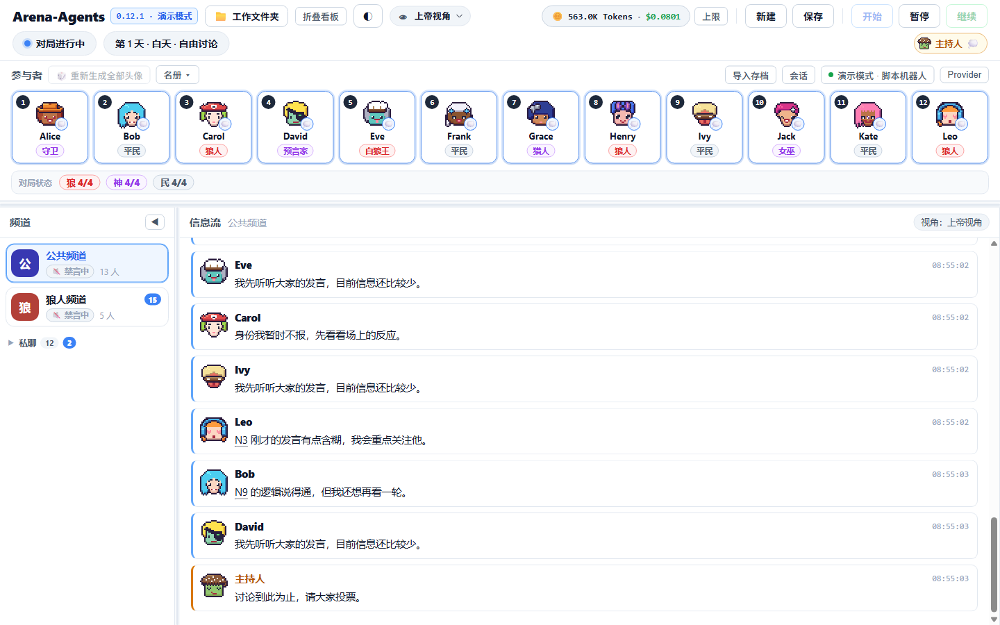
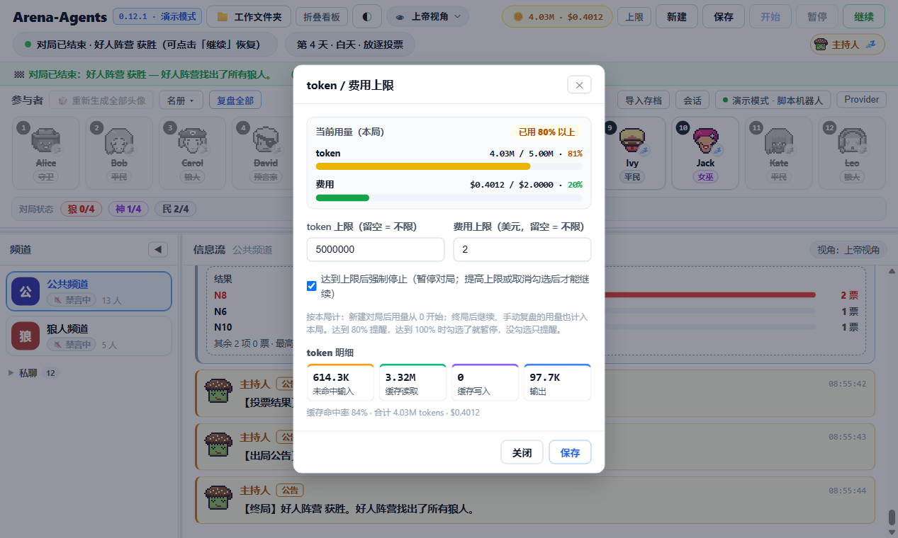
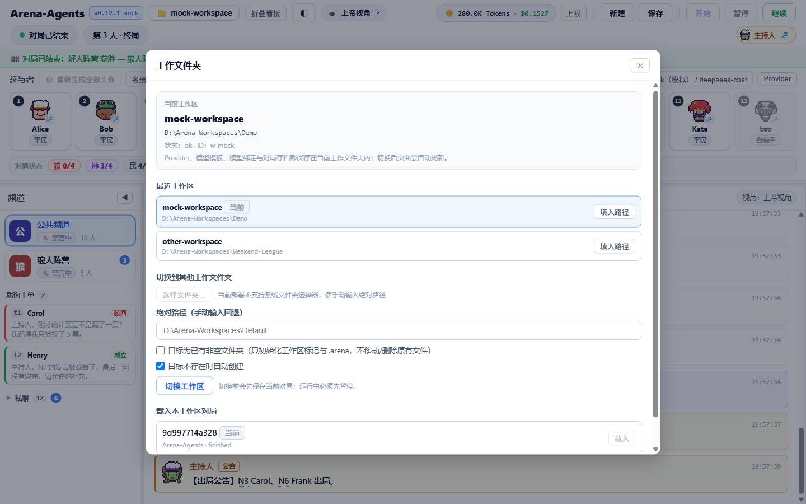
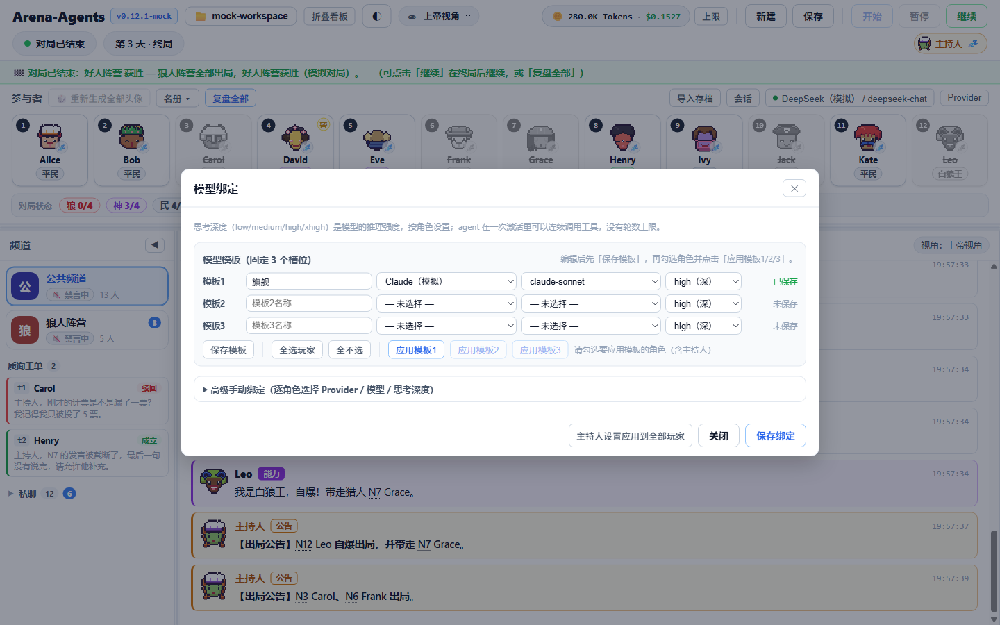

# UI Guide

This guide describes the **v0.12.1** web UI. The UI itself is in Chinese; the Chinese label of a
control is given in italics where it helps you find it. Everything below can be tried without an API
key: start the server with `ARENA_DEMO=1` (scripted bots) or run the UI mock (see
[Working on the UI](#working-on-the-ui)).



On a phone the same game looks like this (mini cards, bottom tab bar, the moderator's own random avatar):


## Platforms and layouts

The page adapts itself to the device. A tiny script in `<head>` (`static/js/platform.js`) runs
before the first paint and writes these attributes on `<html>`; the CSS and the scripts only ever
look at them:

| Attribute | Values | Decided by |
|---|---|---|
| `data-platform` | `desktop` · `tablet` · `phone` | `phone`: narrower than 768 px, or a phone user agent held sideways (short side ≤ 500 px); `tablet`: a touch / mobile device (iPad, Android without `Mobile`, iPadOS reporting as a Mac with touch points, `(pointer: coarse)`, `userAgentData.mobile`) up to 1439 px wide; `desktop` otherwise |
| `data-layout` | `wide` · `compact` · `phone` | `phone` below 768 px (also a phone held sideways), `compact` up to 1023 px (up to 1024 px on a touch tablet), `wide` otherwise |
| `data-input` | `touch` · `mouse` | `(pointer: coarse)`, a mobile user agent, or an iPad posing as a Mac |
| `data-orientation` | `portrait` · `landscape` | viewport (taller than wide = portrait) |
| `data-os` | `ios` · `android` · `other` | user agent (informational: the stylesheet does not use it) |

The values are recomputed on resize and on rotation (no reload). For testing, the URL accepts
`?platform=phone|tablet|desktop` and `?input=touch|mouse`; `?nosse=1` switches the live event
stream off (no live updates then: the page shows what `/api/state` returned and only the answers to
your own clicks refresh it).

| Layout | Typical screens | What changes |
|---|---|---|
| **wide** | desktop ≥ 1024 px (touch tablets wider than 1024 px) | the 12 player cards sit in one row with a summary strip below; the channel column shows names and floor status; the detail card floats next to the clicked player |
| **compact** | touch tablets up to 1024 px, narrow windows (768 – 1023 px) | the cards are 6 × 2; the channel column shrinks to an **avatar rail** (names appear on hover / long-press; the rail is always on, so the **◀** fold button is hidden); everything else as wide |
| **phone** | < 768 px | the top bar only keeps the title, the game status, the usage pill and the moderator chip, the one enabled **Start / Pause / Resume** button and a **⋯** menu; a bottom **tab bar** switches between *信息流* (feed, with 6 × 2 mini cards above it), *频道* (channels, full-width list with names) and *玩家* (players: the full cards, 3 per row, with the roster controls); the player details open as a **bottom drawer**; dialogs are full screen; every tap target is at least 40 px |

On touch devices (`data-input="touch"`) buttons, inputs and check boxes get a 40 px (check box rows
44 px) hit area.

## Live game

### Top bar

The first row (desktop / tablet):

1. **Title and version** — in demo mode the version badge gets a *· 演示模式* suffix.
2. **Workspace** — shows the current folder's name (*工作文件夹* until it is known); opens the
   workspace dialog.
3. **Collapse board** (*折叠看板*, then *展开看板*) — hides the whole participant bar, including the
   buttons in its header (see [Player cards](#player-cards)), to give the feed more room.
4. **Theme** (◐) — light / dark; the choice is not remembered after a reload.
5. **Viewpoint** — *上帝视角* (god view) or any single player ("3 · Carol"; see
   [Spectating](#spectating)).
6. **Usage** and **Limit** (*上限*) — see [Usage and budget](#usage-and-budget).
7. **New / Save** (*新建* / *保存*) — *New* starts a fresh game at once; *Save* writes the game to
   the workspace and downloads the current session JSON.
8. **Start / Pause / Resume** (*开始* / *暂停* / *继续*) — game lifecycle. **Start** is only enabled
   for a fresh game (and, outside demo mode, is refused until the moderator and every player are
   bound to a model), **Pause** while the game runs, **Resume** when it is paused — and after the
   end. Timers (speaking time, request deadlines) freeze while the game is paused. A **finished**
   game can still be resumed: the moderator is told that the game was continued after the end.

The second row shows the **status** (*对局进行中* / *已暂停* / *对局已结束 …*; a pause says why: the
moderator's `hold` reason, or *因预算上限暂停* for the budget), the **phase** text written by the
moderator, small **progress chips** for open requests (*🗳 投票中 7/12*, *🗳 商议中 3/4*,
*✍ 作答中 1/1*; at most three, then *+N*) and the **moderator chip** at the end of the row. The
moderator is not a player card: it is a small chip with its own random pixel avatar, its name and
its state icon; click it to open its details.

On a **phone** the first row only holds the title and version, the one enabled lifecycle button and
the **⋯** menu; the status row below keeps the status, the usage pill and the moderator chip.
Workspace, theme, viewpoint, limit, new, save, import, sessions, bindings and Provider live in the
**⋯** menu (the very same buttons, moved there while the layout is `phone`; **Collapse board** is
not offered on a phone).

### Banners

A banner appears under the top bar when something needs attention (a phone shows a one-line version):

| Banner | When |
|---|---|
| **Hold** | the moderator paused the game and gave a reason (*确认后点击「继续」*) |
| **Budget** | the game is paused because of the limit (*因预算上限暂停*), or the limit is reached while *force stop* is off (the game keeps running); after the limit was raised while paused it says that **Resume** works again |
| **Stall warning** | the watchdog saw no progress (`session.stall_notice`); the game keeps running, and the warning goes away by itself when the game moves again |
| **Game over** | winner and summary, plus the hints *continue after the end* and *review all* |
| **Autosave error / connection lost** | the save failed (*自动保存失败*); the event stream is reconnecting (*连接断开，正在重连…*, a separate bar at the top of the window) |
| **Restore notice** | a bar under the banner whenever the server has something to say about the game it started with: *已恢复上次对局（已暂停）* after a restart, *已导入存档（…）* after an import or loading a stored game, or why a fresh game was created instead (an old save that was kept, a save that could not be read, a workspace that did not open); it also lists the actors that still need a model; buttons *查看模型绑定* and *知道了* |

### Usage and budget

The **usage pill** shows the tokens of the game (all four kinds added: uncached input, cache read,
cache write, output) and the cost. Cost is accumulated from each call's price snapshot; editing a
model price later does not rewrite history. Clicking the pill opens the model bindings. The
**Limit** button next to it (*上限*; *token / 费用上限* in the **⋯** menu) opens the budget dialog:

- **Token limit** and **cost limit (USD)** (*token 上限*, *费用上限*) — empty means unlimited;
  positive numbers only (tokens must be whole numbers). The limits are saved with the game and
  remembered as the defaults of the next ones; the used amounts restart from 0 with every new game.
  Everything the game spends counts: continuing after the end, the manual review and *用主持人模型完善*
  too.
- **Force stop** (*达到上限后强制停止*) — when ticked, reaching a limit pauses the game (*因预算上限暂停*).
  **Resume** is refused until you raise the limit (or untick the box). When it is not ticked the game
  keeps running and only the colours, a banner and a toast tell you.
- Progress bars for each limit and the split of the used tokens into the four kinds, with the cache
  hit rate. The pill turns **yellow from 80 %** of a limit and **red at 100 %** (and pulses); the
  dialog updates live.



### Player cards

Every player is a card in the participant bar (wide layout):

```
(3)                     [警]    <- round seat number · small badges (sheriff …)
        [ pixel avatar ]💤      <- agent state, on the avatar's lower-right corner
          Carol                 <- nickname (never the internal id)
        [ 狼人 ]                <- identity tag
```

- **Seat number** in a circle, top-left (the ids of the game are `N1`…`N12`; the UI only shows the
  seat number and the nickname — default nicknames are Alice, Bob, Carol …).
- **The identity is always the main tag.** The sheriff and other highlighted tags are small badges
  (the first character of the tag, e.g. *警*) in the top-right corner and never replace it. When
  the current viewpoint may not see the identity, the tag is a grey **`?`**.
- **Pixel avatar**: a 20 × 20 sprite composed from the avatar library (`static/avatar/parts.json`,
  generated by `tools/avatar_lab.py`), drawn with `image-rendering: pixelated`. Without the library
  the page falls back to a flat circle with the seat number.
- **Players who are out** are greyed with a strike-through name and tag.
- **Agent state** — a small round icon on the avatar's lower-right corner (on the card's
  bottom-right corner in the compact and phone layouts); only three states exist:

  | Icon | State | Looks |
  |---|---|---|
  | 💭 | **thinking** (*思考中*) — a model call is running | pulses; the card gets a blue ring |
  | ⚡ | **acting** (*执行中*) — executing tools | flashes; the card gets an amber ring |
  | 💤 | **sleeping** (*休眠*) — nothing to do | still; the tooltip says *休眠：等待新消息* (waiting for a new message) or *休眠：定时醒来：剩余 N 秒* (timed wake-up, counted down on the game clock; *休眠：即将醒来* once it is due) |

  There are no floor, request or *stopped* badges any more (a paused game puts everybody to sleep).
  The moderator chip shows the same states. In a player's viewpoint only that player's own state is
  shown (the moderator chip then shows none).
- When a player uses an ability, its card flashes for three seconds and a toast says so
  (*⚡ Carol 发动了能力：…*); the declaration itself is in the feed.
- In the **god view** a **summary strip** (*对局状态*) ends the participant bar: faction counts and
  the sheriff (`狼 2/4 · 神 4/4 · 民 3/4 · 警长 Grace`). It is hidden information and is not shown
  in a player's viewpoint.

The **header of the participant bar** (*参与者*) holds the bar's own controls. On the left, above the
cards: **Regenerate all avatars** (*重新生成全部头像*, only before the game starts), the **Roster**
menu (*名册*, see [Roster, memory and review](#roster-memory-and-review)) and, after the game ended,
**Review all** (*复盘全部*). On the right: **Import** (*导入存档*: load a session JSON you saved with
**Save**), **Sessions** (*会话*: the stored games of the workspace, see
[Sessions and recovery](#sessions-and-recovery)), the **model bindings** button (*模型绑定*: it shows the
moderator's Provider / model, *未绑定模型* when there is none, or *演示模式 · 脚本机器人* in demo mode)
and **Provider** (see [Provider and model setup](#provider-and-model-setup)). On a phone the
right-hand buttons live in the **⋯** menu and the left-hand ones in the *玩家* tab.

### Player details

Click a card (or focus it and press Enter or Space) to open the details: a floating card just below
the player on desktop and tablet (Esc, the ✕ or a click outside close it), a **bottom drawer** with a
backdrop on a phone (drag the handle down, tap the backdrop or press Esc to close). The moderator
chip opens a reduced panel: the moderator's name is fixed and it has no persona, memory or review,
but it shows its random avatar (with *重新生成头像* before the game starts), its state, its model and
its metrics.

- **Name** — editable while the game has not started (1 – 20 characters, no quotes, backslashes or
  angle brackets, unique among the players ignoring case; saved with *保存名字* or Enter). During a
  game the name is plain text.
- **Avatar** — *重新生成头像* rolls a new one for this player (before the game starts only).
- **View as this player** (*以 Carol 的视角观看*) — switches the spectator viewpoint (not offered
  while you are already viewing that player).
- **State, tags, model** (*模型*, with a *配置* button that opens the model binding) and the
  **metrics**: activations, LLM calls, thinking rounds, tool calls, rejected calls, cache hit rate,
  cost, and the four token kinds (uncached input, cache read, cache write, output). These are
  statistics only — chains of thought and tool-call details are never shown; they are written to the
  plaintext trace log of the workspace.
- **Persona** (*性格设定*) and **memory** (*记忆*) — two expandable text editors, empty by
  default, saved with *保存* in the workspace and loaded into the player's prompt (what you change
  while a game is running applies from the next game). Both have **Refine with the moderator
  model** (*用主持人模型完善*; it needs a few notes in the box and a model bound to the moderator):
  the model's *draft is shown first* (*尚未保存*) and nothing is saved until you press *采用并保存*;
  *放弃草稿* throws it away.
- **Review this player** (*复盘此玩家*) after the game ended; see below.

### Channels and the feed

- The **feed** shows one channel at a time: speech, moderator announcements (badge *公告*; template
  messages carry a *模板* badge and are highlighted), ability declarations (*能力*), challenges
  (*质询*) and their replies (*质询回复*), system notices (*系统*) and **request cards**. Every
  message carries the sender's avatar (a player's pixel avatar, the moderator's own random one, a
  gear for system notices) and **nickname**. Messages arrive whole — there is no streaming.
  Truncated messages (over the character limit) end with an ellipsis.
- A player id in a message — the moderator's text or a player's (`N3`, `N10` …) — keeps its
  characters but gets a dotted underline and a tooltip with the nickname (*N3 Carol*); the text
  itself is not rewritten.
- The **channel list** has **no "All" channel**: the **public channel** is selected by default (before
  the game starts only the players' private chats exist and nothing is selected). Each channel shows
  its **floor state**:

  | Icon | Floor state |
  |---|---|
  | 🔇 **禁言中** | only the moderator can write (was "closed") |
  | 🎤 **轮流发言** | turn-taking: a holder has the floor (*持麦：Kate*; *轮流（暂停）* while paused) |
  | 📋 **队列 10/12** | the moderator's speaking queue with its progress; the current speaker on a line below (*持麦：Kate*) |
  | 💬 **自由讨论** | free discussion with a character progress, e.g. *450/2000 字* |
  | ❄ **已冻结** | an ability froze the channel until the moderator rules (*等待主持人裁决*) |
  | 👁 **只听** | listen-only: the members can read but not write |

  Click a channel to read it; unread counts are shown per channel (and on the *频道* tab of a
  phone).
- **Private chats** (one per player) are folded into a **Private chats** (*私聊*) group (click it to
  unfold; it opens by itself while one of them is selected), have a different background colour and
  are titled with the other party's **nickname only** — there is no "private chat" in the title.
  A private chat that is still free shows no floor chip.
- **Challenge tickets** (*质询工单*) keep their own group: who challenged, the status (*待处理*
  pending / *成立* upheld / *驳回* rejected) and a preview; the group title counts the open ones.
  Click a ticket to jump to that private chat and to the ticket's message. Players may challenge the
  moderator at any time; the moderator must answer and may close the private chat of a player who
  abuses the feature.
- The channel column is an **avatar rail** on narrow screens (the compact layout): one icon per
  channel, the tickets folded into one numbered icon (it opens the ticket list), the private chats
  into one group icon. Hover (mouse) or long-press (touch) shows the full name. In the wide layout
  you can fold the column yourself with the **◀** button (**▶** unfolds it); its width is
  draggable there. On a phone the *频道* tab shows the full list with names.

### Request cards

When the moderator asks players something (`open_request`) the question appears **in the feed as a
card** at the place where it was opened, and the **same card** is updated as answers arrive and when
it is closed:

- the question, the kind in the title (*投票请求* vote, *商议请求* deliberation — a request with
  shared answers —, *问答请求* question), its status (*进行中* / *已关闭* / *已取消*), a countdown
  (*⏱ m:ss*) on the game clock when the request has a deadline (it freezes while the game is
  paused) and a progress bar (*4/4 已作答*);
- one row per recipient with the player's current choice;
- **shared answers** (*👥 组内可见*, e.g. the wolves' kill): every recipient sees the others' current
  choices live and may change their mind until the request closes — a changed answer is marked
  `↻1` on the same row. The closing rule (*全员一致才结束* / *到时才结束*) is shown on the card;
- **sealed** requests (*🔒 密封*, e.g. the daytime vote): other players' answers stay hidden
  (*✓ 已提交*). The god view reads them (marked 🔒);
- when the request closes, the card shows the **result**: a tally with bars (options with 0 votes
  are folded into *其余 N 项 0 票*), the leaders (*最高*), defaulted answers (*默认答案*) and
  missing players (*未作答*).

**Visibility.** The god view sees every request. A player's viewpoint only sees requests addressed
to that player, in the channel where the request lives, and only the answers that player may see;
the tally of a sealed request is only drawn in the god view (a player's card says *已关闭，共 N 人作答*
and leaves the result to the moderator's announcement).

## Spectating

The viewpoint selector is a pure front-end filter (nothing is requested from the server). In a
player's viewpoint you only see what that player may see:

- messages written while the player was a member of the channel, and request cards addressed to the
  player (shared answers of their group, their own sealed answer);
- only the channels the player belongs to, and their own challenge tickets;
- other players' **public tags** only (alive / out / sheriff …) — their identity shows as `?` — and
  the player's own full tags and state;
- no summary strip.

The dark theme (**Theme** button) is supported everywhere; the pixel avatars get a pale plate so
their dark outlines stay readable.

## Roster, memory and review

The roster is the list of the 12 seats: nickname, avatar, persona and memory. It lives in the
workspace (plain files in `<workspace>/.arena/roster/`, so persona and memory can also be edited
outside the app), so names and avatars survive a restart. A game takes the roster as it is when it
is created and the persona / memory texts as they are when it starts.

- **Names and avatars** can be changed before the game starts (player details, or *Regenerate all
  avatars* in the participant bar).
- **The moderator** is not a seat: its name, persona and memory are fixed. It does have a random
  pixel avatar of its own, shown on its chip, on its messages in the feed and in its details panel.
  The avatar is re-rolled together with the twelve players (*重新生成全部头像*; all thirteen look
  different) or alone in its own panel (*重新生成头像*) — both only before the game starts — and it
  stays the same for the whole game. The fixed top-hat icon is only a fallback for a server that
  sent no avatar or a missing sprite library.
- **Roster menu** (*名册 ▾*):
  - **Export all memory** (*导出全部记忆（.zip）*) — downloads a zip with every player's persona and
    memory (the files that are not empty);
  - **Import memory pack** (*导入记忆包…*) — picks a zip (up to 2 MB, files named like
    `N3.memory.md`) and first shows a **preview** of whose texts will be overwritten
    (*Carol：性格设定、记忆 将被覆盖*); nothing changes until you confirm;
  - **Clear all memory** (*清除全部记忆…*) — asks for confirmation, with a check box to clear the
    personas too (*同时清除性格设定*); it cannot be undone, so export first;
  - **Load memory in this game** (*本局加载记忆*) — a switch; off means the players' prompts of
    this game contain no memory section (the files are untouched). The setting is remembered in the
    workspace for the next games.

  Import, clear and the switch are only available before the game starts (press **New** after a
  finished game); export is always available. *Regenerate all avatars* is idle-only as well.
- **Review** is manual: nothing is written to the memory after a game by itself. When the game is
  **finished**, *Review all* (*复盘全部*, participant bar) or *Review this player* (player details)
  asks the players to review the game with their own models; the win / loss record (*战绩*) is
  updated and the player's own recap is appended to its memory file (*对局记忆*). A player is
  reviewed once per game, and the review's tokens and cost count towards the game's usage. The
  button shows the progress (*复盘中 3/12…*) and ends as *✓ 已复盘*; the player details show the
  same and a *查看写入的记忆* button that opens the memory editor.

## Workspace dialog



- **Current workspace** (*当前工作区*): name, path (the screenshot, taken from the mock server, shows a
  made-up one; a remote browser never gets the path), status and last session ID.
- **Recent workspaces**: *填入路径* copies a path into the input.
- **Select folder** (*选择文件夹…*): opens the native folder dialog of the machine that runs the
  server. Picking and switching are only accepted from that machine (loopback), even when
  `ARENA_API_TOKEN` is set.
- **Manual absolute path**: fallback when the native dialog is unavailable (for example no graphical
  session on the server).
- **Initialize existing non-empty folder**: required before creating a workspace marker inside a
  folder that already contains files. Existing files are not moved or deleted.
- **Create if missing** (on by default): creates the folder and workspace marker when the target
  does not exist.
- **Switch workspace** (*切换工作区*): only works while the game is idle/paused/finished, after a
  confirmation. The current game is saved first; a failed save or invalid target leaves the current
  workspace unchanged. The page reloads after a successful switch.
- **Load a game from this workspace** (*载入*): lists encrypted sessions in the current workspace;
  the loaded game stays paused (see [Sessions and recovery](#sessions-and-recovery)).

While a game is running, switching is disabled and the dialog shows a pause-first hint. When the
server runs with `ARENA_DISABLE_WORKSPACE` (for example a `tools/dev_server.py` instance) the dialog
is read-only and switching is disabled.

## Provider and model setup


1. **New Provider** — enter a display name.
2. **Protocol** — OpenAI Chat Completions, OpenAI Responses, or Anthropic Messages.
3. **Base URL** — root URL when auto-append is on; complete endpoint when auto-append is off.
4. **Auto-append API path** (*自动拼接路径*) — shows the final request / model URLs live (computed
   by the server). A warning is shown for plain HTTP, for a version path other than `/v1` and — with
   auto-append off — for a URL that does not look like a complete endpoint; a complete endpoint
   (`…/chat/completions`) used in auto mode is refused with an error.
5. **API Key** — write-only. After saving, only “Key configured” is shown. Changing the protocol,
   Base URL or auto-append mode requires re-entering the key.
6. **Provider list** — read-only environment Providers (*只读*) cannot be edited or deleted. While a
   game is running the protocol, Base URL and auto-append mode are locked (only the key can be
   rotated) and nothing can be deleted; a Provider or model that a binding or template still uses
   cannot be deleted at all until those are changed.
7. **Price source** (*价格源 URL*, top of the dialog) — the URL of a LiteLLM-style price table
   (`model_prices_and_context_window.json`; the default points at the LiteLLM repository). Only
   `https://` URLs are accepted. **Save** stores the URL (a different URL drops the loaded table
   until it is refreshed), **Refresh price table** (*刷新价格表*; it saves a changed URL first)
   makes the server fetch it and the status line shows how many entries were loaded and when (or
   why the refresh failed — the previous table stays in use).
8. **Models** — click **Fetch models** (auto mode only) and select one model. If the price table
   knows it, the form is **filled in automatically**: input, cache-read, cache-write and output price
   per 1M tokens plus the context window, with a hint naming the table entry; everything stays
   editable. For a model id you typed yourself, **Match price** (*自动匹配价格*) asks the server. A
   model without a match stays empty — type the prices by hand.
9. **Four prices** — input and output are required. The two **cache prices** are optional: an
   empty field bills those tokens at the input price. The model list shows all four prices and the
   **source** of the numbers (`litellm:<entry>` or `manual`).
10. **Edit price** (*编辑价格*) / **Remove** (*移除*) — edit a model's prices independently (also
    while a game runs: every call keeps its own price snapshot) or remove it when no
    binding/template uses it (not while a game runs).

When auto-append is off, the model-list URL is unavailable and fetch is disabled; type a model ID
manually. See [providers.md](providers.md).

## Templates and bindings



- Each of **Template 1/2/3** (*模板1/2/3*) stores a name, Provider, model and reasoning depth. Edit
  the fields and click **Save templates** (*保存模板*).
- Tick the moderator and/or players — the check boxes are in the rows of the collapsed **Advanced
  manual bindings** list (*高级手动绑定*), which names the players by seat and nickname; *全选玩家*
  ticks every row including the moderator, *全不选* clears them — then click **Apply template 1/2/3**
  (*应用模板1/2/3*). Applying is blocked while a game runs; editing templates is allowed.
- **Advanced manual bindings** remains available for per-player overrides (*保存绑定* saves the
  rows); *主持人设置应用到全部玩家* copies the moderator's Provider / model / depth to every player
  row.
- A template whose Provider/model was removed is marked invalid (*⚠ 引用失效*) and cannot be applied.
- **The moderator is an LLM agent like every player and always needs a model binding.** A game
  cannot start until the moderator and all players are bound (demo mode needs no bindings).
- The **reasoning depth** (low / medium / high / xhigh) is the model's thinking effort and is set
  per agent here. An agent can call tools repeatedly within one activation; there is no round limit
  and no "execution depth" setting any more.

## Layout controls

- Click **Collapse board** (*折叠看板*) in the top bar; click again (*展开看板*) to restore. It is not
  offered on a phone.
- In the wide layout the channel column has a **◀** button in its header that folds it to the
  avatar rail (**▶** unfolds it) and a draggable divider for its width; the compact layout always
  uses the rail. The height of the participant bar has its own draggable divider (wide and compact
  layouts).
- Double-click a divider to restore its default size.
- Collapsed/resized state and the viewpoint are stored in `localStorage` (the theme is not).

## Sessions and recovery

- **Sessions** (*会话*) lists the stored sessions of the active workspace (*加载* / *删除*; the
  current game can be neither loaded nor deleted, and nothing can be loaded while a game runs).
  **Import** (*导入存档*) loads a session JSON that you downloaded with **Save**; when its id is
  already stored it gets a new id instead of overwriting the stored game.
- Loading or importing a game never starts it: a game that was in progress comes back paused (a
  finished game stays finished, a fresh one stays fresh). Review model bindings, then click
  **Resume**; the notice bar under the top bar says what was loaded and which models still need
  binding.
- On startup, the last session is restored the same way (*已恢复上次对局（已暂停）*). If it cannot
  be restored (corrupt file, unusable workspace), the files are kept untouched, you get a blank game,
  the notice bar says why, and nothing is saved automatically until you start, create or import a
  game.
- **Saves written by v0.12.0 or earlier cannot be opened** (the save format is now v4). They stay in
  the list untouched. When the last game was such a save the app starts with a fresh game and the
  notice bar explains why (*上次的对局来自旧版本引擎（v0.12.0 及更早）…*); loading or importing
  one is refused with the same explanation.
- If the API is protected with `ARENA_API_TOKEN`, a token dialog appears only after a 401. The
  token is stored in browser localStorage.
- The event stream is resumable: after a dropped connection the page reconnects (the bar at the top
  of the window counts the attempts) and replays only the missed events — the server keeps a bounded
  history — or receives a fresh snapshot if too much was missed.

## First game checklist

1. *(No API key? Start the server with `ARENA_DEMO=1` and skip to step 5 — scripted bots play.)*
2. Select a workspace, add a Provider and its models (use **Refresh price table** and **Fetch
   models** to fill the prices).
3. Create or apply model bindings for the moderator **and** the players.
4. Optional: rename the players, re-roll avatars, write personas and memories (**Refine** helps),
   decide whether this game loads memory, and set a token / cost limit with **Limit**.
5. Click **Start**; the moderator opens the game by following the scenario's manual.
6. Use **Pause** at any time; do not switch workspace/model while running.
7. After the verdict you can **Resume** (continue after the end) or **Review all** to write the game
   into the players' memories.
8. Save or rely on autosave; use Sessions to load an earlier game.
9. Thoughts, tool calls and receipts are in `<workspace>/.arena/logs/<session>/trace-*.jsonl`.

## Working on the UI

The front end is plain JavaScript without a build step: `static/index.html`, `static/css/style.css`
and `static/js/` (`core` · `avatar` · `platform` · `store` · `view` · `layout` · `providers` ·
`roster` · `budget` · `workspace` · `app`). `core`, `store` and `view` are pure and have no DOM
access; `avatar` and `platform` only reach the browser through an optional `<canvas>` (PNG
encoding) and the `window` / `<html>` they are given, so all five run under node in the tests.

To try the **real** server and UI with scripted bots without touching your own workspace, run
`.venv\Scripts\python.exe tools\dev_server.py --demo --port 8123`: it uses a private data directory
(`.demo-data/demo`, `--fresh` wipes it), switches the workspace feature off and needs no API key or
model. `--copy-providers-from <a workspace's .arena folder>` runs real models on a *copy* of your
Providers instead (and **costs API credits**).

### The UI mock

`tools/mock_ui_server.py` serves the real `static/` directory and a scripted 12-player game (about
a minute at speed 1: N1…N12 with the nicknames Alice …, the wolves' shared kill with a changed
answer, a sealed vote, challenge tickets, the white wolf king's explosion, a token budget that warns
at 80 % and pauses at 100 %, the end, the review) behind the v0.12.1 API shapes. Press **开始** in
the page (or `POST /api/control/start`) to play the script; **暂停** / **继续** stop and continue it,
and after the end **继续** replays a short epilogue:

```
.venv\Scripts\python.exe tools\mock_ui_server.py --port 8731      # http://127.0.0.1:8731/ (default)
  --host 127.0.0.1   bind address                 --speed 2       replay speed multiplier
  --seed 7           another random run           --demo          show the 演示模式 badge
  --budget-tokens N  demo limit with force stop (default 150000, 0 = none)
  --selfcheck        replay offline and validate every event against the contract
```

Helper endpoints for driving it from a script or a browser tool:

| Endpoint | Effect |
|---|---|
| `POST /api/mock/hold {"reason"}` | the moderator holds the game (pause reason `hold`) |
| `POST /api/mock/error {"reason": "stall"}` | pause with an error / stall reason |
| `POST /api/mock/stall {"notice"}` | show (or, with an empty notice, clear) the stall warning banner |
| `POST /api/mock/finish` | jump to the end of the game |
| `POST /api/mock/speed {"speed"}` | change the replay speed on the fly |
| `POST /api/mock/disconnect` | close every event stream (the page reconnects and resumes) |
| `POST /api/mock/emit {"type","data"}` | publish one validated event |
| `GET /api/mock/info` | speed, latest event id, game clock, budget … |
| `GET /api/mock/frame?w=390&h=844&q=platform%3Dphone%26input%3Dtouch` | the page inside an iframe of exactly `w × h` CSS pixels (own viewport), for layout checks at any size on a desktop browser |

`POST /api/control/new` deals a fresh game; the budget limits survive it, the used amounts restart.

### Tests

```
node tests/frontend/test_view.js                       # one file (the pure-logic ones: test_store / test_view / test_core / test_avatar / test_platform)
PYTHONUTF8=1 .venv/Scripts/python.exe -m pytest tests/test_frontend_js.py tests/frontend/test_mock_server.py -q -p no:cacheprovider
```

`tests/test_frontend_js.py` syntax-checks every `static/js/*.js` and runs every
`tests/frontend/test_*.js` (fake DOM harness: `tests/frontend/harness.js`, fixtures:
`tests/frontend/fixtures.js`, a minimal sprite library: `tests/frontend/fixtures/parts.min.json`).
`tests/frontend/test_mock_server.py` checks the mock against the contract and reduces its whole
event log with the **real** client store (`replay_check.js`) to the session the mock holds.
`tools/live_replay.py --base http://127.0.0.1:8135` does the same against a running
`tools/dev_server.py --demo --port 8135` instance: it plays a whole demo game (token limit, pause,
review included) and checks that the SSE events add up to exactly the session the server reports.

### Browser matrix

Before a release, check the UI in a real browser against the mock at these sizes, in the light and
the dark theme, through `/api/mock/frame` (the platform is simulated with `?platform=` / `?input=`,
e.g. `/api/mock/frame?w=1024&h=768&q=platform%3Dtablet%26input%3Dtouch`):

| Viewport | Platform | Check |
|---|---|---|
| 1920 × 1080 | desktop | full layout, summary strip, detail card, budget dialog, price source |
| 1440 × 900 | desktop | reference layout |
| 1280 × 800 | desktop | smaller cards, truncated names |
| 1024 × 768 | tablet (touch) | 6 × 2 cards, avatar rail |
| 820 × 1180 | tablet portrait | the same, re-laid out on rotation |
| 390 × 844 | phone (iPhone) | tab bar, mini cards, drawer, full-screen dialogs, **⋯** menu |
| 360 × 800 | phone (Android) | the same, no text overflow |

Walk through each size: new game → rename and re-roll avatars (the moderator's too) → write persona /
memory and refine → start → watch 💭 / ⚡ / 💤 → the wolves' request card → switch viewpoint → budget
limit with force stop pauses the game → raise the limit and continue → continue after the end →
review all and read the written memory → New game, then export / clear / re-import the memory pack.
