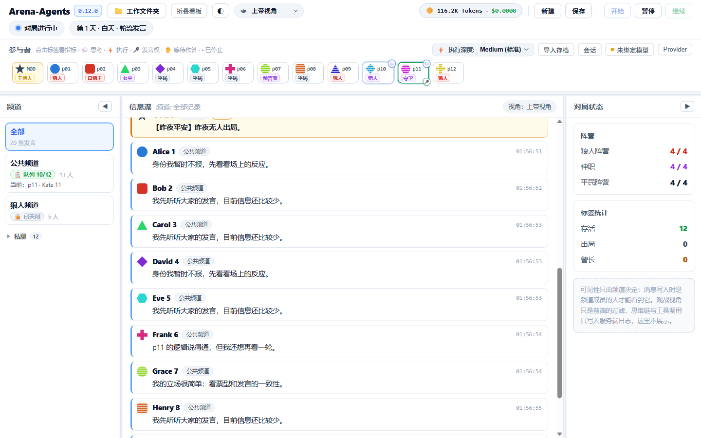
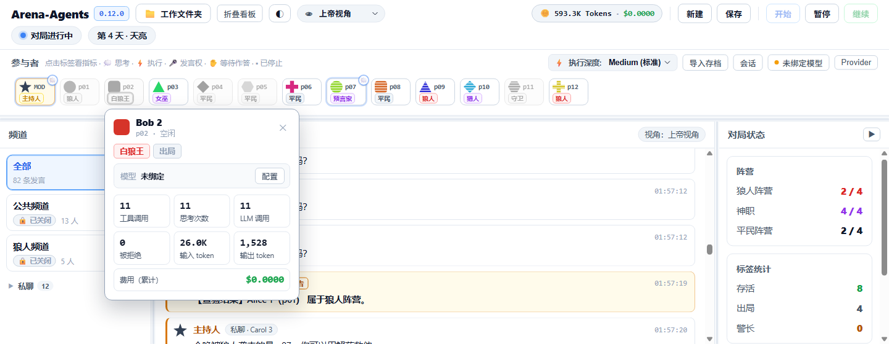
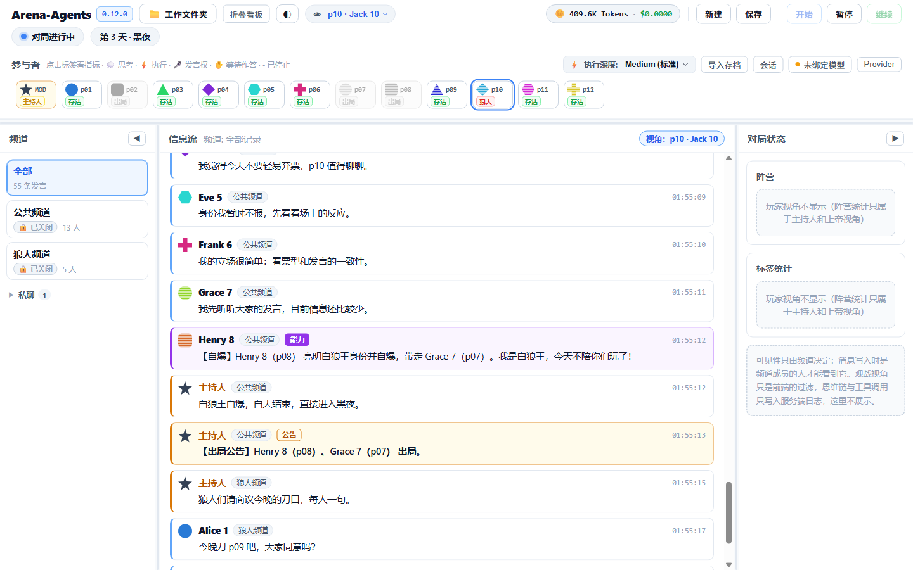
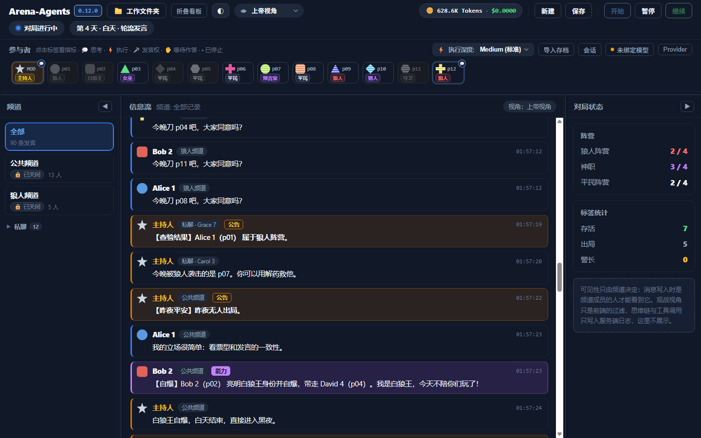

# UI Guide

Screenshots below come from a local **demo-mode** game (scripted bots, `ARENA_DEMO=1`). Workspace
paths and Provider hostnames in the dialog screenshots are pixelated; no credentials are included.

## Live game

The page has three areas: the **participant board** on top, the **channel list**, the **message
feed** and the **game status** panel below.

### Top bar

1. **Workspace** — current work folder name. Opens the workspace dialog.
2. **Collapse board** — hides the participant board to give the feed more room.
3. **Theme** — light / dark.
4. **Viewpoint** — *God view* (everything) or any single player (see [Spectating](#spectating)).
5. **Usage** — accumulated tokens and cost. Cost is accumulated from each call's price snapshot;
   editing a model price later does not rewrite history.
6. **New / Save** — start a fresh game, or save and download the current session JSON.
7. **Start / Pause / Resume** — game lifecycle. Timers (speaking time, request deadlines) freeze
   while the game is paused. A **finished** game can still be resumed: the moderator is told that the
   game was continued after the end.

The second row shows the **status** (running / paused / finished, including a moderator `hold`
reason or an automatic "no progress" pause) and the current **phase** text written by the
moderator. While a request is open a small chip shows its progress, for example *Voting 7/12*.

### Participant tiles

Every agent is a tiny tile: a deterministic **glyph** (shape × colour × texture derived from the
seat), the short **id** and **one main tag**. A small badge shows what the agent is doing:

| Badge | Meaning |
|---|---|
| 💭 | thinking (a model call is running) |
| ⚡ | executing tools |
| 🎤 | holds the floor in some channel |
| ✋ | has an open request to answer |
| ▪ | stopped (game paused / finished) |

Players who are out are greyed. **Click the tag** to open a popover with that agent's **tool calls,
thinking rounds, LLM calls, rejected calls, input / output tokens, cost and model** (and a shortcut
to its model binding). The popover is only statistics — chains of thought and tool-call details are
never shown in the UI; they are written to the plaintext trace log of the workspace.

### Channels and the feed

- The **feed** shows only what was *said*: speech, moderator announcements (template messages are
  highlighted), ability declarations, challenges and their replies. Messages arrive whole — there
  is no streaming. Truncated messages (over the character limit) are marked.
- The **channel list** shows every channel with its **floor state**:

  | Icon | Floor state |
  |---|---|
  | 🔒 closed | only the moderator can write |
  | 🎤 | a holder has the floor (with the holder's name) |
  | 📋 queue | the moderator's speaking queue with progress, e.g. *10/12 · current: p11* |
  | 💬 free discussion | free discussion with a character progress, e.g. *48/600* |
  | ❄ frozen | an ability froze the channel until the moderator rules |
  | 👁 listen | read-only |

  Click a channel to filter the feed; unread counts are shown per channel. The per-player system
  private chats are folded into the **Private chats** group.
- **Challenge tickets** are listed in their own group: who challenged, the status (open / upheld /
  rejected) and a preview. Click a ticket to jump to that private chat. Players may challenge the
  moderator at any time (for example when they believe a rule was applied wrongly); the moderator
  must answer and may close the private chat of a player who abuses the feature.

### Game status panel

Faction and tag statistics are written by the moderator (`update_dashboard`). They are hidden
information, so they are shown **only in the god view**.

## Spectating

The viewpoint selector is a pure front-end filter (nothing is requested from the server). In a
player's viewpoint you only see what that player may see:

- messages written while the player was a member of the channel;
- only the channels the player belongs to, and their own challenge tickets;
- other players' **public tags** only (alive / out / sheriff …), the player's own full tags;
- no game status panel.

Dark theme is also supported:

## Workspace dialog

- **Current workspace**: name, path (redacted in the screenshot), status and last session ID.
- **Recent workspaces**: click a path to fill the input.
- **Select folder**: opens the server-side native folder dialog. It is only available to loopback
  clients.
- **Manual absolute path**: fallback for headless/Docker or when the native dialog is unavailable.
- **Initialize existing non-empty folder**: required before creating a workspace marker inside a
  folder that already contains files. Existing files are not moved or deleted.
- **Create if missing**: creates the folder and workspace marker when the target does not exist.
- **Switch workspace**: only works while the game is idle/paused/finished. The current game is
  saved first; a failed save or invalid target leaves the current workspace unchanged. The page
  reloads after a successful switch.
- **Load a game from this workspace**: lists encrypted sessions in the current workspace.

While a game is running, switching is disabled and the dialog shows a pause-first hint.

## Provider and model setup

1. **New Provider** — enter a display name.
2. **Protocol** — OpenAI Chat Completions, OpenAI Responses, or Anthropic Messages.
3. **Base URL** — root URL when auto-append is on; complete endpoint when auto-append is off.
4. **Auto-append API path** — shows the final request/model URLs live. A warning is shown for
   plain HTTP, unusual version paths, or a complete endpoint used in auto mode.
5. **API Key** — write-only. After saving, only “Key configured” is shown. Changing the protocol,
   Base URL or auto-append mode requires re-entering the key.
6. **Provider list** — read-only environment Providers cannot be edited or deleted.
7. **Models** — click **Fetch models** (auto mode only), select radio one model, then fill input
   and output prices. Prices are required and have no default. Repeat for each model.
8. **Edit price / Remove** — edit a model independently or remove it when no binding/template uses
   it.

When auto-append is off, the model-list URL is unavailable and fetch is disabled; type a model ID
manually. See [providers.md](providers.md).

## Templates and bindings

- Each of **Template 1/2/3** stores Provider + model + reasoning depth. Edit the fields and click
  **Save templates**.
- Check the moderator and/or players, then click **Apply template 1/2/3**. Applying is blocked
  while a game runs; editing templates is allowed.
- **Advanced manual bindings** remains available for per-player overrides.
- A template whose Provider/model was removed is marked invalid and cannot be applied.
- **The moderator is an LLM agent like every player and always needs a model binding.** A game
  cannot start until the moderator and all players are bound.
- **Execution depth** (board header) is the maximum number of "model call → tools" rounds per wake-up
  of one agent (the moderator gets more rounds). It is *not* the model's reasoning depth, which is
  set per agent in the bindings.

## Layout controls

- Click **Collapse board** in the top bar; click again to restore.
- Side panels have their own collapse buttons in their headers.
- Drag the vertical dividers next to the channel/status panels to change widths.
- Double-click a divider to restore its default size.
- Collapsed/resized state and the viewpoint are stored in `localStorage`.

## Sessions and recovery

- **Sessions** lists stored sessions for the active workspace.
- Loading a session keeps it paused. Review model bindings, then click **Resume**.
- On startup, the last session is restored as paused. If it is corrupt, the files are kept and a
  recovery banner is shown; the game is not overwritten.
- **Saves written by v0.11 or earlier cannot be opened** (save format v3). They stay in the list
  untouched; a fresh game is created and a notice explains why.
- If the API is protected with `ARENA_API_TOKEN`, a token dialog appears only after a 401. The
  token is stored in browser localStorage.
- The event stream is resumable: after a dropped connection the page reconnects and replays only
  the missed events (or fetches a fresh snapshot if too much was missed).

## First game checklist

1. *(No API key? Start the server with `ARENA_DEMO=1` and skip to step 4 — scripted bots play.)*
2. Select a workspace, add a Provider and a model with prices.
3. Create or apply model bindings for the moderator **and** the players.
4. Click **Start**; the moderator opens the game by following the scenario's manual.
5. Use **Pause** at any time; do not switch workspace/model while running.
6. Save or rely on autosave; use Sessions to load an earlier game.
7. Thoughts, tool calls and receipts are in `<workspace>/.arena/logs/<session>/trace-*.jsonl`.
