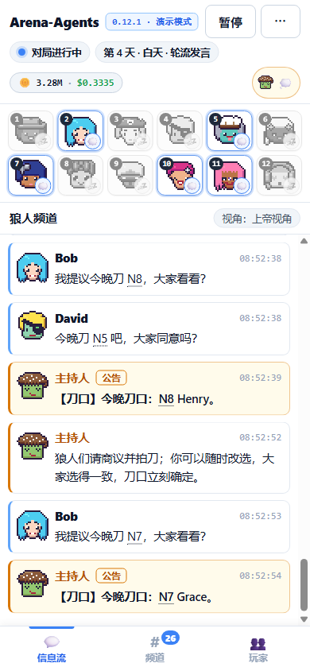
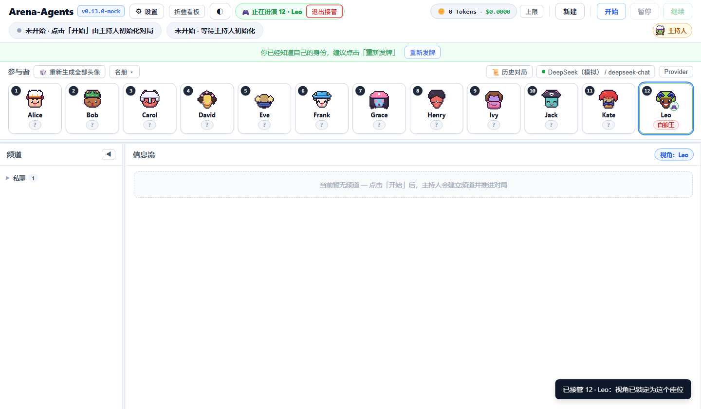
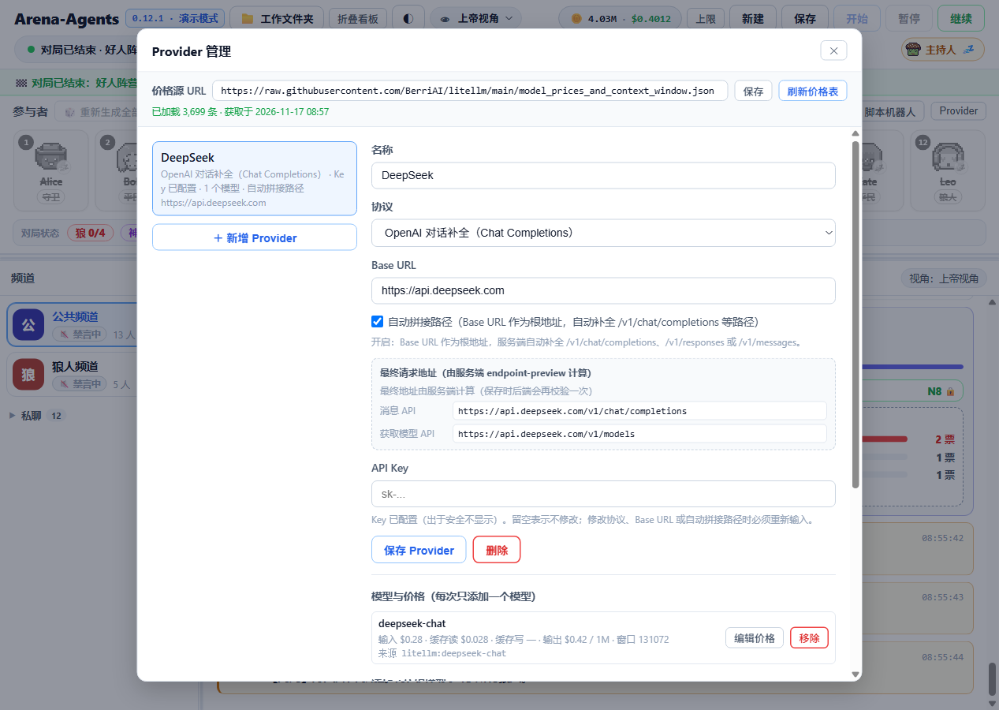

# UI Guide

This guide describes the **v0.13.1** web UI. The UI itself is in Chinese; the Chinese label of a
control is given in italics where it helps you find it. Everything below can be tried without an API
key: start the server with `ARENA_DEMO=1` (scripted bots) or run the UI mock (see
[Working on the UI](#working-on-the-ui)).


On a phone the same game looks like this (mini cards, bottom tab bar, the moderator's own random avatar):



## Platforms and layouts

The page adapts itself to the device. A tiny script in `<head>` (`static/js/platform.js`) runs
before the first paint and writes these attributes on `<html>`; the CSS and the scripts only ever
look at them:

| Attribute | Values | Decided by |
|---|---|---|
| `data-platform` | `desktop` · `tablet` · `phone` | `phone`: narrower than 768 px, or a phone user agent held sideways (short side ≤ 500 px); `tablet`: a touch / mobile device (iPad, Android without `Mobile`, iPadOS reporting as a Mac with touch points, `(pointer: coarse)`, `userAgentData.mobile`) up to 1439 px wide; `desktop` otherwise |
| `data-layout` | `wide` · `compact` · `phone` | `phone` below 768 px (also a phone held sideways), `compact` up to 1023 px (up to 1024 px on a touch tablet), `wide` otherwise |
| `data-input` | `touch` · `mouse` | `(pointer: coarse)`, a mobile user agent, or an iPad posing as a Mac |
| `data-orientation` | `portrait` · `landscape` | viewport (taller than wide = portrait) |
| `data-os` | `ios` · `android` · `other` | user agent (informational: the stylesheet does not use it) |

The values are recomputed on resize and on rotation (no reload). For testing, the URL accepts
`?platform=phone|tablet|desktop` and `?input=touch|mouse`; `?nosse=1` switches the live event
stream off (no live updates then: the page shows what `/api/state` returned and only the answers to
your own clicks refresh it).

| Layout | Typical screens | What changes |
|---|---|---|
| **wide** | desktop ≥ 1024 px (touch tablets wider than 1024 px) | the 12 player cards sit in one row with a summary strip below; the channel column shows names and floor status; the detail card floats next to the clicked player |
| **compact** | touch tablets up to 1024 px, narrow windows (768 – 1023 px) | the cards are 6 × 2; the channel column shrinks to an **avatar rail** (names appear on hover / long-press; the rail is always on, so the **◀** fold button is hidden); everything else as wide |
| **phone** | < 768 px | the top bar only keeps the title (the 🎮 takeover bar takes its place while a [seat is played](#playing-a-seat)), the game status, the usage pill and the moderator chip, the one enabled **Start / Pause / Resume** button and a **⋯** menu; a bottom **tab bar** switches between *信息流* (feed, with 6 × 2 mini cards above it and — for a played seat — its input box below), *频道* (channels, full-width list with names) and *玩家* (players: the full cards, 3 per row, with the roster controls); the player details open as a **bottom drawer**; dialogs are full screen; every tap target is at least 40 px |

On touch devices (`data-input="touch"`) buttons, inputs and check boxes get a 40 px (check box rows
44 px) hit area.

## Live game

### Top bar

The first row (desktop / tablet):

1. **Title and version** — in demo mode the version badge gets a *· 演示模式* suffix.
2. **⚙ Settings** (*设置*) — opens the [settings dialog](#settings-dialog-export-and-import-an-archive):
   export and import an archive, nothing else. (v0.12.1's *工作文件夹* button is gone: the data lives in
   `data/` next to the program and there is no folder to choose.)
3. **Collapse board** (*折叠看板*, then *展开看板*) — hides the whole participant bar, including the
   buttons in its header (see [Player cards](#player-cards)), to give the feed more room.
4. **Theme** (◐) — light / dark; the choice is not remembered after a reload.
5. **Viewpoint bar** `[视角 ▾] [切换] [接管]` — pick *上帝视角* (god view) or a single player
   ("3 · Carol") in the drop-down and press *切换* to apply it (see [Spectating](#spectating)); *接管*
   plays the picked player's seat (see [Playing a seat](#playing-a-seat)). While a seat is played the
   bar is replaced by **🎮 正在扮演 3 · Carol**, *⏸ 暂停 agent* (the
   [soft pause](#thinking-time-the-soft-pause)) and *退出接管*.
6. **📋 日志** (*日志*) — the [error log](#error-log): every model call and runtime error of the game. A
   red badge counts the **unread** timeouts and errors (below 1320 px wide the button shows the icon alone;
   the badge stays).
7. **Usage** and **Limit** (*上限*) — see [Usage and budget](#usage-and-budget).
8. **New** (*新建*) — starts a fresh game at once. There is no *Save* button any more: every change of
   the game is written to `data/` half a second later, so the game is always saved.
9. **Start / Pause / Resume** (*开始* / *暂停* / *继续*) — game lifecycle. **Start** is only enabled
   for a fresh game (and, outside demo mode, is refused until the moderator and every player are
   bound to a model), **Pause** while the game runs, **Resume** when it is paused — and after the
   end. Timers (speaking time, request deadlines) freeze while the game is paused. A **finished**
   game can still be resumed: the moderator is told that the game was continued after the end.

The second row shows the **status** (*对局进行中* / *已暂停* / *对局已结束 …*; a pause says why: the
moderator's `hold` reason, or *因预算上限暂停* for the budget), the **phase** text written by the
moderator, small **progress chips** for open requests (*🗳 投票中 7/12*, *🗳 商议中 3/4*,
*✍ 作答中 1/1*; at most three, then *+N*) and the **moderator chip** at the end of the row. The
moderator is not a player card: it is a small chip with its own random pixel avatar, its name and
its state icon; click it to open its details.

On a **phone** the first row only holds the title and version, the one enabled lifecycle button and
the **⋯** menu; the status row below keeps the status, the usage pill and the moderator chip.
Settings, theme, the viewpoint bar, limit, the error log (*日志*, with its badge, which then also sits
on the **⋯** button itself), new, history, bindings and Provider live in the
**⋯** menu (the very same buttons, moved there while the layout is `phone`; **Collapse board** is
not offered on a phone). The one exception is the takeover bar of a played seat: it takes the title's
place in the first row instead of moving into the menu.

### Banners

A banner appears under the top bar when something needs attention (a phone shows a one-line version):

| Banner | When |
|---|---|
| **Hold** | the moderator paused the game and gave a reason (*确认后点击「继续」*) |
| **Budget** | the game is paused because of the limit (*因预算上限暂停*), or the limit is reached while *force stop* is off (the game keeps running); after the limit was raised while paused it says that **Resume** works again |
| **Stall warning** | the watchdog saw no progress (`session.stall_notice`); the game keeps running, and the warning goes away by itself when the game moves again |
| **Game over** | winner and summary, plus the hints *continue after the end* and *review all* |
| **Autosave error / connection lost** | the save failed (*自动保存失败*); the event stream is reconnecting (*连接断开，正在重连…*, a separate bar at the top of the window) |
| **Old data found** | a bar under the top bar while `data/` is still empty and a v0.12.1 workspace exists at its default place: *检测到旧版（v0.12.1）的数据：请先运行转换脚本，再到「设置」里导入存档*; buttons *查看说明* (the command and the steps, see [Settings dialog](#settings-dialog-export-and-import-an-archive)) and *忽略* (remembered: it never comes back) |
| **Restore notice** | a bar under the banner whenever the server has something to say about the game it started with: *已恢复上次对局（已暂停）* after a restart, *已导入存档（…）* after an import or loading a stored game, or why a fresh game was created instead (an old save that was kept, a save that could not be read, a data folder that could not be used); it also lists the actors that still need a model; buttons *查看模型绑定* and *知道了* |

### Usage and budget

The **usage pill** shows the tokens of the game (all four kinds added: uncached input, cache read,
cache write, output) and the cost. Cost is accumulated from each call's price snapshot; editing a
model price later does not rewrite history. Clicking the pill opens the model bindings. The
**Limit** button next to it (*上限*; *token / 费用上限* in the **⋯** menu) opens the budget dialog:

- **Token limit** and **cost limit (USD)** (*token 上限*, *费用上限*) — empty means unlimited;
  positive numbers only (tokens must be whole numbers). The limits are saved with the game and
  remembered as the defaults of the next ones; the used amounts restart from 0 with every new game.
  Everything the game spends counts: continuing after the end, the manual review and *用主持人模型完善*
  too.
- **Force stop** (*达到上限后强制停止*) — when ticked, reaching a limit pauses the game (*因预算上限暂停*).
  **Resume** is refused until you raise the limit (or untick the box). When it is not ticked the game
  keeps running and only the colours, a banner and a toast tell you.
- Progress bars for each limit and the split of the used tokens into the four kinds, with the cache
  hit rate. The pill turns **yellow from 80 %** of a limit and **red at 100 %** (and pulses); the
  dialog updates live.


### Player cards

Every player is a card in the participant bar (wide layout):

```
(3)                     [警]    <- round seat number · small badges (sheriff …)
        [ pixel avatar ]💤      <- agent state, on the avatar's lower-right corner
          Carol                 <- nickname (never the internal id)
        [ 狼人 ]                <- identity tag
```

- **Seat number** in a circle, top-left (the ids of the game are `N1`…`N12`; the UI only shows the
  seat number and the nickname — default nicknames are Alice, Bob, Carol …).
- **The identity is always the main tag.** The sheriff and other highlighted tags are small badges
  (the first character of the tag, e.g. *警*) in the top-right corner and never replace it. When
  the current viewpoint may not see the identity, the tag is a grey **`?`**.
- **Pixel avatar**: a 20 × 20 sprite composed from the avatar library (`static/avatar/parts.json`,
  generated by `tools/avatar_lab.py`), drawn with `image-rendering: pixelated`. Without the library
  the page falls back to a flat circle with the seat number.
- **Players who are out** are greyed with a strike-through name and tag.
- **Agent state** — a small round icon on the avatar's lower-right corner (on the card's
  bottom-right corner in the compact and phone layouts); an agent has three states, a seat that
  a person plays has a fourth, and the [soft pause](#thinking-time-the-soft-pause) adds a fifth:

  | Icon | State | Looks |
  |---|---|---|
  | 💭 | **thinking** (*思考中*) — a model call is running | pulses; the card gets a blue ring |
  | ⚡ | **acting** (*执行中*) — executing tools | flashes; the card gets an amber ring |
  | 💤 | **sleeping** (*休眠*) — nothing to do | still; the tooltip says *休眠：等待新消息* (waiting for a new message) or *休眠：定时醒来：剩余 N 秒* (timed wake-up, counted down on the game clock; *休眠：即将醒来* once it is due) |
  | 🎮 | **human** (*人类操作中*) — a person plays the seat, there is no agent | still; the card gets a green ring; it stays so while the game is paused (see [Playing a seat](#playing-a-seat)) |
  | ⏸ | **held** (*暂停中*) — the agent was woken up and now waits in front of the soft-pause gate (`agent.status` `held`) | still; the card gets an amber ring; it goes back to 💭 / ⚡ when the pause ends |

  There are no floor, request or *stopped* badges any more (a paused game puts every agent to sleep).
  The moderator chip shows the same states. In a player's viewpoint only that player's own state is
  shown (the moderator chip then shows none) — with one exception: once a soft pause has stopped
  *every* agent (*⏸ agent 已暂停*), every other card and the moderator chip say ⏸ 暂停中, whether the
  agent was awake or not. That is the state of the whole game, so it gives nothing away about who was
  busy; while the calls in flight are still being finished nothing is shown.
- **Colour marks** — while a seat is played, a card carries a small dot in its top-right corner (the
  sheriff's badge moves aside for it): it opens the palette, and a marked player gets a stripe along
  the top edge of the card, too. See [Colour marks on the players](#colour-marks-on-the-players).
- When a player uses an ability, its card flashes for three seconds and a toast says so
  (*⚡ Carol 发动了能力：…*); the declaration itself is in the feed.
- In the **god view** a **summary strip** (*对局状态*) ends the participant bar: faction counts and
  the sheriff (`狼 2/4 · 神 4/4 · 民 3/4 · 警长 Grace`). It is hidden information and is not shown
  in a player's viewpoint.

The **header of the participant bar** (*参与者*) holds the bar's own controls. On the left, above the
cards: **Regenerate all avatars** (*重新生成全部头像*, only before the game starts), the **Roster**
menu (*名册*, see [Roster, memory and review](#roster-memory-and-review)) and, after the game ended,
**Review all** (*复盘全部*). On the right: **Sessions** (*会话*: the stored games, see
[Sessions and recovery](#sessions-and-recovery)), the **model bindings** button (*模型绑定*: it shows the
moderator's Provider / model, *未绑定模型* when there is none, or *演示模式 · 脚本机器人* in demo mode)
and **Provider** (see [Provider and model setup](#provider-and-model-setup)). On a phone the
right-hand buttons live in the **⋯** menu and the left-hand ones in the *玩家* tab.

### Player details

Click a card (or focus it and press Enter or Space) to open the details: a floating card just below
the player on desktop and tablet (Esc, the ✕ or a click outside close it), a **bottom drawer** with a
backdrop on a phone (drag the handle down, tap the backdrop or press Esc to close). The moderator
chip opens a reduced panel: the moderator's name is fixed and it has no persona, memory or review,
but it shows its random avatar with its [code](#avatar-code-and-the-dice-panel) (and the 🎲 panel before
the game starts), its state, its model, its metrics and a **🧠 思考记录** button (the
[thinking record](#thinking-record) of the moderator).

- **Name** — editable while the game has not started (1 – 20 characters, no colon (`:` or `：`), no quotes,
  backslashes or angle brackets, unique among the players ignoring case; saved with *保存名字* or Enter).
  The page checks a *new* name before it sends it and says what is wrong in the server's own words (*名字不能包含冒号（: 或 ：）。*:
  the name is the label in front of an impression); a name that is already stored with a colon, from an older version, is shown
  as it is and saving it unchanged does nothing. During a game the name is plain text.
- **Avatar and its code** — under the avatar: *头像编号* (`f03s05h12c07e04m02a09k03`) and *复制*. Before the
  game starts a **🎲** button opens a small panel: *随机生成* rolls a new avatar, *按编号生成* makes the avatar
  of a code you type. See [Avatar code and the dice panel](#avatar-code-and-the-dice-panel).
- **🧠 思考记录** — opens the [thinking record](#thinking-record) of this player in a window of its own.
- **View as this player** (*以 Carol 的视角观看*) — switches the spectator viewpoint (not offered
  while you are already viewing that player; disabled, with a tooltip, while a seat is
  [played](#playing-a-seat): the viewpoint is locked to it).
- **State, tags, model** (*模型*, with a *配置* button that opens the model binding) and the
  **metrics**: activations, LLM calls, thinking rounds, tool calls, rejected calls, cache hit rate,
  cost, and the four token kinds (uncached input, cache read, cache write, output). These are
  statistics only — tool-call details are never shown, and the model's own thinking is in the
  [thinking record](#thinking-record), not here; everything is also in the plaintext trace log in
  `data/logs/`.
- **Persona** (*性格设定*) and **memory** (*记忆*) — two expandable editors, empty by default, saved with
  *保存* in `data/roster/` and loaded into the player's prompt (what you change while a game is running
  applies from the next game). The persona is a text under a limit with a fixed format; the memory is
  *what this player thinks of the others* plus a few lessons, one box per other player. Both have **Refine
  with the moderator model** (*用主持人模型完善*; it needs a few notes in the box and a model bound to the
  moderator): the model's *draft is shown first* (*尚未保存*) and nothing is saved until you press
  *采用并保存*; *放弃草稿* throws it away. See [Memory and persona](#memory-and-persona).
- **Review this player** (*复盘此玩家*) after the game ended; the panel then lists what the review
  changed (*本次改动*, old → new). See [Roster, memory and review](#roster-memory-and-review).

### Channels and the feed

- The **feed** shows one channel at a time: speech, moderator announcements (badge *公告*; template
  messages carry a *模板* badge and are highlighted), ability declarations (*能力*), challenges
  (*质询*) and their replies (*质询回复*), system notices (*系统*) and **request cards**. Every
  message carries the sender's avatar (a player's pixel avatar, the moderator's own random one, a
  gear for system notices) and **nickname**. Messages arrive whole — there is no streaming.
  Truncated messages (over the character limit) end with an ellipsis.
- A player id in a message — the moderator's text or a player's (`N3`, `N10` …) — keeps its
  characters but gets a dotted underline and a tooltip with the nickname (*N3 Carol*); the text
  itself is not rewritten.
- The **channel list** has **no "All" channel**: the **public channel** is selected by default (before
  the game starts only the players' private chats exist and nothing is selected). Each channel shows
  its **floor state**:

  | Icon | Floor state |
  |---|---|
  | 🔇 **禁言中** | only the moderator can write (was "closed") |
  | 🎤 **轮流发言** | turn-taking: a holder has the floor (*持麦：Kate*; *轮流（暂停）* while paused) |
  | 📋 **队列 10/12** | the moderator's speaking queue with its progress; the current speaker on a line below (*持麦：Kate*) |
  | 💬 **自由讨论** | free discussion with a character progress, e.g. *450/2000 字* |
  | ❄ **已冻结** | an ability froze the channel until the moderator rules (*等待主持人裁决*) |
  | 👁 **只听** | listen-only: the members can read but not write |

  Click a channel to read it; unread counts are shown per channel (and on the *频道* tab of a
  phone).
- **Private chats** (one per player) are folded into a **Private chats** (*私聊*) group (click it to
  unfold; it opens by itself while one of them is selected), have a different background colour and
  are titled with the other party's **nickname only** — there is no "private chat" in the title.
  A private chat that is still free shows no floor chip.
- **Challenge tickets** (*质询工单*) keep their own group: who challenged, the status (*待处理*
  pending / *成立* upheld / *驳回* rejected) and a preview; the group title counts the open ones.
  Click a ticket to jump to that private chat and to the ticket's message. Players may challenge the
  moderator at any time; the moderator must answer and may close the private chat of a player who
  abuses the feature.
- The channel column is an **avatar rail** on narrow screens (the compact layout): one icon per
  channel, the tickets folded into one numbered icon (it opens the ticket list), the private chats
  into one group icon. Hover (mouse) or long-press (touch) shows the full name. In the wide layout
  you can fold the column yourself with the **◀** button (**▶** unfolds it); its width is
  draggable there. On a phone the *频道* tab shows the full list with names.

### Request cards

When the moderator asks players something (`open_request`) the question appears **in the feed as a
card** at the place where it was opened, and the **same card** is updated as answers arrive and when
it is closed:

- the question, the kind in the title (*投票请求* vote, *商议请求* deliberation — a request with
  shared answers —, *问答请求* question), its status (*进行中* / *已关闭* / *已取消*), a countdown
  (*⏱ m:ss*) on the game clock when the request has a deadline (it freezes while the game is
  paused) and a progress bar (*4/4 已作答*);
- one row per recipient with the player's current choice;
- **shared answers** (*👥 组内可见*, e.g. the wolves' kill): every recipient sees the others' current
  choices live and may change their mind until the request closes — a changed answer is marked
  `↻1` on the same row. The closing rule (*全员一致才结束* / *到时才结束*) is shown on the card;
- **sealed** requests (*🔒 密封*, e.g. the daytime vote): other players' answers stay hidden
  (*✓ 已提交*). The god view reads them (marked 🔒);
- when the request closes, the card shows the **result**: a tally with bars (options with 0 votes
  are folded into *其余 N 项 0 票*), the leaders (*最高*), defaulted answers (*默认答案*) and
  missing players (*未作答*);
- for the seat a person [plays](#playing-a-seat) the card is also where the answer is given:
  option buttons or a text box under the rows.

**Visibility.** The god view sees every request. A player's viewpoint only sees requests addressed
to that player, in the channel where the request lives, and only the answers that player may see;
the tally of a sealed request is only drawn in the god view (a player's card says *已关闭，共 N 人作答*
and leaves the result to the moderator's announcement).

### Thinking record

The **🧠 思考记录** button of a player's details (and of the moderator's) opens what that agent *thought*, like a
chat log, in a window of its own above the details (not a browser pop-up; full screen on a phone). Esc or ✕ close the
window first, the details second. The thinking record and the [error log](#error-log) can be open at the same time: the one
opened last is on top, and **one Esc closes one window — the newest** (then the other, then the details).

- **Bubbles.** *🧠 思考* is what the model reasoned, *💬 自言自语* is plain text it wrote without calling a tool. A
  bubble says its round inside the activation (*第 2 轮*), the model and the time; a bubble of more than 700 characters is
  folded (*展开全文* / *收起*). Tool calls, their results and receipts are **not** part of it (so the speech itself is not
  either: that is in the feed).
- **One divider per wake-up**: *⏰ 被唤醒 · 游戏时间 2:05* (the game clock; the local time when the record does not know it).
- **Newest at the bottom.** The window opens at the bottom and follows the newest bubble while you stay there; if you
  scroll up a *↓ 有 N 条新内容* button takes you down. The newest 50 are loaded; *↑ 加载更早的记录* (or scrolling to the
  top) loads 50 more, down to *— 这是最早的记录 —*. A very large log is read one stretch at a time: an empty newest page
  that has more behind it offers *继续往前找*.
- **Every 3 seconds** while the window is open the newest page is read again and only the bubbles that are new are added
  (thoughts never travel in the event stream, in a replay or in a session: they are read from the trace log by this one
  request, see [the contract](v0.12-contracts.md) section 12.4). *刷新* reads at once. If more than one page of bubbles came in
  between two polls (a tab in the background is throttled by the browser; or an agent that thought a lot), the page does not
  lose the stretch in between: it remembers where the hole is and fills it up to 20 pages per poll, newest stretch first,
  until the list is whole again (the footer says *中间有一段新内容正在补读…* meanwhile); no page is read twice.
- **While another seat is played** (*接管*) and the game is not over, the thinking of every *other* agent is closed — the
  button is disabled, with the reason as its tooltip and as a line of text under it (a phone has no tooltips):
  *接管期间不能查看其他玩家的思考记录，对局结束后开放。* The played seat's own record (what its agent thought before
  the takeover) stays open; after the end everything is open. If a takeover begins while the window shows another
  agent, the window says so and shows the record again when the game ends. The server refuses as well (`409`), and its
  words are what the page shows for any refusal (`404` no such player, `400` a bad cursor).
- A [replay](#replay) shows another game than the server's record: the button is disabled with its own reason.
- **Empty record.** *还没有思考记录：这名玩家还没有开始行动…* before the agent has acted; *该模型没有返回思考内容…* when it
  acted but the model returned no reasoning (or the log was left out of an imported archive).

### Error log

The **📋 日志** button of the top bar opens the log of the current game: one line for every model request (each HTTP attempt
is a line of its own) and for the runtime errors that are no model request (a tool that raised, a timer pass that failed,
an agent that gave its action up). Nothing in it is a prompt, a model answer, a header or a key — only counts, names, status
codes and an error text that the server scrubbed (at most 500 characters).

- **The badge** counts the **unread** lines whose result is *超时* or *失败*; a retry and a cancelled request are no error.
  It reads *99+* beyond that. On a phone the button lives in the **⋯** menu and the badge also sits on **⋯**.
- **A line** shows the local time and the game time, who (*N3 Carol*, *主持人*, *复盘 · N4 David*, *完善*, *系统*), the
  Provider / model, the result (*成功* / *重试* / *超时* / *失败* / *取消*, *运行错误* / *将重试* for a line that is no model
  request), how long that attempt took, the tokens (input including cache / output) and why it ended (the finish reason,
  the HTTP status, the error class, *已取消*). Newest first; the first 300 are drawn, *显示更多* adds more.
- **A line opens** on a click: type, role, purpose, Provider / model, *第几次尝试* (*第 1 次（失败，随后重试）*), the time, the
  HTTP status, the error type, the scrubbed message, and the tokens as the four kinds. Several can be open.
- **Filters**: *全部* / *只看错误* (retries included; its count is shown) and a role select. *全部标为已读* clears the badge;
  *刷新* reads the whole log again. The window keeps the last 2000 lines of the game (*只显示最近 2000 条*).
- **Live.** Each line arrives as an `llm.call` event (an ordinary event: it may be dropped); a new game starts a new log. The log
  is the **live** game's: while a [replay](#replay) is on screen its lines keep coming and the badge keeps counting. A server
  without the endpoint (an older one) leaves the button without a badge. The existing *重试用尽* toast stays.
- **When the page reads the log again.** What the page keeps is the failed lines (the badge needs nothing else) — or every line
  while the window is open. It reads that again when the ids skip (an event was dropped), when a line arrives that does not fit
  (an id the page holds for another line, or a failed line that should be there and is not), after the snapshot that follows a
  reconnect, and when the window is opened. It is always **the whole of what the page keeps** (`GET /api/llm/calls?errors_only=true`,
  or without it), never "the lines after the last id": those say nothing about whether the lines before them are still the
  same ones, and a server that was restarted may have numbered a *longer* log from 1 again. An answer **replaces** what the
  page holds. Reads are numbered, and only the answer of the newest one counts: the slow answer of the badge's read can neither
  replace the whole log the window has read since, nor undo it. The answer of a game that was left is never taken.
  Reading again is bounded: the first time after a quiet period it is at once; while a read is on its way, further
  reasons are folded into one more read behind it; and two such reads are at least 1.5 s apart (twice as far for each one in a
  row that found nothing wrong, up to 12 s). A late copy of a failure from far below the ring (older than the 2000 lines the
  server keeps) is simply ignored once the page has the picture of the log — no read, nothing cleared.
- **What "read" means.** *全部标为已读* marks the newest failed line the page holds; the mark is remembered per game in this
  browser (`localStorage`, the last 50 games), so an ordinary refresh keeps it. An id belongs to *one* log, though: after a
  restart, a load or an import the server rebuilds the log of a game from its trace and numbers the lines **from 1
  again** (a rebuilt line also carries the time of its trace record, a few milliseconds off the live one). A bare
  "read up to id 50" would then hide a new error with id 3, so the mark carries a witness — the time of the line it ended
  at, in `arena_calllog_anchor_v1` next to the contract's `arena_calllog_read_v1`. The page trusts a mark only while the log
  still has *that* line at *that* id; otherwise it re-bases the mark **by time**: the failed lines that are not later than
  the mark (with 50 ms of slack for the rebuilt times) stay read, everything else — and every line whose time is not
  known — is unread. It would rather light the badge for a line you did read than hide one you did not. The page also
  notices a rebuild while it is open (a snapshot after a reconnect, an id it holds for another line, a failed line that should
  be there and is not, a gap) and then reads the log again - see above - instead of mixing two numberings.
  A mark written by an older page has no witness and is only checked for not being longer than the log.

## Spectating

The viewpoint selector is a pure front-end filter (nothing is requested from the server): choose in
the drop-down, then press *切换* — the drop-down alone changes nothing (the bar also holds *接管*, see
[Playing a seat](#playing-a-seat), which locks the viewpoint to the seat you play). In a
player's viewpoint you only see what that player may see:

- messages written while the player was a member of the channel, and request cards addressed to the
  player (shared answers of their group, their own sealed answer);
- only the channels the player belongs to, and their own challenge tickets;
- other players' **public tags** only (alive / out / sheriff …) — their identity shows as `?` — and
  the player's own full tags and state;
- no summary strip.

The dark theme (**Theme** button) is supported everywhere; the pixel avatars get a pale plate so
their dark outlines stay readable.

## Playing a seat

A person can play **one player seat** instead of its agent: read what that player may read, write in
its channels, answer its requests and use its abilities. Everything the person does goes through the
same commit gate as an agent's tool call, so whose turn it is, how many characters and messages are
allowed and when time is up are the engine's rules — the page only shows the result. **Nobody is
told**: the moderator and the other players cannot tell a person from an agent (and the seat's agent
is not told afterwards either).



### The viewpoint bar and taking a seat over

The viewpoint selector is a small bar, `[视角 ▾] [切换] [接管]`. The drop-down only *picks*; nothing
changes until you press a button:

| Control | What it does |
|---|---|
| **Viewpoint** drop-down (*视角*) | picks *上帝视角* or a player — a draft, nothing is applied yet |
| **Switch** (*切换*) | applies the draft as the spectator [viewpoint](#spectating); disabled while the draft is the viewpoint already shown |
| **Take over** (*接管*) | plays the picked player's seat, after a confirmation; disabled for the god view |

*接管* is available only when

- a **player** is picked (the moderator cannot be played, the god view has no seat);
- the game has **not started** or is **paused** — not while it runs and not after it ended (the
  tooltip says what to do first, e.g. *请先点「暂停」*);
- no other seat is played (one seat at a time) and no [replay](#replay) is on screen.

The server checks the same conditions and answers `409` otherwise. The confirmation (*接管 3 · Carol？*)
says what happens: the seat's agent pauses (no model calls, no tokens), the viewpoint is locked to
the seat, nobody is told, and speaking times and deadlines stay the moderator's decision; before the
start it adds that you will see your identity first and may re-deal.

### While you play

- The bar is replaced by **🎮 正在扮演 3 · Carol**, **⏸ 暂停 agent** and **退出接管** (on a phone it takes
  the title's place in the first row and is not moved into the **⋯** menu; the soft-pause part wraps
  into a second line there).
- The **viewpoint is locked** to the seat: the page shows exactly what that player may see (its own
  identity, its channels and requests, the others' public tags). The drop-down, *切换* and *View as this
  player* in the player details are disabled. *Known limit:* the lock is a filter in the page, like
  the whole [viewpoint](#spectating) — the server still sends the god view's data, so the browser's
  developer tools would show everything.
- The seat's card says **🎮 人类操作中** (for every spectator). No agent exists for it, nothing is
  called or counted for it. It still needs its **model binding**: the agent comes back when you give
  the seat back, and the seat is reviewed after the game like every other.
- **Time limits are the moderator's.** Speaking time and request deadlines are decided by the
  moderator; the page counts down on the game clock (it stops while the game is paused, or soft-paused).
  When time is up the engine does what it does for an agent: the floor ends, a missing answer gets its
  default. There is one exception: your turn in the *public* channel has
  [no deadline](#your-turn-in-the-public-channel-has-no-deadline). When you need time to think about
  a vote, [soft-pause the agents](#thinking-time-the-soft-pause): the clock stops, nobody times out.
- **The takeover is part of the game's save.** After a restart, when you continue the game from the
  [history](#history-of-games-and-replay) or import an archive that holds it, the game comes back
  **paused and still played**. Every open browser tab follows: the state is the server's.

### Re-dealing the identities

Taking a seat over *before the game starts* shows you your identity, which spoils the game. A green
bar under the top bar says so (*你已经知道自己的身份，建议点击「重新发牌」*) with a **Re-deal** button
(*重新发牌*): it deals every seat's identity anew (names, avatars and the roster stay) — as often as
you like.

**After the start there is no re-deal, ever.** The bar and the button are gone, and the server answers
`409` as soon as the game is not fresh any more (its status is not *idle*, or the ledger holds a
start record). *Start* and *re-deal* run under one lock, so a double click or a second tab cannot
re-deal a game that has begun.

### Giving the seat back

**退出接管** is enabled only while the game does **not run** (before the start, paused or finished);
while it runs the tooltip says to pause first. A confirmation follows. Afterwards the viewpoint is the
one you had chosen before, and when the game continues the seat's agent is built again: its
conversation starts over from the full board and the whole visible history, in which what you said
stands as its own words. It is not told that somebody else played.

### The input box


While a seat is played the bottom of the feed holds an **input box for the selected channel**.
Selecting another channel switches to that channel's box, and **every channel keeps its own draft**
(for this game and this seat).

- **Enter** sends, **Shift+Enter** breaks the line (confirming an IME candidate never sends); the box
  grows with the text.
- The counter shows `23/300`: the characters typed and the limit of *one message* **as the server
  computes it for the seat right now** (the floor's token, the free discussion's or the private
  chat's limit). A longer text is **not refused**: the engine cuts it, and a toast says how many
  characters went (*发言超出字数上限，末尾 N 个字被截掉了*; the message ends with an ellipsis in the feed).
- The line under the box says where you stand: *轮到你发言 · 还可发 2 条 · 单条 ≤ 300 字 · 剩余 1:42*
  (a turn), *这次讨论你还可发 6 条* (a free discussion), or why you cannot write.
- You can **always type**, whatever the state. The **send button** shows the state:

  | Button | When |
  |---|---|
  | **发送** | the engine would accept a message now |
  | **禁言中** (grey) | not your turn, your turns or messages are used up, or the channel is closed, frozen or listen-only; the reason is the hover text and the line under the box |
  | **已暂停** | the game is paused (floor and request timers are frozen as well) |
  | **未开始** / **已结束** | the game has not started / is over |

- A refused message keeps your draft and shows the engine's reason under the box. If something
  important happened while you were writing (a phase change, a player's status …) the engine answers
  `STALE`: the draft is kept, the box says *局面刚刚发生了重要变化 … 草稿已保留 … 再点一次「发送」*, and the
  next press sends it.
- **结束发言** (*end my turn*) appears only while you hold the floor of this channel and gives it up
  early; it is greyed (with the reason) while the floor is paused or the channel frozen.
- **⚡ 技能** (*abilities*) is next to it in every channel; it is grey, with the reason, when no
  ability is enabled for you.

### Abilities

The button lists the abilities the moderator has enabled for the seat and that have uses left (in the
bundled scenario: the white wolf king's explosion, which the moderator enables for the daytime
speeches). Choose one and a form appears, **generated from the scenario's parameter definition**: a
player parameter is a drop-down of the living players (*7 号 Grace*, yourself marked *（我）*), several
players are check boxes, a text has its length limit, choices and numbers follow their definition,
optional ones are marked *（可选）*. *下一步* opens a **second confirmation** that repeats the values and
warns that the ability cannot be undone; only *确认使用* sends it. The engine validates everything once
more and its refusal is shown. The hunter's shot is not an ability but a request to the hunter, and
appears as a [request card](#request-cards).

### Request cards for the played seat

A request addressed to the played seat that is still open is answered **right on its card**:

- a **choice**: one button per option, and a **submit button** under them (v0.13.1, G45 - a stray click
  can never cast a vote). A click on an option only **picks** it: it is highlighted (dashed amber) and the
  card says *已选：4号 David · 未提交*; nothing is sent. Another option moves the pick, a second click on the
  picked option takes it back. Only *提交* sends the pick (the button is the confirmation, there is no extra
  dialog). Your submitted answer is marked (*你的选择：4号 David（请求关闭前可以修改）*, a ✓ on its button);
  to **change** it, pick another option (*已提交：4号 David · 改选：5号 Eve（未提交）*) and press
  *修改回答*, until the request closes (see the closing rule on the card). The pick lives on the page only: it
  survives repaints and channel switches, it is dropped when the request closes, and **a pick that was never
  submitted is never sent** - when the deadline comes the engine's default answer counts. In the last 15
  game seconds the note turns red (*⚠ 快到时间了，点「提交」才算数；到点按默认答案处理*); soft-pause
  the agents if you need more time;
- a **text**: a box with its limit (*写下你的回答（最多 300 字）*) and *提交* / *修改回答*; what you type
  survives the card being redrawn;
- the card's countdown follows the game clock; while the game is **paused** the buttons are disabled
  and the card says why (*对局已暂停，继续后才能作答*);
- cards of other recipients and closed requests have no buttons.

### Thinking time: the soft pause

A vote is hard to think about while the agents keep talking. **⏸ 暂停 agent** in the takeover bar (v0.13.1,
G1–G9) stops the agents but not you:

```
🎮 正在扮演 3 · Carol   [⏸ 暂停 agent]   [退出接管]                              before
🎮 正在扮演 3 · Carol   ⏳ 收尾中（还有 2 个回答）  [▶ 继续]  立即暂停   [退出接管]    the calls in flight finish
🎮 正在扮演 3 · Carol   ⏸ agent 已暂停             [▶ 继续]            [退出接管]    everybody holds
```

- **Only while a seat is played and the game runs.** Otherwise the button is grey and its tooltip says
  why (*对局已暂停，现在不能暂停 agent*, …); the server refuses with `409` as well.
- **Nothing is cancelled, no tokens are wasted.** A model call that is already on its way is received
  as usual and its tools are carried out; after that no agent — the moderator included — starts a new
  call. The game **clock stops at the click**: speaking times, request deadlines and sleep alarms stand
  still, so you cannot run out of time while you think.
- **Two phases.** *⏳ 收尾中（还有 N 个回答）* counts the answers still on their way (at most one model
  timeout, 120 s by default, plus retries); *⏸ agent 已暂停* means everybody holds. The top bar's status
  line says the same, and its dot turns amber once all agents hold. An agent that stops in front of its
  next call shows **⏸ 暂停中** on its card ([agent states](#player-cards)). While the first phase lasts
  **立即暂停** (a link) is the top bar's hard pause: it cancels the calls that are still in flight
  (their tokens are lost) and stops every agent now.
- **You stay in the game.** You can read, type, speak, end your turn, answer request cards and use
  abilities exactly as in a running game (the box, the cards and *技能* do not grey out). What you do is
  delivered at once; the agents get it **in one message** when they are let go.
- **▶ 继续** lets them go: the clock runs again and each agent first merges what arrived meanwhile,
  then calls its model. It also works while the pause is still draining (that cancels it).
- **It is not a game status.** The game stays *running*. A hard pause (the top bar's *暂停* — in a soft pause
  it is the hard pause and ends the soft one), the end of the game, the budget limit, a hold by the
  moderator, a new / loaded / imported game and a shutdown all clear it; after a restart the game is
  paused as always. The top bar's *继续* stays grey during a soft pause (its tooltip points to the takeover
  bar), and *退出接管* still needs a (hard) paused game.
- **Nobody is told.** The agents only find that their next thought comes late — and since the clock
  stood still they cannot tell by how much.
- The page's own countdowns stop with the server's clock: the session says `clock_running` (the game
  `status` is still *running*), and the frozen `clock` comes with the click. The hint under the input box
  says *（计时已冻结）* beside a countdown that stands still.

### Your turn in the public channel has no deadline

When it is **your turn in the public channel** (the channel of type `public`), there is no countdown: the
hint under the input box says *轮到你发言 · 还可发 1 条 · 单条 ≤ 300 字 · 不限时*, the channel's chip *🎤
轮到你发言 · 还可发 1 条 · 不限时*, and everybody who looks at the channel list sees *持麦：Carol · 不限时*
(`FloorView.untimed`; the seat's own state has `floor.untimed` with `seconds_left` and `deadline_clock`
`null`). Your turn lasts until you end it (*结束发言*) or reach its message and character limits, and the
game waits: no stall banner, the moderator is not woken because of the silence. Only the **speaking turn
in the public channel** is untimed: votes and other request cards, the wolves' channel, private chats,
the free discussion and the agents' turns keep their limits — for those use the soft pause.

### Colour marks on the players

While you play, you can mark every **other** player with one of **8 colours** (no text: what a colour
means is up to you — "suspicious", "trust", "wolf pair" …). Each colour has a dot of its own **shape**
(circle, square, triangle, diamond, inverted triangle, hexagon, star, cross), so the marks stay apart for
a colour-blind player; the tooltip is the colour's name.

- **Marking.** The small ring in the top-right corner of a card (a dot once marked) opens the palette:
  the eight colours and *✕* to clear; the same palette sits in the head of the [player
  details](#player-details). Esc or a click elsewhere closes it. The moderator and your own seat cannot
  be marked.
- **Where a mark shows.** On the card (a stripe along its top edge and the dot), before the speaker's name
  in the feed, in the private-chat list (before the name; on the avatar rail on the avatar's corner),
  before a recipient's name on a [request card](#request-cards), and in the head of the player details. The
  card of a player who is out is greyed out as usual, but its stripe and dot keep their colour (after the
  game, when most players are out, the marks are what you read).
- **Where it is kept.** In this browser only (`localStorage`, key `arena_seat_marks_v1`), per game, for
  the 50 most recently marked games; another tab of the same browser follows at once. Deleting a game from
  the [history](#history-of-games-and-replay) deletes its marks. They are not part of the saved game, of
  an archive or of a replay, and no agent is ever told about them.
- **When.** You can change them only while a seat is played. After you give the seat back, the same
  game still shows them on this browser (read-only); a new game starts blank; a [replay](#replay) shows none.

### Marks in the channel list


A channel where **you hold the floor or an unanswered request waits** gets the amber chip
**待你操作** (a ✋ on the avatar rail, an amber frame). The seat's own summary replaces the channel's
general one there: *🎤 轮到你发言 · 还可发 1 条*, *🔇 禁言中*, …

### Not offered

The scenario's speech templates (`speak_template`), notes and `sleep` are not offered to the person:
just type. There is no challenge button either — write to the moderator in your **private chat**.

### On a phone


The takeover bar takes the title's place in the first row. The input box sits at the bottom of the
*信息流* page above the tab bar, one line high and growing with the text; its placeholder is short (a
touch screen has no Shift+Enter). When the soft keyboard opens, the page shrinks to what is left and
the tab bar, the status pills and the mini cards make room for the feed; they come back when the
keyboard closes.

### Interface for scripts

| Endpoint | Body | Answers |
|---|---|---|
| `POST /api/takeover` | `{"seat"}` | the session; `404` unknown seat, `422` the moderator, `409` running / finished / another seat is played |
| `POST /api/takeover/release` | – | the session; `409` while the game runs |
| `POST /api/control/soft-pause` | – | the session (`soft_pause`, `clock_running`); `409` *对局没有在运行。* / *只有接管座位时才能软暂停。*; already soft-paused: `200`, nothing changes |
| `POST /api/control/soft-resume` | – | the session; `409` *没有处于软暂停。* |
| `POST /api/seat/speak` | `{"channel_id", "content", "based_on_seq"?}` | a receipt |
| `POST /api/seat/pass` | `{"channel_id"}` | a receipt |
| `POST /api/seat/respond` | `{"request_id", "value", "reason"?}` | a receipt |
| `POST /api/seat/ability` | `{"ability_id", "params"}` | a receipt |

The actor is always the seat that is played — there is no field to name another one (unknown fields
are `422`). A refusal by the engine is **not** an HTTP error: the receipt `{"accepted": false, "code",
"message"}` comes back with status 200, and the receipt of an accepted message says in `truncated`
how much of it was cut. HTTP errors mean *no seat is played* / *the game does not run* (`409`) or a
malformed body (`422`). All of them are writes: they need a token (`ARENA_API_TOKEN`) or a local client. The
`takeover` field of the session and the `takeover.updated` event carry the state of the seat — what
it may write where, the open requests, the usable abilities; see the contract
([`docs/v0.12-contracts.md`](v0.12-contracts.md), section 11.7). The soft pause (`soft_pause`:
`null` or `{"state": "draining" | "held", "in_flight": n}`, and `clock_running`, in every
`session.updated`), the agent state `held` and the untimed floor (`untimed` in `FloorView` and in the
seat's `floor`) are section 12.2 of the same contract. During a soft pause `/api/seat/*` keeps working; the
soft-pause and soft-resume endpoints are writes like the others.

## Roster, memory and review

The roster is the list of the 12 seats: nickname, avatar, persona and memory. It lives in the
data folder (plain files in `data/roster/`, so persona and memory can also be edited
outside the app), so names and avatars survive a restart. A game takes the roster as it is when it
is created and the persona / memory texts as they are when it starts.

- **Names and avatars** can be changed before the game starts (player details, or *Regenerate all
  avatars* in the participant bar). An avatar can be rolled again or made from a
  [code](#avatar-code-and-the-dice-panel).
- **The moderator** is not a seat: its name, persona and memory are fixed. It does have a random
  pixel avatar of its own, shown on its chip, on its messages in the feed and in its details panel.
  The avatar is re-rolled together with the twelve players (*重新生成全部头像*; all thirteen look
  different) or alone in its own panel (the 🎲 panel) or made from a code — all only before the game
  starts — and it stays the same for the whole game. The fixed top-hat icon is only a fallback for a server that
  sent no avatar or a missing sprite library.
- **Roster menu** (*名册 ▾*):
  - **Clear all memory** (*清除全部记忆…*) — asks for confirmation (it clears the record, the impressions
    of the other players, the lessons and any old memory that is waiting to be tidied up), with a check
    box to clear the personas too (*同时清除性格设定*); it cannot be undone, so export an archive first
    (the memory is part of it);
  - **Load memory in this game** (*本局加载记忆*) — a switch; off means the players' prompts of
    this game contain no memory section (the files are untouched). The setting is remembered in the
    data folder for the next games.

  Clear and the switch are only available before the game starts (press **New** after a
  finished game). *Regenerate all avatars* is idle-only as well. (The v0.12.1 memory pack — a zip of the
  persona and memory files — is gone: the personas and memories travel inside the archive of the
  [settings dialog](#settings-dialog-export-and-import-an-archive).)
- **Review** is manual: nothing is written to the memory after a game by itself. When the game is
  **finished**, *Review all* (*复盘全部*, participant bar) or *Review this player* (player details)
  asks the players to review the game with their own models; the win / loss record (*战绩*) is
  counted, and the player **revises its impressions of the other players and its lessons** — the
  file is overwritten, no recap is appended any more. A player is
  reviewed once per game, and the review's tokens and cost count towards the game's usage. The
  button shows the progress (*复盘中 3/12…*) and ends as *✓ 已复盘*; the player details show the
  same, a [list of what changed](#what-a-review-changed) and a *查看写入的记忆* button that opens the
  memory editor.

### Memory and persona

What a player remembers is a file with four parts (`data/roster/N<k>.memory.md`; the page edits it as parts,
you can still edit the file outside the app):

| Part | What it is | Limit (`limits` of `GET /api/roster`) |
|---|---|---|
| **战绩** record | the win / loss record: the engine counts it, the page only shows it | – |
| **印象** impressions | one line about **each other** player, keyed by seat id (`N5`; the name is only a label, so a renamed player keeps its impression). Style, habits, how far to trust — never "he is a wolf" (the identities are dealt anew every game) | 80 characters each |
| **经验** lessons | what this player learnt, a few lines | 3 lessons, 300 characters together |
| **旧记忆（待整理）** old memory | a text written by v0.13.0 that nobody has tidied up yet; the next review turns it into impressions and lessons and deletes it | 600 characters |

The two parts the model writes (impressions and lessons) together may not be longer than **1500 characters** as the
file holds them (`## 印象` + one `- N5 Eve：…` line per player + `## 经验` + the lessons: the prefixes, bullets and headings
count). A persona may have at most **500 characters** (`limits.persona_chars`); an older, longer one is shown but cannot be
saved until it is shortened. Characters are counted the way the server counts them (an emoji is one).

**The memory editor** (*记忆*) has

- the record (read-only), then **对其他玩家的印象**: a row per *other* player in seat order — the avatar, *5 号 Eve*, a counter
  (*12 / 80*) and a box (an impression is one line: Enter does nothing, a pasted line break becomes a space);
- **我的经验**: a box with one lesson per line (bullet marks and numbering are dropped, empty lines are not lessons) and its
  counters (*1 / 3 条 · 19 / 300 字*), and the whole file's (*整份 490 / 1500 字*);
- *保存*, which sends **only the parts that changed** (`PUT /api/roster/{id}` with `memory_parts`; the record is never sent).
  A text over a limit turns its counter red, says what is too long in the server's own words (*N5 Eve 的印象最多 80 字（现在 81
  字），请精简。*) and keeps *保存* off; if the server refuses anyway its `detail` is shown and what you typed stays;
- **让主持人模型帮忙**: write a few notes (free text), *用主持人模型完善* has the moderator's model merge them into the
  impressions and lessons. The draft comes back **with its structure** and is shown first; *采用并保存* replaces the impressions
  and the lessons (typed-but-unsaved edits are overwritten, the notes box is emptied), *放弃草稿* throws it away;
- when there is an old memory, a block **⚠ 旧记忆（待整理）** with the old text and two buttons: *✨ 用主持人模型整理* sends that
  text through the same refinement (adopting the draft saves the impressions and lessons *and deletes the old text*) and *删除旧记忆*
  (asks first; only that part is removed). Left alone it is tidied up by the player's next review.

Text typed but not saved is kept per player while the panel stays open (not across a page reload); a review that overwrote the
memory, and *清除全部记忆*, drop it. A server that does not send `memory_parts` (an older one) shows the text as an old memory.

**While a request is on its way** (the page cannot know what the server will say, so these rules keep what you did):

- *Typing after Save.* What is typed **after** *保存* was pressed and before the answer comes is a later edit: when the answer arrives
  what was sent is the saved text, and what was typed since stays in the boxes as an unsaved change (*保存* is on again, the next
  save sends only that difference). The same for the persona and for the name. If the cursor is in one of the boxes when the
  answer comes, nothing is repainted (a repaint would take the cursor away): the counters and *保存* just follow.
- *A refinement that arrives too late.* *用主持人模型完善* can take a while. If the text it was made from stops being the text meanwhile
  — you saved, a **review** overwrote the memory, a **new game** began, or the memory was cleared — its answer is dropped: no draft
  comes back (adopting it would overwrite what came after), and a failure of such an old request says nothing and does not wipe the
  *完善中…* of a request you started afterwards. A failed *采用并保存* gives the draft back unless one of those happened meanwhile.
- *Answers that cross.* Every request to the roster is numbered when it is sent. When two answers come in the wrong order, the one
  of the **later** request wins for what both wrote (a seat; the limits): an older read of the roster that arrives after a save does
  not turn the saved persona or name back, while what it says about seats nobody wrote since is taken.

**The persona editor** (*性格设定*) shows the fixed format as its placeholder — **【定位】**, **【说话风格】**, **【思考方式】**,
**【决策偏好】**, **【压力下】**, **【口头禅】** — with a counter (*0 / 500*). Above the limit the counter is red, the hint says
*超出上限，请精简或用主持人模型整理* and *保存* is off; a refined draft is in the same format and is also refused above the limit.

### Avatar code and the dice panel

Every avatar has a **code**: the ids of its eight parts written one after the other — face `f`, skin `s`, hair `h`, hair colour
`c`, eyes `e`, mouth `m`, accessory `a`, accessory colour `k` — for example `f03s05h12c07e04m02a09k03` (no accessory is `a00`,
and then its colour `k00`). The code is shown under the avatar (the moderator has one too) with *复制*, in the details at any
time, also after the game started. Copying uses the clipboard (*头像编号已复制：…*); where the browser has none, the code is `user-select: all`.

Before the game starts the **🎲** button opens a small panel:

- **🎲 随机生成** — the usual roll: at least 3 parts different from every other avatar.
- **按编号生成** — type a code (not case-sensitive; spaces, `-`, `_`, `:` and full-width characters are fine, in any order of
  segments) and press the button or Enter. While you type the panel says *编号有效。* or what is wrong: a missing segment (*缺少「配饰颜色」
  一段（以 k 开头，如 k03）*), a field twice, a part the sprite library does not have, a character that cannot be part of a code. The page
  sends the decoded description with `PUT /api/roster/{id}` (`PUT /api/roster/moderator` for the moderator) — there is no extra endpoint —
  and shows the server's refusal in the panel if it has one.
- A code that gives the same look as another player's (the moderator included) is **allowed**: the panel says *和 5 号 Eve 的头像完全
  相同：可以生成，但看起来会是同款*, and after it was made the toast says so too.

Once the game has started the 🎲 and its panel are gone. The encoder and decoder exist twice, in `static/js/avatar.js` and in
`app/avatars.py`; both are tested against the same vectors, `tests/avatar_code_cases.json`.

### What a review changed

When a review ends, its `review.progress` event (`state: done`) carries `changes`: the impressions that differ from before and the
lessons if they do. The player's details then show **本次改动：2 条印象，经验已更新（旧 → 新）** and a list — for each seat *5 号
Eve*, *旧* and *新* (*（暂无）* for an empty one, *（已清空）* for one the review cleared) and *我的经验*. The list folds; *本次复盘没有改动印
象和经验（战绩已计入）。* says so when nothing changed. The list only exists for a review that ran while the page was open (the
memory itself is saved either way: *查看写入的记忆* opens it).

### Interface for scripts

| Endpoint | Body / query | Answers |
|---|---|---|
| `GET /api/roster` | – | the seats with `memory` (the whole file as text) and `memory_parts` (`record`, `impressions` of the others, `experience`, `legacy`), and `limits` |
| `PUT /api/roster/{id}` | `name`, `avatar`, `persona`, `memory_parts` (`impressions`, `experience`, `legacy`; only what is sent changes), or `memory` (free text: it becomes the old memory) | the seat; `400` a limit is exceeded (the message names the part), `422` `memory` together with `memory_parts` / an impression of oneself or of an unknown seat |
| `PUT /api/roster/moderator` | `avatar` | the moderator |
| `POST /api/roster/{id}/refine` | `{"kind": "persona" \| "memory", "text"}` | `{"draft"}`; for the memory also `memory_parts` (the impressions of all others and the lessons) |
| `GET /api/llm/calls` | `after`, `limit` (1–2000), `errors_only` | `{"calls", "last_id", "total", "errors", "retries"}`; the SSE event `llm.call` is `{"call", "errors"}` |
| `GET /api/agents/{id}/thoughts` | `before` (a cursor), `limit` (1–200) | `{"agent_id", "name", "items", "next_before", "has_more"}`; `409` while another seat is played |

The fields, the limits and the refusals are section 12.3 – 12.6 of the contract ([`docs/v0.12-contracts.md`](v0.12-contracts.md)).

## Settings dialog: export and import an archive

**⚙ Settings** (*设置*, first row of the top bar; in the **⋯** menu on a phone) has exactly two things. Both
work on **one file**, an archive (`.arenaagents`), that holds everything: the games, the roster with the
personas and memories, the Providers (without their keys), the settings, the price table and — if you
want — the thinking logs and the API keys. Use it as a backup or to move to another computer. The format
and its checks are described in [archive.md](archive.md).

While a game runs, **import** is disabled (*对局正在运行：请先点击「暂停」，再导入存档*); export is
always possible (the running game is saved first). Only one export or import runs at a time.

### Export (*导出存档*)

1. **API Key?** — *导出 Key（需要密码）* or *不导出 Key*. Without keys nothing secret is in the file; the
   Providers come back without a key and you enter it again.
2. **Password** (only with keys) — typed twice. The three rules are shown live with ✓ / ✗ and the next
   button stays disabled until they hold: **at least 12 characters, at least three of upper case /
   lower case / digit / symbol, both entries equal**. The password encrypts the keys (AES-256-GCM, key
   derived with scrypt); it is not stored anywhere — forget it and the keys of that archive are lost
   (the rest of the archive can still be imported by skipping the keys).
3. **Thinking logs** — a check box, on by default. The logs show what each agent thought and did and can
   be large; the games themselves do not depend on them.
4. **Progress** — a bar with the phase (*正在保存当前对局…* → *正在收集文件…* → *正在加密 API Key…* →
   *正在打包…* → *正在写入文件…*). It runs on the server: closing the dialog does not stop it, and the
   result opens by itself when it is done.
5. **Result** — the path of the file (`data/exports/arena-<date>-<time>.arenaagents`; a browser on another
   machine than the server only sees `data/exports/…`), its size, what is inside, any warnings (a damaged
   game that was left out, for example) and a **Download** button (*下载*) that saves the file through
   the browser.

### Import (*导入存档*)

1. **Choose the file** — *选择文件…* opens the file picker. The browser sends the file to the server
   (the bar shows the upload; the server writes it to `data/tmp/`, it is never read into memory). The
   size limit is 2 GB (`ARENA_MAX_ARCHIVE_BYTES` changes it).
2. **Check** — the server verifies the whole file: that it is an archive of this program, that its
   format is not newer than this program understands (*请先把 Arena-Agents 升级到较新的版本再导入*),
   that nothing is missing or added, every file's SHA-256, safe paths and sizes, and that every game is
   a valid v0.13 game. A file that fails says why and nothing is changed.
3. **Summary** — file, creation time, app version, how many games, Providers (with their names) and
   roster seats, whether keys and logs are inside.
4. **Keys** — if the archive holds keys: type its password, or press **跳过 API Key并导入** (skip the
   keys). A wrong password is reported at once (*密码错误或 API Key 部分已损坏* — it also appears when the
   key part was changed) and you can try again; nothing has been replaced yet. If the password is right
   but the archive's Provider addresses were changed after the keys were encrypted, no key is imported
   (*存档在导出之后被改动过*) and the same step offers *跳过 API Key并导入*. Skipping keeps the key of a
   Provider you already have here with the same id; the other Providers show *未设置 API Key* until you enter
   one.
5. **Replace** — *整体替换并导入* replaces **all** current data. The page says so, and that the old data is
   first moved to `data/backups/<time>/` (the last 3 are kept) and put back automatically if anything fails.
   A bar shows *校验并解包 → 备份当前数据 → 替换数据 → 保存 API Key → 重新载入*; do not close the page.
6. **Done** — the result lists what came in (games, Providers, keys imported / kept), which Providers still
   need a key, where the backup is, and the page reloads itself. The game that was current in the archive
   comes back **paused**.

*取消* in any step deletes the uploaded file on the server. A file that was uploaded but not applied is
offered again (*继续导入* / *丢弃*) if you reload the page; it expires after two hours.

There is no button to restore a backup: the steps are in [archive.md](archive.md#53-手动恢复).

### Coming from v0.12.1

v0.13 has no workspace folder and never reads the old one. When `data/` is empty and the old default
folder exists, the **old data found** bar appears under the top bar. *查看说明* shows the command to run in the
program folder (as the Windows user who owns the old workspace):

```
python tools/migrate_v0121_to_archive.py                  # add --include-keys to take the API keys along (asks for a password)
```

then open **⚙ Settings → Import** and choose the `.arenaagents` file it wrote. *忽略* hides the bar for good.
The script only reads the old folder; games of v0.12.0 and earlier are skipped and listed in its report.

## Provider and model setup



1. **New Provider** — enter a display name.
2. **Protocol** — OpenAI Chat Completions, OpenAI Responses, or Anthropic Messages.
3. **Base URL** — root URL when auto-append is on; complete endpoint when auto-append is off.
4. **Auto-append API path** (*自动拼接路径*) — shows the final request / model URLs live (computed
   by the server). A warning is shown for plain HTTP, for a version path other than `/v1` and — with
   auto-append off — for a URL that does not look like a complete endpoint; a complete endpoint
   (`…/chat/completions`) used in auto mode is refused with an error.
5. **API Key** — write-only. After saving, only “Key configured” is shown. Changing the protocol,
   Base URL or auto-append mode requires re-entering the key.
6. **Provider list** — read-only environment Providers (*只读*) cannot be edited or deleted. While a
   game is running the protocol, Base URL and auto-append mode are locked (only the key can be
   rotated) and nothing can be deleted; a Provider or model that a binding or template still uses
   cannot be deleted at all until those are changed.
7. **Price source** (*价格源 URL*, top of the dialog) — the URL of a LiteLLM-style price table
   (`model_prices_and_context_window.json`; the default points at the LiteLLM repository). Only
   `https://` URLs are accepted. **Save** stores the URL (a different URL drops the loaded table
   until it is refreshed), **Refresh price table** (*刷新价格表*; it saves a changed URL first)
   makes the server fetch it and the status line shows how many entries were loaded and when (or
   why the refresh failed — the previous table stays in use).
8. **Models** — click **Fetch models** (auto mode only) and select one model. If the price table
   knows it, the form is **filled in automatically**: input, cache-read, cache-write and output price
   per 1M tokens plus the context window, with a hint naming the table entry; everything stays
   editable. For a model id you typed yourself, **Match price** (*自动匹配价格*) asks the server. A
   model without a match stays empty — type the prices by hand.
9. **Four prices** — input and output are required. The two **cache prices** are optional: an
   empty field bills those tokens at the input price. The model list shows all four prices and the
   **source** of the numbers (`litellm:<entry>` or `manual`).
10. **Edit price** (*编辑价格*) / **Remove** (*移除*) — edit a model's prices independently (also
    while a game runs: every call keeps its own price snapshot) or remove it when no
    binding/template uses it (not while a game runs).

When auto-append is off, the model-list URL is unavailable and fetch is disabled; type a model ID
manually. See [providers.md](providers.md).

## Templates and bindings


- Each of **Template 1/2/3** (*模板1/2/3*) stores a name, Provider, model and reasoning depth. Edit
  the fields and click **Save templates** (*保存模板*).
- Tick the moderator and/or players — the check boxes are in the rows of the collapsed **Advanced
  manual bindings** list (*高级手动绑定*), which names the players by seat and nickname; *全选玩家*
  ticks every row including the moderator, *全不选* clears them — then click **Apply template 1/2/3**
  (*应用模板1/2/3*). Applying is blocked while a game runs; editing templates is allowed.
- **Advanced manual bindings** remains available for per-player overrides (*保存绑定* saves the
  rows); *主持人设置应用到全部玩家* copies the moderator's Provider / model / depth to every player
  row.
- A template whose Provider/model was removed is marked invalid (*⚠ 引用失效*) and cannot be applied.
- **The moderator is an LLM agent like every player and always needs a model binding.** A game
  cannot start until the moderator and all players are bound (demo mode needs no bindings).
- The **reasoning depth** (low / medium / high / xhigh) is the model's thinking effort and is set
  per agent here. An agent can call tools repeatedly within one activation; there is no round limit
  and no "execution depth" setting any more.

## Layout controls

- Click **Collapse board** (*折叠看板*) in the top bar; click again (*展开看板*) to restore. It is not
  offered on a phone.
- In the wide layout the channel column has a **◀** button in its header that folds it to the
  avatar rail (**▶** unfolds it) and a draggable divider for its width; the compact layout always
  uses the rail. The height of the participant bar has its own draggable divider (wide and compact
  layouts).
- Double-click a divider to restore its default size.
- Collapsed/resized state and the viewpoint are stored in `localStorage` (the theme is not).

## History of games and replay

Every game is saved automatically (half a second after anything changed). **📜 History** (*历史对局*,
in the participant bar; on a phone in the **⋯** menu) lists all of them, newest first. A row shows the
scenario, when it was created, how it ended (*已结束 · 好人阵营 获胜*, *已暂停*, *未开始*), how long it
lasted in game time, how many tokens / dollars it cost and — with a 🎮 badge — whether a person played a
seat (*有人类参与*). The game on screen is marked *当前*.

| Button | What it does | When it is available |
|---|---|---|
| **▶ Replay** (*重放*) | plays the game back on its game clock (see below) | any saved game; the *current* game only while it is not running and nobody plays a seat (a replay shows everything, which would spoil it for the person at the table) |
| **Continue** (*继续*) | makes the game the live one — it comes back **paused**, like after a restart; the game on screen is saved first | unfinished games only; never while a game runs or a replay is shown |
| **Delete** (*删除*) | removes the game and its logs after a confirmation | every game except the current one |

The delete confirmation says *删除对局不会影响当前 agent 的记忆*, and that is literally true: a player's
persona and memory belong to the **roster** (`roster/N1.memory.md` …), not to a game, so deleting a game
never touches them. A game whose file cannot be read stays in the list as *无法读取* and can still be
deleted. The buttons re-check their condition when they are clicked, so a game that was started while the
list was open cannot be replaced by accident.

### Replay

Replay turns the saved ledger of a game into the same spectator events the live stream sends, and plays them
through the ordinary client store — into a session of its own. The *live* game is kept aside: while you watch,
its events still arrive and are applied to it in the background, and **Exit replay** (*退出重放*) shows it
exactly as it is now. What a replay contains is what spectators saw: messages, channels and floors, requests
and their results, identities and tags, phases, the summary strip. It does **not** contain thoughts, tool
calls or agent states (they are not in the ledger; the player details show only the public side).

The replay bar under the top bar has:

- **⏮** back to the start, **▶ / ⏸** play and pause (*play* at the end plays again from the start);
- the speed **0.5× · 1× · 2× · 4× · 8×**; the wait between two steps is the game-clock gap divided by the
  speed, but at least 0.12 s at 1× (the floor scales with the speed too; a scripted demo game has almost no
  game time, and without a floor its whole replay would flash by);
- **跳过空闲** (on by default): a gap of more than 5 game seconds takes half a second instead;
- a **seek bar** counting ledger steps and the game time (*0:41 / 2:30*). Dragging backwards rebuilds the
  session from the start in one synchronous loop (never frame by frame), dragging forwards applies the
  missing steps; playback continues from the new position.

While a replay is shown the live controls (*新建 / 开始 / 暂停 / 继续*) and **接管** are disabled (the status
line reads *重放中 · 0:41 / 2:30*), but the **viewpoint can still be switched** — replay any game from a
single player's point of view. A replay only starts from the history list; the server refuses to replay the
live game while it runs or while a seat is played (409).

## Sessions and recovery

- Loading a game (**Continue**) never starts it: a game that was in progress comes back paused (a
  finished game stays finished, a fresh one stays fresh). Review model bindings, then click
  **Resume**; the notice bar under the top bar says what was loaded and which models still need
  binding.
- On startup, the last game is restored the same way (*已恢复上次对局（已暂停）*). If it cannot
  be restored (corrupt file), the files are kept untouched, you get a blank game,
  the notice bar says why, and nothing is saved automatically until you start, create or continue a
  game.
- **Games written by v0.12.1 or earlier cannot be opened directly** (the save format is now v5). Convert
  them with `tools/migrate_v0121_to_archive.py` and import the resulting `.arenaagents` file in the
  settings. A game of an older format that is found in the data folder stays where it is, untouched.
- If the API is protected with `ARENA_API_TOKEN`, a token dialog appears only after a 401. The
  token is stored in browser localStorage.
- The event stream is resumable: after a dropped connection the page reconnects (the bar at the top
  of the window counts the attempts) and replays only the missed events — the server keeps a bounded
  history — or receives a fresh snapshot if too much was missed.

## First game checklist

1. *(No API key? Start the server with `ARENA_DEMO=1` and skip to step 5 — scripted bots play.)*
2. Add a Provider and its models (use **Refresh price table** and **Fetch
   models** to fill the prices).
3. Create or apply model bindings for the moderator **and** the players.
4. Optional: rename the players, re-roll avatars or make them from a code, write personas and what each
   player thinks of the others (**Refine** helps), decide whether this game loads memory, and set a
   token / cost limit with **Limit**.
5. Click **Start**; the moderator opens the game by following the scenario's manual.
6. Use **Pause** at any time; do not change the model bindings while running. If something goes wrong with a
   model (a timeout, a rate limit), the **📋 日志** badge counts it and the log says which call and why.
7. After the verdict you can **Resume** (continue after the end) or **Review all**, which counts the
   record and lets every player update its impressions of the others (the player's details list what changed).
8. Rely on autosave (there is no save button); use the history to load an earlier game, and **⚙ Settings → Export** for a backup.
9. What the agents thought is in each player's **🧠 思考记录**; thoughts, tool calls and receipts are also in
   `data/logs/<session>/trace-*.jsonl`.

## Working on the UI

The front end is plain JavaScript without a build step: `static/index.html`, `static/css/style.css`
and `static/js/` (`core` · `avatar` · `platform` · `store` · `view` · `layout` · `providers` ·
`roster` · `budget` · `archive` · `marks` · `thoughts` · `calllog` · `takeover` · `composer` · `app`). `core`, `store` and `view` are pure and have no DOM
access; `avatar` and `platform` only reach the browser through an optional `<canvas>` (PNG
encoding) and the `window` / `<html>` they are given, so all five run under node in the tests. All v0.13.1
styles (soft pause, *held*, colour marks, thinking record, error log, avatar code and memory / persona editors)
are appended to `static/css/style.css` in their original cascade order; there are no temporary per-feature
stylesheets. `thoughts` and `calllog` each draw one window of the page and export their pure
helpers too (`blockedReason`, `buildRows`, `rebaseMark` …), which the tests use.

To try the **real** server and UI with scripted bots without touching your own data, run
`.venv\Scripts\python.exe tools\dev_server.py --demo --port 8123`: it uses a private data directory
(`.demo-data/demo`, `--fresh` wipes it) and needs no API key or model.
`--copy-providers-from <a data folder>` runs real models on a *copy* of your Providers instead (and
**costs API credits**).

### The UI mock

`tools/mock_ui_server.py` serves the real `static/` directory and a scripted 12-player game (about
a minute at speed 1: N1…N12 with the nicknames Alice …, the wolves' shared kill with a changed
answer, a sealed vote, challenge tickets, the white wolf king's explosion, a token budget that warns
at 80 % and pauses at 100 %, the end, the review) behind the v0.12.1 API shapes. Press **开始** in
the page (or `POST /api/control/start`) to play the script; **暂停** / **继续** stop and continue it,
and after the end **继续** replays a short epilogue:

```
.venv\Scripts\python.exe tools\mock_ui_server.py --port 8731      # http://127.0.0.1:8731/ (default)
  --host 127.0.0.1   bind address                 --speed 2       replay speed multiplier
  --seed 7           another random run           --demo          show the 演示模式 badge
  --budget-tokens N  demo limit with force stop (default 150000, 0 = none)
  --selfcheck        replay offline and validate every event against the contract
```

Helper endpoints for driving it from a script or a browser tool:

| Endpoint | Effect |
|---|---|
| `POST /api/mock/hold {"reason"}` | the moderator holds the game (pause reason `hold`) |
| `POST /api/mock/error {"reason": "stall"}` | pause with an error / stall reason |
| `POST /api/mock/stall {"notice"}` | show (or, with an empty notice, clear) the stall warning banner |
| `POST /api/mock/finish` | jump to the end of the game |
| `POST /api/mock/timed-turn {"seconds"}` | the played seat gets a **timed** speaking turn (5 – 600 s, default 60) in an ordinary channel, the round table (*圆桌（计时发言）*): a countdown next to the public channel's untimed turn - and a [soft pause](#thinking-time-the-soft-pause) stops it. `409` without a played seat or a running game |
| `POST /api/mock/speed {"speed"}` | change the replay speed on the fly |
| `POST /api/mock/disconnect` | close every event stream (the page reconnects and resumes) |
| `POST /api/mock/emit {"type","data"}` | publish one validated event |
| `POST /api/mock/archive {"legacy", "max_bytes", "tick"}` | show / hide the *old data found* bar (`--legacy` does it at start-up), change the upload limit, change the time between two progress events of an export / import |
| `POST /api/mock/llm-fail {"actor_id", "status", "retries", "http_status", "error_class", "message", "give_up", "purpose"}` | inject ONE failed model request into the [error log](#error-log): `retries` lines (`retry`), then the request ends as `error` / `timeout` / `cancelled`; with `give_up` (the default) the agent gives its action up too (a runtime line and the *重试用尽* toast). Everything is optional: `{}` is a rate-limited call of N3 that fails after 2 retries |
| `POST /api/mock/llm-rebuild {"drop_every", "jitter_ms"}` | rebuild the error log the way the real backend does after a restart, a load or an import: numbered **from 1 again**, every 4th successful turn gone, the failed lines 3 ms off, nothing announced. To see the page keep what you read: press *全部标为已读* (the badge goes), call this, reload the page, then `llm-fail` — the new error has a low id and the badge shows it |
| `POST /api/mock/legacy-memory {"id", "text"}` | put a v0.13.0-style memory text into a seat (default N3): it shows as *⚠ 旧记忆（待整理）* in the [memory editor](#memory-and-persona) |
| `GET /api/mock/info` | speed, latest event id, game clock, budget … |
| `GET /api/mock/frame?w=390&h=844&q=platform%3Dphone%26input%3Dtouch` | the page inside an iframe of exactly `w × h` CSS pixels (own viewport), for layout checks at any size on a desktop browser |

`POST /api/control/new` deals a fresh game; the budget limits survive it, the used amounts restart.

The scripted game writes the **error log** as it goes (one line per model call, now and then a retried rate limit; `GET
/api/llm/calls` and the `llm.call` event, a ring of the last 2000 lines) and the **thinking record** of every agent (`GET
/api/agents/{id}/thoughts`, paged from the newest, `409` while another seat is played). The roster has the new limits,
`memory_parts` and the `PUT` / `refine` rules of the real server, and a finished review revises the impressions and sends
`changes`. The text a refinement writes is a simple imitation, not a model.

The mock also implements the archive API (`/api/archive/*`): exports and imports are jobs that really take
a couple of seconds and send `archive.progress` events. Nothing touches the disk. To try the import, the
**name of the file you pick** decides what happens: `…demo….arenaagents` is accepted, `…keys….arenaagents`
holds API keys (password `Correct-Horse-9`), `…mismatch…` has keys that no longer match the Provider
addresses, `…fail…` breaks half way through the replacement (and is
rolled back), `…newer…` is "a newer format", `…corrupt…` fails its checksum, `…huge…` is over the size
limit. A file you exported from the mock itself is read through its manifest.

**Playing a seat** works in the mock like on the real server — `POST /api/takeover`,
`/api/takeover/release`, `/api/seat/*` and the re-deal follow the same rules and answer with the same
shapes, `GET /api/state` carries `takeover` and every change of the seat state is pushed as
`takeover.updated` — and the script **waits for the person** instead of acting for the seat: at its
turn in a speaking queue, at the requests addressed to it (the wolves' kill, the votes, last words) and,
for N12, the white wolf king, at the explosion. A silent person is handled like the engine does it: the
time runs out and the default applies - except at a turn in the *public* channel, which has no deadline
([untimed](#your-turn-in-the-public-channel-has-no-deadline): the script waits as long as it takes). To try it:
pick *3 · Carol* in the drop-down → *接管* → *重新发牌* → *开始*; the page then waits for you at Carol's turns.

**The soft pause** works too (`POST /api/control/soft-pause` / `soft-resume`, the same refusals and sentences as
the real server). The script is not an agent runtime, so it plays the same picture: at the click the script and
the game clock stop; the agents that were *thinking* reach the gate after a second or three of real time each
(*⏳ 收尾中（还有 N 个回答）* counts down, each agent's card turns *⏸ 暂停中*), then everybody holds (*⏸ agent 已暂停*).
Your own actions keep working (`/api/seat/*`); *▶ 继续* (or the top bar's *暂停*, which is the hard pause and
clears it) lets the script go on. Every `session.updated` carries `clock`, `soft_pause` and
`clock_running`, like the real server's.

### Tests

```
node tests/frontend/test_view.js                       # one file (the pure-logic ones: test_store / test_view / test_core / test_avatar / test_platform)
PYTHONUTF8=1 .venv/Scripts/python.exe -m pytest tests/test_frontend_js.py tests/frontend/test_mock_server.py -q -p no:cacheprovider
```

`tests/test_frontend_js.py` syntax-checks every `static/js/*.js` and runs every
`tests/frontend/test_*.js` (fake DOM harness: `tests/frontend/harness.js`, fixtures:
`tests/frontend/fixtures.js`, a minimal sprite library: `tests/frontend/fixtures/parts.min.json`).
To test a race, `backend.hold(test)` of the harness parks the answers of the requests `test(key, url)` accepts: an answer is
computed when the request is made and delivered when the test lets it go (`gate.release(i)`), so an older answer can arrive
after a newer one.
`tests/frontend/test_mock_server.py` checks the mock against the contract and reduces its whole
event log with the **real** client store (`replay_check.js`) to the session the mock holds.
`tools/live_replay.py --base http://127.0.0.1:8135` does the same against a running
`tools/dev_server.py --demo --port 8135` instance: it plays a whole demo game (token limit, pause,
review included) and checks that the SSE events add up to exactly the session the server reports.

Playing a seat has its own tests: `tests/frontend/test_takeover_view.js` (the store and the pure view
model: viewpoint bar, takeover bar, re-deal reminder, input box states, request actions),
`tests/frontend/test_takeover_ui.js` (the page: confirmations, the lock, drafts, Enter / Shift+Enter,
the send button's states, `STALE`, abilities, request cards, the phone rules) and
`tests/frontend/test_mock_takeover.py` (the mock plays a whole game with a person at a seat, and its
event log is reduced with the real store: `node tests/frontend/replay_check.js --human`); on the server
side `tests/test_takeover_runtime.py`, `tests/test_takeover_api.py`, `tests/test_takeover_demo_game.py`
(a whole scripted 12-player game with a person at a seat) and `tests/v12/world/test_seat.py` (the seat
state against `speech_gate`, the state board and a real `speak`, channel by channel).

The v0.13.1 play features have theirs: `tests/frontend/test_softpause_ui.js` (the store and the view model
of `soft_pause` / `clock_running` / `held` / `untimed`, the takeover bar's state machine, the local clock that
stops, the cards, what stays possible during a soft pause), `tests/frontend/test_marks_ui.js` (the colour
marks: the stored format, the palette, every place a mark shows, `localStorage` and the `storage` event,
read-only after the seat is given back, nothing in a replay) and `tests/frontend/test_mock_softpause.py`
(the mock's soft pause and untimed turn against the contract; its event log is reduced with the real store
by `replay_check.js`). `tests/frontend/test_live_softpause.py` does the same against the **real** engine: the
backend's whole-game soft-pause scenario is recorded the way a browser sees it (the snapshot, then every event
in its wire form) and checked with the mock's validator and with the real store. On the server side:
`tests/test_softpause_api.py`, `tests/test_softpause_runtime.py`, `tests/test_softpause_demo_game.py` and
`tests/v12/runtime/test_soft_gate.py`.

So do the thinking record, the error log, the avatar code and the memory: `tests/frontend/test_thoughts_ui.js` (the window:
paging, the 3-second poll, holes of more than 20 pages that are filled over several polls, the takeover rule, errors, folding,
two windows and Escape), `tests/frontend/test_calllog_ui.js` (the badge, the lines and their
details, the filters, the live updates and — importantly — **a log that was rebuilt**: the stored read mark against ids that
start over, the re-basing by time, a new error with a low id, SSE lines that must never be taken for duplicates, with ordinary
appends never resetting anything; **reads that overlap** - only the newest answer counts -, a rebuilt log that is *longer*, late
copies from below the ring, and the bounded recoveries), `tests/frontend/test_avatar_code.js` (the encoder / decoder against the vectors shared with Python,
`tests/avatar_code_cases.json`), `tests/frontend/test_avatar_pop_ui.js` (the code row, the copy button, the 🎲 panel, twins, the
server's refusals), `tests/frontend/test_memory_ui.js` (the limits and counters, the editor, the old memory, refinement, the review's
*本次改动*; and the requests on their way: a refinement that arrives after a review / a new game / a save, typing after *保存*, answers
that cross) and `tests/frontend/test_mock_v0131.py` (the mock's log, thoughts, limits, `PUT` / `refine` and `changes` against the
contract, and its rebuilt log). `tests/frontend/test_roster_drift.py` keeps the page and the backend saying the same thing: it runs
the helpers of `static/js/roster.js` and `static/js/core.js` under node and compares them with `app/storage/roster.py` — the limits,
how characters are counted, how a persona, an impression and the lessons are cleaned, which new names are refused (a colon among
them) and the words of every refusal. On the server side:
`tests/test_call_log_api.py`, `tests/test_thoughts_api.py` and the roster / memory tests.

### Browser matrix

Before a release, check the UI in a real browser against the mock at these sizes, in the light and
the dark theme, through `/api/mock/frame` (the platform is simulated with `?platform=` / `?input=`,
e.g. `/api/mock/frame?w=1024&h=768&q=platform%3Dtablet%26input%3Dtouch`):

| Viewport | Platform | Check |
|---|---|---|
| 1920 × 1080 | desktop | full layout, summary strip, detail card, budget dialog, price source |
| 1440 × 900 | desktop | reference layout |
| 1280 × 800 | desktop | smaller cards, truncated names |
| 1024 × 768 | tablet (touch) | 6 × 2 cards, avatar rail |
| 820 × 1180 | tablet portrait | the same, re-laid out on rotation |
| 390 × 844 | phone (iPhone) | tab bar, mini cards, drawer, full-screen dialogs, **⋯** menu |
| 360 × 800 | phone (Android) | the same, no text overflow |

Walk through each size: new game → rename and re-roll avatars (the moderator's too), make one from a code
(a bad code, a twin of another player) and copy a code → write a persona (the template, the counter, over
the limit), the impressions and lessons (the counters, over a limit), refine with notes, tidy up an old memory
(`POST /api/mock/legacy-memory`) → start → watch 💭 / ⚡ / 💤 → read a player's 🧠 思考记录 (dividers, load earlier,
scroll up while new bubbles come) → inject a failed call (`POST /api/mock/llm-fail`): the 📋 badge appears (on **⋯** on a
phone), open the log, open a line, filter, *全部标为已读*, reload the page (still read), `POST /api/mock/llm-rebuild`
and inject again (the new error shows) → the wolves' request card → switch viewpoint → budget
limit with force stop pauses the game → raise the limit and continue → continue after the end →
take a seat over before the start (3 · Carol; then N12 for the explosion) → re-deal → start → write in
your turn and end it (no countdown in the public channel), see *禁言中* with its reason when it is not
your turn → mark some players with colours (card, feed, private chats, request rows, details) → soft-pause
the agents while they think (*收尾中* → *已暂停*, ⏸ on the cards, the clock stands still), write meanwhile,
continue → vote and change the vote
on the card → use the explosion (form, second confirmation) → pause → give the seat back → continue →
review all and read what changed in the memory (*本次改动*, old → new) → New game, then clear the memory; ⚙ Settings → export an archive (with and without keys, with and without logs) → import it (right password, wrong password, skip the keys) → the page reloads.
