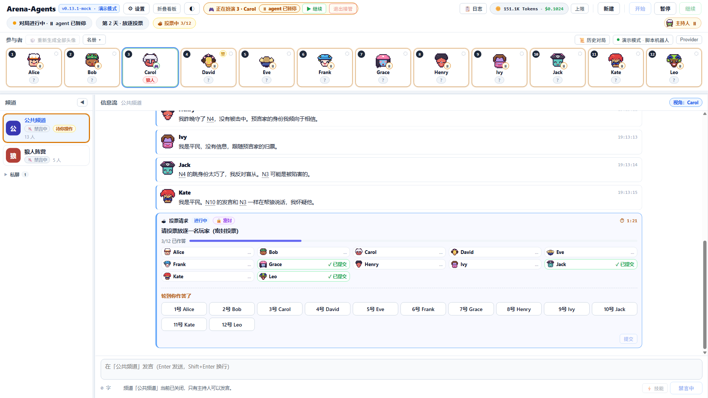
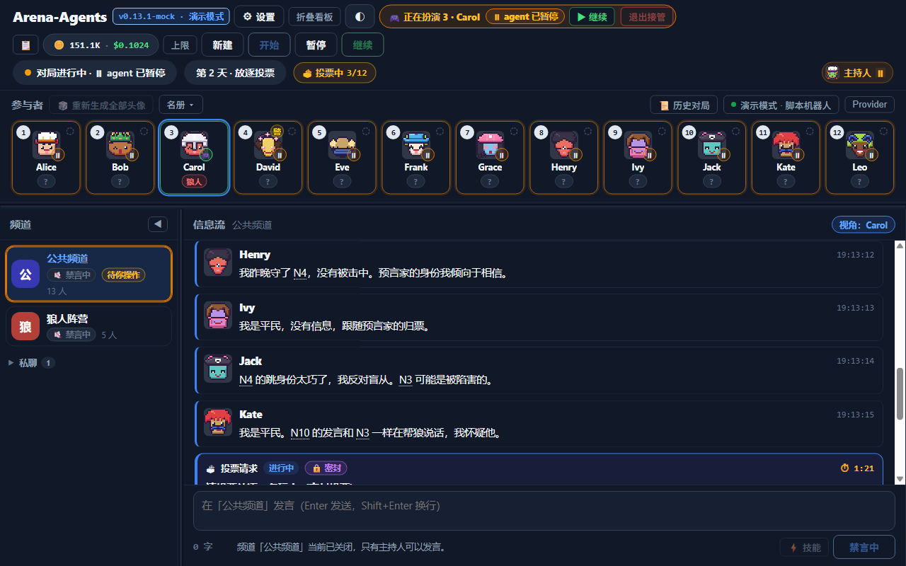
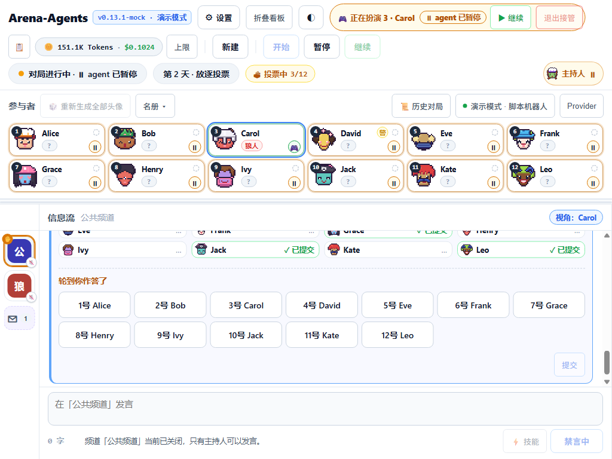
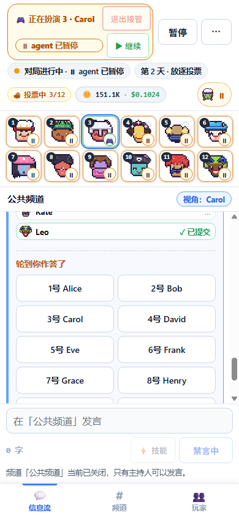
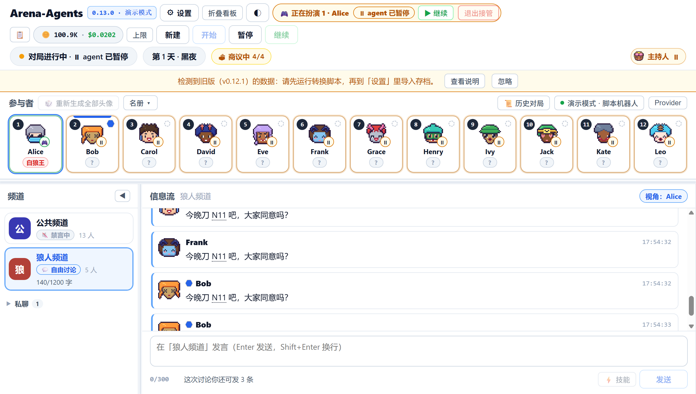
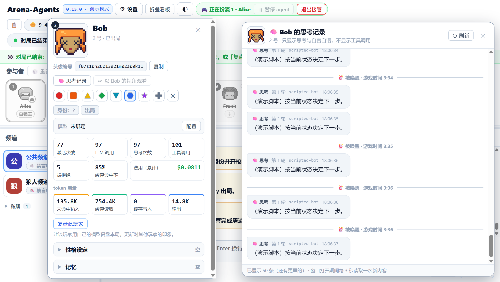

# v0.13.1 验收记录

验收日期：2026-11-18。范围对应 [v0.13.1 方案](v0.13.1-plan.md) G1–G45 与
[实现契约 §12](v0.12-contracts.md)。本记录区分真实后端、模拟服务、自动测试与真实浏览器操作；
“演示通过”不代表真实模型遵从性通过。

## 功能流程

| 功能 | 验收结果 |
|---|---|
| 软暂停 / 继续 | 真实后端从 `draining(n)` 到 `held`；在途模型回答和工具完成，随后不再启动 agent 动作。软暂停时钟立即停止，游戏状态仍为 `running`；继续后恢复。 |
| 公共频道不限时 | 只有人类持有公共频道发言权时显示“不限时”且无截止时间；混合发言权组仍显示限时。软暂停和不限时均未写入账本或 v5 存档。 |
| 私人颜色标记 | 8 种颜色各有独立形状；接管座位时可标记其他座位，跨标签页同步、按对局隔离；退出接管和重放时只读，不赋予颜色文字含义。 |
| 先选后提交 | 选项点击只产生本地选择，明确点“提交 / 修改回答”才请求 `/api/seat/respond`；截止时刻不自动提交。提交中可继续改选，旧回执不会清掉新选择，旧局回执也不能操作新局的同名请求。 |
| 思考记录 | 头像详情以聊天气泡显示思考 / 回答，不含工具调用；可向前翻页、跟随新内容并补读大段缺口。接管未完成的对局时，其他玩家的记录明确拒绝开放。 |
| 调用 / 错误日志 | 顶栏未读徽章、筛选、展开错误详情、已读持久化均通过；日志重建后整份重读并按时间重定已读位置。旧应答、环中迟到副本和断线恢复均有回归测试。`llm.call` 在 REST、实时 SSE 与续传中都只给可信客户端。 |
| 头像编号 | 在真实浏览器复制 N2 的 `f07s10h26c13e21m02a00k11` 到 N3，提示与 N2 同款；两端头像 PNG 数据完全相同。随机重建和错误部件提示另有自动测试。 |
| 结构化记忆 | 终局对 N2 执行真实后端演示复盘，页面列出 11 条“旧 → 新”印象及经验变化；战绩计入，不再追加逐局长篇笔记。保存中继续输入的内容会保留，复盘 / 新局使旧的完善草稿失效。 |
| 固定格式性格 | 演示主持人模型生成定位、说话风格、思考方式、决策偏好、压力下、口头禅六个固定栏目；先显示草稿，点“采用并保存”后写入成功，长度限制生效。 |
| 名字规则 | 新名字在前后端和 mock 中一致拒绝 `:` / `：`；旧存档中的同名历史名字仍可读，未改名保存不会被误拒。 |

## 响应式与主题矩阵

四个尺寸均通过同源 iframe 的真实视口几何检查：文档 `scrollWidth` 等于视口宽度，可见按钮、输入框和选择器横向越界数为 **0**。
1920 / 1280 为桌面布局，1024 为平板 compact 布局，390 为手机布局；手机 `#composer` 底边为 787 px，`#tabbar` 从 787 px 开始，未重叠。

### 桌面：1920 × 1080

### 桌面暗色：1280 × 800

### 平板：1024 × 768

### 手机：390 × 844

### 软暂停与思考记录特写

## 自动化验证

- 最终合并工作树运行完整 `pytest tests`：**3569 passed、9 skipped、101 subtests passed**，用时 455.87 秒；入口包括 `tests/test_frontend_js.py`、`tests/frontend/`、`tests/test_docs.py` 和全部后端测试。
- 前端 Node：**20 个文件、745 项**全部通过；CSS 合入 `style.css` 后，受影响的 6 个套件又单独通过一次。
- Windows 子进程用例使用只对测试环境生效的 ACL 垫片；没有修改业务断言来规避失败。
- 名册 / 日志修复包含变异检查：移除对应防线后，相关测试会变红。

## 未运行项与边界

- **真实模型整局未运行**：当前执行环境没有可用的模型 API 凭据。因此，真实模型的复盘 JSON、固定格式性格和整局稳定性不标记为通过；上述相应流程使用演示机器人和确定性的模拟应答。
- 本机浏览器与自动化验收在 Windows 上完成；没有声称本机执行了 Linux CI。
- 已接受的产品边界（例如排队 agent 的旧状态显示、软暂停的弱提示、`held` 使用可丢弃的 `agent.status`、日志环淘汰后的计数语义）以方案和契约为准，不在本次收尾中扩大范围。
