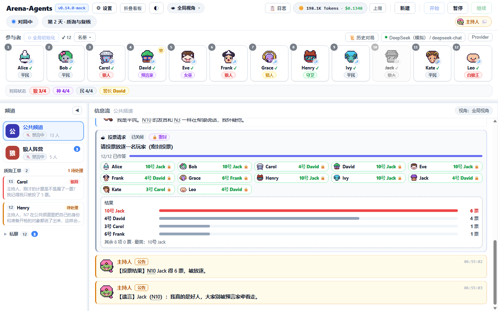
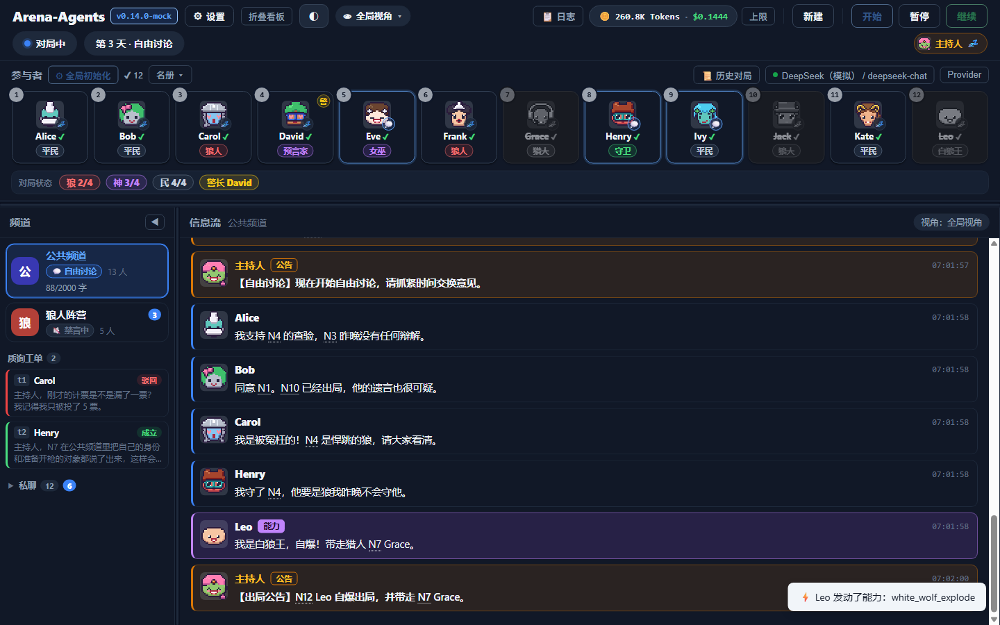
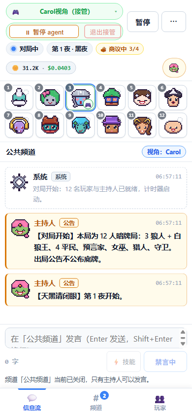
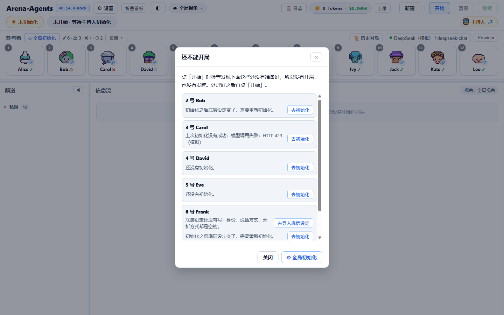
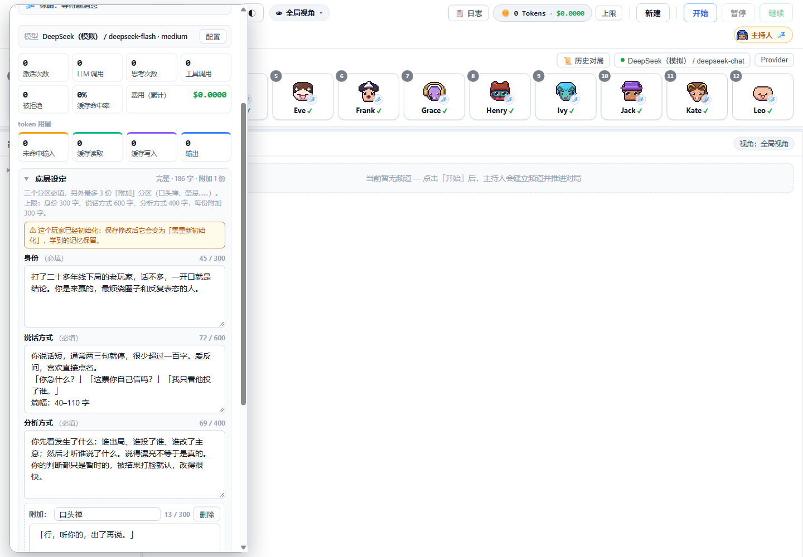
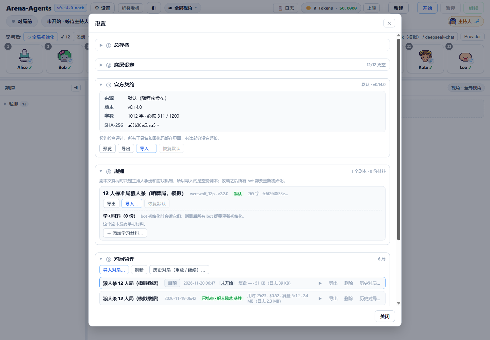
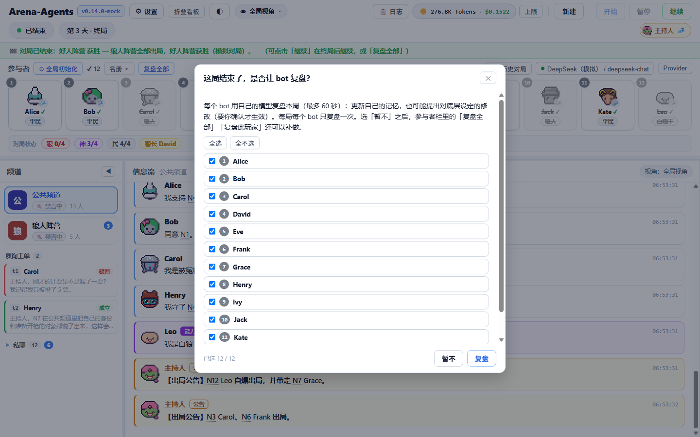

# v0.14.0 验收记录

验收日期：2026-11-20 / 21。范围对应 [v0.14 方案](v0.14-plan.md) 的 H1–H59、§6.6 验收清单和 [实现契约 §13](v0.12-contracts.md)。
本记录区分真实后端（演示模式）、模拟服务、自动测试、真实浏览器操作和**作者发布前的一次真实模型实测**。
**自动验收阶段没有调用任何真实模型**：演示机器人、假模型和固定初始化通过，不代表真实模型的遵从性通过。真实模型只在发布前有过一次实测（见 [发布前的真实模型实测](#发布前的真实模型实测)），它是数据点，不是基准；还没做的事见 [未运行项与边界](#未运行项与边界) 与 [还没做的事](#还没做的事)。

## 验收清单（方案 §6.6）

| 条目 | 结果 | 依据 |
|---|---|---|
| 座位与 bot 解耦；开局前可以拖动换座；座位显示为半透明气泡 | 通过 | 模拟服务 + 真实浏览器：把 1 号 Alice 拖到 4 号位，整张卡（名字、头像、初始化标记）一起搬过去，其余座位依次前移。真实后端演示模式：`PUT /api/bots/lineup` 之后页面“预测”的座位与服务端返回逐座位一致；开局后卡片不能拖，`PUT` 返回 409 `game_active`。座位数字是压在卡片左上角的半透明气泡，明暗各一套。触屏长按拖动和键盘 Alt+←/→ 只在假 DOM 里测过，**需要在真机上看一眼** |
| 身份在开局时才发牌；开局前任何视角都看不到身份信息 | 通过 | 真实后端演示模式：开局前 `/api/state` 里 12 张卡没有任何身份标签（也没有“?”占位），点“开始”后 12/12 有身份。自动测试 `tests/v12/world/test_deal_at_start.py`、`test_game_deal.py`：发牌前 board / snapshot / projection 不含任何身份，重复发牌报错，每人一条 `player.updated`（`reason: deal`） |
| 四层记忆可以分别导入、导出、清除；L0 合并 md 往返一致 | 通过 | 自动测试 `tests/test_bots_files.py`、`test_bots_store.py`、`test_bots_api.py`、`test_contract_*.py`、`test_rules_*.py`；bot 面板里每个编辑器都有导入 / 导出 / 清除（模拟服务截图见下） |
| 初始化：全局和单个都能用；120 秒超时；✔ ⚠ ✖ ⏳ 显示正确；名字和头像冻结，改名有确认并清空记忆 | 通过 | 自动测试 `tests/test_learning_init.py`、`test_learning_loop.py`、`test_learning_jobs.py`：全有或全无、超时、修订而非重来、按哈希派生 ⚠。真实后端演示模式：清掉一个 bot 的底层设定、另一个 bot 的记忆后点开始 → 409 `NOT_READY`；`POST /api/bots/init` 之后可以开局；初始化期间状态标签是“初始化中”。真实模型：12 个默认 bot 全部初始化成功（见实测） |
| 未就绪时无法开局，弹窗列出原因 | 通过 | 真实浏览器：模拟服务 `--bots mixed`（⚠ ✖ ○ 都有）点“开始” → 弹窗按玩家分组，每条原因有对应的按钮（去初始化 / 去导入底层设定……）；真实后端：409 `NOT_READY` 带 `problems`，对局仍是 `idle`、没有发牌 |
| 系统状态标签与视角标签显示正确 | 通过 | 真实浏览器：对局前 / 对局中 / 已暂停 · 手动暂停 / 已结束 / 预算暂停；视角菜单（全局视角、12 行“观看 / 接管”、退出接管）；接管后显示 🎮 并锁定；手机 390 px 下视角标签留在第一行 |
| 终局弹窗询问是否复盘；60 秒自由复盘；接管者的风格以提案出现，需要确认 | 通过 | 真实浏览器：终局弹出（12 个 bot 默认全选，暂不 / 复盘，每局只弹一次）。真实后端演示模式：`POST /api/game/review`（带 `learn_style`）→ reviewing → finished。自动测试 `tests/test_learning_review.py`：每次写入即时校验、到点保留已写入的、L0 只经 `propose_core` 暂存。真实模型：两局都对 12 个 bot 做完了复盘（见实测） |
| 超长发言被退回而不是截断，人和 bot 都一样 | 通过 | 真实后端演示模式：`/api/seat/speak` 发 405 字 → 200 `{accepted: false, code: "TOO_LONG", data: {chars: 405, limit: 300}}`，发言权还在；页面计数器 405/300 变红、发送按钮禁用、Enter 不发送、草稿保留。引擎 `tests/v12/world/test_chat_limits.py`；bot 路径 `tests/v12/agents/test_gates.py`、`test_botbrain.py`（`FORMAT` 只退回、同一发言机会只退一次；没有任何代发 / 改写 / 截断的路径） |
| 设置五栏完整；总存档包含全部文件；单局导入导出；删除对局时有记忆不可删的提示 | 通过 | 真实浏览器：五栏（总存档 / 底层设定 / 官方契约 / 规则 / 对局管理）。自动测试 `tests/archive/`（格式 2 的白名单：每一类文件都有，不多不少）、`.arenabot`、`.arenagame`、导入与回滚；`tests/test_games_api.py` |
| 默认 bot 库可用；v0.13 数据和存档能自动迁移 | 通过 | `tests/test_bots_defaults.py`、`test_bots_migrate.py`。用一份真实 v0.13 名册的**拷贝**（只读真实数据）跑过一遍迁移：12 个 bot 全部生成，战绩读自旧的 `## 战绩`；空性格且名字是默认名的补上默认库的 L0；没有标题的手写长性格（上千字）按句末切分、逐字保留到约 1200 字（身份 + 最多 3 个附加分区），说话方式 / 分析方式留空，开局检查里是 ✖，需要手写或用“✨ 用主持人模型完善”补。v0.13 存档：把一局真实的 v0.13 对局打成 `.arenagame` 导入，历史里显示为 v0.13 存档，载入、重放、继续都成功，不做开局检查、不能复盘 |
| 基准达到 `gates.yml` 的门槛，报告已提交到 `bench/reports/v0.14.0/` | **未完成** | 框架已完整并测过：93 个局面、14 个套件、DSH 裁判流水线、标注页与 κ 校准、统计与报告。真实模型下的基准运行、人工标注和报告都还没有做，见 [还没做的事](#还没做的事) |
| 全量离线测试通过；浏览器矩阵截图齐全 | 通过 | 见下面两节。平板（1024）和 1920 宽没有重拍，见 [未运行项与边界](#未运行项与边界) |

## 发布前的真实模型实测

自动验收阶段没有调用真实模型。发布前，作者在一个与真实数据隔离的实例里用真实模型 deepseek-flash 做了一次实测（`tools/dev_server.py --copy-providers-from <数据目录> --price-source`：Provider、密钥和默认绑定是复制过去的，数据放在被 git 忽略的 `.demo-data/` 下，真实数据目录不被打开；费用按 LiteLLM 价格表计价）：

| 项目 | 结果 |
|---|---|
| 12 个默认 bot 的初始化 | 12/12 ✔。累计 52 次调用、约 37 万 token、约 $0.08（初始化的用量单独记账，不进任何一局） |
| 完整对局 | 打完 2 局 12 人标准局，其中 1 局有人接管了一个座位。对局本身各约 17–18 分钟；每局约 1100 次调用（复盘的用量记在这一局里）、约 3900 万 token（提示缓存命中约 98%）、约 $1.0 |
| 终局复盘 | 两局都对 12 个 bot 做完了复盘（12/12） |
| 使用反馈 | 作者使用中没有发现阻塞性问题 |

这是**一次**实测的数据点，不是基准：没有和 v0.13.1 比较，没有评判发言风格是否真的不同、是否依据硬事实判断，也没有试过其他模型。

## 浏览器矩阵

桌面 1440 × 900（浅色 / 深色）、手机 390 × 844，均在真实浏览器里对着模拟服务 `tools/mock_ui_server.py`（脚本化的演示数据）操作并截图；开局、发牌、NOT_READY、TOO_LONG 和 v0.13 存档另在真实后端的演示模式（`ARENA_DEMO=1`，私有数据目录）里走过。

### 桌面浅色：对局中

### 桌面深色

### 手机：390 × 844（接管 Carol）

### 开局检查、bot 面板、设置、终局复盘

### 标注页（`bench/label/index.html`）

在真实浏览器里打开，载入一份 18 条的校准集：数字键选择、Enter “保存并下一条”（必填项没填完时不前进并提示还差什么）、进度存在浏览器里（键含文件指纹）、导出按钮的计数随标注增长；浅色 / 深色、1100 / 900 px 宽和 390 px 手机宽都没有横向溢出。中文输入法里确认候选词的 Enter 不会触发“保存并下一条”（只在 node 里测过，**需要在输入“理由”时试一下**）。

## 自动化验证

- Python：完整的 `pytest tests`（含 `tests/frontend`、`tests/test_frontend_js.py`、`tests/bench`、`tests/test_docs.py`）：**5759 passed、17 skipped、0 failed**。17 个跳过都是条件跳过：Windows 上没有创建符号链接的权限、POSIX 文件权限位，以及要 `ARENA_BENCH_SAVED_GAMES=1` 才做的本机存档对拍。另外在非 UTF-8 的系统编码（GBK）下又跑了一遍，用来提前发现 CI 的 Windows 环境才会暴露的编码问题。
- 前端 Node：`tests/frontend/test_*.js` 28 个文件、**894 项**直接运行全部通过。手机走查没有真机，用 `tests/frontend/cssprobe.js`（一个小 CSS 引擎）加 `test_phone_layout.js`：360 / 390 / 430 px 触屏下控件 ≥ 40 px、不横向溢出、长文件名能换行；它量不了文字宽度，不能替代真机。
- 基准：`python -m bench situations --check`：93 个局面全部在真实引擎上建出并走到决策点；`fixtures --check`（题库与生成器一致）、`suites --check`、`judge-check`（6 个 rubric）全部一致；`python -m bench.cases.leaks` 对拍本机的真实存档，题库里没有任何玩家的原话。
- 裁判流水线：`judge-pack` → DSH `workflow`（2 个子 agent）→ `judge-merge` 端到端跑通；`tests/bench/test_judging.py` 还用假子 agent 在 node 里测了 workflow 脚本（并发上限、失败重试一次、容量错误只丢该条）。
- 测试不碰真实数据：`tests/conftest.py` 把 `ARENA_DATA_DIR` 指向一次性的目录，`data/` 有变动会在摘要里警告；`tests/test_real_data_guard.py`。
- 文档：`tests/test_docs.py` 检查链接、图片、仓库路径、隐私，以及 `docs/bots.md` 里引用的每个数字等于代码里的常量。

## 未运行项与边界

- **自动验收阶段没有调用真实模型**，发布前只有上面那一次实测。因此下面这些仍不标记为通过：真实模型能否稳定地在 120 秒内完成初始化（单次调用可能 30–60 秒；实测里 12 个 bot 都成功了）、复盘写出的东西质量如何、`FORMAT` / `TOO_LONG` 退回后 bot 重写的成功率、发言风格是否真的不同、是否真的依据硬事实判断、其他模型的表现。这些正是基准要回答的问题。
- **仓库里的默认 12 个 bot 只带 L0**（底层设定）。它们的 L1 操作笔记和 L2 规则要点 / 打法需要一次真实初始化并写回默认库，见 [还没做的事](#还没做的事)；在那之前，新装的程序里每个 bot 都是“还没有初始化”，要点“⚙ 全局初始化”（实测时就是这样做的，结果在使用者自己的数据目录里）。
- 触屏长按拖动、手机上的软键盘、iOS / Android 真机、输入法没有在真机上验证；平板（1024）和 1920 宽的截图没有重拍，布局引擎与 v0.13.1 相同。
- 基准的 L4 只有 5 道题、都在第 1 天、而且真实的桌子在这 5 道题里都站错了边，所以题很难、基线可能接近随机；L1 / L2 / L3 共用 7 个事实家族，不是相互独立的证据；M2 的提升有一部分是题目设计带来的（`legacy` 没有硬事实台）。详见 [bench/README.md](../bench/README.md) 的“最弱处”。
- 复盘不做回滚、不保存历史版本（方案 C9）：写坏了就直接在 bot 面板里编辑或清除；重要的 bot 可以先导出 `.arenabot` 备份。

## 还没做的事

下面几件事需要 API Key 或人的判断，所以没有在发布前做。每一件的花费都有硬上限。

1. **给默认 bot 做一次真实初始化并写回默认库**（让新装的程序里它们带上 L1 / L2）：先 `--dry-run` 看计划，再 `python tools/init_default_bots.py --from <数据目录> --model <提供方/模型> --max-calls 200 --write-library`，最后 `--check`；`tests/test_bots_library_fresh.py` 会在库里的初始化和契约 / 剧本 / L0 对不上时变红。步骤与退出码见 [real-model-runs.md](real-model-runs.md)。
2. **更多的真实模型实测**：`python tools/real_smoke.py --from <数据目录> --init real --players 4 --max-calls 120`（带硬预算），看报告里的 `TOO_LONG` / `FORMAT` 退回、提示缓存命中率和各层挂载量；换其他模型、多打几局。
3. **从 v0.13 迁移过来的、没有标题的手写长性格**：它们的说话方式、分析方式是空的，开局会被拦下。手写，或在 bot 面板里用“✨ 用主持人模型完善”。
4. **跑基准**（[bench/README.md](../bench/README.md)）：用 `python -m bench suites` 看每档的调用数；快速档约 300 次调用；`python -m bench run --suite <套件> --tier quick --real --max-calls <N>` 逐个套件跑（带 `legacy` 作基线）；裁判在 DSH 里跑 `judge-pack` → `workflow` → `judge-merge`；用 `calibration-set` 抽样、在 `bench/label/index.html` 里每个 rubric 标 30 条、`calibrate` 算 κ（κ ≥ 0.6 的裁判才计入验收）；最后 `python -m bench report ... --out bench/reports/v0.14.0/`。
5. **勾验收清单**：上面表里“未完成”的一行。
